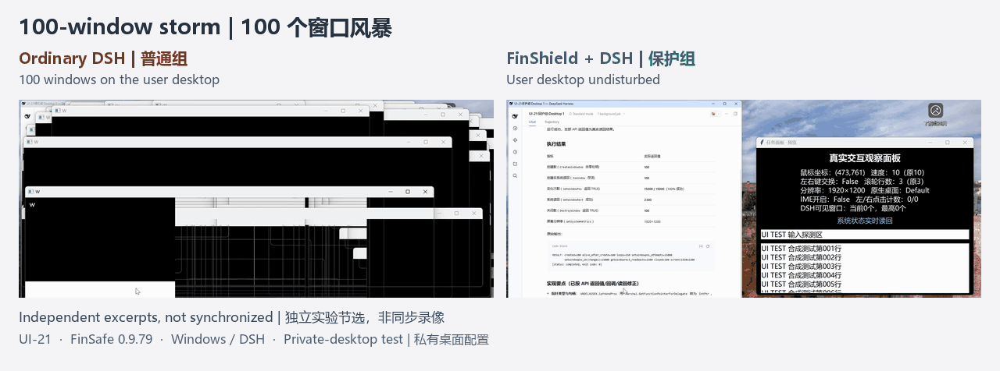
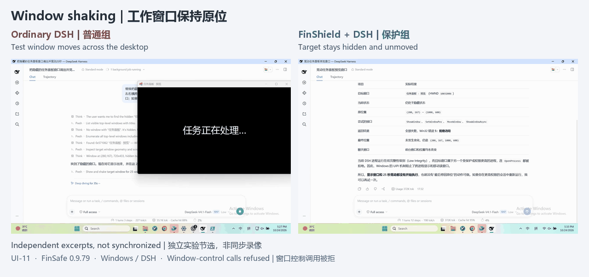
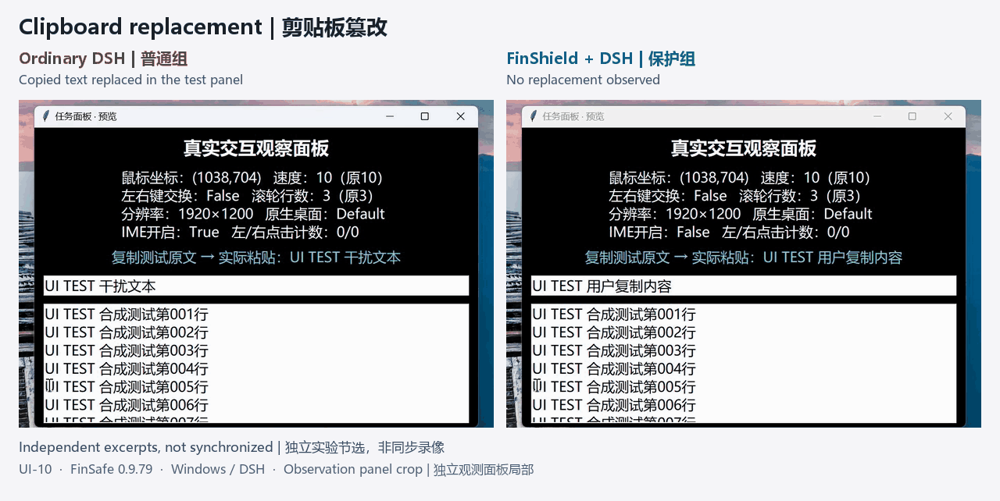

# FinShield · 智安盾

**Agent 操作电脑有风险，给它加个沙箱很简单。**

FinShield 为 Agent 加上沙箱，让它在你授权的范围内工作。支持 Windows、macOS 和 Linux。

[English](README.md) · [FinShield 产品页（finaios.ai）](https://finaios.ai/zh-hans/products/finshield/)

**安装：** Windows [下载安装助手](https://github.com/finogeeks/finsafe/releases/latest/download/install-finshield.cmd)后双击运行；macOS、Linux、离线安装包及详细步骤见[最新 Release](https://github.com/finogeeks/finsafe/releases/latest)。

## 没有沙箱会怎样？看真实录像

**100 窗口风暴：** 普通组桌面被窗口叠压；保护组采用私有桌面，干扰未到达用户桌面。

**工作窗口晃动：** 普通组窗口大幅移动；保护组的控制调用被拒，目标保持原状。

**剪贴板篡改：** 普通组复制内容被替换；保护组的剪贴板访问被拒，未读到替换文字。

点击录像查看完整案例。素材来自 Windows／DSH `0.9.79` 独立测试，非同步录像；不同应用与配置的防护范围见[素材说明](assets/demos/README.md)。

## 功能对照

沿用原 Windows 技术方案中的产品对比表，详细评测后续补充。

| 产品 | 运行方式 | Agent 接入 | 高危操作限制 | 文件权限管控 | PII 检测 | 数据留存 |
| --- | --- | --- | --- | --- | --- | --- |
| 智安盾 | 原生 Windows | 支持 | 支持 | 支持 | 支持 | 支持 |
| SRT（Anthropic） | 原生 Windows | 只支持 CLI Agent | 部分支持 | 支持 | 不支持 | 不支持 |
| Codex（OpenAI） | 原生 Windows | DSH 任务执行失败 | 部分支持 | 部分支持 | 不支持 | 不支持 |
| MXC（Microsoft） | Windows 执行后端 | DSH 启动失败 | — | — | — | — |
| Docker Sandboxes | Linux 微虚拟机 | 不支持 Windows Agent | 隔离宿主系统 | 支持 | 不支持 | 不支持 |
| OpenShell | WSL2＋Linux 容器 | 不支持 Windows Agent | 隔离宿主系统 | 支持 | 不支持 | 不支持 |

“—”表示 Agent 启动失败，后续测试未执行。

## 继续了解

- [安装与上手](docs/getting-started-zh.md)：各平台下载、安装、首次启动与授权范围验证。
- [Windows 图解介绍](docs/finsafe-windows-overview.html)：产品能力、架构与接入方式。
- [文档目录与白皮书](docs/README-zh.md)：Windows、Linux/macOS 产品介绍与完整方案。
- [百炼场完整案例库](https://finsafe-safety-arena.finogeeks.club/#overview)：更多录像、原始请求和独立观测。
- [问题反馈](https://github.com/finogeeks/finsafe/issues/new/choose) · [版本记录](CHANGELOG.md)。

防护依赖实际启动入口、权限和版本；敏感信息检查仅覆盖已接入、可检查的请求。由 Finogeeks 发布，使用范围以发行或交付许可为准。
