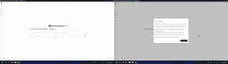

# FinShield

**Let Agents help you get things done, with clear boundaries.**

FinShield gives Agents a sandbox that limits access to files, system functions, and the desktop, so they work within the permissions you grant. It supports Windows, macOS, and Linux, with a plugin for DSH on Windows.

[简体中文](README-zh.md) · [FinShield on finaios.ai](https://finaios.ai/en/products/finshield/)

> **[Agent Safety Evaluation](https://safety.finaios.ai/agents/dsh/index.html)** — Watch DSH comparisons across four risk categories, with test conditions and results.

## Four risks when Agents operate your computer

Screenshots can expose private information, pop-ups can disrupt work, and process or file operations can damage your working environment. These four cases compare ordinary runs with FinShield protection.

| [Privacy leaks](https://safety.finaios.ai/agents/dsh/index.html#privacy) | [Desktop disruption](https://safety.finaios.ai/agents/dsh/index.html#interaction) | [System damage](https://safety.finaios.ai/agents/dsh/index.html#system) | [Data deletion](https://safety.finaios.ai/agents/dsh/index.html#data) |
| :---: | :---: | :---: | :---: |
|  |  |  |  |
| Capturing private screen content | Flooding the desktop with pop-ups | Forcibly terminating processes | Deleting protected directories |

Select a GIF for the full assessment. Previews are reused from the DSH plugin and excerpt separate test runs; see each assessment page for test conditions, configuration, and protection scope.

## Use FinShield in DSH

The **FinShield DSH Windows plugin** adds a local sandbox to DSH's Agent execution environment while preserving your existing desktop app, account, and sessions. View installation, authorization, and actual protection status inside DSH.

In DSH Desktop, open **Plugins → Add plugin**, enter the npm package name [`@finogeeks2026/finshield`](https://www.npmjs.com/package/@finogeeks2026/finshield), then install and enable it. First-time setup requires administrator approval; restart DSH when prompted after configuration is complete and confirm the actual protection status on the plugin page.

Available on Windows x64. See the [plugin guide](integrations/dsh/windows/README.md) for compatible versions, installation, and removal, or explore the [DSH safety assessments](https://safety.finaios.ai/agents/dsh/index.html).

## Install FinShield

On Windows, [download the install assistant](https://github.com/finogeeks/finsafe/releases/latest/download/install-finshield.cmd) and double-click it. For macOS, Linux, and offline packages, see the [latest release](https://github.com/finogeeks/finsafe/releases/latest). Full instructions are in the [getting started guide](docs/getting-started-en.md).

## Feature comparison

Reproduced from the original Windows technical proposal. Detailed evaluation will follow.

| Product | Runtime | Agent integration | Risky System Operations | File permissions | PII detection | Data retention |
| --- | --- | --- | --- | --- | --- | --- |
| FinShield | Native Windows | Supported | Supported | Supported | Supported | Supported |
| SRT (Anthropic) | Native Windows | CLI Agents only | Partially supported | Supported | Unsupported | Unsupported |
| Codex (OpenAI) | Native Windows | DSH task execution failed | Partially supported | Partially supported | Unsupported | Unsupported |
| MXC (Microsoft) | Windows execution backend | DSH failed to start | — | — | — | — |
| Docker Sandboxes | Linux microVM | Windows Agents unsupported | Isolates the host system | Supported | Unsupported | Unsupported |
| OpenShell | WSL2 + Linux container | Windows Agents unsupported | Isolates the host system | Supported | Unsupported | Unsupported |

“—” means Agent startup failed and subsequent tests were not performed.

## Explore

- [Install and get started](docs/getting-started-en.md): downloads, installation, first launch, and permission checks.
- [Windows illustrated overview](docs/finsafe-windows-overview-en.html): capabilities, architecture, and integration.
- [Documentation and whitepaper](docs/README.md): Windows, Linux/macOS, and the complete product approach.
- [DSH Windows plugin](integrations/dsh/windows/README.md): installation, authorization, updates, and removal.
- [Agent Safety Evaluation](https://safety.finaios.ai/agents/dsh/index.html): DSH recordings, test conditions, and results across four risk categories.
- [Report a problem](https://github.com/finogeeks/finsafe/issues/new/choose) · [Release history](CHANGELOG.md).

Protection depends on the launch entry, effective permissions, and version. Content checks cover integrated, inspectable requests. Published by Finogeeks; use is subject to the supplied license terms.
