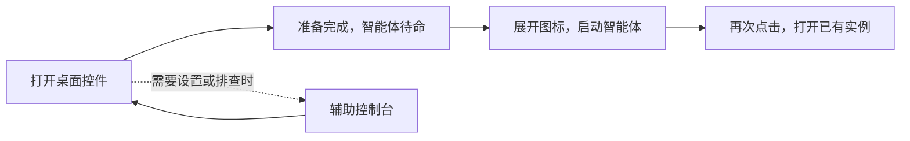
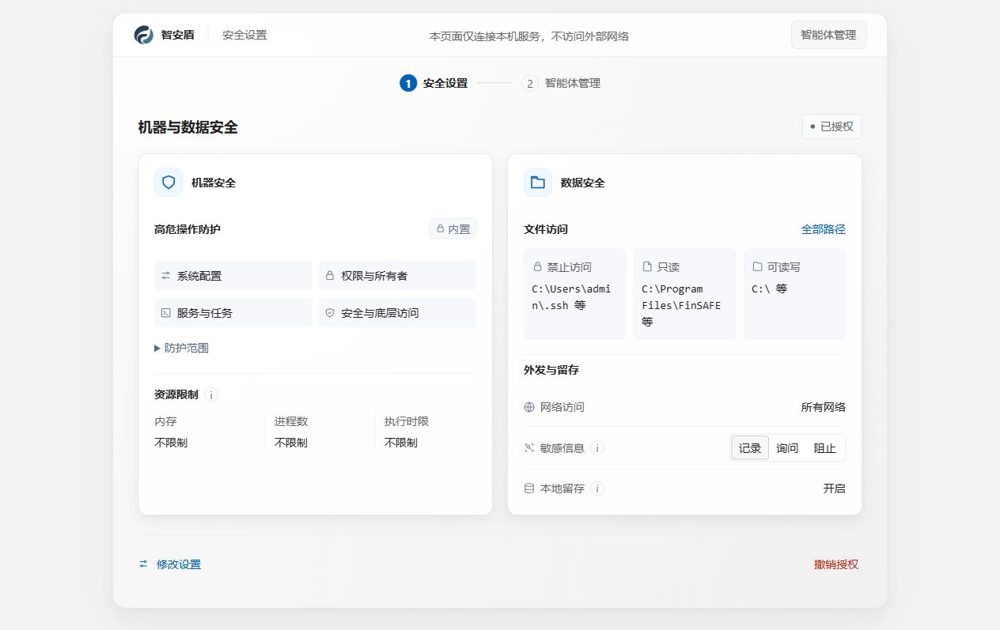
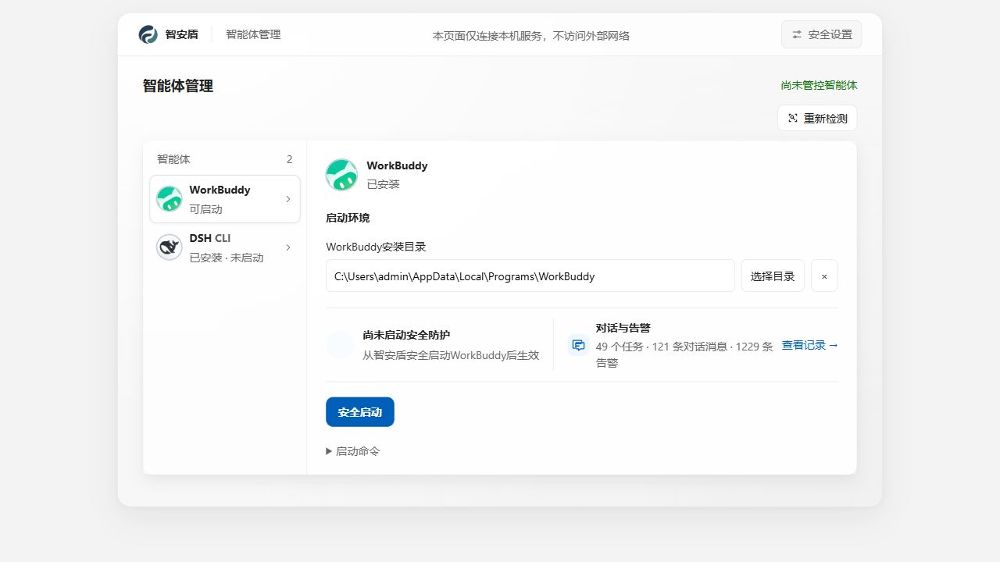
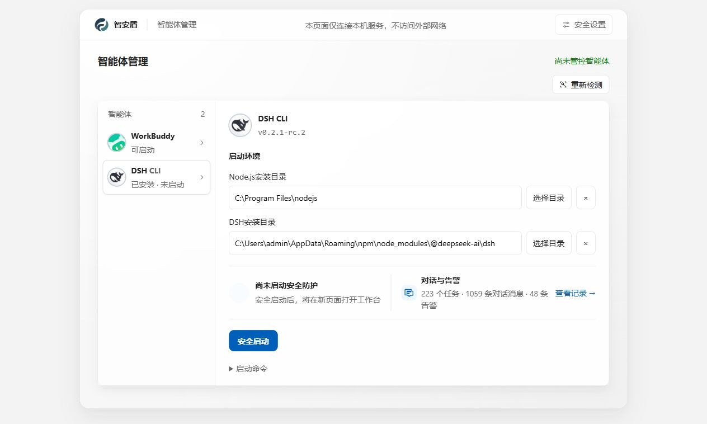
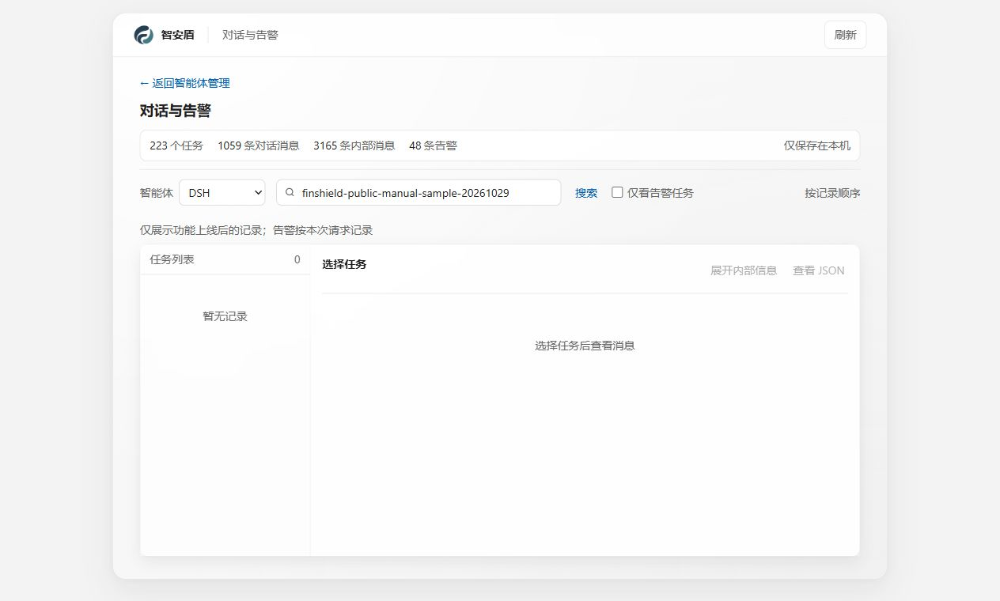

# FinShield Windows 图文使用手册

[English](WINDOWS-GUIDE.md) · [返回首页](../README-zh.md) · [跨平台上手](getting-started-zh.md)

**给 Agent 加上沙箱，只需安装、首次准备，再从桌面控件启动。** 准备完成后，选择 WorkBuddy 或 DSH，照常交给它任务。日常使用控件启动和重新打开；需要调整权限、查看记录或排查问题时，再打开网页控制台。

控件图来自产品原生渲染导出，用于辨认按钮位置，不是运行状态的实机截图。辅助说明中的四张网页截图来自本机实际运行的 FinShield `0.9.97` 控制台。

## 1. 安装后，先找到桌面控件

双击 `finsafe-<版本>-x64-setup.exe`，按向导安装并打开 FinShield。WorkBuddy 或 DSH 需单独安装、配置账号。

准备有效且没有进行中的准备任务时，打开产品主要显示控件。首次尚未授权、准备中或状态异常时，会同时打开辅助控制台。仅打开产品不会自动开始新的授权。

[公开下载](https://github.com/finogeeks/finsafe/releases)仍是旧版，新版 EXE 以上架或正式交付为准，详见[版本说明](FAQ-zh.md#为什么下载页只有旧版本)。

## 2. 在控件上完成准备与日常启动

1. **准备：** 显示“待准备”时，点击左侧圆形按钮，再选“开始准备”。需要确认权限时，在辅助控制台完成授权；Windows 可能请求管理员确认。
2. **选择：** 等到“智能体待命”，点击圆形按钮，展开智能体图标。鼠标移到图标上可确认 WorkBuddy 或 DSH 名称。
3. **启动：** 点击可启动的图标。显示“启动中…”时等待，不要重复点击；确认运行后开始任务。
4. **重新打开：** 再点带绿色状态点的图标，打开已有实例。
5. **整理桌面：** 点击圆形按钮或空白处收起选择区；拖动金属主体移动控件。

有效准备可以复用，日常不需要一直打开网页或重复授权。**从控件选择智能体，是推荐的日常启动方式。** 原厂快捷方式另起的进程不能默认视为已受保护。

## 3. 看控件状态与提醒

| 提示 | 含义与操作 |
| --- | --- |
| 待准备 | 点圆形按钮，再选“开始准备” |
| 准备中 | 等待；需要细节时进入控制台 |
| 智能体待命 | 展开图标，选择智能体 |
| 启动中…／图标转圈 | 尚未确认运行，重复点击不会再次启动 |
| 图标带绿色状态点 | 已确认运行；点击打开已有实例 |
| 红色感叹号 | 点击进入对应问题页；打开页面不等于修复了问题 |
| 黄色数字 | 本次控件运行期间收到的 PII 命中数；点击查看告警，清除的是控件计数，不是历史记录 |

右键菜单提供“控制台”和“退出控件”。**退出控件只关闭控件，已运行的智能体和安全监测继续运行。**

## 4. 需要时再打开辅助控制台

在控件展开区或右键菜单中选择“控制台”。目录不正确、准备失败、需要修改权限或查记录时，参考下方页面；正常启动和重新打开智能体，优先使用控件。

权限确认与调整：安全设置

打开控件中的“控制台”，进入“安全设置”，检查：

| 设置 | 应确认的内容 |
| --- | --- |
| 文件访问 | 任务目录允许读写；参考资料可设为只读；私密目录按需求禁止访问 |
| 网络访问 | 模型及业务服务属于所需的访问范围 |
| 敏感信息 | 选择“记录”“询问”或“阻止”，并确认当前检测类别 |
| 本地留存 | 是否在本机保存已接入的请求、回复与处理结果 |

确认后选择“授权并继续”，等待准备完成。需要管理员权限时，按 Windows 的提示确认。取消或失败后应查看实际错误；不能把安装完成当作准备完成。

文件和网络范围变更后，需要重新授权。准备过程中不要反复点击启动。资源上限可以由配置控制；执行时限只适用于相应工具任务，不能理解为桌面智能体的整体运行时长上限。

图 1：授权完成后，右上角显示“已授权”。首次使用按本节完成授权；截图中的路径、网络和资源值是这台机器的现有配置，不是推荐配置。

智能体找不到或无法启动：安装目录

### WorkBuddy

1. 在“智能体管理”选择 WorkBuddy。
2. 检查安装目录，目录中应有 `WorkBuddy.exe`。自动发现不正确时，使用“重新查找”或“选择目录”。
3. 选择“安全启动”，等待确认运行后再使用。
4. 应用已经运行时，使用 FinShield 的打开入口返回该实例。

图 2：先检查安装目录，再选择蓝色“安全启动”。本图为启动前状态；“已安装”不等于“正在受保护运行”。

### DSH CLI

1. 在“智能体管理”选择 DSH CLI。
2. 分别确认 Node.js 与 DSH 的安装目录。仅填写其中一个，不足以启动。
3. 选择“安全启动”，等待工作台就绪；首次启动期间不要重复提交。
4. 已就绪的工作台可以通过 FinShield 重新打开。修改安装目录用于后续启动，不会迁移当前运行实例。

图 3：DSH 需要两个有效目录。点击“安全启动”后等待工作台就绪，再开始使用。

查看对话、敏感信息与告警记录

可从控件黄色提醒进入告警，或在辅助控制台中选择“查看记录”。

在智能体详情的“对话与告警”中选择“查看记录”，核对已采集的模型请求、回复和处理结果。开启本地留存后，记录在本机加密保存。它不意味着模型服务离线运行：获准的模型请求仍会发往配置的服务。

1. 从智能体详情进入“查看记录”。
2. 选择智能体来源，在搜索框输入任务或消息关键词，再点“搜索”。
3. 选择左侧任务，查看右侧消息；需要排查告警时，勾选“仅看告警任务”。

图 4：为避免公开真实对话，截图使用没有匹配结果的演示关键词，所以左侧显示“暂无记录”。顶部为该来源的记录统计；图片没有伪造任务或消息。

Windows 对已接入、可检查的模型请求提供以下处理：

| 模式 | 检测命中后的行为 |
| --- | --- |
| 记录 | 记录告警，原请求继续发送；这是默认处理 |
| 询问 | 暂停当前请求，等待你在确认窗口中决定是否仅发送这一次 |
| 阻止 | 拒绝当前请求，不将该请求转发给模型服务 |

询问窗口关闭、取消或超时，不会批准已命中的这次请求。一次同意只覆盖一次请求，后续请求仍需独立判断。被拒后，智能体可能显示请求错误，具体表现取决于客户端。

检查不是全量扫描：不支持的协议、无法解读的内容或不可见流量不具备同样覆盖。Windows 对无法完成检查的请求，可能按其他网络与内容规则继续转发并记录原因；即使选择“阻止”，也不代表所有敏感数据都一定被识别和拦截。

## 5. 第一次使用后验证文件范围

先用专用测试目录和测试文件，按本机实际授权范围操作。

| 范围 | 测试方式 | 预期 |
| --- | --- | --- |
| 可读写工作区 | 新建 `finshield-demo.txt`，读取后修改内容 | 操作成功，文件变化可见 |
| 已设为只读的目录 | 读取一个测试文件，再尝试修改该文件 | 可读取，修改被拒，原内容保留 |
| 已设为禁止访问的目录 | 尝试读取一个预先存在的测试文件 | 读取被拒 |

只读与禁止访问必须是实际生效的配置，不要默认认定“桌面必定只读”或某个浏览器目录必定禁止访问。Windows 仅按有效策略中声明的路径和权限执行。

判断以工具实际返回、文件内容和目录状态为准。模型口头拒绝、文件不存在或路径写错，都不能证明防护生效。

## 6. 理解 Windows 防护边界

FinShield 使用 Windows 原生能力执行约束：AppContainer 限制受控进程身份，文件权限管理授权范围，Job Object 管理相应进程与资源，受控代理和 WFP 支持网络限制。

具体作用取决于实际配置与接入路径。桌面 GUI 的兼容性要求、工具进程的桌面设置、模型流量检查范围各有差异。

README 中的窗口与剪贴板案例采用各案例记录的隔离配置，部分使用私有桌面。当前 WorkBuddy GUI 需要交互桌面兼容，不能据此推断它默认也具备所有私有桌面案例的同等隔离效果。

## 7. 遇到问题

| 现象 | 先检查 |
| --- | --- |
| 一直显示“待准备”或“准备未完成” | 进入控制台，查看授权状态、权限配置与实际错误 |
| 找不到 WorkBuddy | 安装目录是否包含 `WorkBuddy.exe`，重新查找或手动选择 |
| DSH 无法启动 | Node.js 与 DSH 两个目录是否有效，是否已完成安全准备 |
| 正常任务提示拒绝访问 | 文件是否位于已授权工作区，参考目录是否为只读 |
| 开了“记录”但数据仍发出 | 记录模式允许发送；如需干预，按需求选择询问或阻止 |
| 看不到对话记录 | 请求是否经过已接入路径、本地留存是否开启，以及记录服务是否正常 |
| 界面提示服务不可用 | 查看实际服务错误或重试读取状态，不要把旧显示当作当前运行结果 |

更新使用新版 EXE。卸载使用 Windows“设置 → 应用 → 已安装的应用”。如需提交问题，按[常见问题中的反馈说明](FAQ-zh.md#如何反馈问题)提供版本与复现步骤。
