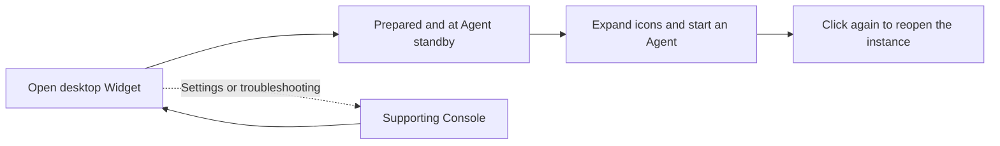

# FinShield Windows illustrated manual

[简体中文](WINDOWS-GUIDE-zh.md) · [Home](../README.md) · [All platforms](getting-started.md)

**Add a sandbox to your Agent: install, prepare once, then launch from the desktop Widget.** Once prepared, select WorkBuddy or DSH and give it tasks as usual. Use the Widget to start and reopen it; open the browser Console when you need to adjust permissions, inspect records, or troubleshoot.

The Widget image is an unmodified native-renderer illustration identifying controls, not an installed-product state capture. The four supporting browser screenshots show the real local FinShield `0.9.97` Console.

## 1. Install and find the desktop Widget

Double-click `finsafe-<version>-x64-setup.exe`, follow the wizard, and open FinShield. Install WorkBuddy or DSH and configure its account separately.

With valid preparation and no preparation in progress, opening the product primarily shows the Widget. Initial authorization, preparation in progress, or unavailable state also opens the supporting Console. Opening alone does not start a new authorization.

[Public downloads](https://github.com/finogeeks/finsafe/releases) still contain older releases; use the new EXE when published or officially delivered. See [version availability](FAQ.md#why-does-the-download-page-still-show-an-older-release).

## 2. Prepare and start from the Widget

1. **Prepare:** At “待准备” (Not prepared), click the orb and choose “开始准备” (Start preparation). Review permissions in Console when required; Windows may request administrator consent.
2. **Select:** Wait for “智能体待命” (Agent standby), click the orb, and hover over an icon to confirm WorkBuddy or DSH.
3. **Start:** Click a launchable icon. Wait during Starting rather than clicking repeatedly; work after running is confirmed.
4. **Reopen:** Click an icon with a green status dot to return to its existing instance.
5. **Arrange:** Click the orb or empty space to fold the selection. Drag the metal body to move the Widget.

Valid preparation is reused. Daily work does not require a browser page to stay open or authorization to repeat. **Selecting an Agent from the Widget is the recommended daily launch route.** A separate vendor-shortcut process must not be assumed protected.

## 3. Read Widget status and notifications

| Indicator | Meaning and action |
| --- | --- |
| Not prepared | Open the orb menu and choose Start preparation |
| Preparing | Wait; use Console for details when needed |
| Agent standby | Expand the icons and select an Agent |
| Starting / spinning icon | Startup is pending; duplicate clicks do not start another instance |
| Green status dot | Running is confirmed; click to reopen the existing instance |
| Red exclamation mark | Open the associated problem page; viewing does not repair the issue |
| Yellow number | PII findings received during this Widget run; click for alerts. Clearing the counter does not delete history |

The right-click menu contains Console and Exit Widget. **Exit Widget closes only the Widget; running Agents and security monitoring continue.**

## 4. Open the supporting Console when needed

Choose Console from the expanded Widget or its right-click menu. Use the pages below for incorrect directories, preparation errors, permission changes, and records. Prefer the Widget for everyday start/reopen actions.

Review or change permissions: Security settings

Open Console from the Widget and review Security settings:

| Setting | What to check |
| --- | --- |
| File access | Writable task directories, read-only references, and inaccessible private directories |
| Network access | The model and business destinations required for the task |
| Sensitive information | Record, ask, or block, with the intended detection categories |
| Local retention | Whether to save captured requests, responses, and decisions on this computer |

Choose “授权并继续” (Authorize and continue), then wait for completion. Windows may request administrator consent. If preparation fails or is cancelled, inspect the actual error; installation success does not establish preparation success.

Changes to file/network scope require authorization again. Do not repeatedly start an Agent during preparation. Resource limits are configured separately; a tool-task time limit does not cap the full lifetime of a desktop Agent.

Figure 1: “已授权” confirms authorization on this machine. Follow this section for first-time authorization. The visible paths, network scope, and resource values are this machine's existing settings, not recommended defaults.

Agent missing or cannot start: installation directories

### WorkBuddy

1. Select WorkBuddy in “智能体管理” (Agent management).
2. Confirm a directory containing `WorkBuddy.exe`. Use “重新查找” (Find again) or “选择目录” (Choose directory) when discovery is incorrect.
3. Choose “安全启动” (Safe start), then wait for confirmed running status.
4. Use FinShield's Open action to return to the running instance.

Figure 2: Check the installation directory, then use the blue Safe start button. This is the state before launch; Installed does not mean running under protection.

### DSH CLI

1. Select DSH CLI in Agent management.
2. Confirm both Node.js and DSH installation directories. One directory alone is insufficient.
3. Choose Safe start and wait for the workbench to become ready. Do not submit repeated launches while it is starting.
4. Reopen the ready workbench through FinShield. Directory edits affect subsequent starts, not the existing instance.

Figure 3: Both directories must be valid. After Safe start, wait for workbench readiness.

Review conversations, sensitive-information checks, and alerts

Use the Widget's yellow notification or View records in Console.

Open “查看记录” (View records) under “对话与告警” (Conversations and alerts) in an Agent's details. When local retention is enabled, captured requests, responses, and decisions are encrypted on this computer. Approved requests still reach the configured model service; local storage does not mean offline inference.

1. Open View records from the Agent details.
2. Select the Agent source, enter a task/message keyword, and choose Search.
3. Select a task on the left to see its messages. Use “仅看告警任务” for tasks with alerts.

Figure 4: A nonmatching sample keyword keeps real conversations out of this public screenshot, so the task list is empty. The top row shows source totals. No tasks or messages were fabricated.

For supported, inspectable Windows model requests:

| Mode | After a sensitive-information finding |
| --- | --- |
| Record | Record a warning and continue sending the original request; this is the default |
| Ask | Hold this request and ask whether to send it once |
| Block | Refuse this request before forwarding it to the model service |

Closing, cancelling, or timing out an approval does not approve a known finding. Approval covers one request only. A refused request may appear as a client error; presentation depends on that client.

Inspection is not exhaustive. Unsupported protocols, unreadable content, and invisible traffic do not receive the same coverage. Windows may forward a request that cannot be checked under the other network/content rules and log the reason. Selecting Block does not guarantee every sensitive value is detected or stopped.

## 5. Verify file scope after first use

Use dedicated test directories and files, with permissions that are effective on your computer.

| Scope | Check | Expected result |
| --- | --- | --- |
| Writable workspace | Create, read, and edit `finshield-demo.txt` | Operations succeed and changes are visible |
| Directory configured read-only | Read a test file, then try to change it | Reading succeeds; modification is refused; original contents remain |
| Directory configured inaccessible | Try to read a test file already present there | Reading is refused |

Do not assume the Desktop is always read-only or a browser directory is always inaccessible. Windows applies the paths and permissions in the effective policy.

Use actual tool results and file state as evidence. An Agent's verbal refusal, a missing file, or an incorrect path does not demonstrate enforcement.

## 6. Understand the Windows boundary

FinShield uses native Windows controls: AppContainer for confined process identity, file permissions for authorized access, Job Objects for applicable process/resource limits, and a controlled proxy/WFP for network boundaries.

Effects depend on configuration and integration. GUI compatibility, tool-process desktop placement, and model inspection have separate coverage.

The README's window/clipboard examples use their recorded case configurations, including private desktops in some cases. WorkBuddy GUI needs interactive-desktop compatibility; do not infer that it defaults to all of the isolation properties shown by those private-desktop cases.

## 7. Troubleshooting

| Symptom | Check first |
| --- | --- |
| Not prepared / preparation incomplete | Console authorization, configured scope, and the actual error |
| WorkBuddy not found | A directory containing `WorkBuddy.exe`; rediscover or choose it |
| DSH cannot start | Both Node.js and DSH directories, plus security preparation |
| Access denied during normal work | Whether the file is in an authorized writable directory |
| Data sent in Record mode | Record permits sending; choose Ask or Block if intervention is required |
| Missing exchange records | Integration path, local retention setting, and record-service status |
| Service unavailable | Read the actual error or retry the state read; stale UI is not current runtime evidence |

Update with the new setup EXE. Uninstall through Windows Settings → Apps → Installed apps. Use the [FAQ reporting instructions](FAQ.md#how-do-i-report-a-problem) for version details and reproduction steps.
