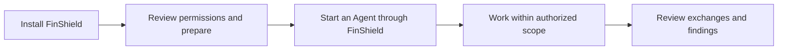

# FinShield for Windows

[简体中文](WINDOWS-GUIDE-zh.md) · [Home](../README.md) · [All platforms](getting-started.md)

FinShield adds execution boundaries to AI agents working on your Windows computer. Keep familiar applications and tools, process files within authorized directories, restrict high-risk operations, and review supported model exchanges and sensitive-information findings.

This guide describes the current desktop workflow. Use a matching installer and application version; older public releases may have different controls and capabilities.

## 1. Download and double-click the EXE

Obtain `finsafe-<version>-x64-setup.exe` from [Releases](https://github.com/finogeeks/finsafe/releases) or your official delivery channel. Double-click it and follow the wizard. Package names may still use FinSafe.

As of 2026-10-29, public Releases still ends at `v0.9.47` and has no new desktop EXE attachment. The old CLI archive is not the desktop installer described here. If you received a current EXE, use that delivered file.

Install WorkBuddy or DSH separately and configure its account/model service. These two Agents appear in the current Windows desktop inventory; other applications are not automatically integrated.

The finish page can request security preparation or only open FinShield. **Installed, authorized, and running under protection are different states.** Merely opening the product does not grant authorization.

## 2. Review permissions and prepare

Open “安全设置” (Security settings) in Console and review:

| Setting | What to check |
| --- | --- |
| File access | Writable task directories, read-only references, and inaccessible private directories |
| Network access | The model and business destinations required for the task |
| Sensitive information | Record, ask, or block, with the intended detection categories |
| Local retention | Whether to save captured requests, responses, and decisions on this computer |

Choose “授权并继续” (Authorize and continue), then wait for completion. Windows may request administrator consent. If preparation fails or is cancelled, inspect the actual error; installation success does not establish preparation success.

The floating entry shows “待准备” (Not prepared) until preparation is complete. Open its menu and explicitly select “开始准备” (Start preparation). When prepared and idle, it shows “智能体待命” (Agent standby). Console is available from the floating entry.

Changes to file/network scope require authorization again. Do not repeatedly start an Agent during preparation. Resource limits are configured separately; a tool-task time limit does not cap the full lifetime of a desktop Agent.

## 3. Start an Agent through FinShield

### WorkBuddy

1. Select WorkBuddy in “智能体管理” (Agent management).
2. Confirm a directory containing `WorkBuddy.exe`. Use “重新查找” (Find again) or “选择目录” (Choose directory) when discovery is incorrect.
3. Choose “安全启动” (Safe start), then wait for confirmed running status.
4. Use FinShield's Open action to return to the running instance.

### DSH CLI

1. Select DSH CLI in Agent management.
2. Confirm both Node.js and DSH installation directories. One directory alone is insufficient.
3. Choose Safe start and wait for the workbench to become ready. Do not submit repeated launches while it is starting.
4. Reopen the ready workbench through FinShield. Directory edits affect subsequent starts, not the existing instance.

The floating entry and Console share the same start/open operations. **Use FinShield to select and start the Agent during daily work.** A separate process launched through its vendor shortcut must not be assumed protected. This guide does not use the old attach-and-intercept-launches workflow.

## 4. Check file boundaries

Use dedicated test directories and files, with permissions that are effective on your computer.

| Scope | Check | Expected result |
| --- | --- | --- |
| Writable workspace | Create, read, and edit `finshield-demo.txt` | Operations succeed and changes are visible |
| Directory configured read-only | Read a test file, then try to change it | Reading succeeds; modification is refused; original contents remain |
| Directory configured inaccessible | Try to read a test file already present there | Reading is refused |

Do not assume the Desktop is always read-only or a browser directory is always inaccessible. Windows applies the paths and permissions in the effective policy.

Use actual tool results and file state as evidence. An Agent's verbal refusal, a missing file, or an incorrect path does not demonstrate enforcement.

## 5. Review sensitive-information checks and records

Open “查看记录” (View records) under “对话与告警” (Conversations and alerts) in an Agent's details. When local retention is enabled, captured requests, responses, and decisions are encrypted on this computer. Approved requests still reach the configured model service; local storage does not mean offline inference.

For supported, inspectable Windows model requests:

| Mode | After a sensitive-information finding |
| --- | --- |
| Record | Record a warning and continue sending the original request; this is the default |
| Ask | Hold this request and ask whether to send it once |
| Block | Refuse this request before forwarding it to the model service |

Closing, cancelling, or timing out an approval does not approve a known finding. Approval covers one request only. A refused request may appear as a client error; presentation depends on that client.

Inspection is not exhaustive. Unsupported protocols, unreadable content, and invisible traffic do not receive the same coverage. Windows may forward a request that cannot be checked under the other network/content rules and log the reason. Selecting Block does not guarantee every sensitive value is detected or stopped.

## 6. Understand the Windows boundary

FinShield uses native Windows controls: AppContainer for confined process identity, file permissions for authorized access, Job Objects for applicable process/resource limits, and a controlled proxy/WFP for network boundaries.

Effects depend on configuration and integration. GUI compatibility, tool-process desktop placement, and model inspection have separate coverage.

The README's window/clipboard examples use their recorded case configurations, including private desktops in some cases. WorkBuddy GUI needs interactive-desktop compatibility; do not infer that it defaults to all of the isolation properties shown by those private-desktop cases.

## 7. Troubleshooting

| Symptom | Check first |
| --- | --- |
| Not prepared / preparation incomplete | Console authorization, configured scope, and the actual error |
| WorkBuddy not found | A directory containing `WorkBuddy.exe`; rediscover or choose it |
| DSH cannot start | Both Node.js and DSH directories, plus security preparation |
| Access denied during normal work | Whether the file is in an authorized writable directory |
| Data sent in Record mode | Record permits sending; choose Ask or Block if intervention is required |
| Missing exchange records | Integration path, local retention setting, and record-service status |
| Service unavailable | Read the actual error or retry the state read; stale UI is not current runtime evidence |

Update with the new setup EXE. Uninstall through Windows Settings → Apps → Installed apps. Use the [FAQ reporting instructions](FAQ.md#how-do-i-report-a-problem) for version details and reproduction steps.
