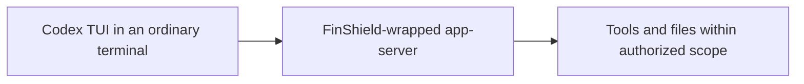

# Connect Codex CLI through the command line (Windows)

[简体中文](codex-cli-zh.md) · [Documentation](README.md) · [Compatibility matrix](agent-compatibility-en.md)

This guide uses Safety Arena's Windows route: start Codex `app-server` through FinShield, then connect from an ordinary terminal. **Codex CLI integration is supported now and requires no plugin.** It does not cover the Codex desktop app, IDE extension, or Agent verification on Linux/macOS.

Arena records Codex `0.166.0`; its wrapping specification uses Windows FinShield `0.10.9`. These identify the evaluation route, not fresh installed-version verification for every later release. Repeat checks after an upgrade.

## Prepare

1. [Install Windows x64 FinShield](getting-started-en.md#windows) and complete preparation and authorization.
2. Install and sign in to Codex CLI separately. Confirm it works normally. Its version must support `app-server --listen` and TUI `--remote`.
3. In the FinShield Console, confirm access to the workspace, Codex executable, and required configuration / state directories. Obtain the actual prepared `effective.yaml` path for that installation. Do not reuse a DSH-plugin-specific configuration as a generic Agent configuration or edit generated `effective.yaml` directly.
4. If permissions change, regenerate the configuration through the product workflow and complete preparation before starting a new session. FinShield does not set up Codex accounts or model providers.

## Start the protected server

Set actual paths in an ordinary PowerShell terminal. The configuration and workspace paths below are placeholders and must be replaced. `Get-Command` must find the actual `codex.exe`; an npm `.cmd` / `.ps1` launcher cannot directly replace that EXE.

```powershell
$finshieldExe = 'C:\Program Files\FinSAFE\finsafe.exe'
$codexExe = (Get-Command codex.exe -CommandType Application -ErrorAction Stop).Source
$effectiveYaml = 'C:\YourFinShieldConfig\effective.yaml'
$workspace = 'C:\YourAuthorizedWorkspace'

foreach ($file in @($finshieldExe, $codexExe, $effectiveYaml)) {
    if (-not (Test-Path -LiteralPath $file -PathType Leaf)) { throw "File not found: $file" }
}
if (-not (Test-Path -LiteralPath $workspace -PathType Container)) { throw "Workspace not found: $workspace" }
& $finshieldExe --version
& $codexExe --version
& $codexExe app-server --help
& $codexExe --help
& $finshieldExe prepare check --yaml-path $effectiveYaml --json
```

Read the preparation result. Resolve missing preparation, configuration mismatches, and diagnostic errors through the product before continuing. Choose an unused local port, for example `8765`, and run in the same terminal:

```powershell
Set-Location -LiteralPath $workspace
& $finshieldExe self-confine --yaml-path $effectiveYaml --stdio inherit --integration-id codex -- $codexExe app-server --listen ws://127.0.0.1:8765
```

Keep the terminal and server running. Confirm the server is listening before connecting. Listen only on loopback. If the port is in use, select another unused port for both commands.

## Connect the Codex terminal UI

Open a second ordinary PowerShell terminal and use the same Codex EXE and workspace:

```powershell
$codexExe = (Get-Command codex.exe -CommandType Application -ErrorAction Stop).Source
$workspace = 'C:\YourAuthorizedWorkspace'
& $codexExe --remote ws://127.0.0.1:8765 -C $workspace --sandbox danger-full-access --ask-for-approval on-request
```

The protected `app-server` in the first terminal executes Agent work. The second terminal provides the UI; independent PowerShell commands there do not gain FinShield protection. Keep the `--remote` connection rather than starting an ordinary local session. Do not assume existing desktop / IDE sessions connect to this server.

`--sandbox danger-full-access` is the Codex setting Arena uses with the external FinShield boundary. FinShield supplies the execution boundary while `on-request` approval remains. **Use this setting only after confirming the connection targets the protected server.** Do not persist it in global configuration or use the combined approval-and-sandbox bypass flag. No `config.toml` edit is required.



## Verify and exit

In a new test session, follow the [permission checks](getting-started-en.md#verify-permission-scope) for writable, read-only, and inaccessible directories. Use nonsensitive test files and inspect actual tool results and file contents. A model's verbal refusal or a listening server does not establish protection.

`--integration-id codex` only labels record attribution and does not select permissions. PII inspection also needs matching network and content-inspection configuration; this launch command alone does not establish coverage.

Exit the Codex session in the second terminal, then stop `app-server` in the first and confirm it has exited. When changing configuration, upgrading, or returning to ordinary execution, end the old server and explicitly start a new session so it cannot reuse the old process.

## Troubleshooting

| Symptom | Action |
| --- | --- |
| EXE missing / only an npm launcher exists | Check the Codex installation and use the full path to its actual native `codex.exe`; do not guess versioned installation paths |
| `--remote` or `--listen` unsupported | Check that Codex version's help; this guide cannot be used with versions missing those interfaces |
| Preparation fails or launch is denied | Check the selected installation, effective configuration, and authorized directories; correct through the product and prepare again rather than granting whole-disk access |
| Cannot connect | Read the first terminal's original error and check the listening address, port, and whether the server exited |
| Model connection or sign-in fails | Check native Codex sign-in, model configuration, and connectivity first, then sandbox permissions and proxy / certificate settings; do not disclose credentials |

Implementation basis: [Arena Codex integration](https://github.com/finogeeks/agent-safety-arena/blob/main/docs/codex-finshield-recording.md). For support, include FinShield / Codex versions, launch route, and redacted errors; see [Get help](getting-started-en.md#get-help).
