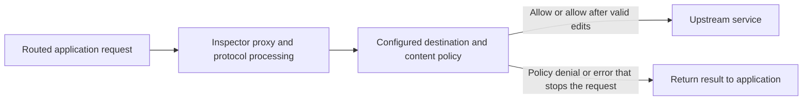

# Inspector: how network requests reach content inspection

[中文](../../zh-CN/architecture/inspector.md) · [Architecture and diagrams](README.md) · [Network access, exfiltration, and PII](../protection/network-pii.md)

**Inspector provides proxying and content inspection for requests routed through a supported integration. Whether it sees a particular transmission depends on the actual traffic path, TLS settings, request format, and effective configuration.** A running Inspector process or a protected status alone does not confirm that the request was redacted.

Scope: delivered Windows product configurations that support proxying, TLS inspection, and content inspection. Before integrating, check the [compatibility matrix](../agents/compatibility.md), release notes for your version, and the selected entry point. The public DSH and OpenCode Windows plugins use `host` networking by default. This page does not establish that those plugins enable Inspector, website allowlisting, or PII by default. It explains existing configuration and the public PII integration workflow; it adds no plugin settings entry point.

## What conditions must a request meet?

Suppose you ask an agent to read a sample customer file and send it to a model. File permissions determine whether it can read the sample. Network policy determines whether it can connect to the destination. Content inspection determines what happens when selected text matches a rule. This is a hypothetical example of responsibilities, not a new evaluation result.

| Layer | Question it addresses | What it does not establish |
| --- | --- | --- |
| File permissions | Which files may the agent read or write? | That content from a readable file cannot be sent |
| Network fencing and destination policy | Does the connection meet the actual network permissions and destination scope? | That an allowed destination receives no sensitive content |
| Inspector proxying and TLS inspection | Can the routed request enter supported HTTP content processing? | Coverage of all device traffic, arbitrary protocols, or every upload |
| Content detection and action policy | How is selected current text checked, allowed, approved, blocked, or validly rewritten? | That no finding means no sensitive data, or that a warning means redaction |

Windows WFP network fencing and Inspector address network access constraints and inspection of routed requests respectively. The presence of WFP does not prove that HTTPS is decrypted. Proxy configuration alone does not prove that direct connections outside the allowed scope are blocked. Verify both parts for the product you use.

Scope: one request on a configured inspection path. Level: processing components. Input: a supported application request. Output: a request sent upstream, or a visible denial or error. The diagram excludes traffic outside the integration and does not describe default plugin configuration.

## Why does HTTPS inspection involve certificates?

HTTPS normally prevents an intermediary proxy from reading the body. Supported inspection configurations use `mode: proxy` for proxy attachment and `tls_terminate: true` to enable TLS termination. The client establishes TLS with the inspection component, which makes a separate upstream connection. The client must trust the applicable inspection certificate, and the upstream certificate must also be validated.

This changes the application's HTTPS trust arrangement. Before enabling it, establish the inspection scope, how certificates are installed and removed, and who can access the inspection component and retained records. Use the selected product's supported trust workflow. Do not resolve connection errors by disabling application certificate validation. An installed certificate, enabled field, or running process alone does not prove that a request entered inspection.

`tls_terminate` and PII are separate settings. Even after TLS processing, invoking a detector requires valid content configuration, a supported model protocol, and applicable text. The public example with `endpoints: ["*.*"]` has a broad destination scope; it is not a strict model-service allowlist.

## What does the detector receive?

FinShield selects the current input from an intercepted outbound model API request, then supplies the selected text to the detector. The public protocol covers supported text from the current user message, or current tool results and the immediately preceding assistant message. A check does not rescan the entire history or the whole disk.

Images, binary attachments, opaque content, custom protocols, traffic outside the integration, and local files absent from the model request must not be treated as covered by this text detector. Rewriting complex Anthropic Messages tool-result and thinking source mappings is not yet supported. See the [PII protocol](https://github.com/finogeeks/finsafe/blob/main/pii-plugins/docs/protocol.md) for the complete scope. [Network access, exfiltration, and PII](../protection/network-pii.md) owns the finding actions and text boundaries.

Only the first entry in `plugins` is selected. Later entries do not run when the first detector has no finding or fails. An external EXE is a trusted extension outside AppContainer; choosing that EXE is a separate trust decision.

## What result establishes redaction?

- `warning` permits forwarding. A warning alone does not stop the original text. Forwarding replacement text also requires valid edits from the external plugin, `allow_rewrite`, and successful validation.
- `block` stops a request with a finding. Permission to rewrite does not override blocking policy.
- `approval_required` waits for approval of that request. It is not a lasting grant for all later requests.

The public resident-ID example uses a format regex to change the synthetic value `11010119900101123X` to `110XXX123X`. The input field may still show the original text; inspect the actual forwarded payload. The example does not validate calendar dates or checksums and is not a PII accuracy measurement.

## Retention and forwarding are separate

The public PII template sets `llm_content.retention: true`. When original-text retention is enabled, local records may contain the original even if outgoing text has been redacted. Manage access, retention, and removal according to the selected product. Redaction does not establish that local originals have been deleted.

Content findings, network errors, and conversation retention serve different purposes. A missing record alone does not prove that a request was not sent. An existing record alone does not prove that the upstream received edited content. Verification must connect the application result with a receiver you control or supported records of the actual payload.

## How do saved settings become active?

The public integration example distinguishes desired configuration, effective configuration, and running settings:

1. Updating `candidate.yaml` saves the desired values.
2. The public example's materialization operation generates `effective.yaml`.
3. A content refresh affects subsequently processed requests. Requests already being processed keep their previous settings. If Inspector is not running, refresh reports that state; the next normal protected application launch loads the configuration.
4. Changes to TLS, destination scope, or other permissions can still require the normal authorization workflow. A content refresh does not authorize them.

Windows configurations that support a shared Inspector allow multiple applications for the same user and security domain to share the inspection process. Application exit and Inspector shutdown are separate lifecycle events. After Inspector stops or fails, do not assume a running ordinary application automatically restores its original connections. Follow the reported recovery steps; restart the application and verify again when needed.

See the [redactor integration example](https://github.com/finogeeks/finsafe/blob/main/pii-plugins/examples/redactor/README.md) for the complete procedure. It replaces the complete network configuration and backs up files, so preserve any existing narrower destination scope. Materialization or refresh failures report errors. The script does not automatically roll back or equate a saved file with active runtime settings.

## How can you verify the path and diagnose failures?

Use a destination you control and synthetic text. Record FinShield, agent, platform, versions, and configuration source:

| Check | Result to observe |
| --- | --- |
| Request path | The particular request enters the selected product's supported inspection path |
| TLS and destination | Correct client trust; an allowed destination works; a destination denied by the current policy is rejected |
| Ordinary text | A normal request completes; connection failure is distinguished from policy denial |
| Findings and blocking | The configured action occurs; a controlled receiver gets no request when it is blocked |
| Valid edits | The receiver sees the expected replacement, beyond what the input field or plugin preview shows |
| Tool results | Tool-returned text is tested as well as manually entered text |
| Configuration refresh | New requests use the new settings; not-running and failure states are reported as observed |
| Retention | Actual stored content and access scope are checked separately from forwarding |

Detector failure, invalid results, certificate errors, and Inspector unavailability are not clean inspection results. A request format or path outside the scope is not a request checked and found safe. A detector failure, timeout or non-applicable check may allow forwarding to continue; without a valid replacement, the original text may reach the upstream service. **`on_finding: block` specifies the action after a finding; it does not guarantee blocking on every detector failure, timeout, or non-applicable check.** If a use case requires requests to stop on inspection failure too, verify the delivered version's actual failure handling. In the public integration workflow, recompression failures return an HTTP error rather than recovering by discarding edits and sending the original body.

A standalone plugin test establishes its result for the supplied text. A successful website build does not establish installed traffic inspection either. Real application coverage, restart, and recovery need verification with the delivered version and actual configuration. Continue with [configuration effects and activation](../protection/configuration.md), the [PII developer kit](https://github.com/finogeeks/finsafe/blob/main/pii-plugins/README.md), and [installation and verification](../getting-started/install.md).
