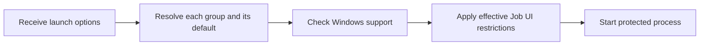

# Windows desktop interaction and Job UI

[简体中文](../../zh-CN/architecture/windows-job-ui.md) · [Security principles](README.md) · [Windows protection](../protection/windows-security.md)

Running a program for an Agent does not necessarily require letting it read the clipboard, change display settings or operate another application's windows. Job UI supplies restrictions on these interactions. File permissions, networking and initial desktop placement remain separate controls.

**Scope:** Windows AppContainer `run` / `self-confine` launch paths that provide grouped UI options. Confirm the options in the installed version's help. Desktop integrations can supply their own explicit compatibility options; CLI defaults do not establish every plugin's effective settings. This page explains existing public options and introduces no UI control, YAML field or runtime editor.

## How Job Objects relate to UI restrictions

A Windows Job Object can group processes and carry lifecycle, resource and UI restrictions. Job UI controls the interaction boundary. Membership in a Job does not prove a particular UI restriction is enabled; check the Job's effective restrictions as well.

For example, suppose an Agent only needs to generate a report in a test directory. Reading the system clipboard or changing mouse settings is not necessary for that task. Job UI can constrain corresponding interactions while file permissions still allow report output in the selected directory. This is an illustrative scenario, not an evaluation result.

## What each restriction addresses

| Category | Effect | What it does not establish |
| --- | --- | --- |
| Clipboard read / write | Separately constrains reading clipboard content into the process and writing content out | Read access does not allow writes, and neither option grants permission per user click |
| External USER handles | Restricts use of USER objects owned outside the Job, affecting corresponding window-message and hook operations | Does not control all file, process, pipe or other kernel handles |
| Global atoms | Restricts communication through this Windows sharing mechanism | Does not disable all interprocess communication |
| Desktop and session operations | Constrains corresponding desktop creation / switching and session-exit operations | Does not select the process's initial desktop |
| System parameters and display settings | Constrains corresponding system-parameter and display changes | Does not cover every setting, registry or device interface |
| IME and injection-related restrictions | Applies corresponding restrictions on supported Windows builds | Does not prove every keyboard-reading, synthetic-input or injection path is blocked |

See [Microsoft's Job UI documentation](https://learn.microsoft.com/en-us/windows/win32/api/winnt/ns-winnt-jobobject_basic_ui_restrictions) for the basic behavior. AppContainer, object ACLs and Windows integrity boundaries can further constrain specific API access.

## How defaults and compatibility work together

On the CLI paths above, omitted UI options enable the restrictions supported by the current Windows host. Changing one group does not release the other groups. `--windows-desktop` controls initial desktop placement separately and defaults to `isolated`.

[Windows system and desktop protection](../protection/windows-security.md#cli-ui-permissions) owns the full option and value table. Common distinctions are:

- `--windows-ui-clipboard read` removes the read restriction while retaining the write restriction.
- `--windows-ui-isolation desktop` permits corresponding USER-object and atom-table sharing; it does not select `--windows-desktop inherit`.
- `--windows-desktop inherit` changes initial desktop sharing without clearing the other UI restrictions by itself.
- `allow` only removes the corresponding Job UI restriction. It does not grant access still denied by AppContainer, UIPI or object ACLs.

A GUI application may need window sharing, clipboard access or IME compatibility. Its integration should supply the required options explicitly and explain the resulting boundary. A working interface does not prove CLI restriction defaults remain intact. Solving one compatibility issue does not require releasing every group.

## How Windows versions affect the result

FinShield checks host support for the applicable restrictions. The current implementation uses Windows build `22621` as the enablement threshold for the IME-related restriction and `26100` for the injection-related restriction. Omitted options use the host-supported set. Explicitly requesting the corresponding `deny` on an unsupported host produces a launch error.

Matching numeric masks on different machines is insufficient to establish equivalent protection. Record the Windows build, explicit requests and effective restrictions. If Windows rejects the restrictions, handle the original error rather than reporting success or silently launching with weaker restrictions.

Scope: one launch that creates a new Job with UI options. Inputs: launch options and Windows support. Outputs: a process under effective restrictions or a launch error. An already running Job is not reconfigured.

These options apply when creating a new sandbox Job. A nested call already inside a protected outer run retains the outer configuration. Different inner values do not reconfigure that Job, including values that appear stricter.

## How to verify actual interaction

Use disposable test programs, a test window and synthetic clipboard content. Record FinShield, Agent and Windows versions, including the build and launch entry.

| Subject | Method and evidence |
| --- | --- |
| Clipboard read | Write distinctive test text from the host, attempt to read it from the protected process, and retain the API result and actual returned content |
| Clipboard write | Write different test text from the protected process and read it independently from the host; a read test does not replace a write test |
| External-window interaction | Use a host test window you own; record the operation, API result and independently observed effect |
| Effective restrictions | If the installed output provides `windows_job_ui_limits`, record it with the options and Windows build; the field alone does not establish behavioral testing of every restriction |
| Application compatibility | Verify input, copy / paste, ordinary tasks and exit in the final Agent version, rather than only testing a standalone executable |

No visible change can also mean the program never ran, its input was wrong or a dependency was missing. Missing denial logs do not prove permission; the current file-denial journal is not a complete Job UI audit.

## Which conclusions need separate proof

Same-desktop `GetDC(NULL)` screen reads are not blocked by the current Job UI mask. A private initial desktop alone does not prove complete isolation of every desktop-access or thread path. This page does not promise complete screenshot prevention, invisibility of all input or disabled IPC.

This page does not report a new native Windows or installed-Agent acceptance run. Historical cases establish only their recorded platform, versions, permissions and operation results. Continue with [Protection boundaries and verification](../protection/windows-security.md), [Compatibility](../agents/compatibility.md) and [Installation verification](../getting-started/install.md#verify-permission-scope).
