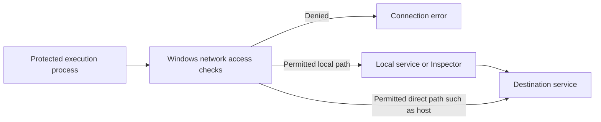

# Windows network isolation and WFP

[简体中文](../../zh-CN/architecture/windows-network.md) · [Security principles](README.md) · [Network and PII](../protection/network-pii.md)

An Agent that can connect to the network does not necessarily have its requests inspected. Windows network protection has two separate responsibilities: **network boundaries constrain which connections are permitted; the connected proxy and Inspector determine how supported request content is processed.**

**Scope:** Windows AppContainer network paths. This page explains mechanisms and verification, and does not introduce a configuration interface. Confirm modes, compatibility and inspection support against the installed FinShield version and integration guide. Public DSH / OpenCode Windows plugins default to `host`; a protected status does not enable destination restrictions or PII inspection. See [Plugin defaults](../protection/defaults.md).

## Which layer WFP controls

Windows Filtering Platform (WFP) is Windows network-filtering infrastructure. FinShield's AppContainer network rules identify the constrained container through its Package SID. Preparation and authorization establish the rules, and Windows permits or rejects connections on the applicable paths. Switching a script from Python to Node.js does not remove those rules. [Microsoft WFP documentation](https://learn.microsoft.com/en-us/windows/win32/fwp/about-windows-filtering-platform)

The network-rule subject is different from a visible application window. Confirm the identities and execution scope of the protected Host and applicable descendants, ordinary desktop Main, updaters and host-local services separately. Protecting one execution process does not put the whole computer under the same network policy.

For example, suppose an Agent reads a synthetic contact list from a test directory and tries to send it to a service. File permissions determine whether the read succeeds; network policy determines whether the service is reachable; content inspection needs the actual request path to block or redact its text. Verify all three results separately.

## How network modes affect connections

Windows effective configuration and older generic CLI policies use different field formats. This table explains intent; it is not a YAML template to paste into any configuration.

| Mode or path | Network behavior | Boundary to check |
| --- | --- | --- |
| `host` | Uses host networking without establishing a FinShield outbound destination fence through this mode | Windows Firewall, other security products and the network can still deny connections; proxy and PII do not turn on automatically |
| `none`, where the entry point provides it | Network restrictions deny outbound connections for the protected identity | Verify the actual execution process, IPv4 / IPv6 and TCP / UDP; testing an ordinary browser is insufficient |
| Windows effective `proxy` path | Connects governed requests to a local proxy and uses a network fence to constrain direct remote connections | Local loopback communication has compatibility permits; proxy destination rules govern requests that pass through that proxy |
| Generic CLI allowlist policy | The corresponding version's sandbox network boundary and proxy enforce destination rules | This is not the Windows Candidate field format; read the matching examples and help first |

Completed preparation means the selected authorization workflow completed. Verify the actual request result at runtime. Change network modes through supported configuration and authorization operations; do not repair application connectivity by deleting Windows filters or changing identity labels directly.

## How WFP, the proxy and Inspector work together

Scope: network connection paths from a protected process. Inputs: a connection attempt and effective network policy. Outputs: connection rejection or access through a permitted path. This diagram shows component connections; it does not say that every mode enables every path.

WFP does not turn HTTPS into model-request text. The proxy handles supported connections and destination rules; an enabled Inspector path performs TLS and content inspection when its requirements are met. HTTPS content inspection needs appropriate certificate trust, request formats and configuration. See [Network access, exfiltration and PII](../protection/network-pii.md) and [Inspector mechanisms](inspector.md).

**Local reachability is an important boundary.** Windows effective proxy configuration permits TCP / UDP loopback communication for the proxy and local application cooperation. A local service can make its own remote connections or act with its own permissions. Direct remote restrictions therefore do not establish that every request passes through Inspector. Testing a single proxy endpoint does not verify every local intermediary path. Loopback compatibility also depends on the version, authorization outcome and Windows Firewall.

## How to verify network restrictions

Use a receiver you control and synthetic content. Record FinShield, Agent and Windows versions, the launch entry and effective network mode. Then check each path:

| Test | Evidence to retain |
| --- | --- |
| Permitted remote destination | Client result and receiver record; confirm the intended business request completes |
| Remote destination outside the permitted scope | Original connection or proxy error and confirmation that the receiver saw no request; distinguish policy denial from service failure |
| Proxy path | Whether the actual request uses the selected proxy; an environment variable alone does not prove the client uses it |
| Local service | Whether required loopback communication works and whether the intermediary makes independent remote connections |
| Content inspection | Actual forwarded payloads for ordinary and synthetic sensitive text, rather than UI status alone |

Verify IPv6, UDP and each required client path separately. One rejected IPv4 TCP request does not verify other protocols or address families. An ordinary host process retaining network access does not by itself prove container restrictions failed.

This page does not report a new installed-Windows acceptance run. A website build, the presence of filters and historical evaluation results do not replace verification of the current installation.

## What an integration should retain

An integration should identify its execution process, effective mode, authorization completion, business destinations, proxy and certificate requirements, and the layer reporting an error. Handle network-preparation errors according to the original result. Do not conceal them by disabling protection, deleting rules or expanding destination scope.

Continue with [Configuration and activation](../protection/configuration.md), [Agent compatibility](../agents/compatibility.md) and [Windows system and desktop protection](../protection/windows-security.md).
