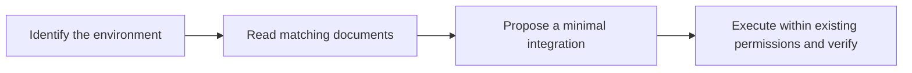

# Integrate FinShield with an AI coding agent

[简体中文](../../zh-CN/development/ai-integration.md) · [Development and integration](README.md)

Ask your AI coding agent to read public documentation matching your environment, propose a minimal integration, and verify it with actual operations. Web pages, single-page Markdown and AI indexes share the same content. Generated commands still need checks against the version, configuration target and execution results.

An integration starts with environment information and ends with observable verification results:



## Give the agent the right documents

Start with the [English documentation index](https://finshield.finogeeks.club/en/llms.txt), then read individual pages for the task. Give tools complete site URLs so links retain their context.

| Entry | Purpose |
| --- | --- |
| [Language entry](https://finshield.finogeeks.club/llms.txt) | Select English or Chinese |
| [Developer topic index](https://finshield.finogeeks.club/en/development/llms.txt) | Select documents for an integration task |
| [Full English text](https://finshield.finogeeks.club/en/llms-full.txt) | Read offline or process documents in bulk |
| [Machine-readable catalog](https://finshield.finogeeks.club/docs.json) | Select document URLs for tools |

The new full-text, topic-index and JSON entries become available with the corresponding website release. If they are unavailable, use the language index and single-page Markdown below rather than guessing the missing content. For long tasks, read on demand instead of supplying unrelated platforms together.

The text bundle includes current documentation bodies. Historical snapshots have source links only; images and external links still need network access. The machine catalog identifies language, summary, content kind, canonical page and corresponding Markdown. Standalone diagrams have `null` for their Markdown URL.

## Identify the platform, version and support status first

Provide the operating system and architecture, FinShield and Agent versions, CLI/desktop/plugin form, intended task and existing configuration entry. Ask the agent to read the [compatibility matrix Markdown](https://finshield.finogeeks.club/en/agents/compatibility.md) and distinguish released integrations, test releases, evaluation evidence and examples only.

Windows CLI results do not automatically apply to a desktop edition, IDE or Linux/macOS. A source field, an accepted argument and an active configuration are separate facts. Identify missing conditions before proceeding.

## A task prompt to give your agent

Replace the bracketed values. This prompt starts with a reviewable proposal; subsequent execution still follows your existing permissions and normal product authorization.

```text
Help me integrate FinShield.
Environment: [OS/architecture]; FinShield: [version].
Agent/application: [name, version and form]. Goal: [specific task].
Configuration target: [existing supported entry; no secrets].

Read first:
https://finshield.finogeeks.club/en/llms.txt
https://finshield.finogeeks.club/en/agents/compatibility.md
https://finshield.finogeeks.club/en/development/integration-guide.md
https://finshield.finogeeks.club/en/reference/cli-configuration.md

Choose a matching documented entry. List prerequisites, version scope and sources.
Give minimal steps, paths to replace, allowed/denied tests and cleanup.
Record unexecuted steps, actual results and missing conditions separately.
Do not guess interfaces, expand permissions or bypass normal authorization.
When permission is needed, explain the operation and its scope.
```

## Check the generated result

Use the [minimal integration example](https://finshield.finogeeks.club/en/development/integration-guide.md) to check the actual EXE, selected configuration and execution process. Use a prepared effective configuration. An existing file or a query exit code of zero does not alone establish that preparation records match.

With dedicated test directories, verify an allowed write, a denied read-only modification and a denied read. Preserve original errors and independently inspect file state. A model's verbal refusal, missing paths and launch failures are not interception evidence. File verification also proves no Inspector or PII activation. When needed, read the [Inspector Markdown](https://finshield.finogeeks.club/en/architecture/inspector.md) and confirm the real request path separately.

## Choose what information to share

Use synthetic text and redacted diagnostics. Keep real customer records, secrets and sensitive conversations out of prompts. Public technical material describes supported integration entries. Enterprise deployment, management interfaces and authorization procedures are supplied through the relevant engagement. Contact the team through [enterprise solutions](https://finshield.finogeeks.club/en/enterprise/) to confirm that scope.

Key answers are in the main text; the agent need not find essential steps in screenshots or expandable controls. Indexes aid discovery, not guaranteed search inclusion, model citations or correct output. Recheck applicability and verify behavior after upgrades.
