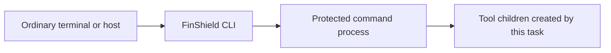

# Choose a FinShield integration

[简体中文](../../zh-CN/development/integration-guide.md) · [Development and integration](README.md) · [Compatibility](../agents/compatibility.md)

Start by identifying the process that executes the task. Installing a desktop plugin, launching a protected service and extending content detection solve different problems. This page helps you choose an existing public entry and verify a command process before adapting your application.

**Scope:** existing Agent entries, Windows CLI and the public PII kit. The Windows example requires an effective configuration that has already been prepared and authorized. It does not automatically adapt arbitrary applications or add new installed-product test results. See [compatibility](../agents/compatibility.md) for product and Agent version evidence.

## Choose an entry for your task

| Goal | Recommended entry | What to verify afterward |
| --- | --- | --- |
| Protect a supported Agent | Its [Agent guide](../agents/README.md), preferably a released plugin or desktop entry | Whether the actual execution Host is protected and what its effective configuration allows |
| Run Codex or Claude from a terminal | [Codex CLI](../agents/codex.md) or [Claude Code CLI](../agents/claude.md) | The Codex TUI connects to the protected server; Claude's tools and shell work in the selected environment |
| Wrap your own command or tool | A CLI entry matching the platform, release and configuration; Windows template below | Program, dependencies, configuration directories, file/network requirements, children and exit behavior |
| Add native protection to your desktop product | Identify the interface, execution and update processes, then confirm SDK and delivery versions | Application adaptation, authorization, status and lifecycle contracts; an integration name alone provides none of these |
| Add sensitive-data detection or redaction | [Windows PII kit](https://github.com/finogeeks/finsafe/blob/main/pii-plugins/README.md) | Real request coverage, the effect of findings on forwarding, and plugin licensing |
| Obtain organizational management and delivery | [Enterprise solutions](../enterprise/README.md) | Contact the team to confirm environment, pilot scope, licensing and delivery requirements |

Linux/macOS wrapper examples and the Windows effective-configuration entry differ. Select by [platform and Agent scope](../agents/compatibility.md); do not exchange their policy files or apply the Windows command unchanged.

## Identify the process boundary

This diagram shows launch relationships for one command started from an ordinary terminal. Inputs are the authorized configuration and command; outputs are the protected task and its execution result. Resolve launch errors before treating the run as a protection test.



The ordinary terminal, an independent updater or an existing desktop process does not automatically enter this boundary. If the command delegates work to an existing external service, verify that service's identity and permissions separately. A successful connection and protected execution are separate facts.

## Minimal Windows CLI integration

Use Windows PowerShell in place of a business application to check launch and file permissions first. This is a generic command template, not compatibility acceptance for a custom Agent.

Prepare these inputs:

- Windows x64 FinShield, with preparation and authorization completed for the selected configuration.
- Actual paths to the FinShield EXE, Windows PowerShell EXE and prepared `effective.yaml`.
- A dedicated test workspace authorized for reading and writing. For denial checks, also prepare read-only and denied test directories with non-sensitive fixture files.
- Access to the selected PowerShell executable and its normal runtime dependencies. If your delivery has no supported entry to prepare the required configuration, use an existing Agent guide first. Do not edit generated `effective.yaml` or borrow another plugin's dedicated configuration.

In ordinary PowerShell, replace the paths and inspect the version and preparation result:

```powershell
$finshieldExe = 'C:\Program Files\FinSAFE\finsafe.exe'
$effectiveYaml = 'C:\YourFinShieldConfig\effective.yaml'
$workspace = 'C:\YourAuthorizedTestWorkspace'
$shellExe = Join-Path $env:WINDIR 'System32\WindowsPowerShell\v1.0\powershell.exe'

& $finshieldExe --version
& $finshieldExe self-confine --help
& $finshieldExe prepare check --yaml-path $effectiveYaml --json
```

Confirm that the paths exist and read the JSON check output: `result: same` means the selected preparation record matches. Resolve `unprepared`, `incomplete` or `different` first, using `differences` to inspect the mismatch. Exit code 0 only means the query completed successfully. The check does not perform new authorization. Resolve a mismatch or failed preparation through the supported product configuration workflow. Then launch from the workspace:

```powershell
Set-Location -LiteralPath $workspace
& $finshieldExe self-confine --yaml-path $effectiveYaml --stdio inherit --integration-id custom-cli -- $shellExe -NoLogo -NoProfile
```

The actual program and its arguments follow `--`. `--stdio inherit` retains interactive input and output. `--integration-id custom-cli` only labels record attribution: it selects no permissions, adapts no application and enables no network or PII inspection. See [Claude CLI](../agents/claude.md) for an existing public integration using this entry.

## Verify operations inside the protected process

Enter these commands in the new PowerShell process. Replace the directories with the actual dedicated test paths in that configuration:

```powershell
$workspace = 'C:\YourAuthorizedTestWorkspace'
$readOnlyDir = 'C:\YourReadOnlyTestDirectory'
$deniedDir = 'C:\YourDeniedTestDirectory'

'integration-check' | Set-Content -LiteralPath (Join-Path $workspace 'finshield-demo.txt') -ErrorAction Stop
Get-Content -LiteralPath (Join-Path $workspace 'finshield-demo.txt') -ErrorAction Stop
Get-Content -LiteralPath (Join-Path $readOnlyDir 'fixture.txt') -ErrorAction Stop
'write-probe' | Set-Content -LiteralPath (Join-Path $readOnlyDir 'write-probe.txt') -ErrorAction Stop
Get-Content -LiteralPath (Join-Path $deniedDir 'fixture.txt') -ErrorAction Stop
```

Run and inspect each operation separately; this is not an automated acceptance script. Create and confirm the fixture files from an ordinary process beforehand. `write-probe.txt` must not already exist in the read-only directory.

| Operation | Expected with the corresponding effective permission | Evidence to inspect |
| --- | --- | --- |
| Workspace write and read | Succeeds and returns `integration-check` | An ordinary process sees the same file contents |
| Read-only fixture read | Succeeds | Returns the prepared fixture contents |
| Create a file in the read-only directory | Access denied | Original error, with no new test file in the directory |
| Read a denied fixture | Access denied | The fixture exists and the error is access denial, not file not found |

If an allowed operation also fails, check dependencies, paths and configuration. If an operation that should be denied succeeds, preserve the result and correct the selected scope. Process startup alone is not acceptance. File tests also prove no desktop or network inspection behavior; see [permission verification](../getting-started/install.md#verify-permission-scope).

## Finish and adapt your application

Run `exit` in protected PowerShell, then confirm the task has ended from the original terminal. Remove only your own test files. Handle any authorization added for the example through the original product workflow; do not manually delete effective configuration or authorization records.

For a business command, replace the program and arguments after `--` and keep the configuration target explicit. Verify ordinary startup, task execution, children, abnormal exits and post-upgrade behavior separately. Do not solve compatibility errors by granting whole-disk access or skipping the Agent's own approval.

## Node SDK and PII extend different boundaries

The public [FinSAFE Node SDK](https://www.npmjs.com/package/@finogeeks2026/finsafe-sdk) carries existing native module calls and is used by DSH and OpenCode plugins. A public package does not make every internal request shape a stable third-party interface. Confirm matching SDK, native component and application-adaptation versions and public contracts for a new host. A CLI wrapper is not a complete desktop adaptation.

A PII plugin receives selected text and returns findings and optional edits. It does not launch the Agent or grant permissions. See the [PII kit](https://github.com/finogeeks/finsafe/blob/main/pii-plugins/README.md) and [redactor integration](https://github.com/finogeeks/finsafe/blob/main/pii-plugins/examples/redactor/README.md) for local development and real product integration, and check licensing before commercial use.

See [advanced CLI and configuration](../reference/cli-configuration.md) for option scope, activation and evidence records. Reports should include product, platform and application versions, the actual entry, redacted configuration scope, original errors and allowed/denied comparison results.
