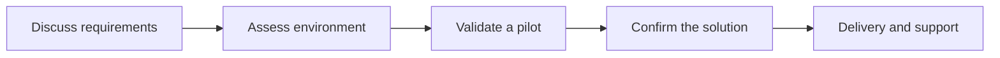

# Enterprise solutions

[中文](../../zh-CN/enterprise/README.md) · [Documentation](../README.md)

Teams using Agents for development and office work need clear boundaries for data access and operations, and evidence that protection is active. FinShield enterprise discussions use those needs to define an environment assessment, pilot and delivery scope.

## Needs to discuss

| Your situation | What the assessment needs to confirm |
| --- | --- |
| Multiple teams use different Agents | Agent form, platform versions, existing integration routes and compatibility requirements |
| You need consistent security management | Policy scope, permission ownership, change processes and available delivery capabilities |
| Work involves sensitive information | Data paths, network conditions, detection or redaction needs and retention requirements |
| You want protection in your own product | Host responsibilities, available interfaces, version constraints, licensing and validation scope |
| You want evidence before adoption | Pilot environment, representative tasks, acceptance criteria and evidence requirements |

These are questions for a solution discussion. Supported platforms, features, deployment options, licensing and services need confirmation for the customer environment and delivered release. Personal-edition capabilities or one plugin's test results do not establish the full enterprise delivery commitment.

## Enterprise AI governance reference

The [enterprise information security governance whitepaper](../resources/agent-security-governance.md) covers risk identification, layered architecture, implementation planning and FinShield practice. Read online or download the November 2026 PDF. Product and test descriptions retain their stated version and environment scope; delivery follows the agreed solution.

## Understand the product and evidence

- [Product introduction](../overview/README.md): positioning, integration routes and platform scope.
- [Protection guide](../protection/README.md): protected objects, effective defaults and limits.
- [mechanisms and evaluation archive](../reference/whitepaper.md): technical context and scoped evaluation results.
- [Agent Safety Arena](https://safety.finaios.ai/): public recordings, conditions and results. A test record describes its own environment and does not replace acceptance in your environment.

## Engagement process

Scope: enterprise solution discussions. Input: requirements and environment information. Output: an agreed pilot or delivery arrangement. If an incompatibility or scope gap appears, explain it before deciding the next step.

## Contact us

To request a demonstration, discuss an enterprise solution or explore an integration, contact **[contact@finogeeks.com](mailto:contact@finogeeks.com)**.

Include your company or team, use case, operating system, Agent name and version, expected scale and the questions you want to validate first. An initial enquiry does not need customer records, secrets or real sensitive conversations.

Enterprise deployment guides, management interfaces, authorization procedures and operations material are provided with the relevant engagement. Start with [development and integration](../development/README.md) for public interfaces, or [installation](../getting-started/install.md) for personal use.
