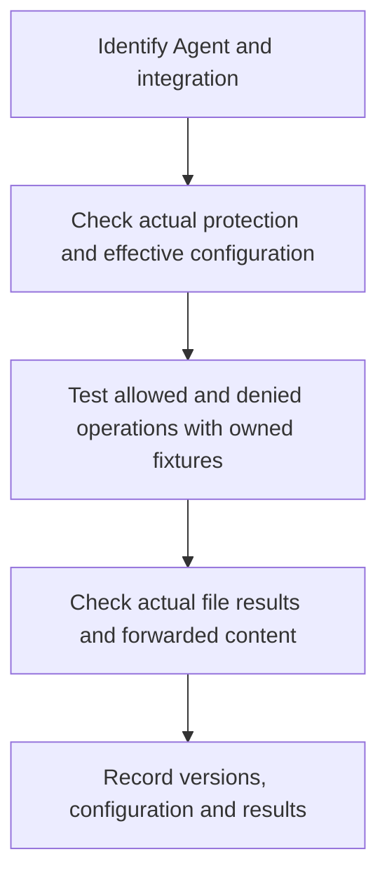

# What does FinShield protect?

[简体中文](../../zh-CN/protection/README.md) · [Documentation](../README.md)

FinShield adds file, system, device-privacy and desktop-interaction boundaries to protected Agent execution processes. This guide explains **what is protected by default, what remains allowed, what configuration changes, and how to check the result**. Installation is covered by each [Agent integration guide](../agents/README.md).

> **Check your integration first.** The public DSH and OpenCode Windows plugins default to `network.mode: host`. A “protected” plugin status does not establish website restrictions, HTTPS content inspection or PII redaction. See [Network access, exfiltration and PII](network-pii.md) for their separate configuration requirements.

## Start with your product entry

| Integration | How this guide describes protection |
| --- | --- |
| DSH / OpenCode Desktop Windows integration plugins | Default file boundaries and system / desktop protection from the public bundled configurations; networking defaults to `host` |
| Windows FinShield configurations with content inspection and PII developer integration | Check the effective proxy, TLS, permitted destinations and detector settings; a developer example is not an integration-plugin default |
| WorkBuddy, Hermes, Codex, Claude and other entries | Check their own [compatibility scope](../agents/compatibility.md); do not apply DSH / OpenCode defaults to them |
| Linux / macOS CLI | Use the platform's policy and host capabilities; Windows plugin configuration and desktop results do not transfer directly |

## What default protection provides

These examples require a FinShield protected launch and depend on the actual version, effective configuration and authorization.

| Concern | Protection | Boundary to understand |
| --- | --- | --- |
| Reading SSH, cloud-service or browser data | The bundled configurations explicitly deny listed sensitive directories, including `.ssh`, `.aws` and Chrome / Edge user profiles | Coverage is by path; custom locations and unlisted files do not automatically receive the same protection |
| Overwriting or deleting important files | `deny` rejects access; `read_only` permits reads and restricts writes | Writable directories can still be changed or deleted; protection does not supply backups or undo |
| Screen capture, recording or desktop interference | The Windows protected execution environment constrains the relevant device access and desktop interactions | It does not cover every application on the computer; check the integration and test conditions |
| Terminating other processes or changing system settings | Windows permission boundaries constrain the protected process | A successful evaluation scenario is not a guarantee for every system operation |
| Visiting websites or sending text to a model | Default integration plugins retain host networking | Their default configuration enables neither a FinShield website blacklist nor PII inspection |

See [Plugin defaults](defaults.md) for directory coverage, compatibility exceptions and allowed operations. The [whitepaper](../reference/whitepaper.md) records public evaluation versions and conditions; scenario counts do not establish PII detection accuracy.

## Three common questions

**After installation, is only the workspace writable?**

The public plugin configurations set `filesystem_coverage.root` to `read_write`, then declare deny and read-only rules. They do not deny all files outside the workspace by default. Neither configuration has a universal filename-deny rule for `.env`. Check the actual paths and effective rules for important data; see [Default scope](defaults.md).

**Which websites are blocked?**

Neither plugin default supplies a FinShield destination allowlist or website-category filter. Host firewalls, enterprise networks and destination services can still reject requests. Destination restrictions require an integration that supports them and a configured permitted-target set; a “protected” status alone does not establish coverage. See [Website access rules](network-pii.md#which-websites-are-blocked).

**If an ID number is detected, is sending always stopped?**

Content inspection must first cover the actual request. After a finding, `warning` permits sending, `block` stops sending, and `approval_required` waits for approval. Redaction also needs valid replacement text and permission to rewrite. See [Finding actions](network-pii.md#what-happens-after-a-pii-finding).

## How configuration changes behavior

- [Plugin defaults](defaults.md): directories, writable scope and protected processes.
- [Configuration explained](configuration.md): path permissions, network, PII and resource fields, with the currently documented configuration entry points.
- [Network access, exfiltration and PII](network-pii.md): permitted destinations, inspection, warnings, blocking, approval and redaction.

A field in a file, an editable control, and an effective setting are different facts. Configuration entry points that are not available are not presented as current user features.

## Verify your protection

Scope: user verification of current protection. Input: the current Agent, version and test configuration. Output: actual allowed and denied results, preserving original errors. This flow does not change product authorization.

Save tasks first. Use owned test directories for writable, read-only and denied targets. Use synthetic text and an owned receiver for network and PII checks; do not test with real credentials or customer data. Editor text, a model's verbal refusal, or success in a standalone developer tool cannot replace actual file results or forwarded payloads. See [Installation checks](../getting-started/install.md#verify-permission-scope).
