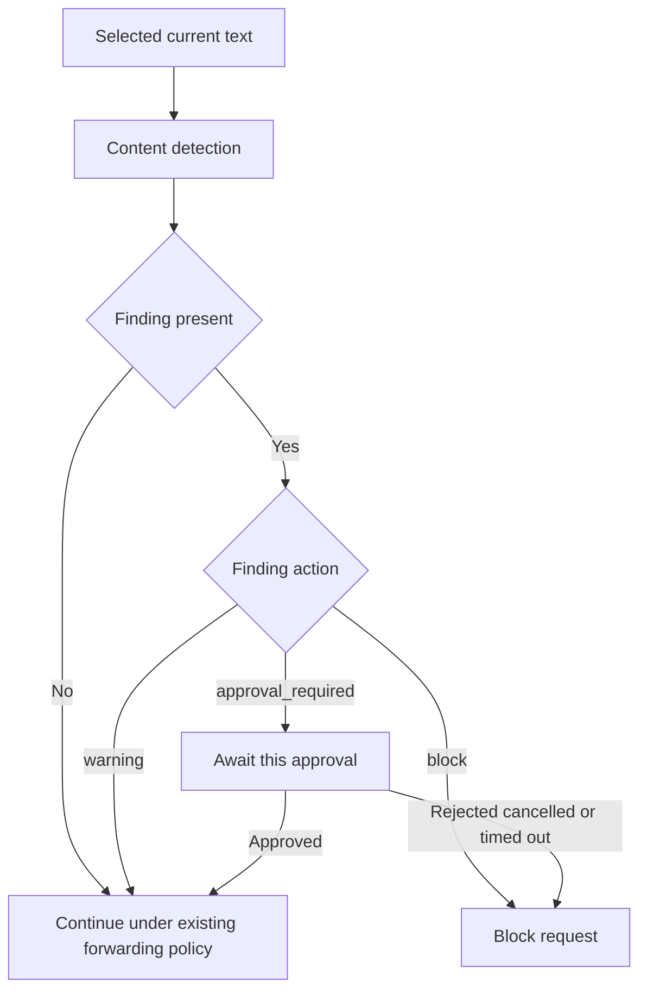

# Network access, exfiltration and PII

[中文](../../zh-CN/protection/network-pii.md) · [Protection guide](README.md)

Exfiltration controls address three questions: **what the Agent can read, where it can connect, and how outbound content is handled**. File protection does not establish blocking of sensitive text entered by the user. Destination restrictions do not establish redaction of content sent to an approved model.

## Do plugin defaults restrict websites or inspect PII?

The public DSH and OpenCode Windows plugins use `host` networking. DSH operations explicitly exclude proxying, TLS inspection, PII and outbound-content filtering. OpenCode's public documentation likewise does not establish complete network isolation.

A default plugin's “protected” status therefore does not establish website allowlisting, file-sharing upload blocking, HTTPS inspection, PII blocking or automatic redaction. These require the relevant product support, configuration and actual traffic coverage. The public Windows PII example is a separate configuration workflow; see [Configuration explained](configuration.md).

## Which websites are blocked?

| Setting / condition | How to interpret access |
| --- | --- |
| Integration-plugin default `mode: host` | This configuration enables no FinShield website deny list; host or enterprise networking can still reject connections |
| A supported proxy configuration restricts destinations | Check access against permitted targets; actual verification should reject destinations outside that scope |
| PII example's `endpoints: ["*.*"]` | A broad permitted scope, not a strict allowlist limited to model services |
| A permitted destination | Destination permission alone does not establish that an upload or model payload is safe |
| Search pages, redirects, downloads, APIs or CDNs use other hostnames | Check every actual destination; permitting a page address does not establish permission for all subsequent requests |

This guide does not claim a built-in category list of all dangerous websites, file-sharing services or social networks. Public examples do not fully specify `endpoints` matching for apex domains, subdomains, IPs, ports or URL paths. This guide therefore does not invent wildcard rules or promise unverified syntax.

To narrow outbound scope, first list required model, repository and API destinations. Configure them through an entry supported by your product, then test both permitted and out-of-scope destinations. Preserve existing narrower rules rather than replacing them with `"*.*"`. Older CLI policy examples for Linux / macOS and other routes use a different format; do not paste them directly into a Windows Candidate.

## What PII inspection covers

PII means personally identifiable information. Under the public plugin protocol, FinShield first selects current input text from an actual intercepted outbound model API request, then supplies it to the detector. The plugin does not receive an arbitrary whole disk or every conversation.

| Text or data | Public protocol scope |
| --- | --- |
| Supported text blocks in the current user message | Can be selected as current input |
| Current tool results and the immediately preceding assistant message | Can include tool-result text and supported reasoning / tool-argument text, subject to the model protocol |
| Earlier conversation history | Not all rescanned by the current call |
| Locally read files not included in the model request | Not observed by this model-content plugin; file permissions apply separately |
| Images, binary attachments and opaque blocks | This public text protocol does not decode or OCR them |
| Ordinary web uploads, arbitrary custom protocols or requests outside the inspection path | Coverage cannot be inferred from a model PII plugin |

HTTPS inspection also requires a supported proxy path, effective certificate trust and a parseable format. Installing a certificate, setting one field or observing an Inspector process does not establish inspection of a specific request. Complex Anthropic Messages tool-result and thinking rewrite mappings remain unsupported; returned edits fail validation rather than establishing redaction.

## What happens after a PII finding?

`on_finding` belongs to the selected detector entry.

| Policy | Finding outcome | Exfiltration implication |
| --- | --- | --- |
| `warning` | Records a warning and permits sending | A warning alone does not prevent sending original text; verify actual replacement if valid edits are also returned |
| `block` | Rejects the matching request | Verify that an owned receiver did not receive that request |
| `approval_required` | Waits for the existing approval flow | Approval can permit sending; rejection, cancellation or timeout stops it. This is not permanent permission for all later requests |

Scope: supported model-content inspection. Input: selected current text and detector policy. Output: permitted forwarding, pending approval or blocking. Unparseable content, plugin failures and invalid results are errors, not clean findings. This diagram does not define network internals.

No finding does not prove absence of sensitive information. Coverage depends on the detector and categories. Published file / desktop evaluation success rates are not PII accuracy measurements.

## Detection and redaction

A finding does not establish rewriting. External-plugin redaction needs valid replacement text, `allow_rewrite` permission and a finding policy that permits sending. `block` still stops a matching request; rewrite permission does not override it.

The public ID example uses a format regex to change synthetic `11010119900101123X` to `110XXX123X`. It does not validate dates or checksums, or detect 15-digit IDs. Editor text may remain unchanged; inspect actual forwarded payloads.

Only the first `plugins` entry runs. Later entries are not tried after a clean result or failure. Multiple configured entries are not a chain of active detectors. An external EXE runs outside AppContainer as a trusted extension; installing it is a separate trust decision.

## Verify that original content was not sent

1. Record the actual Agent, FinShield version, configuration source and integration. A default `host` plugin is not a PII-enabled test configuration.
2. In a supporting configuration, confirm destinations, proxy / TLS, effective settings and the selected first detector.
3. Test normal and synthetic sensitive text in both user messages and tool results, such as `user@example.com` and the public ID example above.
4. Verify warning, blocking, approval and redaction separately. Check actual forwarded content at an owned receiver or in supported records. Distinguish policy rejection, network failure and plugin errors when a request does not arrive.
5. If original-content retention is enabled, manage local-record access and retention too. Redacted delivery does not establish deletion of local originals.

A standalone developer page proves only plugin responses to its supplied text, not that production Agent traffic followed the inspection path. See the [PII integration example](https://github.com/finogeeks/finsafe/blob/main/pii-plugins/examples/redactor/README.md), [protocol v1](https://github.com/finogeeks/finsafe/blob/main/pii-plugins/docs/protocol.md) and [DSH operations](https://github.com/finogeeks/finsafe/blob/main/integrations/dsh/windows/OPERATIONS.md).
