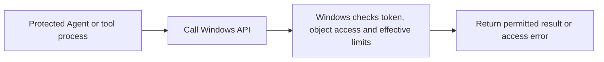

# Windows system and desktop protection

[简体中文](../../zh-CN/protection/windows-security.md) · [Protection guide](README.md) · [Plugin defaults](defaults.md)

Agents can call Windows APIs through Python, Node.js, native executables and extensions. This page explains the system restrictions on protected execution processes, the role of Job/UI limits, and what still needs verification for a particular integration.

**Scope:** Windows AppContainer execution. Results depend on FinSAFE, Windows, the integration and effective launch configuration. System mechanisms and supported CLI options described here do not establish matching controls in the DSH / OpenCode plugin UI, or identical plugin defaults. See [Protected processes](defaults.md#which-processes-are-protected) for desktop Main, ordinary updaters and other host processes.

## Where permissions are enforced

AppContainer tokens, Capability SIDs, object ACLs, integrity levels and Job limits constrain actual operations. Changing scripting language or calling Win32 / Native APIs directly does not itself grant additional process rights. **This does not mean FinShield intercepts and records every low-level API individually.** Identify the object, requested access and applicable enforcement layer separately.

File rules, Job/UI limits, network controls and PII inspection have different scopes. File-read permission does not grant arbitrary process access; file protection does not prevent permitted text from being sent over an allowed network path.

## Job Objects and UI limits

A Job Object groups controlled processes and can carry resource, lifecycle and UI restrictions. **Job/UI limits constrain desktop interaction; they are separate from CPU and memory quotas.**

| Restriction | Operation constrained | Boundary |
| --- | --- | --- |
| Clipboard read and write | Reading clipboard data into a process and writing data out are restricted separately | Allowing one direction does not allow the other; these limits do not express “only after a real user click” |
| External USER objects | Use of USER handles owned outside the Job, with corresponding window and hook restrictions | USER handles are not all kernel handles; files, pipes and process handles need separate access checks |
| Global atoms | Sharing through the system global atom table | Does not disable all IPC |
| Desktop and session control | Corresponding desktop creation / switching and session-exit operations | Initial desktop placement is a separate setting; placement alone does not prove every escape path is closed |
| System parameters and display settings | Corresponding system-parameter and display changes | Does not cover every registry write or system-setting API |
| IME and injection restrictions | Corresponding Job/UI restrictions on supported Windows versions | Does not establish blocking of every input-reading, synthetic-input or injection method |
| Resources and lifecycle | Applicable process-count, memory, runtime and task-termination behavior | Check separately from UI restrictions; public plugins use `max` for several resource fields |

Microsoft documents the [basic Job/UI restrictions](https://learn.microsoft.com/en-us/windows/win32/api/winnt/ns-winnt-jobobject_basic_ui_restrictions). Check FinShield launch options and host support as well; Job membership alone does not identify the effective limits.

## CLI UI permissions

Windows versions of `finsafe run` / `self-confine` that expose these options use groups rather than a raw bitmask. Check the installed version's `finsafe run --help` and `finsafe self-confine --help` first. These are launch arguments, not fields to insert into plugin Candidate YAML.

| Option | Values | CLI behavior when omitted |
| --- | --- | --- |
| `--windows-ui-clipboard` | `none`, `read`, `write`, `all` | `none`: restrict both directions |
| `--windows-ui-isolation` | `container`, `handles`, `atoms`, `desktop` | `container`: restrict external USER objects and global-atom sharing |
| `--windows-ui-desktop-control` | `deny`, `allow` | `deny` |
| `--windows-ui-system-settings` | `none`, `parameters`, `display`, `all` | `none`: restrict corresponding parameter and display changes |
| `--windows-ui-ime` | `deny`, `allow` | `deny`, subject to Windows support |
| `--windows-ui-injection` | `deny`, `allow` | `deny`, subject to Windows support |
| `--windows-desktop` | `isolated`, `inherit` | `isolated`: initial private-desktop placement |

`clipboard=read` removes only the read restriction; `write` removes only the write restriction. `isolation=desktop` selects UI-object sharing and **does not mean** `--windows-desktop inherit`. Allowing a group only removes its Job/UI restrictions. Other groups, AppContainer, UIPI and object ACLs still apply, so an allowed setting does not guarantee success.

GUI integrations may use different launch inputs for windows, copy / paste or application compatibility. Check the integration's effective configuration and results. CLI defaults do not establish clipboard restrictions for every desktop plugin.

## Low-level API access

These examples explain resource access; they are not individual API switches exposed by FinShield.

| Operation / example APIs | Principal access boundary | What this does not establish |
| --- | --- | --- |
| File access: `CreateFileW` and related operations | Effective path permissions, object ACLs, AppContainer checks and applicable integrity constraints | Default denial outside the workspace, backups or undo |
| Registry access: `RegOpenKeyExW`, `RegSetValueExW` | Key ACLs, process token and requested rights | A public arbitrary-registry rule editor, or denial of every registry read / write |
| Process termination, memory writes and handle duplication: `OpenProcess`, `TerminateProcess`, `WriteProcessMemory`, `DuplicateHandle` | Target security descriptor, requested process rights, token and integrity boundary | A surviving target alone does not prove a particular API returned access denied; own children and other processes have different access conditions |
| Window messages, hooks and desktop operations | Job/UI, UIPI and effective desktop / window access | Blocking of every desktop-read or input method |
| Camera, microphone and other devices | Device access, capabilities, system privacy and applicable broker paths | Disabling devices across the machine; host or third-party broker behavior needs separate checks |
| Named pipes, shared memory, events and COM | Object ACLs, namespaces, AppContainer identity, capabilities and service authorization | A USER-handle limit is not a ban on all IPC; authorized communication can remain available |
| Sockets, HTTP and model requests | Effective network mode and applicable system networking policy; content inspection must separately cover the request | Default `network.mode: host` supplies neither destination allowlisting nor automatic PII blocking |

See Microsoft's [AppContainer isolation overview](https://learn.microsoft.com/en-us/windows/win32/secauthz/appcontainer-isolation) for platform background. FinShield's public process-termination, memory, handle and registry cases, with version scope, are in the [mechanisms and evaluation archive](../reference/whitepaper.md). A platform mechanism, a passing case and effective protection on the current machine are different evidence.

## Limits to keep explicit

- **AppContainer or Job/UI alone does not establish complete screen-capture prevention.** Same-desktop screen reads through `GetDC(NULL)` are not blocked by the existing Job/UI mask. A tested capture path does not cover all graphics, recording or broker paths.
- **Initial private-desktop placement is not complete desktop-isolation proof.** Desktop access and related thread / descendant behavior also need verification; `inherit` changes desktop sharing.
- **There is no complete per-API denial-audit guarantee.** Windows file-denial logs cover integrated events and attributable processes. Job/UI, registry and all denials are not guaranteed to appear. Missing logs prove neither permission nor absence of an attempt.
- **Describe compatibility exceptions individually.** Clipboard or UI-object sharing changes the corresponding boundary; host networking does not automatically remove file protection. One “protected” status cannot summarize every capability.
- **Keep verification scope specific.** Results for one Agent, Windows build or API path do not establish all integrations and versions.

## Verification

| Subject | Evidence to record |
| --- | --- |
| Process coverage | FinSAFE, Agent and Windows versions, protected entry point, actual execution process and descendants |
| Job/UI | Effective restrictions; test clipboard read / write separately and interaction with an owned host test window |
| Files and registry | Owned test directories / keys, allowed and denied controls, actual contents or resulting changes and original errors |
| Cross-process access | A disposable target process, requested rights, API return and error code, then independent target-survival / memory checks |
| Network and PII | Synthetic text, an owned receiver, actual forwarded payload and finding action |

Use only owned, recoverable fixtures. Do not test with business processes, credentials or customer data. A model's refusal, failure to start, missing dependencies or absent logs is insufficient proof of enforcement. See [Installation checks](../getting-started/install.md#verify-permission-scope).
