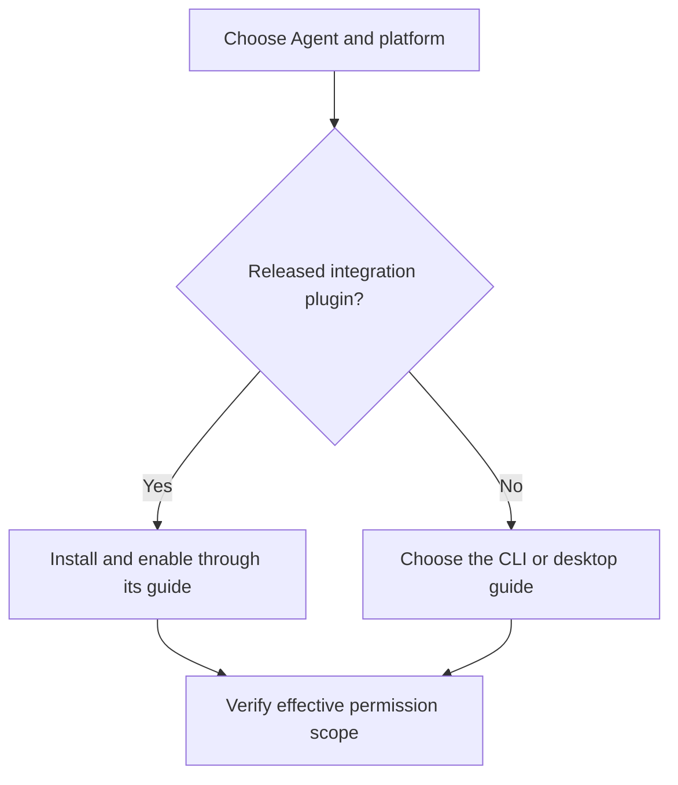

# Get started with FinShield

[简体中文](zh-CN/getting-started/install.md) · [Documentation](en/README.md) · [Product home](https://github.com/finogeeks/finsafe) · [Agent Safety Evaluation](https://agent-safety-arena.finogeeks.club/index.html) ([中文](https://agent-safety-arena.finogeeks.club/zh-CN.html))

Choose the package for your operating system. Windows offers an install assistant and an offline EXE; macOS and Linux use CLI archives. Download information was checked on 2026-11-24 against [v0.11.50](https://github.com/finogeeks/finsafe/releases/tag/v0.11.50); that release uses Windows v0.11.50 and reuses the macOS / Linux v0.11.48 builds. For later versions, follow the assets and notes in the [latest Release](https://github.com/finogeeks/finsafe/releases/latest).

## Choose an Agent and integration route

Start with the [compatibility matrix](en/agents/compatibility.md) to confirm the Agent form, platform, and version scope.

| Route | Where to start |
| --- | --- |
| Plugin (preferred) | Use the [released DSH Desktop Windows plugin](https://github.com/finogeeks/finsafe/blob/main/integrations/dsh/windows/README.md); follow its guide to install native components and confirm protection status. OpenCode Desktop uses the [released FinShield plugin](#opencode-desktop) |
| CLI | [Codex CLI (Windows)](en/agents/codex.md) and [Claude Code CLI (Windows)](en/agents/claude.md) are both supported and require no plugin |
| Desktop launcher | WorkBuddy, DSH, Hermes Desktop and OpenCode Desktop use the FinShield Console / Widget; see Windows below |
| Test plugin | [Kilo CLI local interactive TUI](#kilo-cli), with the documented test version and matching native components |
| Other Agents / platforms | Choose the [documented examples and scope](en/agents/compatibility.md); do not apply Windows commands directly |

For PII detection / redaction extensions, use the [developer kit](https://github.com/finogeeks/finsafe/blob/main/pii-plugins/README.md). It serves a different purpose from Agent integration plugins.



## Windows

These steps cover standalone FinShield installation, preparation, and desktop launch. After installation and preparation, Codex / Claude users continue with their CLI guide; they do not need to find an Agent icon in the desktop Widget.

1. Install and sign in to your Agent separately, such as Codex CLI, Claude Code, WorkBuddy, DSH, Hermes Desktop, or OpenCode Desktop. FinShield does not replace the Agent or configure its account.
2. [Download `install-finshield.cmd`](https://github.com/finogeeks/finsafe/releases/latest/download/install-finshield.cmd) and double-click it. The assistant uses English prompts. Press Enter to download the latest stable installer and verify its SHA-256 and publisher signature, confirm the administrator prompt, and follow the wizard. For offline installation, run the matching `finshield-<version>-x64-setup.exe` directly.
3. Find the desktop Widget. When it shows Not prepared, click the orb and choose Start preparation. Review and authorize permissions in the supporting Console when required. Windows may request administrator consent.
4. At Agent standby, expand the icons and select WorkBuddy, DSH, Hermes Desktop, or OpenCode Desktop. Use the Console to correct an invalid detected executable or installation directory; DSH also needs its Node.js directory.
5. Click a launchable Agent icon, wait for confirmed running status, and start work. Click its green-dot icon later to reopen the existing instance. A browser page need not remain open for daily use.

Begin with an empty test workspace. Ask the Agent to create `finshield-demo.txt` in an authorized writable directory, write “Test complete”, and read it back. Then use [Verify permission scope](#verify-permission-scope) below to check read-only and inaccessible directories.

Opening FinShield does not start a new authorization automatically. Choose Start preparation when it shows Not prepared. Agent standby means an integrated Agent can be selected. Installed, prepared, and running are separate states.

### OpenCode Desktop

On Windows x64, OpenCode Desktop can use the released `@finogeeks2026/finshield-opencode` plugin or the standalone FinShield desktop launcher. The plugin integration targets Desktop/SDK 2.3.0; check the delivered package requirements for later versions.

Save your work and close OpenCode. Install the plugin with Desktop's bundled CLI from PowerShell:

```powershell
$openCodeCli = "$env:LOCALAPPDATA\Programs\ai.opencode.desktop\resources\opencode-cli.exe"
& $openCodeCli plugin add '@finogeeks2026/finshield-opencode'
```

Choose the CLI path for the Desktop installation you actually use:

| Desktop installation | Bundled CLI path in PowerShell |
| --- | --- |
| Default per-user | `$env:LOCALAPPDATA\Programs\ai.opencode.desktop\resources\opencode-cli.exe` |
| All users | `$env:ProgramFiles\ai.opencode.desktop\resources\opencode-cli.exe` |
| Custom directory | `<Desktop installation directory>\resources\opencode-cli.exe` |

For all-users or custom installations, change `$openCodeCli` before running `plugin add`. This uses Desktop's own CLI and requires no separate CLI installation or PATH change. If your terminal already resolves `opencode`, you can also run `opencode plugin add @finogeeks2026/finshield-opencode`.

The plugin manages its matching native FinShield installation. You can follow this plugin route directly without first completing the standalone Widget installation above. For a default managed installation, the directories are:

| Purpose | Default location |
| --- | --- |
| Native FinShield programs | `%ProgramFiles%\FinSAFE\opencode-plugin-versions\<version>` |
| Native configuration | `%ProgramData%\FinSAFE\opencode-plugin-versions\<version>\config` |
| Installer downloads | `%LOCALAPPDATA%\FinSAFE\opencode-plugin\downloads` |
| Plugin instance settings | `%USERPROFILE%\.config\opencode\finsafe-windows\config.json` |

`<version>` is the matching native release, such as `0.11.50`. If you selected custom directories or set `XDG_CONFIG_HOME`, use those actual locations. OpenCode owns plugin-package storage; it is separate from the native installation directories above. The [published plugin guide](https://github.com/finogeeks/finsafe/blob/main/integrations/opencode/windows/README.md) covers its installation and update flow.

Open **Settings → FinShield**, follow the native-component installation and Windows authorization prompts, and wait for preparation to finish. Save your work, choose **Exit OpenCode**, then open OpenCode manually. Confirm the current protection status on the FinShield page. Preparation alone does not protect the current ordinary Host.

The plugin protects the execution Host while keeping Desktop Main outside AppContainer. Use **Check for updates** on the FinShield page and follow the installed version's update and reopen instructions. Disabling or removing the plugin does not undo confinement in a running Host or uninstall native FinShield; manage those separately.

To use OpenCode without the plugin, install and prepare standalone FinShield, select the detected OpenCode Desktop in the Console or Widget, and use its secure launch entry. Verify the actual Host protection after startup.

### Hermes Desktop

On Windows x64, install Hermes Desktop separately, then install and prepare standalone FinShield as above. The Console and Widget discover both registered MSIX and source-installed Hermes Desktop. Confirm the selected executable and native profile, then start it through FinShield's secure launch entry. Use Open to return to the existing desktop instance.

FinShield starts the execution Host in AppContainer and connects the ordinary desktop to it. The desktop UI itself is outside AppContainer. Starting Hermes directly is a different route and does not establish protection. This desktop launcher does not require the experimental Hermes FinShield plugin. Check allowed and denied file operations with [Verify permission scope](#verify-permission-scope).

For Hermes CLI on macOS / Linux, use the current release's CLI help and documented policy examples; the Windows desktop instructions do not apply.

### Kilo CLI

The Windows x64 integration covers Kilo CLI **7.8.27**, local interactive TUI. The documented test package is **`0.11.1-debug.6`**, with native FinShield **0.11.1**. It is a test delivery, separate from a stable marketplace release. It does not cover `kilo run`, remote attach, daemon workspaces, mini mode, Kilo Desktop, the VS Code extension, Linux, or macOS.

Save your work and close Kilo before installing the test version:

```powershell
kilo.cmd plugin @finogeeks2026/finshield-kilo@0.11.1-debug.6 --global --force
```

Reopen Kilo in your project. The plugin prepares its dedicated native installation and policy, requests Windows authorization when needed, and offers a protected restart. Choose **Later** to keep the current ordinary session. Open **FinShield** in Kilo's command palette to check preparation and actual current-process protection. When preparation is already ready, activation can restart Kilo automatically.

After an update, close and reopen Kilo to load the new plugin; disabling and enabling the plugin alone can retain an older callback. Use the same installation scope when updating. Disabling the plugin does not remove confinement from an existing process, and plugin removal is separate from native FinShield uninstall. Current-session restoration and exit acceptance remain incomplete; verify your workflow before relying on them.

## macOS

The macOS package in v0.11.50 reuses the v0.11.48 Apple Silicon build. No Intel package is included in this release.

1. Download `finshield-<version>-macos-arm64.tar.zst` from Releases.
2. Extract it with a Zstandard-capable tool and compare its checksum with `SHA256SUMS` from the same release.
3. Keep the directory structure and accompanying files. In the extracted directory, run:

```sh
./finsafe --version
./finsafe probe
./finsafe doctor
./finsafe --help
```

Add the directory to `PATH` to use `finsafe` directly. Follow that package's help and notes to launch an installed Agent through FinShield. Versions that include the Hermes shortcut support:

```sh
finsafe hermes
```

Starting Hermes directly is a different entry. See the [Linux/macOS information security overview](en/overview/linux-macos.html#data) for network and privacy-inspection coverage.

## Linux

The current public build target is x86_64 GNU/Linux.

1. Download and extract `finshield-<version>-linux-x64.tar.zst`.
2. Keep accompanying programs, especially `finsafe-helper`, `finsafe-supervisor`, and `finsafe-landlock-shim`. Do not copy only the main executable.
3. In the extracted directory, run:

```sh
./finsafe --version
./finsafe probe
./finsafe doctor
./finsafe --help
```

Linux capabilities depend on bubblewrap, cgroup, the kernel, and host authorization. Follow diagnostics and that release's host-setup instructions before using a supported FinShield launch entry. Diagnostic success does not replace an actual task check.

## Verify permission scope

Use dedicated test directories and files under the effective permissions:

| Scope | Test | Expected result |
| --- | --- | --- |
| Writable workspace | Create, read, and edit `finshield-demo.txt` | Operations succeed and changes are visible |
| Directory configured as read-only | Read a test file, then try to edit it | Reading succeeds; editing fails and the original remains |
| Directory configured as inaccessible | Try to read a test file that already exists | Reading is refused |

Judge the actual tool result, file contents, and directory state. A model's verbal refusal, a nonexistent file, or an incorrect path does not prove enforcement. Applications launched through vendor shortcuts must not be assumed protected. Network and content inspection covers only integrated, inspectable paths.

## Update and uninstall

Windows `v0.10.1` supports update checks from the Widget or Console. Automatic checks are at least 24 hours apart; manual checks are available at any time. Run the new EXE and follow its instructions for running applications, then check authorization and Agent startup. Uninstall through Windows Settings → Apps → Installed apps; the entry may use FinShield or the earlier FinSafe name.

This version sends basic usage statistics with update requests and has no statistics switch. Installers download from GitHub or CDN. See the [v0.10.1 notes](https://github.com/finogeeks/finsafe/releases/tag/v0.10.1).

On macOS and Linux, end protected tasks before replacing the extracted directory with the complete files from one version. Removing programs is separate from deleting configuration, models, certificates, or records. Follow the matching release's cleanup instructions and keep files still in use.

## Get help

When opening a [GitHub Issue](https://github.com/finogeeks/finsafe/issues/new/choose), include the product version, OS and CPU architecture, Agent name/version, launch entry, reproduction steps, expected and actual results, and redacted errors or logs.

Do not submit customer information, keys, session tokens, or complete sensitive conversations. Report sensitive security issues privately through your existing Finogeeks support channel.
