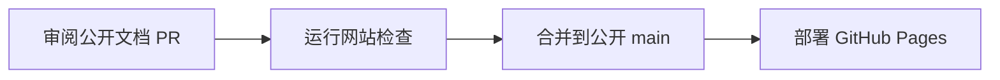

# 维护 FinShield 文档网站

[English](README.md)

网站、用户指南、插件使用说明、仓库首页、贡献指南和 `AGENTS.md` 由本公开仓库维护。直接在这里修改、审阅和合并，不需要私有仓库、私有源文件同步或产品发布。

## 源文件与检查

在 `docs/en/` 和 `docs/zh-CN/` 修改对应语言的正式文档，保持翻译、防护边界和版本范围一致。`docs/site/content.json` 只引用本公开仓库中的文件。DSH 和 OpenCode 的完整中英文教程在 `docs/site/guides/` 维护；插件 README 只保留简要安装步骤和文档入口，精简 README 不能删减网站教程。清单中的 `linkSource` 保留原文档的相对链接上下文，不是第二个内容来源。`.generated/` 是可重新生成的构建产物，不在其中修改内容。

使用 Node.js 22 或更新版本，在 `docs/site/` 执行：

```sh
npm ci
npm run check
npm run dev
```

`npm run check` 运行内容准备与 PR 分类测试，构建网站，检查所有本地链接和资源，并验证 canonical、双向语言关联、sitemap 和抓取入口。站点验收还检查语言导航、防护页面、公开架构范围、客户端元信息及损坏产物的拒绝行为。公开仓库的 Pages 工作流执行这些检查。PR 构建没有部署权限，`main` 构建通过后部署。

独立的 `*-diagram.html` 是完整 HTML，没有 VitePress 页面模块。Markdown 渲染器统一给它们的链接添加 `target="_self"`，使用同标签页原生导航；产物检查拒绝缺少此类导航声明的链接，也检查手写 HTML 链接。HTTP 直连成功不能代替客户端跳转验证。发布前从文档点击中英文共六个图解入口，检查带锚点的图解链接及返回文档；部署后在正式域名重复这些操作，并检查 sitemap 地址和资源。

导航 Logo 与 favicon 复用现有 FinShield 桌面品牌素材，原图保存在 `public/finshield-logo.webp`，不使用通用盾牌替代。防护指南分别说明机制、实际默认值、兼容性例外及证据边界；修改保护结论时保持两种语言一致。

普通读者无法打开私有研发仓库。内容准备保留引用标签作为文字，不把私有地址的 404 当成源引用不存在。渲染器修正两处已确认的第三方 GitHub 文件点击地址，保留引用的许可原文；产物检查拒绝这些不可访问地址。外站 403、临时服务错误和超时需单独核实，不当成已确认的 404，也不为消除检查告警而删除必要许可材料。



每种语言的文档页面使用同一棵侧边栏目录。正式白皮书及网页全文放在最前，不随当前页面重排分组；其他分组可以折叠，客户端换页时保留其状态。原技术白皮书保留旧 URL，作为历史机制与测评资料，与正式出版物区分；AI 全文包只保留历史链接，不重复收录旧版正文。

顶部导航与侧边栏共用 `.vitepress/config.mts` 的 `sections()` 定义，一级栏目依次为白皮书、产品介绍、使用指南、开发与集成、企业方案、资源与支持。下载和联系我们保留为顶部快捷入口。产品介绍只保留产品概览、常见问题、安全原理三个入口，平台细节从有正文的产品概览进入；原来的简短产品与安装过渡页分别合并到产品概览和安装指南。各 Agent 指南从使用指南的接入目录进入，不单独展开一组。防护配置和 PII 开发保留二级分类。

## 产品发布时的维护边界

私有研发文档与公开用户文档分开维护。产品发布更新实现代码、运行配置、脚本、二进制、版本元数据及必要的许可声明，保留公开的 Markdown 和 HTML 指南，包括插件和 PII 开发套件的 README。发布行为变化时，审阅并修改公开使用文档，不从私有快照恢复或覆盖。不能为修复链接而引入私有 Core、Windows 或桌面核心架构。

## 域名与搜索平台

### 页面摘要与机器可读来源

`page-descriptions.json` 为每个公开 HTML 路由维护一条经过审核的独立摘要，覆盖语言入口和独立图解页。键必须与生成路由清单完全一致。新增页面时为已发布的语言补齐摘要；实际存在译文后才添加语言关联。标题来自正文可见标题；导入页的标题覆盖由 `content.json` 维护。摘要说明该页的具体任务、平台和限制，不使用重复泛述或关键词堆叠。

准备步骤生成 `metadata.json`，供逐页 description、Open Graph、摘要分享卡片及 `WebPage`/`WebSite` JSON-LD 使用。客户端换页更新同一份元数据，独立 HTML 在准备阶段接收经过转义的标签。结构化数据不虚构作者、日期、评分、客户或产品保证。404 保持 `noindex`，Google 验证文件保持不变。

| 资源 | 内容范围 |
| --- | --- |
| `/llms.txt` | 语言选择与机器入口 |
| `/<locale>/llms.txt` | 按主题组织的标题与摘要，历史参考单列 |
| `/<locale>/<topic>/llms.txt` | 专题选页，如 `development`、`architecture` |
| `/<locale>/llms-full.txt` | 当前 Markdown 正文、绝对链接与来源；历史快照只列链接 |
| `/docs.json` | 各页路由、标题、摘要、语言、内容类别、规范网页与 Markdown URL |

这些资源只使用公开网站输入。代码示例保持原文；图片和外部资源保留链接，不承诺离线可用。语言入口及独立图解没有 Markdown 时对应字段为 `null`。不将内部运维材料加入索引或全文包。关键答案直接放在可见正文中，证据链接注明平台和版本范围。[使用 AI 完成集成](../zh-CN/development/ai-integration.md)提供可复用的任务提示。

`npm run check` 还会拒绝缺失或重复摘要、不一致的分享元数据或 JSON-LD、损坏的机器目录及不可用的 AI 资源链接。它验证生成产物，不验证搜索排名或外站账户状态。

### 白皮书出版物

治理白皮书在 `docs/<locale>/resources/` 下提供专题页与连续全文页。中文 PDF 是用户提供的原版，原样保存在 `public/whitepapers/`；英文译本保留原版 37 页、矢量图形、图像位置、配色和链接，只替换文字，在审阅过的区域内安排英文换行。出版物不代替当前安装与集成指南，页面保留出版版本及平台、测试范围。

`whitepapers.json` 记录各版 PDF 的版本、出版机构、字节数、页数、SHA-256、封面与页面路由。准备步骤将同一出版范围写入 `docs.json`、`resources/llms.txt` 主题和全文包。各网页使用自己的 canonical，实际存在译文才建立语言关联。保留 PDF 的抓取权限，不把 PDF 的 canonical 指向内容不等价的专题摘要页。

更新时保留原有版本化 PDF，审阅新原稿与译文，再更新对应网页、封面和清单。产物检查核对源 PDF 与发布文件的字节，验证可见预览、直接打开、下载、全文和引用入口。提 PR 前检查 PDF 版式与手机、浏览器行为；HTTP 成功不能证明浏览器支持内嵌 PDF。

`whitepapers/english-layout.json` 保存经过审校的译文、原文坐标和英文文字区域；译文应与英文 Markdown 一致。在 Python 环境安装 `pymupdf==2.2`、`fonttools` 和 `pypdf`，然后从本目录执行以下命令，生成英文 PDF、封面和 HTML 使用的 26 幅图：

```sh
python3 whitepapers/render-english.py \
  public/whitepapers/agent-security-governance-2026-11.pdf \
  public/whitepapers/agent-security-governance-2026-11-en.pdf \
  --assets-dir public/whitepapers/agent-security-governance-2026-11-en \
  --audit /tmp/finshield-english-layout-audit.json
```

脚本核对原版哈希，从原嵌入字体恢复 Unicode 映射，透明删除旧文字，并使用原字体替换英文。它拒绝小于 7pt 的字号、缺字、漏字、残留中文、原图形变化、图像位置变化和链接动作变化，同时翻译原目录书签。仍须渲染并逐页检查全部 37 页，确认无文字碰撞且清晰可读；坐标与文字检查不能代替视觉检查。核对网页的 26 幅英文图，必要时更新其尺寸，最后更新 `whitepapers.json`。中文原版保持不变。旧修订保留在 Git 历史中，公开 URL 标识 11 月版本。

### 部署后检查

`.vitepress/site.mjs` 定义正式地址 `https://finshield.finogeeks.club` 和根路径 `/`。Pages 自定义域名和 DNS 应与此地址一致，`public/CNAME` 记录域名。更换地址时，一起更新页面元信息、原始 Markdown、图解页、LLM 索引、sitemap 和 robots 抓取入口。

`public/googlea9662cdfe1496029.html` 是 Google 原始所有权验证文件。保持内容不变，在站点根路径发布，验证成功后也要保留。它不属于文档页面，也不进入 sitemap。部署后先确认文件可访问，再在 Search Console 验证网址前缀资源 `https://finshield.finogeeks.club/`，并提交 `https://finshield.finogeeks.club/sitemap.xml`。网站发布成功不代表账号验证或收录完成，见 [Google 所有权验证说明](https://support.google.com/webmasters/answer/9008080)。

构建还会从同一份路由清单生成 `/sitemap.txt`，每行一个绝对规范网址，包含独立图解页。两种格式都在 `robots.txt` 中列出，并与构建页面核对。搜索平台无法处理 XML 时，可提交文本版，再检查读取状态和发现网址数。实际抓取成功或收到提交回执，不代表 sitemap 处理或网页收录已完成。见 [Google 支持的 sitemap 格式](https://developers.google.com/search/docs/crawling-indexing/sitemaps/build-sitemap#text)。

Bing 使用平台签发的验证方式，或导入已验证的 Search Console 资源。不添加占位验证令牌或统计 ID。比较相同时长的完整统计周期，按语言、查询和落地页查看曝光、点击、CTR、排名和已收录页面。AI 回答及引用检查单独记录，`llms.txt` 不保证平台收录或回答准确。

部署后在搜索平台中检查产品、安装、WFP、Inspector、集成与企业入口，核对抓取权限、选定 canonical、语言对应、摘要和结构化数据。浏览器连续切换主题与语言，确认元数据没有停留在上一页。记录站点版本及收录错误，提交当前 sitemap，不提交废弃副本。

AI 可见性使用一组有记录的实际问题，覆盖 Agent 安装、Windows 网络／桌面限制、PII 集成和企业联系。记录引擎、日期、原始问题、回答、引用 URL，以及回答是否保留文档边界。未引用与事实错误分别处理，重复提问不等于排名趋势。站点构建不执行搜索或 AI 账户操作。

参考：[Google 摘要说明](https://developers.google.com/search/docs/appearance/snippet)、[Google AI 搜索指南](https://developers.google.com/search/docs/appearance/ai-features)、[结构化数据政策](https://developers.google.com/search/docs/appearance/structured-data/sd-policies)及 [Cloudflare AI 文档实践](https://developers.cloudflare.com/style-guide/how-we-docs/ai-consumability/)。Google 没有额外的 AI 专用 schema 或文本文件准入要求；机器导出用于直接读取文档，不保证发现或引用。
