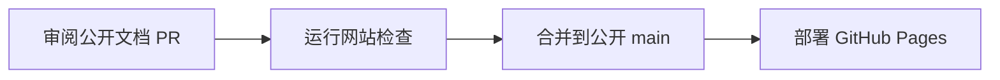

# 维护 FinShield 文档网站

[English](README.md)

网站、用户指南、插件使用说明、仓库首页、贡献指南和 `AGENTS.md` 由本公开仓库维护。直接在这里修改、审阅和合并，不需要私有仓库、私有源文件同步或产品发布。

## 源文件与检查

在 `docs/en/` 和 `docs/zh-CN/` 修改对应语言的正式文档，保持翻译、防护边界和版本范围一致。`docs/site/content.json` 只引用本公开仓库中的文件，包括公开插件文档和网站维护的译文。`.generated/` 是可重新生成的构建产物，不在其中修改内容。

使用 Node.js 22 或更新版本，在 `docs/site/` 执行：

```sh
npm ci
npm run check
npm run dev
```

`npm run check` 运行内容准备与 PR 分类测试，构建网站，检查所有本地链接和资源，并验证 canonical、双向语言关联、sitemap 和抓取入口。站点验收还检查语言导航、防护页面、公开架构范围、客户端元信息及损坏产物的拒绝行为。公开仓库的 Pages 工作流执行这些检查。PR 构建没有部署权限，`main` 构建通过后部署。



## 产品发布时的维护边界

私有研发文档与公开用户文档分开维护。产品发布更新实现代码、运行配置、脚本、二进制、版本元数据及必要的许可声明，保留公开的 Markdown 和 HTML 指南，包括插件和 PII 开发套件的 README。发布行为变化时，审阅并修改公开使用文档，不从私有快照恢复或覆盖。不能为修复链接而引入私有 Core、Windows 或桌面核心架构。

## 域名与搜索平台

`.vitepress/site.mjs` 定义正式地址 `https://finshield.finogeeks.club` 和根路径 `/`。Pages 自定义域名和 DNS 应与此地址一致，`public/CNAME` 记录域名。更换地址时，一起更新页面元信息、原始 Markdown、图解页、LLM 索引、sitemap 和 robots 抓取入口。

`public/googlea9662cdfe1496029.html` 是 Google 原始所有权验证文件。保持内容不变，在站点根路径发布，验证成功后也要保留。它不属于文档页面，也不进入 sitemap。部署后先确认文件可访问，再在 Search Console 验证网址前缀资源 `https://finshield.finogeeks.club/`，并提交 `https://finshield.finogeeks.club/sitemap.xml`。网站发布成功不代表账号验证或收录完成，见 [Google 所有权验证说明](https://support.google.com/webmasters/answer/9008080)。

Bing 使用平台签发的验证方式，或导入已验证的 Search Console 资源。不添加占位验证令牌或统计 ID。比较相同时长的完整统计周期，按语言、查询和落地页查看曝光、点击、CTR、排名和已收录页面。AI 回答及引用检查单独记录，`llms.txt` 不保证平台收录或回答准确。
