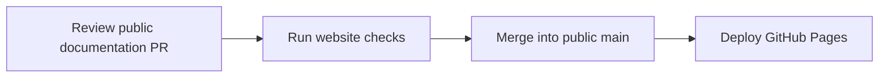

# Maintain the FinShield documentation website

[简体中文](README-zh.md)

This public repository owns the website, user guides, plugin usage documentation, homepages, contribution guides and `AGENTS.md`. Edit and review them here. No private checkout, private-source synchronization or product release is required.

## Sources and checks

Edit canonical guides under `docs/en/` and `docs/zh-CN/`. Keep translations, protection limits and version scope consistent. `docs/site/content.json` imports only files from this public checkout. The complete DSH and OpenCode tutorials, in both languages, live under `docs/site/guides/`. Their package READMEs are short installation and documentation entry points; shortening a README must not remove website tutorial content. The manifest's `linkSource` preserves the original relative-link context, not a second content source. The `.generated/` directory is disposable build output. Do not edit it.

From `docs/site/`, with Node.js 22 or later:

```sh
npm ci
npm run check
npm run dev
```

`npm run check` runs preparation and PR-intake tests, builds the site, checks every local link and asset, and verifies canonical URLs, reciprocal language alternatives, sitemap and crawler discovery. Site acceptance also checks locale navigation, protection routes, public architecture scope, client metadata and rejection of damaged output. These checks run in the public Pages workflow. Pull requests build without deployment permission; successful `main` builds deploy.



## Ownership during product releases

Private engineering documentation and public user documentation have separate owners. Product releases update implementation files, runtime configuration, scripts, binaries, version metadata and required license notices. They preserve public Markdown and HTML guides, including plugin and PII-kit READMEs. Review public usage documentation when released behavior changes; do not restore it from a private snapshot. Do not import private Core, Windows or desktop architecture to repair a link.

## Domain and search setup

`.vitepress/site.mjs` owns `https://finshield.finogeeks.club` and the root base `/`. Keep the Pages custom-domain setting and DNS aligned with that origin. `public/CNAME` records the domain. If the origin changes, update page metadata, raw Markdown, illustrated pages, LLM indexes, sitemap and robots discovery together.

`public/googlea9662cdfe1496029.html` is Google's original ownership-verification file. Publish it unchanged at the domain root and retain it after verification. It is not a documentation page or sitemap entry. After deployment, confirm the file is accessible, verify the URL-prefix property `https://finshield.finogeeks.club/` in Search Console, and submit `https://finshield.finogeeks.club/sitemap.xml`. Site publication does not prove account verification or indexing. See [Google ownership verification](https://support.google.com/webmasters/answer/9008080).

For Bing, use the platform-issued verification method or import a verified Search Console property. Never add placeholder verification or analytics IDs. Compare complete equal reporting periods for impressions, clicks, CTR, position and indexed pages, split by locale, query and landing page. Keep AI-answer citation checks separate from search metrics; `llms.txt` does not guarantee inclusion or accurate answers.
