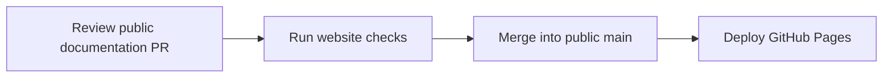

# Maintain the FinShield documentation website

[中文](README-zh.md)

This public repository owns the website, user guides, plugin usage documentation, homepages, contribution guides and `AGENTS.md`. Edit and review them here. No private checkout, private-source synchronization or product release is required.

## Sources and checks

Edit canonical guides under `docs/en/` and `docs/zh-CN/`. Keep translations, protection limits and version scope consistent. `docs/site/content.json` imports only files from this public checkout. The complete DSH and OpenCode tutorials, in both languages, live under `docs/site/guides/`. Their package READMEs are short installation and documentation entry points; shortening a README must not remove website tutorial content. The manifest's `linkSource` preserves the original relative-link context, not a second content source. The `.generated/` directory is disposable build output. Do not edit it.

From `docs/site/`, with Node.js 22 or later:

```sh
npm ci
npm run check
npm run dev
```

`npm run check` runs preparation and PR-intake tests, builds the site, checks every local link and asset, and verifies canonical URLs, reciprocal language alternatives, sitemap and crawler discovery. Site acceptance also checks locale navigation, protection routes, public architecture scope, client metadata and rejection of damaged output. These checks run in the public Pages workflow. Pull requests build without deployment permission; successful `main` builds deploy.

Standalone `*-diagram.html` pages are full HTML documents. Their Markdown links must use native same-tab navigation (`target="_self"`); they have no VitePress page module. The Markdown renderer applies this automatically, and the output checker rejects unsafe links, including handwritten HTML anchors. A successful direct HTTP request does not test client navigation. Before publication, click all six bilingual diagram entries from a documentation page, follow an anchored diagram link, and return to the documentation. After deployment, repeat these checks against the live domain as well as checking sitemap URLs and resources.

The navigation logo and favicon reuse the existing FinShield desktop brand artwork unchanged, stored as `public/finshield-logo.webp`. Do not replace it with a generic shield. Capability guides describe mechanisms, effective defaults, compatibility exceptions and evidence limits separately; keep both languages consistent when changing a protection claim.

Public readers cannot open the private engineering tracker. Content preparation keeps its citation labels as plain text; it does not assume a private 404 means a reference is missing. The renderer corrects two known third-party GitHub file targets while preserving quoted license text. The output checker rejects these inaccessible targets. External 403 responses, transient server errors and timeouts require separate verification; do not report them as confirmed 404s or remove required license material.



Each language uses one stable sidebar tree across documentation routes. Keep the formal whitepaper and its web full text first; do not reorder groups when readers change pages. Other groups stay collapsible and retain their state during client navigation. The former technical whitepaper keeps its URL as a historical mechanisms/evaluation reference, separate from the formal publication; AI bundles link to it without reproducing superseded body text.

The sidebar has seven primary sections from `sections()` in `.vitepress/config.mts`: Whitepaper, Product, User guides, Developers, Technical blog, Enterprise and Resources. The top navigation follows the same order after omitting Whitepaper, and ends with Contact. The whitepaper remains first in the sidebar; downloads remain in installation and Resources, keeping both out of the top navigation. Product contains only the overview, common questions and security mechanisms. Platform details are linked from the substantive overview; the former short product and installation landing pages are consolidated into the overview and installation guide. Individual Agent guides are reached through the integration index in User guides. Protection settings and PII development are nested within their relevant sections.

Engineering articles and their index live under `docs/<locale>/blog/`. The language home pages feature them after the goal selector and before security mechanisms. Current content is outline-only: label cards, pages and discovery summaries accordingly; do not present planned experiments as completed results. The first outline covers AppContainer child-process compatibility and preserves pinned public AgentScope, Hermes, DSH and OpenCode examples. The former draft path links to the canonical bilingual pages instead of maintaining another copy. Card links use explicit locale-prefixed HTML routes because raw HTML links do not receive Markdown link rendering. Keep featured links, summaries and translated routes consistent. When full articles are added, distinguish mechanism analysis, proposed verification and recorded evidence. The blog has its own `blog/llms.txt` topic; add reviewed page summaries alongside new pages. Home and blog indexes hide the right outline, while individual pages retain it for chapter navigation.

## Ownership during product releases

Private engineering documentation and public user documentation have separate owners. Product releases update implementation files, runtime configuration, scripts, binaries, version metadata and required license notices. They preserve public Markdown and HTML guides, including plugin and PII-kit READMEs. Review public usage documentation when released behavior changes; do not restore it from a private snapshot. Do not import private Core, Windows or desktop architecture to repair a link.

## Domain and search setup

### Page summaries and machine-readable sources

`page-descriptions.json` owns one reviewed summary for every public HTML route, including the root language page and standalone diagrams. The route keys must match the generated route inventory exactly. Add summaries for each published language; advertise a translation only after it exists. Page titles come from the visible source heading or title, with imported-page title overrides in `content.json`. Avoid generic repeated summaries and keyword lists; describe the page's actual task, platform and limits.

Preparation generates `metadata.json` from those sources. The site uses it for each page's description, Open Graph, summary sharing card and `WebPage`/`WebSite` JSON-LD. Client navigation updates the same metadata; standalone HTML receives escaped metadata during preparation. Do not invent authors, dates, ratings, customer references or product guarantees for structured data. The 404 page remains `noindex`, and Google's verification file remains unchanged.

| Resource | Scope |
| --- | --- |
| `/llms.txt` | Language selection and machine-resource entry points |
| `/<locale>/llms.txt` | Page titles and summaries grouped by topic, with historical references separate |
| `/<locale>/<topic>/llms.txt` | Focused page selection, such as `development` or `architecture` |
| `/<locale>/llms-full.txt` | Current Markdown bodies with absolute links and source attribution; historical snapshots have links only |
| `/docs.json` | Route, title, summary, language, content kind, canonical URL and Markdown URL for each public page |

These files use only public website inputs. Code examples retain their original text. Images and external resources are linked, not included for offline use. Root and standalone diagram records have a `null` Markdown URL. Do not add private operations material to an index or bundle. Keep each page's key answer in its visible main text and link to evidence with its platform/version scope. The [AI integration guide](../en/development/ai-integration.md) provides a reusable task prompt.

`npm run check` also rejects missing or duplicate descriptions, inconsistent social metadata or JSON-LD, damaged machine catalogs and broken AI-resource links. This verifies generated files, not search ranking or external account state.

### Published whitepapers

The governance publication has a landing page and one continuous full-text page per language under `docs/<locale>/resources/`. The Chinese PDF is the supplied publication, copied unchanged into `public/whitepapers/`. The reviewed English translation retains the original 37 pages, vector figures, image placements, colors and links. Only text is replaced; English wraps within reviewed regions. Neither publication replaces current installation or integration guides. Keep the dated edition and platform/test limits visible.

`whitepapers.json` records each PDF's edition, publisher, byte count, page count, SHA-256, cover and page routes. Preparation adds the same publication scope to `docs.json`, the `resources/llms.txt` topic and text bundles. Each web page uses its own canonical URL; language alternatives exist only for real translations. PDF indexing remains allowed. Do not point a PDF canonical at the short landing-page summary.

To update a publication, retain its prior versioned PDF, review the new source and translation, then update the matching pages, cover and manifest. The checker compares source and built PDF bytes and checks the visible preview, direct-open fallback, download, full text and references. Inspect PDF rendering and mobile/browser behavior before the PR; an HTTP response alone does not prove inline PDF support.

`whitepapers/english-layout.json` stores the reviewed translation, source text geometry and English placement regions. Keep its wording consistent with the English Markdown. To regenerate the PDF and its 26 illustrated HTML figures, install `pymupdf==2.2`, `fonttools` and `pypdf` in a Python environment, then run from this directory:

```sh
python3 whitepapers/render-english.py \
  public/whitepapers/agent-security-governance-2026-11.pdf \
  public/whitepapers/agent-security-governance-2026-11-en.pdf \
  --assets-dir public/whitepapers/agent-security-governance-2026-11-en \
  --audit /tmp/finshield-english-layout-audit.json
```

The renderer verifies the original source hash, restores Unicode maps from its embedded font subsets, replaces text with transparent redactions, and uses the original font families. It rejects text below 7pt, missing text/glyphs, untranslated text, altered artwork, changed image placements or changed link actions. It also translates the original outline. Review all 37 rendered pages for text collisions and legibility; geometry and text checks alone do not prove visual quality. Inspect the 26 English HTML figures, update their dimensions if needed, and update `whitepapers.json` only after checking the final output. Keep the supplied Chinese PDF unchanged. Previous publication revisions remain available in Git history; the public URL identifies the November edition.

### After deployment

`.vitepress/site.mjs` owns `https://finshield.finogeeks.club` and the root base `/`. Keep the Pages custom-domain setting and DNS aligned with that origin. `public/CNAME` records the domain. If the origin changes, update page metadata, raw Markdown, illustrated pages, LLM indexes, sitemap and robots discovery together.

`public/googlea9662cdfe1496029.html` is Google's original ownership-verification file. Publish it unchanged at the domain root and retain it after verification. It is not a documentation page or sitemap entry. After deployment, confirm the file is accessible, verify the URL-prefix property `https://finshield.finogeeks.club/` in Search Console, and submit `https://finshield.finogeeks.club/sitemap.xml`. Site publication does not prove account verification or indexing. See [Google ownership verification](https://support.google.com/webmasters/answer/9008080).

The build also publishes `/sitemap.txt`, with one absolute canonical URL per line from the same route inventory, including standalone diagrams. Both formats are listed in `robots.txt` and checked against the built pages. If the search platform cannot process the XML sitemap, submit the text version and verify its reading status and discovered URL count. A successful live fetch or submission receipt does not prove sitemap processing or page indexing. See [Google's supported sitemap formats](https://developers.google.com/search/docs/crawling-indexing/sitemaps/build-sitemap#text).

For Bing, use the platform-issued verification method or import a verified Search Console property. Never add placeholder verification or analytics IDs. Compare complete equal reporting periods for impressions, clicks, CTR, position and indexed pages, split by locale, query and landing page. Keep AI-answer citation checks separate from search metrics; `llms.txt` does not guarantee inclusion or accurate answers.

Inspect the product, installation, WFP, Inspector, integration and enterprise URLs in the search-platform tools after deployment. Confirm crawl access, selected canonical, language alternatives, snippet text and structured-data validity. Test client navigation between different topics and languages so metadata does not stay on the previous page. Record the site release and any indexing errors; submit current sitemap URLs rather than deprecated copies.

For AI visibility checks, use a recorded set of realistic questions about Agent installation, Windows network/desktop limits, PII integration and enterprise contact. Record the engine, date, exact question, answer, cited URL and whether the answer preserves the documented scope. Treat a missing citation separately from a factual error. Repeating a question does not establish a ranking trend. No search or AI account actions run during the site build.

References: [Google snippets](https://developers.google.com/search/docs/appearance/snippet), [Google AI search guidance](https://developers.google.com/search/docs/appearance/ai-features), [structured-data policies](https://developers.google.com/search/docs/appearance/structured-data/sd-policies), and [Cloudflare AI-readable documentation](https://developers.cloudflare.com/style-guide/how-we-docs/ai-consumability/). Google requires no special AI schema or text file for AI search eligibility; machine exports support direct document use and do not guarantee discovery or citations.
