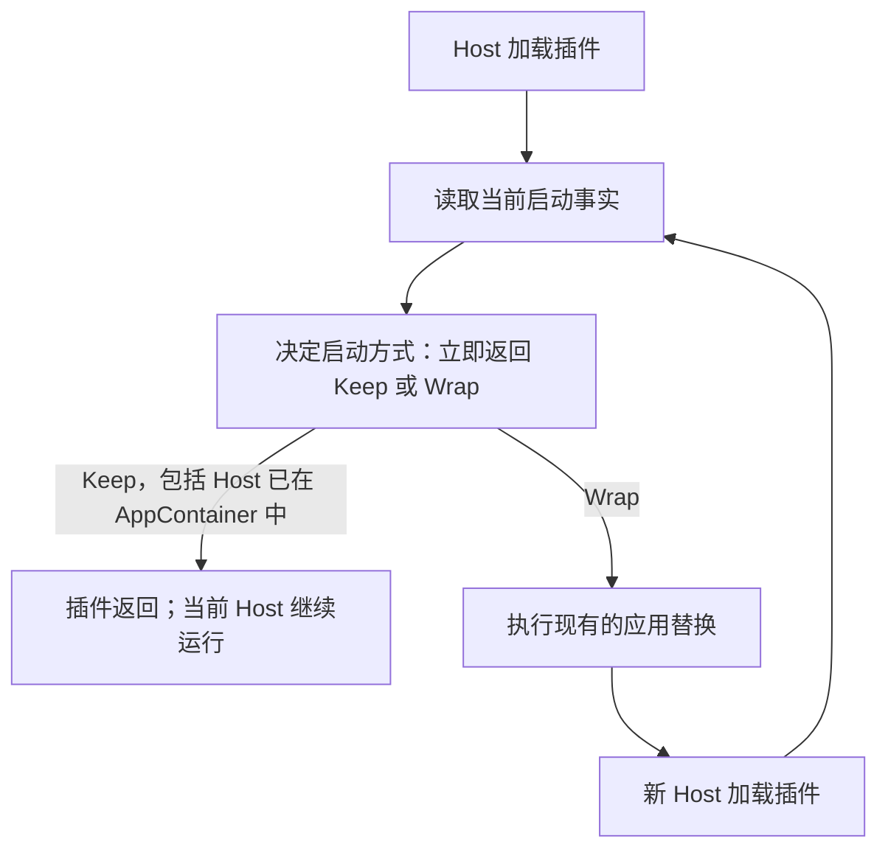
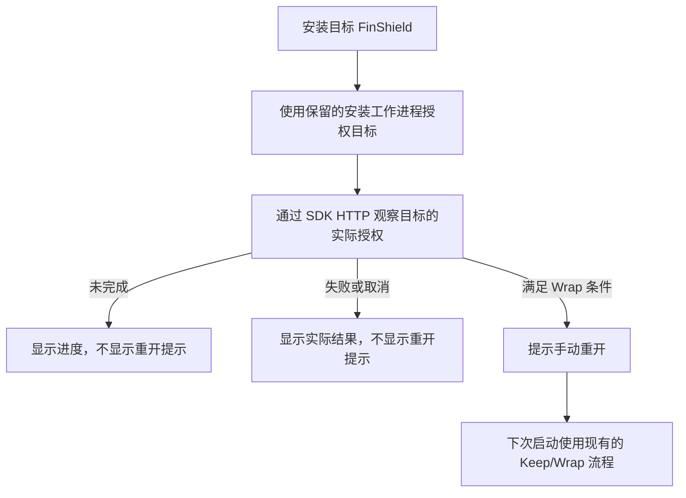
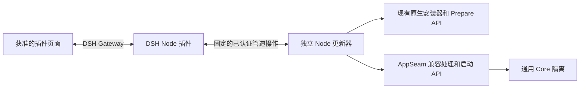
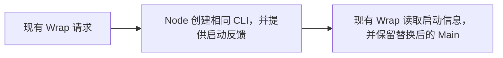
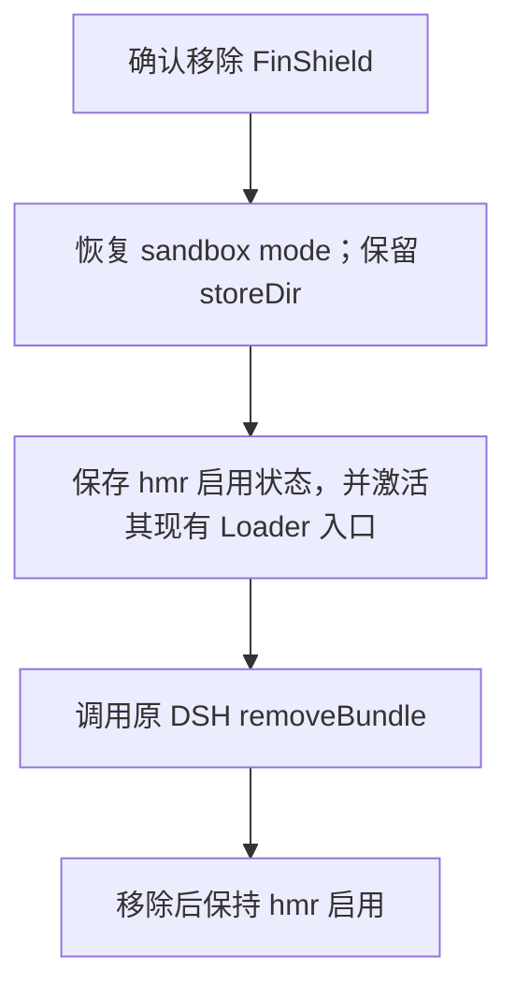
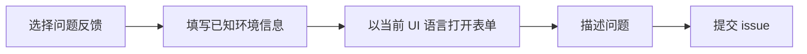
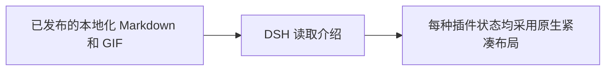

# DSH Desktop 的 FinShield：设计与运行

[English](https://github.com/finogeeks/finsafe/blob/main/integrations/dsh/windows/DESIGN.md)

## DSH 激活修正，2026-11-24

本次修订恢复 DSH 的启动和更新顺序。若下文较早的激活与查询顺序与此处冲突，以本次修订为准。共享更新器增加一个可选输入 `prepareUpdates`，仅由 DSH 启用。其他插件行为、SDK、AppSeam、Core、HMR 和选定的安装路径保持不变。隔离能力没有变化，平台功能矩阵无需更新。

插件先采样 `appReady`，并注册状态、命令和清理，再等待现有的共享激活操作。Keep 会将控制权交还 DSH Loader。纯决策返回 Wrap 后，更新器停止旧 Main，然后直接执行现有的替换启动。DSH 准入使用原有的 `onStopped` 交接，不等待保留替换后的 Main。新的 AppContainer Host 选择 Keep 并完成加载。替换过程不等待新 Host 绑定。

现有共享 `decideStartup()` 保持不变：AppContainer Host 始终选择 Keep，不读取授权。普通 Host 仅在选定授权完成时选择 Wrap，否则选择 Keep。下文的启动工作流将输入读取、纯决策和替换执行分开。对 DSH，更新器立即收到纯决策，执行 Wrap，并在原有的 Main 停止交接点回复。运行期激活仍跳过启动准入；AppContainer Host 仅连接现有的普通更新器。共享协调器继续拥有会话和 Main。DSH 适配器只将现有的 `onStopped` 交接转发给等待中的准入请求。原生 `stop_main`、其 10 秒退出等待以及 HMR 行为保持不变。

范围：DSH 激活工作流。输入：当前 Host 和显式选择。输出：启动准入后返回 Keep、旧 Main 停止后返回 Wrap，或实际操作错误。状态注册和查询独立于启动完成。后台安装和授权不延迟 Keep。

替换节点使用 `updater/launch.js`：停止 Main，发出原有的 `onStopped` 交接，禁用 HMR，打开工作监听器，再通过 FinShield 启动并保留替换后的 Main。Main 停止后，插件回复、页面请求或新 Host 绑定均不作为启动门槛。替换失败时，沿用共享启动工作流的错误报告和清理分支。

| 流程节点 | 现有实现 |
| --- | --- |
| Host 加载插件；Keep 返回 | `src/desktop.js`：`apply()` 等待 `activation.start()` |
| 读取当前启动事实 | 共享激活和更新器 `admit()`；AppContainer 跳过授权读取 |
| 决定启动方式 | 共享同步 `decideStartup()`；保持不变 |
| 执行现有的应用替换 | 共享 `executeStartup()` 拥有该操作；由 `updater/launch.js` 执行 |
| 原有的 Main 停止交接 | DSH `updater/coordinator.js` 转发 `onStopped`；服务器等待准入 |
| 新 Host 加载插件 | 相同入口和当前 AppContainer 令牌选择 Keep |

DSH 与 OpenCode 使用相同的共享请求错误传播策略。准入和管理命令错误属于调用诊断，不是授权结果。适配器保留本次激活的启动诊断，并保留最近一次命令诊断，直到命令成功。建立绑定后，即使准入超时或 Exit RPC 失败，仍继续读取状态。新的激活不继承这些诊断。查询错误传播到现有的 DSH 状态边界，该边界将当前 Host 令牌证据单独保留。查询失败和命令失败均不触发重试或另一次 Wrap。

原生调用和 HTTP 调用均通过现有的共享包加载器加载同一个插件自有 SDK。对于固定的 0.11.6/0.11.8 纯脚本复制布局，DSH 适配器向加载器提供已安装的 DSH 插件包作为来源。它不搜索配置档案级 SDK，也不使用其他插件的依赖。这是固定布局映射，不是文件存在性或版本预检查。普通包和自包含暂存包仍使用各自的来源。这样可恢复旧发送方的加载，而不增加后继版本激活路径。

插件、其 SDK 和正常选定的 FinShield 使用同一个发布版本。现有的显式更新是唯一的跨版本操作：插件 A 和 SDK A 安装并授权 FinShield B。该操作不加载 SDK B，也不激活插件 B。原生调用前不增加新的文件、版本或布局准入检查。

### 更新准备完成，2026-11-24

负责人恢复了 DSH 较早的完成边界：只有满足现有 Wrap 条件的目标，才可提示用户重新打开 DSH。文件已安装但授权仍待完成，不满足此边界。本次修订取代共享手动重开修订中 DSH 仅安装即完成的行为。

范围：已加载插件请求的更新。输入：显式目标版本和当前原生状态。输出：实际准备进度、失败、取消，或针对已准备目标的重开提示。启动仍使用上文未更改的 Keep/Wrap 流程。

DSH 在共享协调器上启用 `prepareUpdates`。显式更新请求随后继续执行现有的后端和授权操作，不再在安装后以 `authorizationPending: true` 返回 `ready`。`updater/server.js` 已将安装器保留的工作进程交给现有 Desktop 授权入口。在当前会话结束前复用此交接。原生授权仍负责同意、完成和有效性；现有 SDK HTTP 观察提供进度和最终结果。其他调用方的该选项默认为 false。不引入更新器或后继插件激活、额外启动检查、轮询循环或新的授权机制。已安装产品的升级验收仍与单元测试结果分开。

DSH 适配器还移除了此前基于 Host 脚本名称/平台的拒绝、启动器的平台/架构预检查，以及 Node 可执行文件/目录元数据预检。Node 和 Windows 直接接收选定路径，并报告实际加载或进程创建错误。直接读取设置；只有可选设置文件不存在时，才使用现有默认值。移除未使用的 JavaScript 安装记录/版本/路径评估和第二次暂存版本比较。可选安装结果也直接读取，不先探测文件是否存在。后台安装选择仍由现有原生所有者负责。IPC 认证、外部输入解析、下载完整性和授权准入继续位于现有边界。

定向测试覆盖延迟获取和准入、经共享更新器和 DSH 页面存储传递的 HTTP 进度及最终结果、错误保留，以及旧复制布局的加载。已安装产品的启动、替换和授权验收仍单独进行。共享协调器针对匹配受保护目标的观察捷径不在本次 DSH 专用修正范围内；本次修订不声称该分支现在能观察到外部授权变化。

修订日期：2026-11-21。本文描述此包中的 Node 插件和独立 Node 更新器。单元测试和自有测试夹具检查不能证明已安装产品通过验收。负责人执行安装、Windows 同意、重启和升级检查。

共享代码提取（2026-11-17，负责人批准的修正）：此插件仅包含 Node/JavaScript 实现及其页面/配置资源，没有 Rust crate、原生构建命令或插件专用 DLL。声明的[公开 Node SDK](https://www.npmjs.com/package/@finogeeks2026/finsafe-sdk) 携带个人版的 `finsafe_native.dll`。Prepare、Execution 和 Installer 负责共享原生操作；AppSeam 负责 DSH 发现、对端验证和兼容处理。现有个人版 CLI 包构建共享 C 调用边界。显式选定的安装/配置输入、单例规则和生命周期保持不变。SDK 发布和已安装产品验收单独记录。

包交付，2026-11-21：DSH 从其运行时提供 Schemastery。Schemastery 继续作为声明的可选对等依赖以兼容宿主，同时作为开发依赖供编写时使用。可选对等依赖元数据可防止 npm 自动安装另一个宿主 schema 包。DSH 加载插件时仍需要该 API。从选定的 DSH 运行时解析 Schemastery，包括旧的自更新发送方加载私有后继副本时。不要依赖配置档案或原 pnpm 目录中的对等包。Node SDK 负责固定版本的 Koffi 及其 Windows x64 原生包。Host 绑定使用 SDK 的公开 `loadKoffi` 入口。更新器暂存复制完整 SDK，不从 DSH 解析 Koffi。唯一的常规安装依赖是 FinSAFE Node SDK，DSH 不提供它。Host 绑定将声明的完整 SDK 复制到进程私有快照，包括代码、DLL 和依赖。快照的包名和版本必须与插件的精确依赖匹配；不匹配时报告两边的标识并停止加载。恢复方法是完成匹配的包更新，然后重新打开 DSH。从该快照解析公开 SDK 入口。令牌观察、原生适配器、Host DLL 副本和更新器暂存均使用同一 SDK 快照。依赖提升更新不能替换其文件，也不能复用旧模块的命名空间。这不增加生命周期状态、依赖回退或新的准备操作。SDK 从自身的进程私有临时副本加载 Koffi，防止 Windows 占用可移除包的原生扩展。首次原生加载同步复制约 2.83 MB；现有 Host DLL 和更新器暂存仍采用异步方式。

其余宿主依赖各有用途：

| 依赖 | 来源与用途 |
| --- | --- |
| Node 可执行文件 | DSH 实际选定的运行时，由更新器在原位置执行 |
| Schemastery | 声明的可选对等依赖；使用 DSH 的配置 schema 契约 |
| React 和 DSH UI 基础组件 | DSH 客户端模块加载器；在 DSH 内渲染 |
| DSH home、Typert、app-boot 和 atomic-write 模块 | 配置档案、RPC 和移除操作的宿主集成 |
| YAML | DSH 依赖树；移除时编辑宿主的补丁格式 |
| FinSAFE Node SDK 和 Koffi | 插件声明的 SDK 交付；独立于 DSH 的 Koffi |

本次更改移除了对宿主 Koffi 的依赖，但不会使 DSH 插件独立于 DSH API，也不会把第二套宿主框架复制到插件中。

共享 Node 更新器提取，2026-11-20。共享的激活、获取、协议和协调器源码位于 `integrations/common/windows`。构建暂存将这些模块交付到此包的 `updater/common` 目录内。DSH 保留其应用适配器、appReady 采样、操作完成事件、HMR 和包移除集成。现有进程、Job、通信和替换契约继续作为基准。提取后的已安装产品验收尚未完成。

配置修订 #1094，2026-11-14 批准：使用[规范配置算法](#appseam-设置)更新当前文件、尽力创建同级备份，并仅清理指定字段。源码和自有测试夹具检查实现了本次修订；已安装产品验收尚未完成。应用配置不再读取独立的原始字段记录，也不再使用基于历史所有权的门槛。

Host 自更新（源码已实现，已安装产品验收尚未完成）：`apply` 注册更新协调器。启用状态下的自更新完成且 HMR 不存在时，可从 `<profile.dir>/.finshield-runtime/<version>/` 加载后端代码，并替换其受管理实例，无需重启 DSH。插件先等待现有原生恢复操作。导入失败时保留旧实例；新激活失败时尝试恢复其缓存的前任实例并记录错误。注册和激活均尽力执行，不自动重试。下载、包安装、DSH、HMR 和原生保护规则保持不变。这不会刷新 Client 模块，也不会抑制 DSH 要求重启的结果。首个包含监听器的版本需要正常加载一次。负责人已批准版本化副本目录；不引入自动目录清理。

SDK 迁移兼容（2026-11-17）：0.11.6 和 0.11.8 发送方在加载后继版本前复制 `src`、`updater`、`install`、`policy` 和 `bin`。交付的纯 Node 包保留 `bin/README.md`，使现有复制契约成功。该目录不包含 DLL。后继版本从配置档案的依赖中解析 SDK；原生安装和 Restart 保留其流程。

当前源码生命周期（#1075；已安装产品验收尚未完成）：Keep 不再将 Main 分配到更新器 Job；通过 Wrap 启动的 DSH 也在该 Job 外启动。更新器通过异步退出等待观察保留的 Main 进程句柄。Main 退出使更新器结束；更新器退出或启动恢复不停止 DSH。更新器 Job 仍负责更新器及其安装工作的启动发现和清理。参见[生命周期所有权摘要](#组件与所有权)。负责人于 2026-11-21 批准的当前状态修订 [#1159](https://github.com/Geeksfino/finsafe/issues/1159)：[共享激活与 Startup 决策](#激活与就绪状态)取代历史 Job、保留和 Keep 阶段门槛。Main 所有权和 #1075 生命周期机制保持不变。[DSH 页面观察契约](#页面观察与呈现)取代页面本地业务阶段，以及读取失败时编造的保护状态。这两项修订均已在源码实现；原生产品验收尚未完成。历史源码和测试夹具结果不能验证这些修订。

选定的 FinSAFE Desktop CLI 与 Widget、Console 调用同一个快速返回授权函数。每两秒观察一次原生任务状态和进度。这些读取不重新提交授权。通用更新器可服务较新的插件，并选择版本化的原生安装目标。

更新器是独立的普通 Node 进程，始终在 AppContainer 外运行。Main 独立退出时，更新器立即退出。页面 Restart 在停止旧 Main 并将其替换期间保留更新器。Setup 加入同一个会话 Job，因此更新器退出会停止安装。已受理的授权保持独立，并在更新器退出后继续执行。更新器直接调用其异步 DLL 安装入口。没有结果宿主或安装观察进程。NSIS 加入会话 Job 并关闭其临时句柄；更新器持有该 Job 唯一的长期句柄。仅移除插件不等于 Main 最终退出。FinSAFE 不重新加载 Host。

插件静默安装显式复用现有的安装工作进程交接。安装成功后，Desktop CLI 接收该描述符并将其传给现有 AuthoritySession。已提交的授权及其 FinSAFE 所有者仍独立于更新器。因此，正常首次安装可以复用一次 Windows UAC 同意。Prepare、工作进程检查和个人版默认值保持不变。

安装终止恢复推迟到问题 #1016。本次更改不增加自动中断检测、修复或回滚。有现有原生结果时，继续显示该结果。可能残留部分文件或配置；后续工作应先评估重新运行现有完整安装器。

所有 DSH 启动都使用同一个初始化流程。启动来源不得决定行为。当前令牌和同步 appReady 采样决定阶段。启动 Wrap 仅用于已经就绪的普通 Host；Main 始终位于更新器 Job 外。参见[启动时的 Wrap 与 Keep](#激活与就绪状态)。

FinShield 使用 FinSAFE AppContainer 隔离 DSH Host 及其工具。继续使用原有 Desktop、图标、账号和会话。Main 保持为普通进程。Core 不包含 DSH 专用的启动或权限决策。

## 组件与所有权

范围：组件连接。输入：已启用的 DSH bundle。输出：观察到的状态、Keep、Wrap 或会话退出。安装和启动算法属于子流程。

DSH 负责包选择、启用、加载和释放。Host 入口注册页面服务和清理，然后安排初始化。更新器负责原生任务附加和进度观察。页面 Restart 仅停止旧 Main，并使用 AppSeam 启动及保留其替换进程。Node SDK 调用共享个人版 DLL，执行原生传输、身份/生命周期检查和现有产品操作。它不是原生更新器守护进程。个人版 Shell 没有插件监听器；`finsafe desktop-channel` 已移除。

插件没有独立版本序列。必需的 npm version 字段使用 FinSAFE 根发布版本；发布准备同步包及锁定元数据，G0 拒绝版本偏差。支持 DSH `>=0.2.1-rc.5 <0.3.0` 和更新器协议 1。包版本和协议标签不作为更新器复用的门槛。受保护激活使用当前 Host 令牌，不要求新发布的原生版本。原生目标版本由请求插件选择，不由更新器包版本选择。

## 安装实例与路径

可通过 DSH 的“添加插件”入口及其市场安装。插件从当前请求的版本和实际 Windows 已知文件夹派生路径，不提供安装路径配置。插件不持久化或重新加载第二份设置快照。Host 将派生路径传给已认证的更新器；更新器为当前操作保留目标。旧插件可使用该操作的显式目标安装较新的原生版本。安装注册和授权记录继续由其原生所有者负责。安装结果保持为诊断输出，绝不决定下一次安装。

范围：插件设置解析。父流程：激活和管理。输入：请求版本和 Windows 已知文件夹。输出：显式操作路径。程序和 SDK 错误保持可见。默认路径不依赖先前执行。平台隔离行为保持不变。

安装目录决定使用哪个现有原生记录、已安装版本、更新策略和卸载所有权。配置目录决定 Candidate/Effective YAML。用户 SID 加上 `security_domain_id: finshield.dsh` 决定原生安全资源。不同目录可存放不同版本，但若用户/域 ID 相同，就共享授权。个人版配置、快捷方式、报告和更新默认值保留现有行为。位于其他位置的个人版安装不能替代此记录。

| 内容 | 解析位置 |
|---|---|
| DSH desktop 配置档案 | `<DSH_HOME>/profiles/desktop/` |
| 插件安装诊断 | `<DSH_HOME>/finsafe-windows/` |
| 原生运行时，默认位置 | `<ProgramFiles>/FinSAFE/dsh-plugin-versions/<release>/` |
| 原生配置，默认位置 | `<ProgramData>/FinSAFE/dsh-plugin-versions/<release>/config/` |
| 已验证的安装程序及结果 | `<LocalAppData>/FinSAFE/dsh-plugin/downloads/<version>/` |
| Node SDK、Koffi 和更新器代码 | `<LocalAppData>/FinSAFE/dsh-updater/<version>/` |
| 在原位置复用的 Node 可执行文件 | DSH Host 实际选定的主运行时 |
| 可选配置备份，#1094 已实现 | `<DSH_HOME>/profiles/desktop/cordis.patch.yml.back` 和 `pnpm-workspace.yaml.back` |
| 旧版 AppSeam 原始字段记录，已不再使用 | `<LocalAppData>/FinSAFE/AppSeam/dsh-originals/`；不是目标启动输入 |

这些是模板，不是特定机器的路径。DSH home 解析器和实际 Host 命令行决定 home、配置档案、选定运行时和可用 Node。原生 Windows 已知文件夹决定用户和系统根目录，包括已迁移的文件夹，不使用 AppContainer 包重定向。内部提供绝对实例操作输入。原生文件解析提供资源比较键；Node 不删除扩展路径前缀，也不重建驱动器/用户路径。向安装、准备、兼容处理和启动显式传递 `DSH_HOME`。普通引导直接使用选定的 DSH Node。Setup 在该更新器中通过现有 DLL 运行；运行时操作不需要额外 Node 进程或 PowerShell。应用路径保留普通 DOS/UNC 写法。原生句柄/File ID 检查与传给安装和 Desktop 授权的值保持分离。

普通 Host 在原位置执行其实际选定的 DSH Node。每个包版本将声明的 Node SDK、其自带 Koffi 和所需脚本复制一次到插件包之外。复用现有副本，不扫描内容或计算哈希。不创建 Node 副本、哈希清单或完整版本指纹。版本化的 Host 私有 SDK 库副本可避免 pnpm 移除时持续占用包内 DLL。两类副本的文件 I/O 均异步执行。已发布包版本用于标识这些文件；同版本修改字节不是刷新方式。更新器依赖选定 DSH 运行时持续可用。Node 缺失或不可用时，报告启动错误；不下载单独运行时。暂存不验证包来源的真实性；参见已接受的漏洞。

## 激活与就绪状态

范围：一次后端激活。输入：当前 Host 和选定实例。输出：Keep、Wrap、Host 绑定、运行期场景，或实际错误。规范路由：[共享激活](#激活与就绪状态)。规范 DSH 子流程：[启动期和运行期](#激活与就绪状态)。

在入口处、首次异步操作之前同步采样 `appReady`；保留现有的 false/unknown/error 默认处理。受保护 Host 根据其实际令牌连接现有更新器。普通运行期激活跳过 Startup 决策；普通启动使用当前选定目标的就绪状态决定 Keep/Wrap。现有更新器、未变化的 Main、先前的 Keep/Wrap 和已完成工作均不能证明当前处于运行期。移除 `mainRetained`、`session.keep`、其提前返回以及其他地方未使用的 Keep 确认；不增加替代性的历史标志或磁盘记录。

Keep 完成 `apply`、建立绑定，并进入本次激活的 Running 准备。Main 保持在更新器 Job 外，使用经过验证的进程句柄所有权和异步退出等待。完成与状态不重复 Startup 决策；新激活再次使用当前 Host 令牌、阶段和就绪状态。将同一次激活重复附加到同一存活 Host 时，可以复用。不同 Host 即使 Main 未变，也需要经过验证的附加和实际令牌观察。

Loader 入口在自更新前后负责当前操作完成。保留匹配的 `started`/`settled`、旧发送方当前有效的完成交接，以及独立目标就绪状态。任何单一条件均不足以允许运行期 Restart。不增加事件超时、重放、轮询、恢复或就绪检查。

AppContainer Host 只能连接现有的外部更新器，不能引导普通进程，也不能自行安装。已认证的更新器暂存更新，并保留已确认的原生转换。保护观察使用 TokenIsAppContainer。更新器不可用是实际错误，不会移除 Host 已有的保护。

启动先读取安装，再读取授权。目标缺失或不匹配时，当前 DSH 选择 Keep，不调用缺失的可执行文件；准备属于运行期。安装或授权读取错误也选择 Keep，保留原始错误，不拒绝 `apply`。运行期评估通过现有原生 API 读取选定安装。存储的安装记录仅用于诊断：恢复或等待旧结果不得阻止后续尝试。运行时缺失或不匹配时，使用经过验证的发布下载和完整静默 NSIS 安装。安装器保留提权、CA、Service、Defender、Restart Manager、取消和重启语义。插件禁用原生自更新，并省略集成输出。安装成功后，调用选定安装中的共享 Desktop 授权入口。Service 配置和维护仍是安装器操作；更新器不检查 SYSTEM Service 进程。它不解包安装器，也不重写安装/授权算法。

Prepare ensure/status 保留原生任务附加、原生已完成状态复用、实际结果和百分比计算。Node 仅共享匹配的活动工作。在激活/新 Host 附加及现有准备结果事件时，重新评估适用性。实际安装和授权保留原生有效性规则。已完成的保护仅属于其经过验证的 Host。联合审查 `beginAssessment`、`session.items`、`satisfied` 和 `restartPolicy`；新的普通 Host 不能继承旧保护或 `restartPolicy:never`。适用时保留已就绪操作和“稍后”关闭状态，不重复工作。安装或配置的冲突修改必须明确失败。打开页面仅观察状态；未知百分比保持不确定。不增加重试直到成功的循环或 Console/授权按钮。可选进度标题根据原生阶段显示安装或授权，并在可用时包含原生百分比。

页面关闭和页面 Restart 后，更新器继续运行。Main 独立退出使更新器结束。现有原生引导启动选定的普通 Node；不得使用进程分离来逃离 AppContainer 身份。每个更新器槽仅以 FinSAFE ID 为键。命名空间和对端用户/登录/会话检查与该键保持分离。更新器独立于 Inspector，没有自动启动、看门狗服务、SYSTEM 服务或生命周期锁。Main 最终退出和停止信号使更新器退出，不等待独立授权；随后原生操作系统停止其安装进程组。跨插件版本复用更新器，不通过插件版本比较替换它。

## IPC 与绑定目标

原生适配器使用 Windows 解析的 LOCAL/AppContainer 命名空间、显式 ACL、客户端仅数据访问、最大 16 KiB 的 JSON 帧及超时。原生对端句柄确定用户、登录、会话、容器和进程身份。服务器身份包括客户端实际 DSH Host 命令行所选的普通 Node 及其暂存更新器入口。Windows 原生路径解析确定可执行文件路径相等，不使用内容哈希。在 Wrap 启动前创建工作管道，不等待绑定。子流程：[Host 绑定](#ipc-与绑定目标)。

`hello` 和 `bind` 建立协议和客户端上下文。固定绑定操作为 `status`、`ensure`、`restart`、`release` 和 `uninstall`；拒绝未知操作和字段。受保护调用方仅使用固定的已认证操作；安装和进程控制在外部更新器执行。没有任意执行、环境、路径写入或安装接口。原生不透明句柄保留在更新器内部，不进入 IPC。

绑定保留实际管道 Host、原始 Main、映像、配置档案/home 和选定原生路径。进程创建时间和保留句柄用于拒绝 PID 复用或已离开的目标。受保护 Host 现有的 supervisor 作为其与 Main 关系的一部分接受验证。不同客户端不替换彼此的目标。匹配的活动任务可以附加；不同原生资源保留各自结果。每个原生绑定都有自己的 Main 句柄。会话保留那个持有替换后 Main 的绑定，用于生命周期所有权和退出观察；Host 重新绑定不替换该生命周期所有者。负责人确认，共用同一配置档案的并发独立 Host 不在本实现范围内。正常打包的 DSH 使用自己的单实例锁。

## 重启

从原有快捷方式或菜单打开 DSH、退出后重新打开，以及选择“重启 DSH”，均进入同一个 apply 流程。不得按启动来源分类。在**启动期**，由 Host 的实际保护状态和原生就绪状态决定 Keep 或 Wrap。

普通启动激活在选定目标已安装且已授权时选择 Wrap；安装缺失/不匹配或授权未完成时返回 Keep。读取错误返回 Keep，并保留实际原因。Startup 决策不执行准备，也不增加 Core 预检查。Keep 和替换期间，Main 始终位于更新器 Job 外。现有显式 breakaway AppSeam 启动保留经过验证的 Main，不等待新 Host 绑定或 apply。

运行期准备保留首次安装、更新和授权操作。通过现有绑定，在激活/经过验证的附加及现有准备结果事件时评估当前目标提示。保留一个适用操作和“稍后”关闭状态；状态读取不增加第二套提示策略，也不提交工作。已完成的保护不能转移给另一个 Host。“稍后”保留会话；准备完成需要现有规则允许的确认。页面观察当前事实，不拥有生命周期。

页面 Restart 记录重启中，及时确认收到，并直接使用保留的选定目标执行命令。报告实际操作失败。进度和结果记录用于显示和清理，不用于抑制命令或选择目标。此更新器停止旧 Main，等待该 Main 退出，再通过 AppSeam 以现有显式 breakaway 启动，并在更新器 Job 外保留新 Main。Restart 不执行安装或授权，不等待旧 Host 退出或新 Host 绑定。

Wrap 失败通过现有尽力写入的 `startup-*.log` 输出报告，包含操作、目标路径/版本、Main 身份和原始错误。如果原 Main 仍存活，则保留它。否则清理失败的启动器和管道，并退出更新器；其 Job 随之关闭。不增加重试、恢复进程或普通模式回退。

实现和测试必须严格遵循规范提示及 Restart 流程。不得增加额外业务条件、辅助读取、扫描或重试。

运行期绑定失败时，报告连接失败并保留 Job。不得重建更新器或执行 Wrap。问题 #1029 的原因是启动前缺少工作管道监听，不是 AppContainer 命名空间阻止。

规范生命周期：[Main 所有权与运行期](#重启)。替换仅停止保留的旧 Main；Main 独立退出使更新器结束。更新器退出或普通获取恢复让 DSH 在其 Job 外继续存活。独立于 Host 绑定，保留原生句柄和异步退出观察。

### 页面观察与呈现

使用规范的 [DSH 页面观察修订](#页面观察与呈现)。`src/status.js` 独立观察当前 Host 令牌及更新器任务/结果；页面通过现有 DSH 状态服务接收两者。更新器错误不能抹去有效令牌。整个 RPC 失败时，报告该观察错误，既不能据此认定未受保护，也不能认定授权未完成。绝不沿用其他 Host 的保护。

优先呈现实际安装、授权、更新或已请求的 Restart；单独显示当前保护。然后显示适用的已准备目标切换，保留 Loader/settled 许可。否则，有效的受保护令牌显示保护已启用。信息缺失时保持加载；实际错误保留原因。内部启动中或未知任务数据不表示正在授权。移除重复的页面业务阶段、从未知转为授权中的逻辑，以及编造 `protected:false` 的路径。保留 UI 请求、可见性、提交和“稍后”状态。Restart 提交在收到确认后保留一个仅用于 UI 的 pending 标志，直到新的观察到达。已在途的观察不能清除此标志。请求错误清除 pending UI，并与观察到的任务事实保持分离。注册独立于推断的启动决策。页面打开/刷新仅观察；不增加轮询、超时、重试、预检查或恢复。

验证规范契约中的所有页面观察场景和操作，并与原生桌面验收分开。本次 DSH 专用修订不改变 OpenCode 页面设计，也不改变启动、准备和替换算法。

## AppSeam 设置

AppSeam 负责共享 DSH 启动适配。它使用当前文件绑定配置档案实际的 pnpm store，并在 desktop `cordis.patch.yml` 中应用 `sandbox-policy.config.mode`。Node 仅调用固定 API。Core 不编辑供应商 YAML。插件更新器 Wrap 先停止旧 Main，通过现有固定 YAML 解析器设置 `hmr.disabled: true`，再调用 AppSeam 启动。仅操作 hmr 的步骤不改变 sandbox 或 pnpm，也不属于独立启动准备。

CreateProcess 适配器为选定和未选定子进程保留原始标志。Host 和中间启动进程使用 Windows 默认 Job 成员关系及现有启动链。负责人于 2026-11-12 的修正撤回了强制将 Host 排除在 Job 外的要求。Core 隔离和个人版 Desktop Job 限制保持不变。原生适配器测试夹具覆盖更新器和个人版 Desktop Job；已安装 DSH/Core 验收仍单独进行。

固定版本的官方 `@pnpm/modules-yaml` 1002.0.1 读取器打包到 AppSeam 固定解析器中。现有元数据提供 storeDir。没有已安装模块时，由选定的 DSH 自带 pnpm 在普通环境中报告其 store。不推断驱动器、用户名或 store 版本后缀。匹配的显式绑定保持不变。已安装模块存在冲突或缺失元数据时，报告错误，不猜测另一个 store 路径。配置错误遵循规范的尽力执行操作契约；保留实际受保护启动错误。其他工作区设置、注释、模块元数据、锁定文件和全局 pnpm 配置均保留。禁用、释放、移除 bundle、普通启动和原生卸载后，store 绑定仍保留。清理不读取或恢复工作区备份，仅改变 sandbox mode：可用备份提供已保存值或字段缺省状态；没有可用备份时，移除自身匹配的覆盖值。不同的用户值保留。普通兼容恢复保持 desktop hmr 禁用。下文显式 FinShield bundle 移除流程启用并保留 hmr。

实际修改文件前，尝试将源文件保存到同级 `.back` 文件。已有备份保持不变。备份失败仅警告，不阻止写入或启动。启动不读取或验证这些备份或旧原始字段记录。清理绝不将完整备份复制覆盖到当前文件。共享 home、CLI 和 Chromium sandbox 设置不变。解析器保留 YAML 标签，不执行 JavaScript。其短启动器通过 stdin 发送编译后的解析器，以避免 Windows 命令行长度限制。

## 策略

两个产品均使用相同的 `finsafe config resolve` 命令生成 Candidate。插件选择 `windows/config/dsh-plugin/manifest.yaml`；个人版打包选择 `windows/config/personal/manifest.yaml`。每个基础配置均显式声明其安全域、网络、覆盖范围和资源。共享强制 YAML 及选定集成 YAML 声明权限。没有策略重写脚本或 Resolve 后覆盖。发布打包在编译原生绑定前解析插件 Candidate，并发布完全相同的 Candidate 字节。

插件专用兼容 YAML 声明 `${DSH_PLUGIN_INSTALL_ROOT}`。正常物化器根据显式输入或选定原生运行时的版本父目录展开它。暂存保留 Candidate 字节，不添加规则、域或权限。首次安装的原生身份来自打包的 Candidate YAML。

## 更新与移除

### Node Wrap 启动器

负责人决定，2026-11-13：更新器的 Wrap 启动器使用 Node 及其现有 Koffi 依赖调用 CreateProcessW。仅改变该 Node 启动适配器；Rust、原生 DLL 接口、AppSeam、Core 和 DSH 保持不变。负责人批准放宽十行限制，以保留现有进程行为。

适配器保留相同的可执行文件、带引号参数、环境覆盖、NUL stdin、隐藏控制台和 breakaway。STARTF_FORCEONFEEDBACK 属于 STARTUPINFO.dwFlags；Windows 自动结束反馈。仅继承三个标准句柄。两个 Node 工作线程用同步 Win32 读取排空 stdout 和 stderr，使管道读取不阻塞更新器事件循环，并确保在调用线程读取 GetLastError。Stdout 保留有界 UTF-8 行契约；stderr 增量解码并转发，不等待 EOF。Wrap 保留 64 KiB 失败尾部，并将诊断异步转发到现有更新器日志，启动成功后仍继续。目标写入错误被消费；出现背压时丢弃数据块；启动绝不等待日志写入。传递尽力完成。在两个读取器结束前，进程句柄持续可用，以便超时终止；随后关闭全部自有句柄。创建或读取失败仍为错误；不增加备用启动器或重试。Windows x64 布局显式确定，与此包的原生载荷匹配。

独立的十行 Node 实验观察到了可见的 Windows 反馈光标，但不能证明反馈时长或覆盖整个 DSH 交接。平台功能矩阵仍正确：此适配器不改变隔离、授权或平台能力。完整已安装产品检查仍由负责人执行。

DSH 负责包更新和移除。受保护和普通 Host 向普通更新器请求固定原生工作。更新器通过现有安装流程准备选定目标，再提供 Restart。原生文件使用者处理、选定 ID 授权和个人版业务逻辑保留现有契约。

hmr 禁用时，DSH 插件管理器成功保存的禁用/移除事件请求 AppSeam 恢复 sandbox，不释放 Host 绑定。插件释放会释放 Host 绑定，并请求 AppSeam 恢复 sandbox。页面关闭不释放后端。释放不取消原生工作。恢复等待使用该绑定的已受理工作，并报告实际失败。后续受保护启动通过现有 AppSeam 入口应用兼容设置。异步清理失败时，DSH 不保证禁用回滚或 pnpm 回滚。

负责人决定，2026-11-13：FinShield 启用期间，仅针对 `@finogeeks2026/finshield-dsh`，为运行中管理器的 `removeBundle` 方法增加限定范围的预处理。其他目标直接调用原方法。DSH 确认、Gateway 授权、移除检查和 pnpm 操作仍由 DSH 负责。插件在释放时移除其方法适配器，不释放 hmr。

范围：确认移除已启用的 FinShield bundle。父流程：DSH 包移除。输入：当前管理器、Loader、配置档案和已绑定更新器。输出：官方移除结果，且 hmr 正在运行并保存为启用。恢复尽力执行：报告其失败，然后继续处理 hmr 和移除。hmr 入口不存在、保存启用失败或即时激活失败时，在包移除前停止，并在原生 UI 保持可见。

DSH 将 hmr 标为管理必需，因此 `setPluginEnabled` 拒绝它。使用已安装的 YAML AST 解析器和原子写入器，仅设置 desktop `hmr.disabled = false`，保留其他设置、标签和注释；再使用 app-boot 的 `reconcileProfilePatches` 无重启激活。进入移除前检查真实 hmr 服务。已有 hmr 服务继续保留。Hmr 是根 Include 中的同级项，所以移除 FinShield 不会释放它。不增加假 hmr 服务、新监视器、额外队列、自动重试或 DSH 源码更改。移除失败可能让 hmr 保持启用；不得将其关闭。这不改变当前 AppContainer、Job、原生运行时或授权。

更新器或身份不可用时，清理报告失败，覆盖值可能在后续普通启动时仍然存在。没有崩溃恢复，也不承诺已禁用插件会再次运行。移除适配器要求插件已启用；禁用后移除仍遵循 DSH 现有规则。当前 Host 保留其启动 sandbox 策略和 AppContainer。

移除 bundle 保留更新器、原生文件、配置和授权。显式原生卸载单独进行：固定的仅普通环境操作先恢复兼容设置，再复用选定的已安装卸载器和 Windows 同意。其限定范围的 unprepare 撤销选定用户/域 ID，包括共享该 ID 的其他安装。不同 ID 相互独立；不增加引用计数例外。

## DSH 插件已知安全漏洞

负责人决定，2026-11-07：暂时接受以下风险；修复推迟。

- **DSH-PLUGIN-SEC-01：** 可写的插件代码、依赖或加载配置可在后续普通启动中或普通更新器中执行。之后复制源代码或计算其哈希，不能验证其真实性。只读代码保护和普通包维护路径推迟实现。
- **DSH-PLUGIN-SEC-02：** sandbox 可写的模块元数据提供普通 AppSeam/pnpm 使用的 store 路径。自动绑定已实现，但没有可信来源验证。此权限暴露仍未解决。

这些决定不免除 IPC 认证或原生操作边界要求。配置修订 #1094 不能证明已接受的漏洞已修复。本文不声称提供完整启动链保护。

## 发布与验证

npm 发布名称为 `@finogeeks2026/finshield-dsh`；公开仓库仍为 `finogeeks/finsafe`，显示的产品名称仍为 FinShield。负责人决定，2026-11-15：重命名 DSH 包，不自动迁移，也不继续以旧名称发布。原有 `@finogeeks2026/finshield` 和 `@finogeeks/finshield` 是不同的 DSH bundle。这不是原地升级：现有用户必须先通过旧 bundle 的正常清理将其移除，再安装新名称。不得同时启用两个 bundle。原生实例路径和 FinSAFE 身份不随 npm 包名改变。平台功能矩阵仍正确，因为本次重命名不改变隔离、平台支持或授权行为。

负责人决定，2026-11-24：从两种语言的 Discover 详情及保护页面中移除旧包迁移提示。本次文案更改不改变安装、重启或隔离行为。平台功能矩阵仍正确。

### 问题反馈

负责人于 2026-11-16 批准的流程：Discover 详情和保护页面的每个状态下，现有页脚链接旁始终显示 `反馈问题 ↗` 链接。错误附近保留通向同一草稿的链接。英文标签使用 `Report a problem ↗`。问题标题、表单字段和环境摘要使用插件当前的中文或英文 UI 语言。

该链接选择公开仓库的 `plugin_feedback_zh.yml` 或 `plugin_feedback_en.yml` 问题表单，并预填标题、`plugin` 和 `environment` 字段。客户唯一必须填写的是问题描述。GitHub 负责登录和提交。打开链接不会创建 issue。规范表单位于 `.github/ISSUE_TEMPLATE/`；稳定发布时，在固定的插件提交发布到 npm 之前，将这两个文件原样复制到公开仓库。FinSAFE 仓库中所有插件的问题报告共享这些表单。`plugin` 字段接受调用方的插件名称和稳定标识，不是固定的 DSH 专用下拉框。此 DSH 集成自动填写 `FinShield DSH (@finogeeks2026/finshield-dsh)`。后续插件使用相同的 `plugin`、`description` 和 `environment` 字段 ID，并填写各自身份。不改变现有公开 issue 模板。已于 2026-11-16 检查 GitHub 支持的 URL [预填契约](https://docs.github.com/en/issues/tracking-your-work-with-issues/using-issues/creating-an-issue#creating-an-issue-from-a-url-query)。

范围：插件反馈草稿。父流程：DSH 插件用户支持。输入：显示的包版本和当前状态。输出：在新窗口中打开已预填的问题表单。问题描述和最终提交仍由用户完成。

现有已认证状态响应增加可选的 `feedback` 摘要：已加载插件包版本、DSH 运行时包版本、操作系统平台/版本和进程架构。Host 仅读取一次，不延迟启动或状态，仅在其生命周期内持有，不持久化。元数据缺失或待获取时，字段保持未知，不改变观察到的保护状态，也不启动恢复。前端选取这些字段，并加上当前保护、原生版本、阶段和数字安装错误码。绝不将完整状态、原始错误、令牌身份、路径、配置、日志或对话序列化到公开 URL 中。

安装前，Discover 保持为原生静态 Markdown。链接包含已发布页面版本，并将 Windows 标为支持的平台，不声称已检测到本机操作系统。本地 DSH/系统详情保持 `未获取`。客户端构建器刷新两种本地化链接及其现有原型草稿。不可用字段绝不变为额外的客户必填项。平台功能矩阵仍正确：隔离、权限、网络策略或启动行为均无变化。

| 验收项 | 证据 |
| --- | --- |
| 所有状态的页脚反馈及错误附近均指向同一草稿，使用当前语言 | `feedback stays available in every protection state and drafts localized context without private diagnostics` |
| 缺失或不安全字段保持未知 | `feedback accepts missing context and refuses arbitrary strings in automatic public fields` |
| 实际运行时元数据在观察错误后仍可用，且不延迟状态 | `feedback reads the selected DSH runtime and remains available when protection observation fails`；`optional feedback metadata failure cannot replace actual protection state`；`pending feedback metadata cannot delay the existing status RPC` |
| 静态 Discover 草稿标识页面版本 | `localized Discover documents ship the approved introduction and all relative assessment images` |
| 共享双语表单标识插件，仅要求描述，并先于 npm 发布 | `test_bilingual_plugin_feedback_templates_have_one_customer_field_and_precede_npm` |

FinShield 已安装详情页和 Discover 详情页在打开时，将其所在页面的滚动位置重置一次，包括详情上方的原生 Plugins 标题。不得只用 scrollIntoView 对齐详情，否则会裁掉外层标题。状态刷新保留手动滚动位置；其他页面不变。客户端仅观察自己的 Discover 详情元素，因为该文档由宿主渲染。Discover 在安装前、启用中和移除后均使用同一紧凑原生 Markdown。标题和简短描述共用一行，位于两张 GIF 上方（负责人于 2026-11-13 选择的方案 A）。Client CSS 不改变 Discover 字体排版、网格或文档高度。四条中文描述各含九个汉字，第一条为 `约束摄录和截屏操作`。英文使用 Privacy、Controls、System 和 Data，配简短单行描述。保留页脚文案。在已安装 DSH 渲染器中验证标准窗口适配；较小视口保留宿主原生滚动行为。读取安装状态，对较新的稳定 npm 版本提供 Update；确认后，以显示版本和 registry 调用 DSH 原生 updateBundle API。首次安装、Git 来源和其他插件继续使用其原生路径。更新失败保持可见，不回退为安装/卸载。交付的评估 GIF 为 288×81，每个不超过 100 KiB，保留帧时序；Data 使用受保护目录删除场景。私有 npm registry 的 Discover 内容需要索引仓库 README；仅有已安装包的语言文档不能提供该内容。获准的本地体验源通过单独只读 Git 仓库提供该介绍，不改变包或安装位置。完整本地源读取器契约见安装设计。

负责人于 2026-11-15 更新链接：产品链接使用 `https://finaios.ai/zh-hans/products/finshield/`。评估标题和 GIF 链接使用 `https://safety.finaios.ai/agents/dsh/`，并为相应类别使用 `#privacy`、`#interaction`、`#system` 或 `#data`。已启用客户端仅更新自身缓存 Discover 文档中的旧链接。GIF 文件继续作为 `detail/assessments/` 下的相对包资源；评估网站是点击目标，不是图片来源。已安装详情使用本地包文件。安装前，DSH 通过其正常读取器/缓存读取版本化公开包或仓库资源。本地体验 Git 来源不是生产依赖。

Discover 呈现边界：输入 = 已发布的本地化文档和 GIF；输出 = 宿主原生介绍。插件状态不选择其布局。

稳定发布构建并签署共享个人版 DLL，将其打包到公开 Node SDK，并先于 DSH 发布 SDK。公开 DSH 镜像包含包声明的 Node 代码、客户端、策略、许可证和声明，不包含插件原生二进制或 Rust 构建。发布步骤将配置的 HTTPS 下载基础地址写入 `install/download-source.json`。DSH 和 OpenCode 在交付的 `updater/common/download.js` 中共享经过验证的安装器下载操作。CDN 和 GitHub 同时开始。第一个通过版本、元数据和 SHA-256 检查的来源获选；取消待处理请求。两种来源都不得用最新版本替代指定版本。两者均失败时，报告两个错误。调用方取消会同时取消两个来源。当前配置使用公开 COS 源站；CDN 域名可使用同一契约。现有更新器进程保留其启动时的下载代码，直到会话结束。自定义 DSH 索引固定公开提交/子目录和原始源码提交。现有稳定条目不可变。个人版归档不携带或启动更新器。本 PR 不表示已发布版本或上架市场。

自有测试覆盖任务共享、受保护状态提前返回、精确字段恢复、store 绑定与冲突、传输契约、暂存决策和旧 CLI 移除。原生双端点/进程查询权限、AppContainer 拒绝基线写入、共享会话 Job 成员关系、更新器负责的 Restart、实际包更新/移除，以及完整已安装产品生命周期仍需单独验收。
