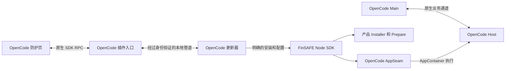
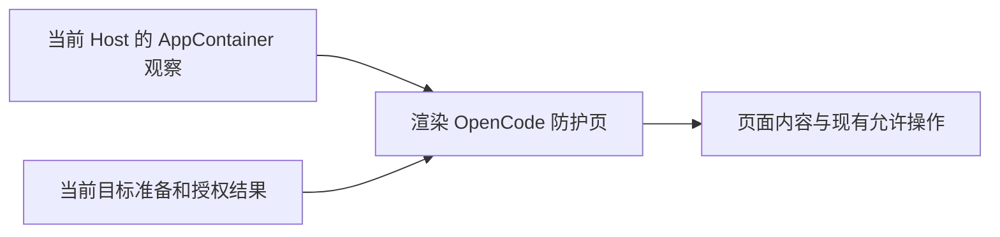
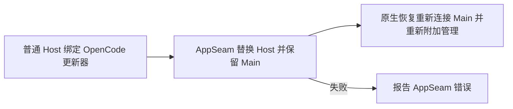
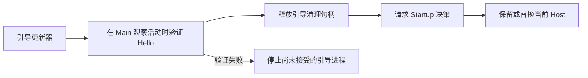
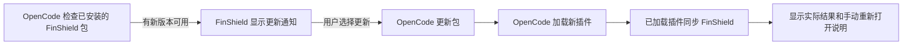

# OpenCode Windows 插件架构

[English](https://github.com/finogeeks/finsafe/blob/main/integrations/opencode/windows/DESIGN.md)

## 复用 OpenCode 运行时（#1189，2026-11-25）

负责人已批准独立更新器复用 OpenCode 已安装的运行时。普通插件 Host 通过 `process.execPath` 提供其当前可执行文件。AppSeam 在 Host 替换进程树之外启动该可执行文件，并在子进程环境中设置 `BUN_BE_BUN=1`。此方式使用 Bun [文档规定的独立 CLI 模式](https://bun.sh/docs/compiler/executables#act-as-the-bun-cli)。子进程使用现有参数执行暂存的 `updater/server.js`。更新器在启动任何管理或 Host 工作之前移除该模式变量，使正常的 OpenCode 启动不会继承 Bun CLI 模式。

范围：更新器组件。父流程：原生桌面插件激活。输入：普通 Host 可执行文件和此发行版本的暂存包。输出：使用所交付 SDK 的独立普通更新器。启动错误沿用现有诊断和状态路径。不变量：不增加启动前检查、运行时下载或全局 Node 依赖；不更改 Core、身份验证、Job、授权、手动重新打开或受保护 Host 的引导流程。

包中不包含 Node 可执行文件或 `node-win-x64` 依赖。暂存保留完整 SDK 和发行目录契约。旧的 `opencode-updater/runtime/node.exe` 会被忽略并保持原样；它不是回退方案。共用传输为兼容其他调用方，保留现有的 `node` 可执行文件字段。不复制 DSH 实现。已从上一发行版本启动的更新器保持现有生命周期。手动关闭并重新打开后，新更新器会使用 Host 运行时启动。

2026-11-24 的研究使用已安装的 OpenCode Desktop 2.3.2，其后端包含 Bun 1.4.4。独立后端进程执行了外部 JavaScript，加载了包 SDK 0.11.50 和 Koffi 3.1.1，并完成同步 FFI 调用和异步原生构建信息调用。交付 SDK DLL 的 Authenticode 签名有效。这些是运行时兼容性探测，不是干净配置下的安装、更新器生命周期或受保护会话验收。其他 OpenCode 版本仍需验收；不要据此推导并添加版本准入门槛。编译时未启用 CLI 支持的 Bun 可执行文件无法使用此机制；应报告实际启动错误，不要安装另一运行时。

更改后的产物必须使用新的协同插件/SDK/原生发行版本。已发布的 0.11.50 字节内容及现有版本暂存保持不可变。源码开发和自有测试夹具不构成 npm 发布或用户安装授权。

## 推导操作输入（2026-11-24）

负责人在问题 #1180 中决定移除生成的设置快照。OpenCode 配置仍是唯一的用户配置入口。每次激活均根据已加载包请求的发行版本和 Windows 已知文件夹，推导安装路径及配置路径。原生路径覆盖和手动外部安装流程已停用。不再读取、写入、迁移 `<OpenCode config home>/finsafe-windows/config.json`，也不建立替代缓存。

在旧插件/新原生版本更新期间，现有更新器保留明确的目标。SDK 和原生组件的责任方提供安装注册、先前安装输入、配置及授权事实。原生回执和诊断结果沿用现有契约。不增加启动检查或生命周期状态。

下文早期的外部/共用选择证据属于历史记录。自有测试夹具覆盖安装中断、手动重新打开以及更新器 A 准备原生版本 B；它们不能证明本次修订已通过实际 Desktop 验收。

## 分离启动决策修订（2026-11-23）

负责人同意的[共用启动决策设计](https://github.com/finogeeks/finsafe/blob/main/docs/internal/design/plugin-startup-decision.md)将即时 Keep/Wrap 决策与输入读取、Host 替换、后台准备及页面观察分离。页面/状态附加不得发起启动，观察不得等待 `activation.start()` 或授权完成。共用源码将这些操作分离。Main 的初始插件初始化提供启动意图，端点重新附加仅用于观察；如何区分同一 Main 下的插件重载和实际启动，仍是共用设计中明确列出的适配器缺口。保留双条件策略、现有 AppSeam 交接和手动重新打开流程。已安装产品的验收尚未完成。

## 独立运行（2026-11-23）

负责人批准的[独立运行契约](https://github.com/finogeeks/finsafe/blob/main/docs/internal/design/plugin-updater-shared.md#independent-plugin-runs-2026-11-23)取代下文插件层的启动缓存和已完成任务缓存。每次初始化负责自己的附加。每次显式调用 Shell 都执行现有 Shell 入口；实例获取由 Shell 负责。OpenCode 使用 DSH 共用的基于授权的启动决策，不设置自己的 `startupReady` 包装层。程序不存在时，启动保持普通模式；随后管理流程安装并授权请求的发行版本。每次新的管理运行均读取实际状态。

## 简化启动与交接（2026-11-23）

负责人批准的 [OpenCode 启动修订](https://github.com/finogeeks/finsafe/blob/main/docs/internal/design/opencode-personal-app-seam.md#startup-and-handoff-simplification-2026-11-23)为权威依据。启动使用所选 AC 和授权完成状态；保留 Main 的交接仅匹配 PID 和创建时间。它传入实际绑定的 Host 可执行文件及服务注册，不猜测暂存路径，不增加固定版本、文件哈希或重复的完整准备门槛。现有传输身份验证、Core 准入和操作结果处理保持不变。

## 手动重新打开修订（2026-11-22）

[共用手动重新打开契约](https://github.com/finogeeks/finsafe/blob/main/docs/internal/design/plugin-updater-shared.md#manual-reopen-revision-2026-11-22)取代本文运行中的 Restart 和更新器复用方式。运行中的准备流程提供“退出 OpenCode”和“稍后”。退出会停止 Main，不启动替代进程。下次正常启动加载已安装插件。每次普通模式获取都会终止现有更新器 Job 并创建新更新器。Shell 负责现有实例获取算法；插件不保留常驻 Shell 句柄或启动结果缓存。受保护 Host 仅附加到本会话的更新器。启动时的 Keep/Wrap 保持不变。

状态：已实现技术验证；剩余验收缺口见[验证记录](https://github.com/finogeeks/finsafe/blob/main/integrations/opencode/windows/docs/verification.md)。负责人澄清日期：2026-11-17。

2026-11-21 的[保留 Main 的 Host 交接](https://github.com/finogeeks/finsafe/blob/main/integrations/opencode/windows/docs/retained-main-host-handoff.md)记录了保留 Main 的实现和源码实验。其[不回滚修订](https://github.com/finogeeks/finsafe/blob/main/integrations/opencode/windows/docs/retained-main-host-handoff.md#registration-ownership-and-no-rollback)及[共用当前状态修订](https://github.com/finogeeks/finsafe/blob/main/docs/internal/design/plugin-updater-shared.md#current-state-decision-revision)在 [#1159](https://github.com/Geeksfino/finsafe/issues/1159) 中获批；源码已实现这些修订，原生验收尚未完成。负责人于 2026-11-22 批准下文 OpenCode 页面的最小对齐。此次后续批准仅将 DSH 观察规则扩展到 OpenCode 展示层。

## SDK HTTP 查询修订（#1163，2026-11-22）

状态：源码已实现。负责人仅选择针对性单元检查；PR 记录了被测提交和结果。遵循[权威 SDK HTTP 查询契约](https://github.com/finogeeks/finsafe/blob/main/docs/internal/design/plugin-updater-shared.md#unified-sdk-http-status-queries-1163-2026-11-22)。独立普通更新器使用包自带 SDK 查询所选 FinShield Shell 后端的新 HTTP 资源。替换 OpenCode 的授权查询子进程和重复查询缓存。迁移所有使用方，并移除旧 HTTP 别名、授权状态/进度 CLI 入口以及不再使用的查询代码和测试。不得引入直接 DLL 状态查询或 CLI 回退。

GUI 和服务端 Host 保留原生 RPC 及现有更新器管理通道。当前 Host 令牌仍是防护事实；HTTP 应用状态不能证明此 Host 或 Main 的业务连接。不增加受保护 Host 的回环权限或普通进程创建权。HTTP 观察失败保留实际原因。上述独立运行修订在启动时将可执行文件缺失处理为 Keep，随后安装。这两种结果均不能证明当前 Host 的令牌。状态读取不启动后端，也不要求可见的 Widget/Console。

保留实际 Main/Host 附加、原生命令提交、不回滚及受保护会话关闭/重新打开的限制。只读 HTTP 观察绑定到所选实例，独立于 SDK 发行版本。在 #1163 激活完成前，分别展示活动版本 A 和已准备版本 B。现有实现/预览证据不能验证此次迁移。

## 插件独立性

正式 Windows 构建使用 `dev/build_release.py` 暂存包、安装锁定的开发依赖、构建 GUI 和更新器，并打包与源码匹配的公共 SDK。共用公共插件渲染器提供发行 CDN 基址。完整 Actions 发布和本地 Windows 发布均在匹配的原生版本及 SDK 发布后，发布此构建包。
原生安装使用 `updater/common/download.js` 中共用的校验下载：CDN 与同版本公共 GitHub Release 同时开始；首个通过校验的结果生效，并取消另一来源。本地 npm 预览仅覆盖其暂存包的 CDN 基址。

本地预览交付使用插件自身的 [npm 预览流程](https://github.com/finogeeks/finsafe/blob/main/integrations/opencode/windows/docs/local-npm.md)。它暂存包副本，并通过回环地址提供不可变产物。此开发工具不改变任何沙箱或平台能力；平台矩阵无需因该交付工具另行更改。

OpenCode 使用自己的应用适配器和声明的产品 SDK。

Node 更新器流程由 `integrations/common/windows` 负责，并随此插件归档交付。OpenCode 声明 FinSAFE Node SDK 用于原生调用，并拥有自己的应用适配器、Candidate、运行时命名空间和 UI。SDK 包含个人版产品 DLL。插件包不包含 Rust 构建或私有 DLL。

### 安装依赖

OpenCode Desktop 2.3.0 通过 Bun 运行时模块加载器提供服务端插件 SDK，通过 GUI 宿主提供 GUI 共用模块。`@opencode/plugin` 仅放在开发依赖中。2026-11-21 的隔离 npm 11.19.1 安装表明，即使将 SDK 声明为可选 peer，npm 仍会查询宿主的 peer 依赖树，包括 Electron、Vite 和 Playwright。因此不声明该安装 peer，也不声明常规 SDK 依赖。现有开发 SDK 仍固定为 2.3.0；运行时启动路径在调用其他版本的实际接口之前，不会拒绝它们。其他发行版本仍需兼容性验收。

官方 GUI 预设将 React 和 React DOM 构建进交付页面。这些包及构建工具保留在开发依赖中。没有直接运行时导入需要单独安装 `@opencode/client`。仅 FinSAFE Node SDK 保留为常规依赖。该 SDK 按 npm 的捆绑依赖契约，负责并捆绑 Koffi 3.1.1 及其 Windows x64 原生组件。现有直接 Windows 绑定使用其公开 `loadKoffi` 入口。独立更新器复制完整 SDK，无需单独复制 Koffi，也不从 OpenCode 解析原生依赖。独立进程按上文规定复用 OpenCode 编译后的 Bun 运行时。GUI 使用 OpenCode 声明的共用模块；React/React DOM 构建进页面。

预览发布拒绝不含 Windows x64 插件组件的 SDK 归档。交付验证必须从新的 npm 使用方中加载 SDK 和 Koffi。较早的 `.1` 预览遗漏原生包；`.2` 将其直接捆绑在插件中。后续预览在 DSH 和 OpenCode 中均使用由 SDK 负责的布局。

2026-11-21 检查了 OpenCode [2.3.0 运行时加载器](https://github.com/anomalyco/opencode/blob/v2.3.0/packages/plugin/src/runtime.ts)、[GUI 构建契约](https://opencode.ai/docs/build/plugins/gui/#build-the-bundle)和 npm [可选 peer 行为](https://docs.npmjs.com/cli/v11/configuring-npm/package-json/#peerdependenciesmeta)。通用 OpenCode 示例将 SDK 声明为常规依赖；这个面向特定宿主的包使用已验证的宿主模块契约，避免安装第二份 SDK。

第三方对比，2026-11-21：已发布的 [`@rizal72/oc-notify` 0.1.2](https://github.com/rizal72/opencode-plugins/blob/main/plugins/oc-notify/package.json) 和 [`@rizal72/oc-plugin-updates` 0.1.9](https://github.com/rizal72/opencode-plugins/blob/main/plugins/oc-plugin-updates/package.json) 交付预构建 GUI，不声明常规依赖或 peer 依赖。其开发工作区安装 SDK。相比之下，[`@slkiser/opencode-quota` 6.3.0](https://github.com/slkiser/opencode-quota/blob/main/package.json) 保留必需的 SDK peer。这些示例说明存在多种打包模式，并不构成通用的零依赖规则。FinShield 对宿主 API 使用第一种模式，同时保留自身原生支持。修订 5 归档的本地注册表使用方在 5.46 秒内完成安装，交付 136 个文件；npm 安装阶段耗时 1.76 秒。请求日志仅包含本地 FinShield 包/SDK 请求，捆绑的 Windows Koffi 正常加载。第二个使用空 npm 缓存的自有使用方端到端耗时 9.20 秒；安装阶段耗时 2.45 秒。插件归档获取/解压耗时 2.23 秒，SDK 为 0.10 秒，没有公共网络请求。这些测量使用 npm 11.19.1，而非 OpenCode plugin-add 命令，不能构成一般性的安装时间保证。
## 组件

用户操作名为“Enable protection”/“开启防护”。它会切换执行环境，在保留窗口的同时中断运行中的任务。不要将其称为页面刷新或完整的 OpenCode 重启。内部操作名保持不变。在不支持实时替换受保护版本的情况下，已准备更新的受保护会话仍使用现有关闭并重新打开说明；其文字不得承诺窗口保持打开。

页面内容遵循[页面观察契约](#页面观察对齐2026-11-22)定义的两项当前观察。`starting` 和未知阶段不能提供授权事实。无论目标工作或观察错误如何，都独立保留当前 Host 观察的可见性。

侧边栏入口在首次启动决策后注册。现有原生回执检查仍选择 Keep 或 Wrap；页面不读取回执文件，也不作此决策。等待 Wrap 的即将退出 Host 不发布入口。受保护 Host 可根据实际令牌观察发布入口；普通 Keep 会话在已知准备、就绪状态或错误时发布入口。注册后，状态/连接变化不撤回入口。本地客户端尚不存在时，现有状态循环等待下一轮，不伪造准备失败结果。这只延迟插件入口；OpenCode 启动和后端准入保持不变。如果首次观察表明启动待处理，则在 Host 替换期间发生的后续 RPC 传输错误不视为原生授权结果。包含当前防护观察的原生失败响应仍会显示错误页。一次性注册仅限本 GUI 实例，按正常插件生命周期移除；不持久化任何内容。

负责人批准的布局（2026-11-21）保留现有双列防护摘要，见[批准的参考图](https://github.com/finogeeks/finsafe/blob/main/windows/prototypes/assets/opencode-plugin-layout-2026-11-21.png)。仅在确认包更新时，于状态卡上方右侧增加“安装更新”按钮。现有自动包检查和原生更新通知提供该状态。安装时禁用同一操作；成功或后续当前版本结果会移除按钮。页面没有手动“检查更新”控件。更新工作仍需明确的用户操作，并使用 OpenCode 现有包 API。

页脚严格保留三个普通链接，位于同一行：“FinShield 如何保护你”“FinShield 网站”和“反馈”。第一个链接在独立窗口打开负责人选定的 https://safety.finaios.ai/ 。英文和中文标签使用同一目标。错误区域保留实际失败，不重复反馈链接。

范围：组件连接。父流程：OpenCode 集成。输入：桌面业务请求和固定插件管理请求。输出：原生服务结果和观察到的防护。管理流程不代理会话流量。

页面和更新器协调明确的管理请求。SDK 调用 OpenCode AppSeam 适配器以获得经验证的绑定。适配器将固定安装和授权操作交给相应产品责任方。更新器保留现有安装程序 Job，并使用共用 Desktop 授权传输，包括确认、终态结果和保留工作进程的交接。

## 页面观察对齐（2026-11-22）

负责人批准的范围：在现有 OpenCode 页面中应用已确认的 DSH 展示规则。保留其布局、侧边栏注册和闪烁修正、包更新入口、原生提示以及原生启动和授权流程。使用 OpenCode 自有源码；DSH 是设计参考，不是运行时导入。平台能力不变，因此功能矩阵仍准确。源码已实现此次对齐；自有验证记录如下。已安装产品的验收尚未完成。

范围：防护页观察。父流程：OpenCode GUI 插件。输入：当前 Host 的实际 AppContainer 观察，以及所选目标的当前准备/授权任务和结果。输出：页面内容与现有允许操作。读取和命令错误保留实际原因。观察不提交安装、授权、交接或恢复。

| 当前事实 | 显示方式 |
| --- | --- |
| 实际下载、安装、授权或交接正在进行 | 显示该操作和进度，并单独显示当前 Host 防护。只有实际授权操作才能使用授权措辞。 |
| 目标已准备，等待允许的切换 | 显示就绪和“开启防护”。保留 Main 及现有操作能力检查。 |
| 受保护 Host 已准备更新，且 `restartAllowed:false` | 显示更新就绪及现有关闭并重新打开说明；不提供实时切换。 |
| 无活动操作或待切换项；实际 Host 在 AppContainer 中 | 显示防护已开启。实际操作错误仍单独显示。 |
| 必需观察不可用 | 为该信息显示加载中。保留独立获取的任何当前事实。 |
| 任务、令牌或整个 RPC 观察失败 | 显示实际原因。读取失败既不能证明没有防护，也不能证明授权未完成。 |

对于不允许实时切换的受保护就绪更新，在页面摘要中仅显示一次关闭并重新打开说明。不要在切换警告或第二段状态文字中重复。保留现有折叠帮助和实际当前发行版本显示。此处不增加重启能力，也不改变现有通知策略。

Host 状态边界独立保留令牌和任务观察。令牌读取失败时，移除从该次失败读取推导的防护字段，同时保留成功获取的任务信息。任务读取错误不抹去成功的实际 Host 观察。整个 RPC 失败时，仅提供错误，不伪造防护或任务阶段。

页面存储收到的观察，不改写其业务阶段。为 UI 用途保留请求进行中、页面可见性和“稍后”/通知状态。“开启防护”或“稍后”的请求错误是独立 UI 错误。收到确认后，在新观察到达前保持提交禁用；确认前开始的观察不能解除禁用。这些错误不将已准备目标改为准备失败。`starting` 和 `running` 不是页面的第二套业务状态。现有更新器任务阶段仍由更新器负责。保留现有读取计划和操作。OpenCode 使用共用激活流程的请求错误传播选项，使 status 或 Enable RPC 拒绝到达这些现有观察和命令边界。它不得变成激活内部持续保留的失败任务。其他适配器保留现有默认错误策略。此处不增加现有计划外的重连、重试、准备请求或状态读取。

实现前，添加以下回归：未知/starting 观察、实际工作加 AC、普通就绪、受保护就绪更新、空闲 AC、部分观察错误、整个 RPC 失败，以及目标已就绪时的“开启防护”/“稍后”RPC 错误。同时检查内容和操作。现有侧边栏闪烁、一次性注册、包更新和 Main 保留测试仍为必需。自有测试不能证明已安装原生桌面的验收。

### 此次对齐的验证

本地源码：`63f38e4c0a4c49f538cb64e14233cff8a34ab8e0` 加工作树更改，于 2026-11-22（Asia/Shanghai）检查。先添加测试，再修复。首次运行在伪造授权/防护、命令错误改写就绪观察及独立令牌/任务信息丢失方面失败。新增的真实 Host 路径回归首先复现了 status/Enable RPC 错误后持续保留失败状态；现在它们会在下一次现有读取中观察实际就绪结果，不提交新工作。
后续独立审查发现下载/安装标题中未翻译的可选第二行键。回归先复现可见键；四个空的本地化值修正了它，不改变布局或逻辑。

| 验证 | 结果 |
| --- | --- |
| 共用更新器、OpenCode 展示/附加/管理、DSH 默认激活/启动兼容性 | 最终针对性运行：136 通过；0 失败，包括两种语言的下载/安装标题 |
| `windows-plugin-common` | 通过，包括共用交付和默认 DSH 行为 |
| `file-cell-opencode-plugin-unit` | 最终标题修正前，构建通过，78 项 Node 测试中 77 项通过。未更改的清单 SDK 要求 0.11.19 与工作区 SDK 0.11.24 不同；此版本断言是唯一失败。该通道为失败，而非通过。仅涉及标题的修正由最终针对性运行、构建和页面检查覆盖 |
| 单元验证计划器剩余部分 | 4 项 Python 测试通过；因单元通道在 Node 失败处停止，单独运行 |
| `file-cell-opencode-plugin-page` | 使用自有 Edge/Host 替代实现通过：侧边栏、语言/主题/状态渲染、三种页脚宽度、有条件包更新及现有操作 |
| `acceptance-hygiene`、`planner-tests`、`docs`、`docs-layout` | 通过 |
| `file-cell-opencode-plugin-native` | 自有 Main 退出/Installer 缺失测试夹具通过；原生产品实现未更改 |
| 已安装桌面及策略验收 | 未运行：没有已声明的可弃用 OpenCode 宿主/选项/证据或兼容的 `FINSAFE_OPENCODE_POLICY_CLI` |

准确的选择记录在 `target/opencode-page-scope-plan.txt`；没有缺失的文件声明。本地红/绿及最终输出在 `target/opencode-page-*.log`。此次对齐未改变现有 SDK 版本、已安装配置、授权、原生启动或 DSH 页面工作。

## 通过 AppSeam 启动

范围：插件启动步骤。父流程：更新器管理。输入：普通 OpenCode 实例和已选择且获授权的 FinSAFE Effective。输出：同一 Main 和经验证的 AppContainer Host，或实际交接错误。

插件初始化注册基于 Promise 的管理处理程序后返回，不等待更新器完成。待处理和失败的管理在状态中保持可见。桌面启动路径不等待安装、授权、页面、下载或管理连接。

更新器调用固定 SDK `replace_host` 操作。它使用选定的 Effective 和 Desktop 映像运行所选 `finsafe app launch opencode --retain-main PID:CREATED --replace-host PID:CREATED`。[个人版 AppSeam 流程](https://github.com/finogeeks/finsafe/blob/main/docs/internal/design/opencode-personal-app-seam.md)启动 Core，验证新受保护 Host，然后共用的经验证目标替换流程仅停止锁定的旧 Host。该模式保留现有 Main，绝不创建或终止 Main。共用 Shell 在更新器 Job 之外具有自己的原生生命周期。启动器在更新器 Job 之外运行。Main 的原生断流恢复采用新的原生服务注册。SDK 验证返回的进程祖先关系、Main 身份、原生注册和 Host 的实际 AppContainer 令牌。

Host 就绪不等于连接确认。响应式 sidecar 引用在连接后触发插件自有 Main IPC；Main 在 `server.info()` 确认业务 Host PID 后，通过其当前 `ctx.client` 重新发送附加。更新器最多等待 45 秒，直到该精确受保护绑定建立，才报告交接完成。在等待期间仍可观察 Main 退出。新 Host 的实际令牌提供防护状态。
公共 SDK 没有原生重连方法。OpenCode 负责原生服务发布和恢复，包括启动普通 Host 的能力。FinShield 验证当前令牌，绝不将普通 Host 报告为受保护。负责人已撤销控制后续原生恢复的要求。
失败时，仅释放本次尝试的资源并报告实际错误；不恢复注册，也不重新启动先前的 Host/Main。新 Host 必须先就绪，才能终止旧 Host。权威[不回滚契约](https://github.com/finogeeks/finsafe/blob/main/integrations/opencode/windows/docs/retained-main-host-handoff.md#registration-ownership-and-no-rollback)取代注册备份/恢复。源码移除了回滚责任方；原生失败验收尚未完成。
关闭页面或释放绑定不会停止受保护会话。已受保护会话的更新在关闭并重新打开后应用。现有更新器必须声明 `retainedMainHost`；较早的完整启动更新器要求重启 OpenCode。交付需要匹配的 SDK 和产品 CLI。
## 共用更新器提取契约

负责人于 2026-11-20 批准提取。源码实现已完成；已安装产品的验收尚未完成。[共用更新器设计](https://github.com/finogeeks/finsafe/blob/main/docs/internal/design/plugin-updater-shared.md)定义共用责任方和适配器契约。下文 OpenCode 附加流程由本插件及其 AppSeam 适配器实现。
以现有 DSH 更新器流程作为共用基线，包括独立进程创建、Job 所有权、经过身份验证的 Host 通信、启动获取、Keep/Wrap、运行中准备和替换生命周期交接。`integrations/common/windows` 负责共用 Node 实现。每个插件提供自己的 AppSeam 适配器，并保留应用专有的包输入。

应用适配器在其宿主能够识别激活阶段时提供该阶段。缺失或未知阶段选择现有启动流程。这是明确的默认规则，不能证明应用实际正在启动。DSH 保留当前同步 `appReady` 采样和运行中操作完成门槛。OpenCode 支持的宿主 API 没有提供等效阶段信号，因此使用启动默认值；`OPENCODE_CLIENT` 表示客户端来源，不得用于确定激活阶段。

激活通过权威[共用激活流程](https://github.com/finogeeks/finsafe/blob/main/docs/internal/design/plugin-updater-shared.md#current-state-decision-revision)路由。观察当前 Host 的实际令牌。受保护 Host 连接现有更新器，不执行 Startup 决策；连接失败不引导普通更新器。普通 Host 使用适配器阶段：running 跳过 Startup 决策，缺失或未知则选择该决策。OpenCode 没有可靠阶段信号，即使窗口可见，也保留此启动默认值。

OpenCode 更新器在提供 Hello 前开始原生 Main 退出观察。因此，经验证的 Hello 确认更新器拥有其已验证 Main 的生命周期。此时释放调用方的引导清理句柄，然后再请求 Startup 准入，因为准入可能替换并断开调用方 Host。准入连接丢失不能停止该 Main 所有的更新器。Hello 验证前失败仍停止尚未接受的引导进程。共用传输默认保留其他适配器的现有清理边界。

激活和附加传输失败携带实际错误，不附带准备阶段。仅更新器任务结果能够报告准备失败。管理不可用时，保留独立观察到的 Host 防护。

不得从更新器存在、Main 未改变、先前 Keep/Wrap、已完成工作、`mainRetained`、`session.keep` 或等效历史记录推断阶段。Keep 仅属于一次激活。准备完成提供现有经确认的切换，不重复 Startup 决策。Status 和 Later 不提交准备或替换。用户 Restart 执行已展示的所选目标，不再作 Startup 决策。

共用责任方保留适用的已接受工作和原生结果。一起审查 `beginAssessment`、`session.items`、任务 `satisfied` 和 `restartPolicy`：已完成防护属于经验证的 Host，不能将 `protected` 或 `restartPolicy:never` 转移给新的普通 Host。通过现有绑定，在经验证的附加和现有准备结果事件发生时重新评估；不增加并行身份存储、轮询或状态读取时恢复。

更改运行时之前，通过 activation、bind、ensure 和 status 添加回归。覆盖独立于先前 Keep/Wrap 的启动就绪、已完成交接结果复用、重复附加加入已接受工作，以及替换期间 Main 退出。DSH 保留 `appReady` 和 Loader/`settled` 门槛。单元验证和已安装验收必须分别记录；原生验收尚未完成。

## OpenCode 桌面重新附加

OpenCode 的服务端插件可在桌面关闭后继续存在于普通原生后台服务中。每次桌面激活必须重新附加管理。使用支持的 GUI `main` 入口发送此桌面生命周期通知。其初始化返回不依赖异步附加。服务端入口在接受附加工作前注册管理 RPC。窗口页面初始化观察结果状态。

AppSeam 按 PID 和创建时间保留明确提供的 Main 和 Host。它不从 Host 的原始父进程推断 Main，也不要求暂存路径、Desktop 版本、捆绑 Host 哈希、映像名或命令行形态。原生管理传输仍验证对端身份。实际选定的 AC 令牌提供防护；原生操作保留原始错误。

每次激活或经验证的新 Host 附加均获取或复用更新器，并建立经验证绑定。同一次激活重复附加到同一活动 Host，可复用该次激活。同一 Main 下的不同 Host 需要自己的经验证附加和实际令牌观察；仅 Main 未变不足以允许复用。新 Main 获得自己的经验证生命周期责任方。被取代的连接和终态失败随所属激活释放。
加入适用且已接受的安装、授权或替换工作，不重复提交。在仍适用时保留就绪操作和“稍后”关闭状态，并在新 Host 附加时重新评估适用性。不要将先前 Host 的已完成防护或永不重启策略转移给新的普通 Host。

OpenCode Host 替换保留同一经验证 Main，并通过共用生命周期契约使更新器保持运行。旧 Host 退出不等于 Main 退出。即使 OpenCode 复用未改变的 GUI 包且不再次运行 Main 初始化，响应式 sidecar 端点改变仍会重新附加现有 Main。AppSeam 仍负责应用原生启动命令和就绪证据。当前受保护 Host 通过 `restartAllowed:false` 表明原生替换限制；其已准备更新会说明需要关闭并重新打开桌面。直接 Restart 也执行该能力限制。

## 可用包更新

负责人批准的修订，2026-11-23，#1170。OpenCode 负责包安装和插件加载。仅已加载插件提供原生目标版本。本修订取代共用手动重新打开契约中较早的 OpenCode 仅安装更新顺序。DSH 保留现有顺序。

范围：一次 OpenCode 包更新。父流程：插件管理。输入：配置的包来源和用户更新操作。输出：实际包、加载及原生准备结果。错误保留在所属阶段。正常启动和当前 Host 防护不依赖更新完成。

DSH 让宿主管理包更新。OpenCode 通过内置服务端的插件清单、检查和更新 API 承担同一职责。FinShield 在启动时、定期以及设置页请求时检查其配置的包。通知提供“更新”或“稍后”。宿主应用配置的来源和版本规则。检查不更改包，也不操作原生安装。仅在用户确认后开始更新。

旧插件在 `plugin.update()` 返回后结束。它不读取 `plugin.list()` 来推断原生目标或提交原生安装。包完成不等于插件激活。如果 OpenCode 在本会话中没有加载新插件，用户先手动关闭并重新打开。加载失败保留宿主错误；不会为未加载插件启动原生任务。

已加载服务端模块仅读取一次自身包版本 V。管理 `version()` 返回 `{version: V}`，不启动或等待更新器或 Host 附加。状态也报告此模块版本，独立于旧 Host 反馈。Host 管理对象仅在同一不可变发行版本内共享，因此 B 不能继承 A 的激活闭包或 SDK。桌面附加使用现有经验证 Main 和 Host 输入。

父节点：`已加载插件同步 FinShield`。输入：已加载包、其交付的 SDK、明确根目录及现有更新器通道。输出：V 的原生准备任务，或原始错误。插件注册不等待原生安装或授权。

在受保护会话中，B 连接现有普通 A 更新器。该更新器执行 B 的安装和授权任务时，保留自身 A 运行时和 SDK。它自身的版本不是目标。不增加更新器替换、SDK 热替换、新普通进程或版本协商流程。正常普通启动仍通过现有获取操作创建新更新器。插件激活始终使用正常管理流程。

现有 `ensure` 处理同版本状态和完整准备。仅安装确认不等于完成或授权成功。页面区分包完成、已加载服务端模块版本、原生工作及其错误、当前 Host 防护。窗口本地交接数据仅保留包通知，不选择原生发行版本。退出会停止 OpenCode，不重新启动。如果加载 B 需要重新打开一次，那么激活已准备的 FinShield B 仍可能需要再次重新打开。

V 原样传给设置和管理。稳定发行版本的插件、捆绑 SDK 和 FinShield 使用同一三段版本号。不通过去除本地后缀来声称版本对齐：在另行定义带后缀发行版本契约之前，现有仅支持稳定版本的原生交付契约报告其错误。完整包暂存和明确版本根目录保持不变；绝不扫描 OpenCode 缓存代次来寻找目标。

## 配置与移除

产品负责 `windows/config/opencode-plugin/manifest.yaml`。Resolve 根据 OpenCode 基础配置、Windows 强制规则和现有 OpenCode 兼容性源生成随包提供的 `policy/candidate.yaml`。
原生版本分别位于 `opencode-plugin-versions` 的独立子目录。只读安装规则覆盖其稳定父目录。版本目录改变时，Resolve/Materialize 必须生成相同授权输入。实际原生升级回执复用仍需已安装验收。

安装期间，如果与原始原型 Candidate 逐字节一致，则选择新版本随包提供的正式 Candidate。暂存保留已编辑 Candidate，并保留活动安装的原有配置。

原生管理使用插件自身域 `finshield.opencode` 进行产品安装或授权。开发测试夹具保持 `finsafe.shared` 不变。实际安装需要最终阶段的可弃用 Desktop 测试环境。

OpenCode 的 Extensions 开关仅控制 GUI。原生负 ID 配置控制服务端加载。移除包条目会释放其管理绑定；当前受保护 Host、运行时、配置和授权仍保留。原生卸载在分派前被拒绝。本插件不包含原生卸载驱动或实现。

## 设计参考与本地责任归属

| 参考 | OpenCode 自有实现 |
| --- | --- |
| DSH 独立更新器生命周期 | `updater/coordinator.js`、`src/activation.js` |
| DSH 固定管理传输模式 | `updater/protocol.js`、`updater/native.js`、OpenCode AppSeam |
| DSH 安装程序/授权编排模式 | `install/`、`src/preparation.js`、`updater/operations.js` |
| DSH 页面交互模式 | `ui/`、`src/gui.tsx`、`src/presentation.js` |
| OpenCode Desktop/SDK 2.3.0 原生契约 | `src/index.js`、`updater/launch.js`、OpenCode AppSeam |

检查的 OpenCode 源码：`v2.3.0`，提交 `a6b15d33daf6ab7d35569f6d711fdb630b9f04e7`，MIT。原生服务注册、Promise RPC、GUI SettingsPage 和 Back to app 遵循此固定契约。不引入桌面补丁、额外服务端选择或会话代理。
