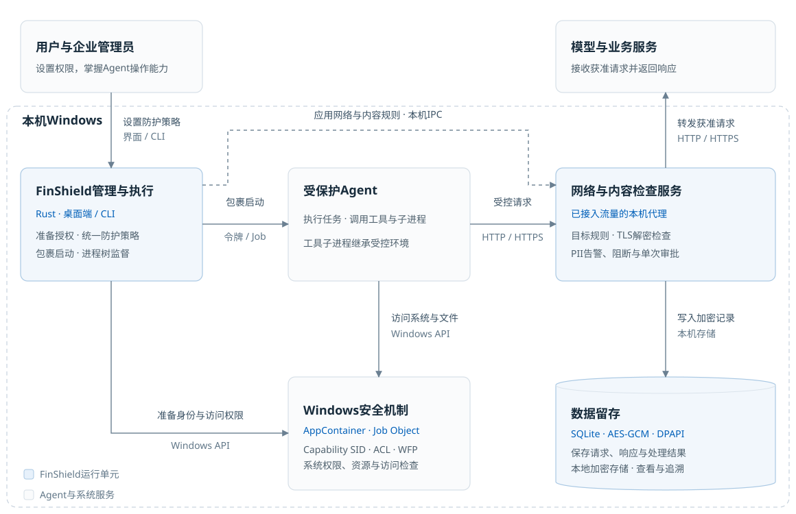
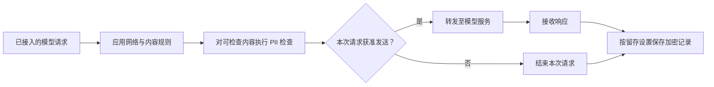
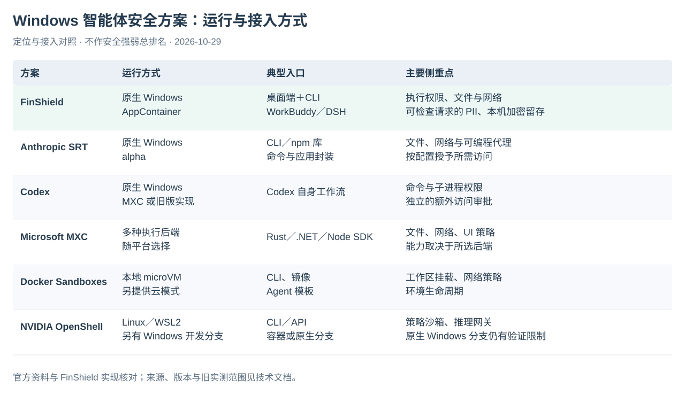

# FinShield 技术方案与产品对比

[English](technical-overview.md) · [产品首页](../README-zh.md) · [Windows 图文手册](WINDOWS-GUIDE-zh.md) · [完整案例库](https://finsafe-safety-arena.finogeeks.club/#overview)

FinShield 把使用方的权限配置落实到智能体的实际执行过程。Windows 侧保留本机程序和工具链，结合原生安全机制、受控网络与内容检查、本机加密记录，覆盖机器安全与数据安全。

## Windows 防护架构

图示沿用此前 Windows 技术方案的运行架构，品牌更新为 FinShield。网络与内容检查只作用于已接入的路径；留存取决于配置，不表示所有通信都已采集。

| 控制层 | 机制 | 作用 |
| --- | --- | --- |
| 执行身份与系统访问 | AppContainer、Windows 访问检查 | 限制受控进程修改系统配置、权限、服务与其他进程的能力 |
| 文件范围 | Capability SID、文件 ACL | 按有效策略区分可读写、只读、禁止访问的路径 |
| 进程与资源 | Job Object、执行生命周期 | 管理相关进程树和资源，执行时限适用于对应任务路径 |
| 网络与内容 | WFP、受控代理、可用的 TLS 检查 | 应用连接目标规则，对可检查请求执行内容规则 |
| 本地记录 | SQLite、AES-GCM、用户 DPAPI | 按配置加密保存已采集的请求、回复与处理结果 |

### 一次模型请求如何处理

上图展开“网络与内容检查服务”的处理路径。Windows 的“记录”模式允许原请求继续发送；询问只批准一次请求，阻止只拒绝已命中的请求。检查不完整时，原请求仍可能按其他规则继续转发。不能把成功启动、开启留存或选择阻止模式理解为完整的数据防泄漏保证。

### 三个平台的实现

| 平台 | 主要执行机制 | 用户入口 |
| --- | --- | --- |
| Windows | AppContainer、ACL、Job Object、WFP | EXE、日常桌面控件；控制台辅助配置与查记录，接入 WorkBuddy／DSH |
| macOS | Seatbelt、受控出口代理 | 命令行；当前发布 Apple 芯片包 |
| Linux | bubblewrap、seccomp、cgroup、可用的 Landlock | 命令行；能力随内核和主机授权变化 |

Windows 内容检查与 macOS／Linux Privacy Guard 是不同工作流。案例使用的私有桌面配置也不代表 WorkBuddy GUI 默认具有相同隔离效果。

## 与其他方案的接入方式对照

这张图对照产品定位、运行方式和接入方式，不给出安全强弱总排名。以下为 2026-10-29 核对的官方资料与本产品实现：

| 方案 | 运行与接入 | 主要差异与来源 |
| --- | --- | --- |
| **FinShield** | 原生 Windows；桌面控件与 CLI，接入 WorkBuddy／DSH | 将执行权限、可检查请求的 PII 处理和本机加密留存放进同一管理流程；见上方架构与[使用手册](WINDOWS-GUIDE-zh.md) |
| **Anthropic SRT** | CLI 与 npm 库；提供 Windows alpha | 面向命令与应用封装，提供文件、网络及可编程代理控制；[官方说明](https://github.com/anthropics/sandbox-runtime#windows-alpha) |
| **Codex** | 原生 Windows，围绕 Codex 自身工作流 | 命令和子进程受到文件与网络权限约束，审批单独控制额外访问；支持 MXC 与旧版实现；[官方说明](https://developers.openai.com/codex/windows) |
| **Microsoft MXC** | 应用嵌入的 SDK，具有多种执行后端 | 文件、网络、UI 控制随后端变化，集成方选择负载与规则；[官方说明](https://github.com/microsoft/mxc) |
| **Docker Sandboxes** | 本地隔离环境或云环境，通过 CLI、镜像和 Agent 模板接入 | 提供工作区挂载、网络策略及环境生命周期；本地架构使用 microVM；[官方说明](https://docs.docker.com/ai/sandboxes/) |
| **NVIDIA OpenShell** | Linux／WSL2 路径；另有原生 Windows 开发分支 | 提供策略沙箱与推理网关；Windows 分支使用 MXC，仍有明确的实现与验证限制；[项目说明](https://github.com/NVIDIA/OpenShell)、[Windows 分支说明](https://github.com/NVIDIA/OpenShell/blob/main/WINDOWS.md) |

此前技术方案中的“启动失败”“不支持”不能直接作为所有新版本的能力结论。尤其 OpenShell 已有原生 Windows 开发分支，不能再概括为仅有 WSL2。

### 既有实验能说明什么

2026-10-19～20 的内部对照实验使用 Windows 11 23H2、DSH `0.2.0-rc.2` 和固定版本，摘要如下：

| 测试对象 | 当时观察到的结果 | 范围 |
| --- | --- | --- |
| SRT `0.0.80` | 原生 Windows DSH 完成开发任务，文件与网络控制探针通过 | 需要账号准备和启动配置，不是免配置接入 |
| MXC SDK `1.0.1` | 本机选中的 `appcontainer-dacl` 后端未通过目标 Agent 启动前提 | 不能推广为所有 MXC 后端或新版本均失败 |
| Docker Sandboxes `0.48.0` | 同版本 Linux DSH 完成任务，验证了挂载与部分网络规则 | 是 Linux 执行环境，不等同于原 Windows 程序透明接入 |
| OpenShell `0.1.4` | 在 WSL2＋Podman 路径运行 Linux DSH，验证了只读共享与可写工作区 | 不覆盖后来的原生 Windows 开发分支 |

该轮没有与 FinShield 成品对应的完整验收，不能据此把本产品标为“所有项目通过”。未测能力也不等于产品不支持；本页没有重新执行这些实验。

## 从技术说明到实际使用

先按[Windows 图文手册](WINDOWS-GUIDE-zh.md)完成准备与启动，再用授权范围内的专用文件验证任务。具体场景的录像、调用结果和独立观测见[百炼场](https://finsafe-safety-arena.finogeeks.club/#overview)。
