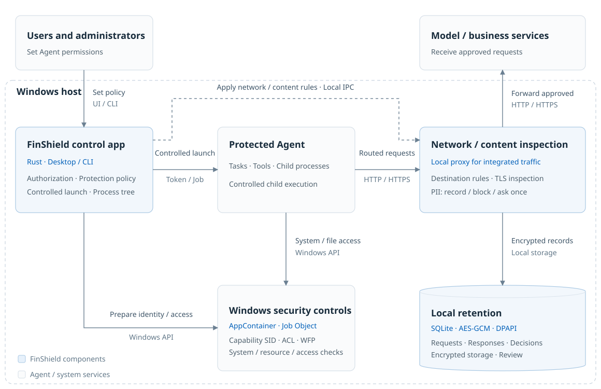
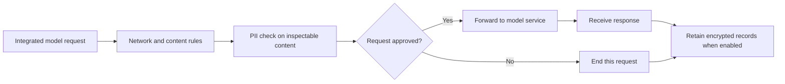

# FinShield architecture and comparisons

[简体中文](technical-overview-zh.md) · [Home](../README.md) · [Windows illustrated manual](WINDOWS-GUIDE.md) · [Case library](https://finsafe-safety-arena.finogeeks.club/#overview)

FinShield applies user-controlled permissions to actual Agent execution. On Windows, native applications and tools work with OS security boundaries, network/content inspection, and encrypted local records.

## Windows protection architecture

Adapted from the earlier Windows technical design, with updated product branding. Inspection applies to integrated traffic; retention is configurable. The diagram does not imply complete capture of every connection.

| Layer | Mechanisms | Purpose |
| --- | --- | --- |
| Execution identity / system access | AppContainer, Windows access checks | Restrict controlled processes' system, permission, service, and cross-process operations |
| Files | Capability SID, file ACLs | Apply effective writable, read-only, and inaccessible paths |
| Processes / resources | Job Objects, execution lifetime | Manage applicable process trees and resource limits; timeouts apply to supported task paths |
| Network / content | WFP, controlled proxy, available TLS inspection | Apply destination rules and inspect supported requests |
| Records | SQLite, AES-GCM, user DPAPI | Encrypt captured requests, responses, and decisions according to retention settings |

### Following a model request

This expands the inspection service in the architecture. Windows Record mode permits sending. Ask approves one request; Block refuses a known finding. An incomplete check may still allow forwarding under other rules. Launch success, enabled retention, and Block mode do not establish complete data-loss prevention.

### Platform implementations

| Platform | Main execution mechanisms | Entry |
| --- | --- | --- |
| Windows | AppContainer, ACLs, Job Objects, WFP | EXE and everyday Widget; supporting Console for settings/records; WorkBuddy/DSH |
| macOS | Seatbelt, controlled egress proxy | CLI; current release target: Apple Silicon |
| Linux | bubblewrap, seccomp, cgroup, available Landlock | CLI; capability depends on kernel and host authorization |

Windows content inspection differs from macOS/Linux Privacy Guard. Private-desktop case results do not establish identical defaults for WorkBuddy GUI.

## Feature comparison and notes

The [README feature table](../README.md#feature-comparison) lists permission, file, network, PII, outbound-content and encrypted-retention capabilities individually. Statuses reflect capability documentation; a detailed evaluation under matching environments, versions and cases will follow.

Permission controls constrain risky operations through process identity, syscall restrictions or isolation boundaries; they do not establish that every risky operation has been tested. File/network entries refer to each product's supported environments: Codex varies by Windows sandbox mode, MXC networking varies by backend, and native Windows OpenShell has verification limits. PII detection, sensitive-content ask/block decisions and encrypted conversation retention refer to built-in features. Domain blocking, ordinary runtime logs and extension hooks do not by themselves establish those features. An undeclared feature is not a proven lack of support.

Official documentation was checked on 2026-10-29:

| Option | Execution / entry | Difference and source |
| --- | --- | --- |
| **FinShield** | Native Windows; Widget and CLI, WorkBuddy/DSH | Combines execution permissions, PII handling on inspectable requests, and encrypted local retention; see the architecture and [manual](WINDOWS-GUIDE.md) |
| **Anthropic SRT** | CLI/npm library; Windows alpha | Command/application wrapping, filesystem and network controls, programmable proxy; [official documentation](https://github.com/anthropics/sandbox-runtime#windows-alpha) |
| **Codex** | Native Windows, within Codex workflows | Filesystem/network permissions for commands and children, with separate approvals; MXC and legacy implementations; [official documentation](https://developers.openai.com/codex/windows) |
| **Microsoft MXC** | Embedded SDK, multiple execution backends | Filesystem, network, and UI policy depend on the selected backend; [official documentation](https://github.com/microsoft/mxc) |
| **Docker Sandboxes** | Local or cloud environments; CLI, images, Agent templates | Workspace mounts, network policy, environment lifecycle; local architecture uses microVMs; [official documentation](https://docs.docker.com/ai/sandboxes/) |
| **NVIDIA OpenShell** | Linux/WSL2 and a separate native Windows development branch | Policy sandboxes and inference gateway; the MXC-based Windows branch has documented implementation and verification limits; [project](https://github.com/NVIDIA/OpenShell), [Windows guide](https://github.com/NVIDIA/OpenShell/blob/main/WINDOWS.md) |

Earlier “failed to start” or “unsupported” labels must not be applied to every current version. OpenShell now documents a native Windows development branch, so describing it solely as WSL2 is incomplete.

### What the earlier experiments establish

The 2026-10-19–20 campaign used Windows 11 23H2, DSH `0.2.0-rc.2`, and fixed versions:

| Tested version | Observation then | Scope |
| --- | --- | --- |
| SRT `0.0.80` | Native Windows DSH completed development tasks; file/network probes passed | Required account preparation and launch configuration |
| MXC SDK `1.0.1` | The selected `appcontainer-dacl` backend did not meet the target Agent startup prerequisite | Not a verdict on all backends or later versions |
| Docker Sandboxes `0.48.0` | Same-version Linux DSH completed tasks; mounts and some network rules were checked | Linux execution, not transparent wrapping of the original Windows executable |
| OpenShell `0.1.4` | Linux DSH ran through WSL2/Podman with RO sharing and a writable workspace | Does not cover the later native Windows branch |

That campaign had no matching finished-product FinShield acceptance run; it cannot mark FinShield as passing every case. Untested does not mean unsupported. These experiments were not rerun for this document.

## Try the product

Use the [Windows illustrated manual](WINDOWS-GUIDE.md), then verify a dedicated test file under your effective permissions. Recordings, tool results, and independent observations are in the [Safety Arena](https://finsafe-safety-arena.finogeeks.club/#overview).
