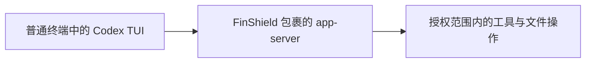

# 通过命令行接入 Codex CLI（Windows）

[English](../../en/agents/codex.md) · [文档目录](../README.md) · [兼容矩阵](compatibility.md)

本指南采用 Safety Arena 的 Windows 接入方式：用 FinShield 启动 Codex `app-server`，再从普通终端连接该服务。**Codex 已支持 CLI 接入，无需安装插件。** 本页不覆盖 Codex 桌面版、IDE 扩展或 Linux/macOS 的 Agent 验证。

Arena 记录的 Codex 版本为 `0.166.0`，包裹实现说明采用 Windows FinShield `0.10.9`。这说明该测评路径的依据，不代表本文对所有后续版本进行了安装验证；升级后需重新检查。

## 准备

1. 按[安装指南](../getting-started/install.md#windows)安装 Windows x64 FinShield，完成安全准备和授权。
2. 单独安装并登录 Codex CLI，先确认它能正常使用。需要支持 `app-server --listen` 和 TUI `--remote` 的版本。
3. 在 FinShield 控制台确认工作区、Codex 程序及所需配置／状态目录的访问范围。取得该安装实际使用、已准备的 `effective.yaml` 路径。不要把 DSH 插件专用配置直接当作通用 Agent 配置，也不要直接编辑生成的 `effective.yaml`。
4. 修改授权范围时，通过产品配置流程重新生成配置并完成准备，再启动新会话。FinShield 不代办 Codex 账号或模型服务配置。

## 启动受保护的服务

在普通 PowerShell 终端中设置实际路径。下面配置和工作区路径是示例，必须替换；`Get-Command` 需要找到实际的 `codex.exe`，不能将 npm 的 `.cmd`／`.ps1` 启动脚本直接替代 EXE。

```powershell
$finshieldExe = 'C:\Program Files\FinSAFE\finsafe.exe'
$codexExe = (Get-Command codex.exe -CommandType Application -ErrorAction Stop).Source
$effectiveYaml = 'C:\YourFinShieldConfig\effective.yaml'
$workspace = 'C:\YourAuthorizedWorkspace'

foreach ($file in @($finshieldExe, $codexExe, $effectiveYaml)) {
    if (-not (Test-Path -LiteralPath $file -PathType Leaf)) { throw "File not found: $file" }
}
if (-not (Test-Path -LiteralPath $workspace -PathType Container)) { throw "Workspace not found: $workspace" }
& $finshieldExe --version
& $codexExe --version
& $codexExe app-server --help
& $codexExe --help
& $finshieldExe prepare check --yaml-path $effectiveYaml --json
```

检查准备结果；未准备、配置不匹配或诊断报错时，先在产品中解决，不继续启动。选择未被使用的本机端口，例如 `8765`，然后在同一终端运行：

```powershell
Set-Location -LiteralPath $workspace
& $finshieldExe self-confine --yaml-path $effectiveYaml --stdio inherit --integration-id codex -- $codexExe app-server --listen ws://127.0.0.1:8765
```

保持终端和服务运行，确认服务已监听后再连接。仅监听本机回环地址；端口冲突时，两端同时改用另一个空闲端口。

## 连接 Codex 终端界面

打开第二个普通 PowerShell 终端，使用相同的 Codex EXE 和工作区：

```powershell
$codexExe = (Get-Command codex.exe -CommandType Application -ErrorAction Stop).Source
$workspace = 'C:\YourAuthorizedWorkspace'
& $codexExe --remote ws://127.0.0.1:8765 -C $workspace --sandbox danger-full-access --ask-for-approval on-request
```

实际执行 Agent 工作的是第一个终端中的受保护 `app-server`。第二个终端提供界面；它的独立 PowerShell 命令不因此受到 FinShield 保护。不要用普通本地会话替代 `--remote` 连接，也不要假定已有桌面／IDE 会话连接到了该服务。

这里的 `--sandbox danger-full-access` 是 Arena 在外部 FinShield 边界下使用的 Codex 设置，将执行边界交给 FinShield；仍保留 `on-request` 审批。**仅在确认连接到受保护服务时使用该设置。** 不将它写入全局配置，不使用跳过审批与沙箱的组合开关。不需要修改 `config.toml`。



## 验证与退出

在新建测试会话中，按[授权范围验证](../getting-started/install.md#验证授权范围)检查工作区读写、只读目录与禁止访问目录。使用无敏感信息的测试文件；核对实际工具结果和文件内容。模型口头拒绝或服务监听成功均不能证明保护生效。

`--integration-id codex` 仅标记记录来源，不选择权限。PII 检查还需匹配网络与内容检查配置，不能由本启动命令推断已开启。

退出第二个终端的 Codex 会话后，在第一个终端结束 `app-server`，确认该服务已退出。更换配置、升级或需要普通运行时，结束旧服务并明确启动新会话，避免连接到旧进程。

## 常见问题

| 现象 | 处理 |
| --- | --- |
| 找不到 EXE／只有 npm 启动脚本 | 确认 Codex 安装方式，改为真实原生 `codex.exe` 的完整路径；不要猜测版本化安装目录 |
| `--remote` 或 `--listen` 不支持 | 核对该 Codex 版本的帮助；本指南不能用于缺少这些接口的版本 |
| 准备检查失败或启动被拒 | 核对所选安装、有效配置和已授权目录，在产品配置流程修正后重新准备；不靠扩大为全盘权限排错 |
| 无法连接服务 | 查看第一个终端的原始错误、监听地址及端口；确认服务没有退出 |
| 模型连接或登录失败 | 先确认原生 Codex 登录、模型配置和网络可用，再检查沙箱授权及代理／证书配置；不要公开凭据 |

实现依据：[Arena Codex 接入说明](https://github.com/finogeeks/agent-safety-arena/blob/main/docs/codex-finshield-recording.md)。反馈时提供 FinShield／Codex 版本、启动入口及脱敏错误，见[获取帮助](../getting-started/install.md#获取帮助)。
