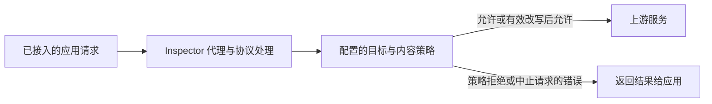

# Inspector：网络请求怎样进入内容检查

[English](../../en/architecture/inspector.md) · [架构与图示](README.md) · [网络访问、外泄与 PII](../protection/network-pii.md)

**Inspector 为已经接入的请求提供代理与内容检查。它能否看到一次发送，取决于实际流量路径、TLS 设置、请求格式和有效配置。** 看到检查器进程或“已受保护”状态，还不足以确认该请求已经脱敏。

适用范围：Windows 中已交付且支持代理、TLS 与内容检查的产品配置。集成前核对[兼容矩阵](../agents/compatibility.md)、当前版本的发行说明和所用入口。公开 DSH 与 OpenCode Windows 插件默认使用 `host` 网络；不能通过本页推断这些插件默认启用了 Inspector、网站白名单或 PII。本文解释已有配置与公开 PII 接入流程，不新增插件设置入口。

## 请求需要经过哪些条件

设想你让 Agent 读取一份客户样本并发给模型：文件权限决定它能否读取样本；网络策略决定它能否连接目标；内容检查决定选中的文本命中规则后怎样处理。这是一个说明职责的假设场景，不是新的测评结果。

| 层次 | 负责的问题 | 不能由此推断 |
| --- | --- | --- |
| 文件权限 | Agent 能读写哪些文件 | 可读文件中的内容一定不会发送 |
| 网络围栏与目标策略 | 连接是否符合实际网络权限与目标范围 | 目标获准就表示载荷没有敏感信息 |
| Inspector 代理与 TLS 检查 | 已接入的请求能否进入支持的 HTTP 内容处理路径 | 全机流量、任意协议和所有上传都已覆盖 |
| 内容检测与动作策略 | 对选中的当前文本执行检测、允许、审批、阻断或有效改写 | 未命中等于没有敏感信息，或有告警就已经脱敏 |

Windows 的 WFP 网络围栏与 Inspector 分别处理网络访问约束和接入请求的检查。WFP 的存在不证明 HTTPS 已解密；只配置代理也不证明范围外的直连已被阻止。两部分都需按所用产品验证。

范围：一个已配置检查路径中的请求；层次：处理组件。输入：受支持的应用请求。输出：发往目标的请求或可见的拒绝／错误。图中不包含未接入流量，也不表示默认插件配置。

## HTTPS 检查为什么涉及证书

HTTPS 通常使中间代理看不到正文。支持的检查配置使用 `mode: proxy` 接入代理，并通过 `tls_terminate: true` 启用 TLS 终止。客户端与检查组件建立 TLS，检查组件再与上游服务建立连接；客户端必须信任对应检查证书，上游证书也要经过验证。

这会改变应用对 HTTPS 连接的信任安排。启用前应明确检查范围、证书的安装与移除方式，以及谁能访问检查组件和留存记录。按所用产品的受支持流程处理证书信任；不要以关闭应用证书验证来解决连接错误。证书存在、字段启用或进程运行，都不能单独证明某个请求已进入检查。

`tls_terminate` 与 PII 是不同设置。即使 TLS 已处理，仍需有效的内容配置、受支持的模型协议和适用文本，才能调用检测器。目标范围为 `["*.*"]` 的公开示例是宽泛配置，不能视为严格模型服务白名单。

## 检测器实际收到什么

FinShield 从已拦截的出站模型 API 请求中选择当前输入，再把选中的文本交给检测器。公开协议覆盖当前用户消息的受支持文本，或当前工具结果及紧邻助手消息中的受支持文本。它不因一次检查而重新扫描所有历史，也不扫描整块硬盘。

图片、二进制附件、不透明内容、自定义协议、未接入路径，以及没有进入模型请求的本地文件，不应被当作这个文本检测器已覆盖的对象。复杂 Anthropic Messages 工具结果与 thinking 的改写映射尚不受支持。完整范围见[PII 协议](https://github.com/finogeeks/finsafe/blob/main/pii-plugins/docs/protocol.md)；命中动作与文本边界由[网络访问、外泄与 PII](../protection/network-pii.md)统一说明。

目前 `plugins` 只选择第一项。第一项未命中或失败时，不会自动调用后续条目。外部 EXE 是在 AppContainer 外运行的受信任扩展；选择该 EXE 是另一项信任决定。

## 什么结果才表示脱敏

- `warning` 允许发送。告警本身不阻止原文；要继续发送替换文本，还需外部插件返回有效修改、启用 `allow_rewrite` 并通过校验。
- `block` 阻断命中请求。改写许可不会覆盖阻断策略。
- `approval_required` 等待本次审批。它不是对所有后续请求的长期许可。

公开的身份证示例用格式正则把合成值 `11010119900101123X` 改为 `110XXX123X`。输入框可能仍显示原文，应核对实际转发载荷。该示例不验证日期和校验码，也不代表 PII 识别准确率。

## 数据留存与转发是两回事

公开 PII 模板设置了 `llm_content.retention: true`。启用原文留存时，发送出去的文本即使已经脱敏，本地记录仍可能包含原文。应按所用产品管理记录的访问、保存和清理；不能把脱敏理解为本地原文已经删除。

内容检测记录、网络错误和会话留存各有用途。没有发现某条记录，不能单独证明请求未发送；存在记录也不能单独证明上游接收了改写后的内容。验证需要将应用结果与自有接收端或受支持的实际载荷记录对应起来。

## 配置保存后怎样生效

公开接入示例区分期望配置、有效配置和运行中设置：

1. 修改 `candidate.yaml` 保存期望值。
2. 使用公开示例中的物化操作生成 `effective.yaml`。
3. 内容配置刷新影响之后处理的请求；已在处理中的请求继续使用原设置。检查器未运行时，刷新会报告未运行，之后正常启动受保护应用再加载配置。
4. TLS、目标范围或其他权限变化仍可能需要原有授权流程。内容刷新不代替授权。

在支持共享 Inspector 的 Windows 配置中，同一用户和安全域中的多个应用可共用检查进程。应用退出与检查器停止是不同的生命周期事件。检查器停止或失效后，不能假定已运行的普通应用会自动恢复原连接；应按错误提示恢复，必要时重新启动应用并再次验证。

完整步骤见[脱敏示例接入](https://github.com/finogeeks/finsafe/blob/main/pii-plugins/examples/redactor/README-zh.md)。示例会替换完整网络配置并备份文件；要保留已有更窄的目标范围。生成或刷新失败会报告错误，脚本没有自动回滚，也不把配置保存成功当作运行生效。

## 怎样验证和定位失败

使用自己控制的测试目标和合成文本，记录 FinShield、Agent、平台、版本与配置来源：

| 检查项 | 需要观察的结果 |
| --- | --- |
| 请求路径 | 该次请求确实进入所用产品支持的检查路径 |
| TLS 与目标 | 客户端信任正确；允许目标能访问；按当前策略拒绝的目标被拒绝 |
| 普通文本 | 正常请求完成，不把连接失败当作策略拒绝 |
| 命中与阻断 | 对应动作出现；阻断时自有接收端未收到该请求 |
| 有效改写 | 接收端看到预期替换文本，不只查看输入框或插件预览 |
| 工具结果 | 同时测试工具返回文本，不能仅测手工输入 |
| 配置刷新 | 新请求使用新设置，未运行或失败状态按原样报告 |
| 留存 | 核对实际保存内容及访问范围，与转发结果分别检查 |

检测器失败、无效结果、证书错误和检查器不可用不能记为“检查无命中”。请求格式或路径不在范围内也不能记为“已检查且安全”。检测器失败、超时或检查不适用时，请求可能继续转发；没有产生有效替换时，原文可能送达上游。**`on_finding: block` 是命中后的动作，不能当作检测器失败、超时或检查不适用时一律阻断的保证。** 对要求检查失败也不得发送的场景，必须验证所交付版本的实际失败处理。公开接入流程中的重新压缩失败返回 HTTP 错误，不以丢弃改写并转发原文作为恢复手段。

独立插件调试成功只证明给定文本上的插件结果；网站构建成功也不能证明安装后流量已被检查。真实应用的覆盖、重启和恢复行为，需要在所交付版本与实际配置中验证。继续阅读[配置项作用与生效](../protection/configuration.md)、[PII 开发包](https://github.com/finogeeks/finsafe/blob/main/pii-plugins/README-zh.md)和[安装与验证](../getting-started/install.md)。
