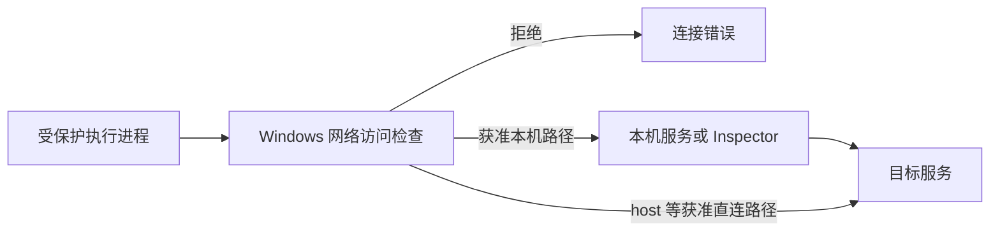

# Windows 网络隔离与 WFP

[English](../../en/architecture/windows-network.md) · [安全原理](README.md) · [网络与 PII](../protection/network-pii.md)

Agent 能联网，不代表它的每个请求都经过内容检查。理解 Windows 网络防护，先分清两件事：**连接是否获准，由网络边界约束；获准请求中的文本怎样处理，由实际接入的代理与 Inspector 处理。**

**适用范围：** Windows AppContainer 网络路径。本页说明网络机制和验证方法，不提供新的配置入口。模式、兼容性和检查能力需按所安装的 FinShield 版本及接入指南确认。公开 DSH／OpenCode Windows 插件默认使用 `host`，不因显示“已受保护”就启用网站限制或 PII 检查，见[插件默认防护](../protection/defaults.md)。

## WFP 管住哪一层

Windows Filtering Platform（WFP）是 Windows 的网络过滤基础设施。FinShield 的 AppContainer 网络规则使用 Package SID 识别受规则约束的容器身份。规则由准备与授权流程设置，Windows 在相应网络路径上执行允许或拒绝。它们不会因为脚本从 Python 改成 Node.js 就失去作用。[Microsoft WFP 说明](https://learn.microsoft.com/en-us/windows/win32/fwp/about-windows-filtering-platform)

网络规则的对象与某一个窗口不同。受保护的执行 Host 及适用子进程、普通桌面 Main、更新器和宿主本机服务，需要分别确认其身份和运行范围。不能把保护一个执行进程理解成整台电脑采用同一套网络策略。

例如，假设 Agent 在测试目录中读取一份合成名单，再尝试发送给某个服务：文件读取能否成功由文件权限决定；服务能否连接由网络策略决定；内容是否被阻断或脱敏还要检查实际请求路径。三个结果必须分别验证。

## 网络模式怎样影响连接

Windows 有效配置与旧版通用 CLI 策略的字段格式不同。下表说明意图，不是可直接粘贴进任意 YAML 的配置模板。

| 模式或路径 | 网络作用 | 需要核对的边界 |
| --- | --- | --- |
| `host` | 沿用宿主网络，不以此模式建立 FinShield 出站目标围栏 | Windows 防火墙、其他安全产品和网络环境仍可拒绝连接；不自动启用代理或 PII |
| `none`，在提供该模式的入口中 | 通过网络限制拒绝受保护身份的出站连接 | 需要验证实际执行进程及 IPv4／IPv6、TCP／UDP；不能只测试浏览器是否能联网 |
| Windows 有效 `proxy` 路径 | 将需要治理的请求接入本机代理，并以网络围栏限制直接外连 | 本机回环通信有兼容性许可；代理目的地限制只治理经过该代理的请求 |
| 通用 CLI 的 allowlist 策略 | 由对应版本的沙箱网络边界与代理执行目标规则 | 不等同于 Windows Candidate 的字段；先读相应版本的示例和帮助 |

准备完成表明所选授权流程已完成；某个请求是否获准，仍需在实际运行中检查。使用正式配置和授权入口修改网络模式，不直接删除 Windows 过滤规则或改身份标识来修复应用连接问题。

## WFP、代理和 Inspector 怎样配合

范围：受保护进程的网络连接路径。输入：进程发起连接及有效网络策略。输出：连接拒绝，或经获准路径到达服务。本图只表示组件连接，不表示所有模式都同时启用这些路径。

WFP 不负责把 HTTPS 还原成模型请求文本。代理先处理其支持的连接与目标规则；启用且满足条件的 Inspector 路径再执行 TLS 和内容检查。HTTPS 内容检查需要适用的证书信任、请求格式和配置，见[网络访问、外泄与 PII](../protection/network-pii.md)和[Inspector 原理](inspector.md)。

**本机可达是重要边界。** Windows 有效代理配置允许 TCP／UDP 回环通信，以支持代理和本机应用协作。本机服务可能自行外连或以自己的权限执行操作。因此，不能把“直接外连受限”写成“所有流量必经 Inspector”，也不能只验证一个代理端点就认定本机所有中介路径均已覆盖。具体回环兼容性还受版本、授权结果和 Windows 防火墙影响。

## 怎样验证网络限制

使用自有接收端和合成内容，先记录 FinShield、Agent、Windows 版本、启动入口及有效网络模式。然后分别检查：

| 测试 | 需要保留的证据 |
| --- | --- |
| 允许的远端目标 | 客户端结果与接收端记录；确认预期业务请求能完成 |
| 范围外的远端目标 | 原始连接或代理错误；接收端确认未收到请求；区分策略拒绝与服务故障 |
| 代理路径 | 实际请求是否使用选定代理；仅设置代理环境变量不证明客户端采用它 |
| 本机服务 | 所需回环通信是否可用；本机中介是否产生独立外连 |
| 内容检查 | 用普通文本和合成敏感文本检查实际转发载荷，而非只看界面状态 |

需要 IPv6、UDP 或某类客户端时，为该路径单独验证。一个 IPv4 TCP 请求被拒绝，不能证明其他协议和地址族都已验证。普通宿主进程能联网也不能单独证明容器网络限制失效。

本页没有重新执行安装后的 Windows 网络验收。站点构建、规则存在或历史测评结果，均不能替代当前安装环境的验证。

## 集成时应保留哪些信息

接入方应能说明当前执行进程、有效模式、授权是否完成、业务目的地、代理与证书要求，以及错误来自哪一层。网络准备错误应按原始结果处理；不要通过关闭网络保护、删除规则或扩大目标范围掩盖原因。

继续阅读：[配置项作用与生效](../protection/configuration.md)、[Agent 兼容矩阵](../agents/compatibility.md)、[Windows 系统与桌面防护](../protection/windows-security.md)。
