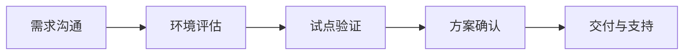

# 企业方案

[English](../../en/enterprise/README.md) · [Documentation](../README.md)

团队在研发和办公环境中使用 Agent 时，需要明确它可以访问哪些数据、执行哪些操作，以及如何确认保护已经生效。FinShield 企业方案围绕这些需求开展环境评估、试点和交付沟通。

## 哪些需求适合进一步讨论

| 你的场景 | 评估时需要确认的内容 |
| --- | --- |
| 多个团队使用不同 Agent | Agent 形态、平台版本、现有接入方式和兼容要求 |
| 需要一致的安全管理 | 策略范围、权限责任、变更流程与实际交付能力 |
| 涉及敏感信息处理 | 数据路径、网络条件、检测或脱敏需求与留存要求 |
| 将保护接入自己的产品 | 宿主职责、可用接口、版本约束、许可和验证范围 |
| 希望先验证实际效果 | 试点环境、代表性任务、验收标准和证据要求 |

以上是方案沟通的问题清单。具体支持平台、功能、部署形式、许可和服务范围，需要按客户环境及交付版本确认。个人版能力或某一插件的测试结果，不自动代表企业方案的全部交付承诺。

## 先了解产品与证据

- [产品介绍](../overview/product-introduction.md)：产品定位、接入方式和平台范围。
- [防护说明](../protection/README.md)：实际保护对象、默认配置及限制。
- [技术白皮书](../reference/whitepaper.md)：技术背景和有范围的测评结果。
- [Agent Safety Arena](https://safety.finaios.ai/)：公开录像、测试条件和结果。测试记录说明对应环境中的表现，不代替客户环境验收。

## 怎样开展合作

范围：企业方案沟通。输入：需求与环境信息。输出：双方确认的试点或交付安排。任何阶段发现不兼容或超出范围时，先说明缺口，再决定后续安排。

## 联系我们

申请产品演示、咨询企业方案或讨论集成需求，请联系 **[contact@finogeeks.com](mailto:contact@finogeeks.com)**。

建议说明公司或团队、使用场景、操作系统、Agent 名称及版本、预计使用规模，以及希望先验证的问题。首次咨询无需提供客户资料、密钥或真实敏感对话。

企业部署手册、管理接口、授权操作和运维资料随对应项目交付提供。公开开发能力请从[开发与集成](../development/README.md)开始；个人使用请从[安装指南](../getting-started/install.md)开始。
