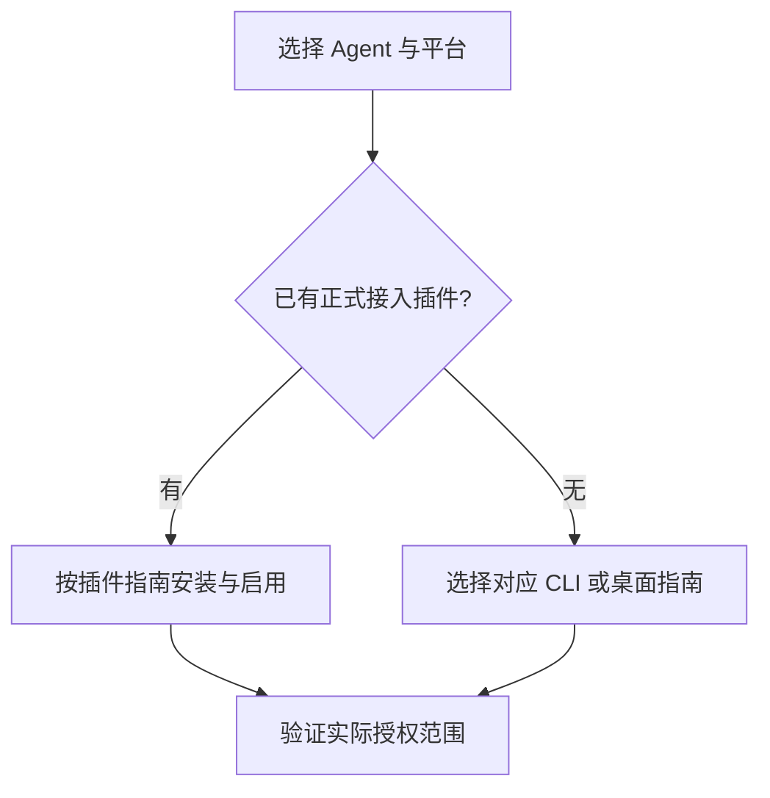

# FinShield 快速上手

[English](../../en/getting-started/install.md) · [文档目录](../README.md) · [Agent 安全测评](https://agent-safety-arena.finogeeks.club/zh-CN.html) ([English](https://agent-safety-arena.finogeeks.club/index.html))

[文档目录](../README.md) · [产品首页](https://github.com/finogeeks/finsafe)

选择操作系统，下载对应发行文件。Windows 推荐安装助手，也可下载离线 EXE；macOS 与 Linux 使用命令行压缩包。本文下载信息于 2026-11-24 按 [v0.11.50](https://github.com/finogeeks/finsafe/releases/tag/v0.11.50) 核对：Windows 为 v0.11.50，macOS／Linux 沿用 v0.11.48 构建，后续版本以 [最新 Release](https://github.com/finogeeks/finsafe/releases/latest) 的附件与说明为准。

## 先选择 Agent 与接入方式

先看[兼容矩阵](../agents/compatibility.md)，确认 Agent 形态、平台及版本范围。

| 接入方式 | 从哪里开始 |
| --- | --- |
| 插件（优先） | DSH Desktop Windows 使用[已发布插件](https://github.com/finogeeks/finsafe/blob/main/integrations/dsh/windows/README-zh.md)；按其指南安装原生组件并确认保护状态。OpenCode Desktop 使用[已发布的 FinShield 插件](#opencode-desktop) |
| 命令行 | [Codex CLI（Windows）](../agents/codex.md)和[Claude Code CLI（Windows）](../agents/claude.md)均已支持，无需安装插件 |
| 桌面入口 | WorkBuddy、DSH、Hermes Desktop、OpenCode Desktop 可从 FinShield 辅助控制台／悬浮控件启动，见下文 Windows 步骤 |
| 测试插件 | [Kilo CLI 本地交互 TUI](#kilo-cli)，使用文档指定的测试版本及配套原生组件 |
| 其他 Agent／平台 | 按[兼容矩阵中的示例与范围](../agents/compatibility.md)选择；不要直接套用 Windows 命令 |

PII 检测／脱敏扩展见[开发包](https://github.com/finogeeks/finsafe/blob/main/pii-plugins/README-zh.md)，它与 Agent 接入插件用途不同。



## Windows

以下介绍独立 FinShield 的安装、准备与桌面入口。Codex／Claude 用户完成安装和准备后，转到对应 CLI 指南，不需要在桌面控件中寻找这些 Agent 的启动图标。

1. 先安装并登录你要使用的 Agent，例如 Codex CLI、Claude Code、WorkBuddy、DSH、Hermes Desktop 或 OpenCode Desktop。FinShield 不代替这些智能体，也不代办账号登录。
2. [下载 `install-finshield.cmd`](https://github.com/finogeeks/finsafe/releases/latest/download/install-finshield.cmd) 并双击运行。安装助手使用英文提示，按 Enter 开始下载最新稳定版，并校验 SHA-256 和发布者数字签名。出现管理员授权窗口时确认，再按向导完成安装。离线安装可直接运行同一版本的 `finshield-<版本>-x64-setup.exe`。
3. 安装结束后找到桌面悬浮控件。显示“待准备”时，点击圆形按钮，再选“开始准备”；首次需要确认权限时，在辅助控制台检查范围并授权。Windows 可能请求管理员确认。
4. 等到“智能体待命”，展开控件图标，选择 WorkBuddy、DSH、Hermes Desktop 或 OpenCode Desktop。发现的程序或安装目录无效时，在辅助控制台修正；DSH 还需确认 Node.js 目录。
5. 点击可启动的智能体图标，等待确认运行后开始任务。之后再次点击带绿色状态点的图标，即可打开已有实例；日常无需保持网页打开。

首次使用建议从一个空的测试工作区开始。让智能体在已授权的可写目录里创建 `finshield-demo.txt`，写入“测试完成”，再读取它。确认基本功能可用后，按下方[验证授权范围](#验证授权范围)检查只读和禁止访问范围。

普通双击打开 FinShield 不会自动开始新的授权。看到“待准备”时，主动选择“开始准备”；“智能体待命”表示可以选择已接入的智能体。安装完成、安全准备完成和智能体运行是三个不同状态。

### OpenCode Desktop

Windows x64 的 OpenCode Desktop 可使用已发布的 `@finogeeks2026/finshield-opencode` 插件，也可使用独立 FinShield 桌面入口。插件接入目标为 Desktop/SDK 2.3.0，后续版本请核对所交付插件的要求。

先保存工作并退出 OpenCode，再在 PowerShell 中使用 Desktop 自带的 CLI 安装插件：

```powershell
$openCodeCli = "$env:LOCALAPPDATA\Programs\ai.opencode.desktop\resources\opencode-cli.exe"
& $openCodeCli plugin add '@finogeeks2026/finshield-opencode'
```

按实际使用的 Desktop 安装位置选择 CLI：

| Desktop 安装方式 | PowerShell 中的自带 CLI 路径 |
| --- | --- |
| 默认按用户安装 | `$env:LOCALAPPDATA\Programs\ai.opencode.desktop\resources\opencode-cli.exe` |
| 全机安装 | `$env:ProgramFiles\ai.opencode.desktop\resources\opencode-cli.exe` |
| 自定义目录 | `<Desktop 安装目录>\resources\opencode-cli.exe` |

全机安装或自定义安装时，先修改 `$openCodeCli`，再运行 `plugin add`。该方式使用 Desktop 自带的 CLI，无需额外安装命令行版或修改 PATH。若当前终端已能运行 `opencode`，也可使用 `opencode plugin add @finogeeks2026/finshield-opencode`。

插件会管理版本匹配的 FinShield 原生安装，可直接走插件接入流程，无需先完成上文独立悬浮控件的安装步骤。默认管理目录如下：

| 用途 | 默认位置 |
| --- | --- |
| FinShield 原生程序 | `%ProgramFiles%\FinSAFE\opencode-plugin-versions\<version>` |
| 原生配置 | `%ProgramData%\FinSAFE\opencode-plugin-versions\<version>\config` |
| 安装包下载 | `%LOCALAPPDATA%\FinSAFE\opencode-plugin\downloads` |
| 插件实例设置 | `%USERPROFILE%\.config\opencode\finsafe-windows\config.json` |

`<version>` 为配套原生版本，例如 `0.11.50`。如果已选择自定义目录，或设置了 `XDG_CONFIG_HOME`，以实际位置为准。插件包缓存由 OpenCode 管理，与上表的原生安装目录分别存放。安装与更新流程另见[已发布插件指南（英文）](https://github.com/finogeeks/finsafe/blob/main/integrations/opencode/windows/README.md)。

打开 **Settings → FinShield**，按提示安装原生组件、完成 Windows 授权，并等待准备结束。保存工作，选择 **Exit OpenCode**，再手动打开 OpenCode；在 FinShield 页面确认当前保护状态。准备完成本身不会使当前普通 Host 进入保护。

插件保护执行 Host，桌面 Main 保持在 AppContainer 外。通过 FinShield 页面的 **Check for updates** 检查更新，并按已安装版本的提示更新和重新打开。停用或移除插件不会解除正在运行的 Host 的隔离，也不会卸载原生 FinShield；这些操作需分别处理。

不使用插件时，先安装并准备独立 FinShield，在辅助控制台或悬浮控件选择发现的 OpenCode Desktop，通过安全启动入口运行，并核对实际 Host 保护状态。

### Hermes Desktop

Windows x64 用户先单独安装 Hermes Desktop，再按上文安装并准备独立 FinShield。辅助控制台与悬浮控件可发现已注册的 MSIX 和源码安装的 Hermes Desktop。确认所选程序与原生配置后，通过 FinShield 的安全启动入口运行；后续可用“打开”返回已有桌面实例。

FinShield 将执行 Host 放入 AppContainer，普通桌面连接该 Host；桌面界面本身仍在 AppContainer 外。直接启动 Hermes 是另一条入口，不能据此认定已受保护。该桌面启动方式无需安装实验性的 Hermes FinShield 插件。按[验证授权范围](#验证授权范围)检查允许与拒绝两种文件操作。

macOS／Linux 的 Hermes CLI 请使用当前发行版的命令行帮助和策略示例，勿套用 Windows 桌面步骤。

### Kilo CLI

Windows x64 接入范围为 Kilo CLI **7.8.27** 的本地交互 TUI。当前文档对应测试插件 **`0.11.1-debug.6`**，配套原生 FinShield **0.11.1**；测试交付与正式市场发布分别说明。`kilo run`、远程 attach、daemon 工作区、mini 模式、Kilo Desktop、VS Code 扩展、Linux 和 macOS 不在该验证范围。

保存工作、退出 Kilo 后，安装指定测试版本：

```powershell
kilo.cmd plugin @finogeeks2026/finshield-kilo@0.11.1-debug.6 --global --force
```

在项目目录重新打开 Kilo。插件准备专用的原生安装与策略，按需请求 Windows 授权，准备好后提供受保护的重启入口。选择 **Later** 会保留当前普通会话。通过 Kilo 命令面板中的 **FinShield** 查看准备进度和当前进程的真实保护状态；已准备好的情况下，插件激活可能自动重启 Kilo。

更新后须关闭并重新打开 Kilo；仅停用再启用插件可能仍使用旧回调。更新应沿用原安装范围。停用插件不会解除已有进程的隔离，移除插件与卸载原生 FinShield 也需分别处理。当前会话恢复与退出验收尚未完成，依赖这些功能前请验证自己的工作流程。

## macOS

v0.11.50 中的 macOS 包沿用 v0.11.48 Apple 芯片构建，本次发行不含 Intel 包。

1. 在 Releases 下载 `finshield-<版本>-macos-arm64.tar.zst`。
2. 使用支持 Zstandard 的解压工具解压；校验文件可与同一版本的 `SHA256SUMS` 对照。
3. 保留包内目录和配套文件。从终端进入解压后的目录，运行：

```sh
./finsafe --version
./finsafe probe
./finsafe doctor
./finsafe --help
```

将该目录加入 `PATH` 后，可以直接使用 `finsafe`。按当前包的帮助和发行说明，通过 FinShield 启动你已经安装的 Agent。例如，包含 Hermes 快捷入口的版本可使用：

```sh
finsafe hermes
```

不要将“直接启动 Hermes”视为同一个受保护入口。网络与隐私检查的覆盖范围见 [Linux/macOS 资料安全说明](../overview/linux-macos.html#data)。

## Linux

当前公开构建目标为 x86_64 GNU/Linux。

1. 下载 `finshield-<版本>-linux-x64.tar.zst` 并解压。
2. 保留包内配套程序，特别是 `finsafe-helper`、`finsafe-supervisor` 和 `finsafe-landlock-shim`；不要只复制主程序。
3. 在解压后的目录运行：

```sh
./finsafe --version
./finsafe probe
./finsafe doctor
./finsafe --help
```

Linux 的实际能力取决于 bubblewrap、cgroup、内核与授权配置。按诊断结果和该版本的发行说明完成主机准备，再通过该版本支持的 FinShield 入口运行 Agent。命令行检查通过不能代替实际任务验证。

## 验证授权范围

使用专用测试目录和测试文件，按实际授权范围验证：

| 范围 | 测试方式 | 预期 |
| --- | --- | --- |
| 可读写工作区 | 创建、读取并修改 `finshield-demo.txt` | 操作成功，文件变化可见 |
| 已设为只读的目录 | 读取测试文件，再尝试修改 | 可读取，修改被拒，原内容保留 |
| 已设为禁止访问的目录 | 尝试读取预先存在的测试文件 | 读取被拒 |

判断以工具返回、文件内容和目录状态为准。模型口头拒绝、文件不存在或路径写错，都不能证明防护生效。直接从原厂快捷方式启动的应用不能默认视为受保护；网络与内容检查也仅覆盖已接入、可检查的路径。

## 升级与卸载

Windows `v0.10.1` 可从控件或控制台检查更新，自动检查至少间隔 24 小时，手动检查可随时发起。安装新版 EXE 时，按向导处理正在运行的应用，再检查授权范围和启动状态。卸载通过 Windows“设置 → 应用 → 已安装的应用”中的 FinShield／历史 FinSafe 条目完成。

该版本在更新检查请求中上报基本使用统计，不再提供统计开关；安装包从 GitHub 或 CDN 下载。详见 [v0.10.1 发行说明](https://github.com/finogeeks/finsafe/releases/tag/v0.10.1)。

macOS 和 Linux 更新时，先结束受保护任务，再用同一版本的整套发行文件替换原目录。移除命令行程序与清理配置、模型、证书、记录是不同操作；需要清理这些数据时，按对应版本的说明执行，勿直接删掉仍在使用的文件。

## 获取帮助

在 [GitHub Issues](https://github.com/finogeeks/finsafe/issues/new/choose) 反馈问题时，请提供产品版本、操作系统与 CPU 架构、Agent 名称与版本、启动入口、复现步骤、预期与实际结果，以及经过脱敏的错误文字或日志。

请勿提交真实客户资料、密钥、会话令牌或完整敏感对话。敏感安全问题请通过已有 Finogeeks 支持渠道私下反馈。
