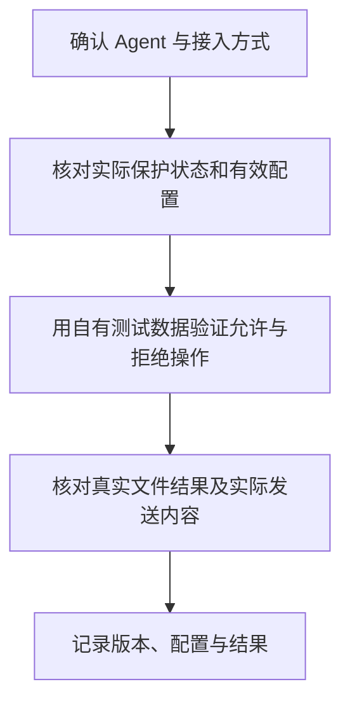

# FinShield 到底防护什么

[English](../../en/protection/README.md) · [文档首页](../README.md)

FinShield 为受保护的 Agent 执行进程增加文件、系统、设备隐私和桌面交互边界。本页解释**默认保护哪些内容、哪些操作仍然允许、配置会改变什么，以及怎样确认实际效果**。安装方法见各 [Agent 接入指南](../agents/README.md)。

> **先确认接入方式。** 公开的 DSH 和 OpenCode Windows 插件默认使用 `network.mode: host`。插件显示“已受保护”，不表示已经启用网站访问限制、HTTPS 内容检查或 PII 脱敏。网络与 PII 的独立配置条件见[网络访问、外泄与 PII](network-pii.md)。

## 先看你使用的产品入口

| 使用方式 | 本页怎样解释防护 |
| --- | --- |
| DSH／OpenCode Desktop 的 Windows 接入插件 | 按公开随包配置说明默认文件边界及系统／桌面防护；网络默认为 `host` |
| 支持内容检查的 Windows FinShield 配置及 PII 开发集成 | 按有效配置检查代理、TLS、允许目标和检测器；不能把开发示例当成接入插件默认值 |
| WorkBuddy、Hermes、Codex、Claude 等其他入口 | 先核对各自[兼容范围](../agents/compatibility.md)，不直接套用 DSH／OpenCode 的默认配置 |
| Linux／macOS CLI | 使用对应平台的策略和主机能力；Windows 插件配置格式与桌面防护结果不直接适用 |

## 默认防护能带来什么

以下场景需从 FinShield 的受保护入口运行，并以实际版本、有效配置和授权为准。

| 你关心的事 | 防护作用 | 仍需知道的边界 |
| --- | --- | --- |
| Agent 读取 SSH、云服务或浏览器资料 | 随包配置明确拒绝访问已列出的敏感目录，例如 `.ssh`、`.aws`、Chrome／Edge 用户资料目录 | 按路径覆盖；自定义位置或未列出的文件不自动获得同样保护 |
| Agent 覆盖或删除重要文件 | `deny` 拒绝访问；`read_only` 允许读取并限制写入 | 允许写入的目录仍可能被修改或删除；防护不提供文件备份或撤销 |
| Agent 摄录或干扰桌面 | AppContainer 与有效 Job/UI 限制共同约束设备和桌面操作 | 不保证阻止所有截屏方法；同桌面屏幕读取等边界见 [Windows 系统与桌面防护](windows-security.md) |
| Agent 结束其他进程或改系统设置 | 受保护进程受到 Windows 权限边界约束 | 不能把某项成功测评扩展成对所有系统操作的保证 |
| Agent 访问网站或向模型发送文本 | 默认接入插件仍使用宿主网络 | 默认没有 FinShield 网站黑名单，也没有由该配置启用的 PII 检查 |

完整的默认目录范围、兼容性例外及允许操作见[插件默认防护](defaults.md)。公开测评及其版本、条件见[产品机制与测评资料（历史）](../reference/whitepaper.md)；测评场景数不用于证明 PII 检测率。

## 三个常见问题

**装上插件后，只有工作区能写吗？**

公开插件配置的 `filesystem_coverage.root` 是 `read_write`，再列出拒绝和只读规则。这不是“所有工作区外文件默认禁止”的配置。`.env` 也不是这两份公开默认配置中的通用文件名拒绝规则。重要资料应核对实际路径及生效规则，见[默认范围](defaults.md)。

**哪些网站不能访问？**

当前两种插件的默认配置没有 FinShield 目标白名单或网站分类拦截。主机自身的防火墙、企业网络或网站服务仍可能拒绝请求。需要限制目标时，必须使用支持该功能的接入方式并配置允许目标；不能只看“已受保护”状态，见[网站访问规则](network-pii.md#哪些网站会被阻止)。

**检测到身份证号，就一定不会发出去吗？**

要先有实际覆盖请求的内容检查。检测命中后，`warning` 允许发送，`block` 阻止发送，`approval_required` 等待审批。脱敏还需要有效替换文本及相应改写许可。详见[命中后怎样处理](network-pii.md#pii-命中后怎样处理)。

## 配置项怎么影响行为

- [插件默认防护](defaults.md)：默认目录、写入范围和保护对象。
- [配置项作用与生效](configuration.md)：路径权限、网络、PII、资源字段，以及目前哪些入口已经公开。
- [Windows 系统与桌面防护](windows-security.md)：Job/UI 分组、底层 API 访问、进程与注册表权限、兼容性取舍及验证边界。
- [网络访问、外泄与 PII](network-pii.md)：允许目标、内容检查、告警／阻断／审批与脱敏。

“配置文件中有字段”“界面提供可修改入口”“配置已经生效”是三件事。未开放的配置入口不作为当前可用功能介绍。

## 怎样验证自己受到了什么保护

范围：用户确认当前防护。输入：当前 Agent、版本和测试配置。输出：允许与拒绝操作的实际结果；错误保留原始原因。不改变现有产品授权流程。

先保存任务，在自有测试目录分别测试可写、只读及禁止访问的目标。网络与 PII 使用合成文本及自有接收端验证；不要用真实凭据或客户数据做测试。输入框里的文本、模型口头拒绝和独立开发工具测试成功，都不能代替实际文件结果或真实转发载荷。操作步骤见[安装与验证](../getting-started/install.md#验证授权范围)。
