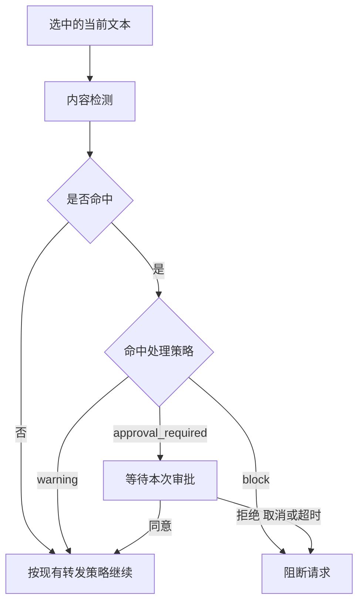

# 网络访问、外泄与 PII

[English](../../en/protection/network-pii.md) · [防护说明](README.md)

防止数据外泄需要分清三件事：**Agent 能读到什么、能连接哪里、实际发送的内容会怎样处理**。只保护文件，不能证明用户输入的敏感文本也会被阻止；只限制网站，也不能证明发往获准模型的内容已经脱敏。

## 当前插件默认有没有网站或 PII 防护

公开 DSH 与 OpenCode Windows 插件的网络模式是 `host`。DSH 运行说明明确不提供代理、TLS 检查、PII 或出站内容过滤。OpenCode 的公开说明同样不能作为完整网络隔离的保证。

因此，默认插件用户不能仅凭“已受保护”认定下列能力已经开启：网站白名单、网盘上传阻断、HTTPS 内容检查、PII 命中阻断或自动脱敏。这些功能需要对应产品支持、配置与实际流量覆盖。公开的 Windows PII 集成示例属于单独的配置流程，见[配置项作用与生效](configuration.md)。

## 哪些网站会被阻止

| 当前设置／条件 | 怎样理解网站访问结果 |
| --- | --- |
| 接入插件默认 `mode: host` | 没有由此配置启用的 FinShield 网站拒绝清单；宿主或企业网络仍可能阻止连接 |
| 支持的代理配置使用目标范围限制 | 按允许目标执行检查；不在获准范围内的目的地应在实际验证中被拒绝 |
| PII 示例的 `endpoints: ["*.*"]` | 是宽泛允许范围，不能把它当作只允许模型服务的严格白名单 |
| 目标已被允许 | 只说明目的地层面的许可，不能证明上传或模型请求内容已经安全 |
| 搜索页面、重定向、下载链接、API 或 CDN 使用其他主机名 | 每个实际目的地都需核对；允许一个网页地址不等于所有后续请求都已获准 |

本页不提供“所有危险网站”“所有网盘”或“所有社交网站”的内置分类拦截清单。公开示例没有完整定义 `endpoints` 对裸域名、子域名、IP、端口及 URL 路径的匹配语法，因此本页不编造通配符规则或保证某种写法有效。

需要缩小外发范围时，先列出业务必需的模型、代码仓库和 API 目的地，再通过所用产品已支持的入口配置，分别测试允许目标与范围外目标。保留已有更严格的范围，不直接用 `"*.*"` 覆盖。Linux／macOS 等 CLI 的旧版策略示例使用另一种格式，不能直接贴进 Windows Candidate。

## PII 实际检查什么

PII 是个人身份信息。在公开插件协议中，FinShield 先从实际拦截的出站模型 API 请求中选择当前输入文本，再交给检测器；插件不接收任意完整硬盘或全部会话。

| 文本或数据 | 公开协议中的范围 |
| --- | --- |
| 当前用户消息的受支持文本块 | 可作为当前输入选择 |
| 当前工具结果及紧邻的助手消息 | 可包括工具返回文本、受支持的推理及工具参数文本；受具体模型协议限制 |
| 更早的对话历史 | 不因本次检查而全部重新扫描 |
| 本地读取、但没有放进模型请求的文件 | 不在该模型内容插件的观察范围内；文件访问另由文件权限控制 |
| 图片、二进制附件和不透明内容块 | 该公开文本协议不负责解码或 OCR |
| 普通网页上传、任意自定义协议或绕开检查路径的请求 | 不能仅凭模型 PII 插件推断已覆盖 |

HTTPS 检查还需要流量经过支持的代理路径、有效的证书信任和可解析的格式。仅安装证书、启用一个字段或看到检查器进程，都不能证明某个请求已被检查。复杂 Anthropic Messages 工具结果与 thinking 的改写映射尚不受支持；返回修改会校验失败，不能当作已经脱敏。

## PII 命中后怎样处理

`on_finding` 属于当前选中的检测器条目。

| 策略 | 命中后的作用 | 对外泄控制的含义 |
| --- | --- | --- |
| `warning` | 记录告警并允许发送 | 告警本身不阻止原文发送；若另有有效改写，需核对实际替换结果 |
| `block` | 拒绝发送命中请求 | 用实际接收端确认该请求没有送达 |
| `approval_required` | 等待原有审批流程 | 同意后可继续，拒绝、取消或超时不发送；不是永久放行所有后续请求 |

范围：支持的模型内容检查。输入：已经选中的当前文本与检测器策略。输出：允许转发、等待审批或阻断；不可解析、插件失败及无效结果属于错误，不是“检查无命中”。本图不定义底层网络实现。

未命中不等于不含敏感信息。识别范围依检测器和类别，不能把公开文件／桌面测评的成功率当作 PII 准确率。

## 检测与脱敏有什么区别

检测器报告命中，不等于已经改写。外部插件的脱敏需要：返回有效的替换文本、配置允许 `allow_rewrite`，且命中策略允许继续发送。`block` 仍会阻断命中；不能用改写许可覆盖阻断策略。

公开身份证示例使用格式正则，把合成测试值 `11010119900101123X` 改成 `110XXX123X`；它不校验日期或校验码，也不检测 15 位号码。输入框可能仍显示原文，应检查实际转发载荷。

目前只执行 `plugins` 第一项。第一项未命中或失败时，也不会尝试后续条目。不要把多个检测器条目理解成已串联的多层防线。外部 EXE 是在 AppContainer 外运行的受信任扩展，安装它本身是独立的信任决定。

## 怎样确认没有外发原文

1. 记录实际 Agent、FinShield 版本、配置来源和当前接入方式。默认 `host` 插件不作为已启用 PII 的测试对象。
2. 在支持该能力的配置中确认实际目标范围、代理／TLS、有效配置及所选第一项检测器。
3. 使用普通文本和合成敏感文本，分别测试用户消息与工具返回文本；例如 `user@example.com`，以及上述公开身份证示例。
4. 对告警、阻断、审批及脱敏分别核对结果，检查自有接收端或受支持记录中真正转发的内容。请求未到达也要区分策略拒绝、网络失败与插件错误。
5. 若启用了原文留存，同时管理本地记录的访问和保存。已脱敏发送不代表本地原文已删除。

独立开发页面只证明插件在给定文本上的返回结果，不证明真实 Agent 的请求已经过生产检查链路。完整示例和协议见[PII 接入说明](https://github.com/finogeeks/finsafe/blob/main/pii-plugins/examples/redactor/README-zh.md)、[协议 v1](https://github.com/finogeeks/finsafe/blob/main/pii-plugins/docs/protocol.md)及[DSH 运行说明](https://github.com/finogeeks/finsafe/blob/main/integrations/dsh/windows/OPERATIONS-zh.md)。
