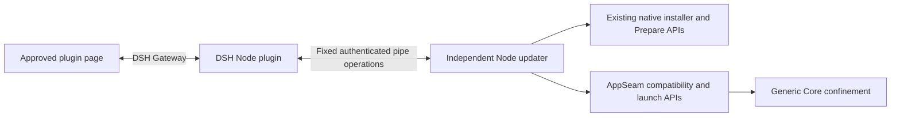
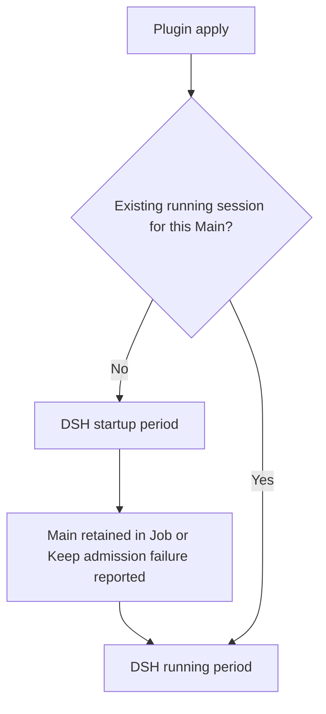
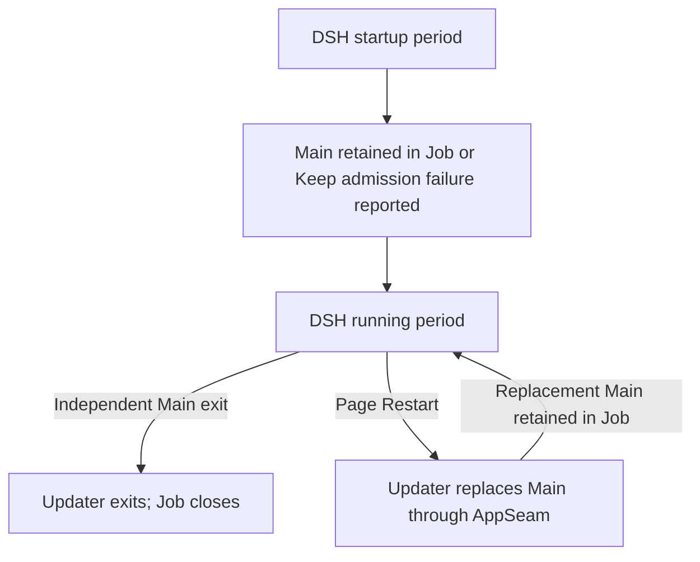
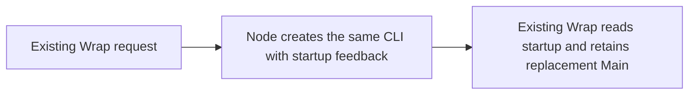
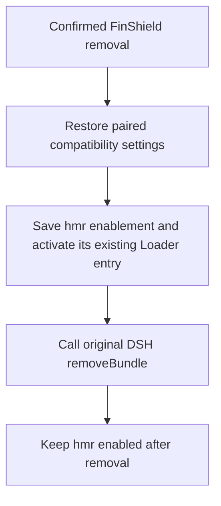

# FinShield for DSH Desktop: design and operation

Revision: 2026-11-13. This document describes the Node plugin and independent
Node updater in this package. Unit and owned-fixture checks do not establish
installed-product acceptance. The owner performs installation, Windows consent,
restart and upgrade checks.

Host self-update (source implemented, installed-product acceptance pending):
`apply` adds one listener registration. A completed enabled self-update with HMR
absent can load backend code from `<profile.dir>/.finshield-runtime/<version>/`
and replace its managed instance without restarting DSH. The plugin waits for
existing native restoration first. Import failure keeps the old instance; a
failed new activation attempts to resume its cached predecessor and logs the
error. Registration and activation are best effort, without automatic retry.
Downloads, package installation, DSH, HMR and native protection rules stay unchanged.
This does not refresh Client modules or suppress DSH's restart-required result.
The first listener-equipped version needs one normal load. The owner approved
the versioned copy directory; no automatic directory cleanup is introduced.

Current source lifecycle (#1075; installed-product acceptance pending): Keep no longer assigns
Main to the updater Job; wrapped DSH also launches outside that Job. Updater
observes the retained Main process handle through an asynchronous exit wait.
Main exit ends updater; updater exit or startup recovery leaves DSH running.
The updater Job still owns startup discovery and cleanup of updater and its
installation work. See the [canonical revision](../../../docs/design/dsh-configuration-and-startup-order.md#approved-lifecycle-revision-source-implemented).
The shared-Job description below is historical implementation context, not
the current lifetime contract or acceptance of this revision.

Owner issue [#1029](https://github.com/Geeksfino/finsafe/issues/1029): startup
enters running with Main retained in updater's Job or a reported Keep admission
failure. Updater creates and joins its Job before listening.
Keep completes `apply` before explicitly assigning Main;
Job admission failure is reported while DSH continues. Wrap retains a replacement
that inherits the Job at creation.
Page Restart replaces Main through this updater and retains the Job. Canonical:
[updater process lifetime](../../../docs/design/dsh-plugin-updater.md#5-updater-process-lifetime)
and [startup and running periods](../../../docs/design/dsh-configuration-and-startup-order.md).
Source implements startup keep-or-wrap, Main ownership, then running bind and
the three native-work scenarios. Installed-product acceptance remains separate.

The selected FinSAFE Desktop CLI calls the same prompt-return authorization
function as Widget and Console. Native task state and progress are observed at
two-second intervals. These reads do not resubmit authorization. The generic
updater can serve a newer plugin and selects versioned native installation targets.

The updater is an independent ordinary Node process. It never runs in
AppContainer. Independent Main exit makes updater exit promptly. Page Restart
retains updater while it stops old Main and replaces it. Setup joins this same
session Job, so updater exit stops installation. Accepted authorization remains
independent and continues after updater exit.
The updater directly calls its asynchronous DLL setup entry. There is no result
host or installation observer process. NSIS joins the session Job and closes
its temporary handle; updater holds that Job's sole long-lived handle.
Plugin removal alone is not final Main exit. FinSAFE does not reload Host.

Silent plugin setup explicitly reuses the existing installation worker handoff.
After setup succeeds, Desktop CLI receives that descriptor and passes it to the
existing AuthoritySession. The submitted authorization and its FinSAFE owner
remain independent of updater. Normal first installation can therefore reuse
one Windows UAC consent. Prepare, worker checks and personal defaults are unchanged.

Installation-termination recovery is deferred in issue #1016. This change adds no
automatic interruption detection, repair or rollback. The existing native result
remains visible when available. Partial files or configuration may remain; future
work should first evaluate rerunning the existing full installer.

All DSH launches use one initialization flow. Launch origin must not select
behavior. Startup wrap is only for an already-ready ordinary Host, before the
Job. See
[startup wrap versus keep](../../../docs/design/dsh-configuration-and-startup-order.md#2-startup-period).

FinShield uses FinSAFE AppContainer confinement for the DSH Host and its tools.
The original Desktop, icon, account and sessions remain in use. Main remains an
ordinary process. Core has no DSH-specific startup or permission decisions.

## Components and ownership

Scope: component connections. Input: enabled DSH bundle. Output: observed status,
keep, wrap, or session exit. Installation and launch algorithms are child flows.

DSH owns package selection, enablement, loading and disposal. The Host entry
registers page services and cleanup, then schedules initialization. The updater
owns native-task attachment and progress observation. Page Restart stops only
old Main and uses AppSeam to launch and retain its replacement.
A thin plugin-owned DLL supplies Windows transport, native identity/lifetime
checks and fixed API calls. It is not a native updater daemon. The personal
Shell has no plugin listener; `finsafe desktop-channel` has been removed.

The plugin has no independent version sequence. Its required npm version field
uses the root FinSAFE release version; release preparation synchronizes package
and lock metadata, and G0 rejects drift. It supports DSH
`>=0.2.1-rc.5 <0.3.0` and updater protocol 1. Package version and protocol
labels do not gate updater reuse. Protected activation uses the current Host
token without requiring the newly published native release. The requesting
plugin selects the native target release; the updater package version does not.

## Installation instances and paths

The installation directory selects the existing native record, installed version,
update policy and uninstall ownership. The configuration directory selects the
candidate/effective YAML. User SID plus `security_domain_id: finshield.dsh`
selects native security resources. Different directories can hold different
versions but share authorization if their user/domain ID is the same.
Personal configuration, shortcuts, reporting and update defaults retain their
existing behavior. A personal installation elsewhere cannot replace this record.

| Content | Resolved location |
|---|---|
| DSH desktop profile | `<DSH_HOME>/profiles/desktop/` |
| Plugin instance settings and private Host DLL copy | `<DSH_HOME>/finsafe-windows/` |
| Native runtime, default | `<ProgramFiles>/FinSAFE/dsh-plugin-versions/<release>/` |
| Native configuration, default | `<ProgramData>/FinSAFE/dsh-plugin-versions/<release>/config/` |
| Verified setup and results | `<LocalAppData>/FinSAFE/dsh-plugin/downloads/<version>/` |
| Independent DLL, Koffi and updater code | `<LocalAppData>/FinSAFE/dsh-updater/<version>/` |
| Node executable, reused in place | Actual DSH Host-selected primary runtime |
| AppSeam original-field records | `<LocalAppData>/FinSAFE/AppSeam/dsh-originals/` |

These are templates, not machine-specific paths. DSH's home resolver and actual
Host command line determine home, profile, selected runtime and available Node.
Native Windows known folders determine user and system roots, including relocated
folders, without AppContainer package redirection. Explicit absolute instance
settings are supported. Native file resolution supplies resource comparison keys;
Node does not strip extended path prefixes or reconstruct drive/user paths.
`DSH_HOME` is passed explicitly to setup, preparation, compatibility and launch.
The fixed `<DSH_HOME>/finsafe-windows/config.json` discovery entry retains any
custom setup-result directory. Ordinary bootstrap uses the selected DSH Node
directly. Setup runs through the existing DLL in that updater; runtime operation
requires no extra Node process or PowerShell. Application paths retain
ordinary DOS/UNC spelling. Native handle/File ID checks remain separate from
the values passed to setup and Desktop authorization.

The ordinary Host executes its actual selected DSH Node in place. It copies
Koffi, the plugin DLL and required scripts once per package version, outside the
plugin package. Existing copies are reused without scanning or hashing their
contents. No Node copy, hash manifest or full-release fingerprint is created.
A versioned private Host DLL copy avoids holding the package's DLL open during
pnpm removal. File I/O for both copies is asynchronous. Published package versions
identify these files; changing bytes under the same version is not a refresh route.
The updater depends on the selected DSH runtime remaining available. Missing or
unusable Node reports the startup error; no separate runtime is downloaded.
Staging does not authenticate the package source; see the accepted vulnerabilities.

## Activation and readiness

Scope: one backend activation. Input: current Host and selected instance.
Output: keep, wrap, Host bind, a running scenario, or an actual error.
Canonical:
[startup and running periods](../../../docs/design/dsh-configuration-and-startup-order.md).

Do not bind, download, Ensure, or wrap inside this section. Startup obtains
the updater, then keeps or wraps. Keep completes `apply`, then assigns Main;
status and logs report any Job failure without stopping DSH or changing the
actual Host protection result. Wrap retains its inherited
replacement. Running binds, then
observes or runs one scenario: first install, update, or authorization ready.
Keep assignment failure does not establish Job membership or a Job-close
termination guarantee for that Main. Later activation of the retained session
does not repeat startup wrap eligibility.

An AppContainer Host can only connect to the existing outside updater; it cannot
bootstrap an ordinary process or perform installation itself. The authenticated
updater stages updates and retains the confirmed native transition. Protection
observation uses TokenIsAppContainer. An unavailable updater is an actual error
and does not remove the Host's existing protection.

Startup reads installation before authorization. A missing or mismatched target
keeps this DSH without invoking a missing executable; preparation belongs to the
running period. Installation or authorization read errors also select Keep,
retain their original error and do not reject `apply`. Running assessment reads
the selected installation through the existing native API. Stored setup
records are diagnostics only: no resume or old-result wait blocks a later attempt.
Missing or mismatched runtime
uses the verified release download and full silent NSIS setup. The installer
retains elevation, CA, Service, Defender, Restart Manager, cancellation and reboot
semantics. The plugin disables native self-update and omits integration outputs.
After setup succeeds, call the shared Desktop authorization entry in the selected
installation. Service configuration and maintenance remain installer operations;
the updater does not inspect the SYSTEM Service process.
It does not unpack the installer or reproduce installer/authorization algorithms.

Prepare ensure/status retain native task attachment, completed-state reuse,
actual outcomes and percentage calculation. Node shares only matching active
work. Completed tasks are re-evaluated on a new activation. Conflicting mutations
of an installation or configuration fail visibly. Opening a page only observes
status; unknown percentage remains indeterminate. No retry-to-success loop or
Console/authorization button is added.
The optional progress heading names installation or authorization from the native
phase and includes the native percentage when available.

The updater survives page closure and Page Restart. Independent Main exit ends
updater. The existing native bootstrap starts the selected ordinary Node;
detachment is not used to escape AppContainer identity. One updater slot is keyed
only by FinSAFE ID. Namespace and peer user/logon/session checks remain separate
from that key. It is separate from Inspector and has no autostart,
watchdog service, SYSTEM service or lifecycle lock. Final Main exit and stop
signals exit updater without waiting for independent authorization; the native
operating system then stops its installation group. The updater is reused
across plugin versions rather than replaced by a plugin-version comparison.

## IPC and bound targets

The native adapter uses Windows-resolved LOCAL/AppContainer namespaces, explicit
ACLs, data-only client access, bounded 16 KiB JSON frames and timeouts. Native
peer handles establish user, logon, session, container and process identity.
Server identity includes the ordinary Node selected by the client's actual DSH
Host command line and its staged updater entry point. Windows native path
resolution establishes executable-path equality without content hashing.
Create the work pipe before wrap launch. Do not wait for bind. Child:
[Host bind](../../../docs/design/dsh-configuration-and-startup-order.md#31-host-bind).

`hello` and `bind` establish protocol and client context. Fixed bound operations
are `status`, `ensure`, `restart`, `release` and `uninstall`; unknown operations
and fields are rejected. Protected callers use only the fixed authenticated
operations; installation and process control execute in the outside updater.
There is no arbitrary execution, environment, path-write or setup interface.
Native opaque handles remain internal to the updater, outside IPC.

Binding retains the actual pipe Host, original Main, image, profile/home and
selected native paths. Process creation times and retained handles reject PID
reuse or departed targets. A protected Host's existing supervisor is validated
as part of its relationship to Main. Separate clients do not replace each other's
targets. Matching active tasks can attach; distinct native resources retain
separate results. Each native bind has its own Main handle. The session keeps
the binding that retained replacement Main for Job membership and exit observation;
a Host rebind does not replace that lifecycle owner. Concurrent independent Hosts sharing the same profile are
outside this implementation scope, as confirmed by the owner. Normal packaged
DSH uses its own single-instance lock.

## Restart

Opening DSH from its original shortcut or menu, reopening it after exit and
choosing Restart DSH all enter the same apply flow. Do not classify launch
origin. Actual Host protection and native readiness govern keep versus wrap
in the **startup** period.

An ordinary activation that is already native-ready wraps in startup. Old Main
stays outside updater's Job during Keep/Wrap. Keep completes `apply` before Job
admission; failure does not reject that completed activation. Wrap
uses the existing AppSeam launch; launcher and replacement Main inherit the Job
at creation. Retention records the new Main owner without waiting for new Host
bind or new `apply`. Child:
[Wrap restart](../../../docs/design/dsh-configuration-and-startup-order.md#23-wrap-restart).
Running-period work is first install, update, or authorization ready. When the
selected target enters authorization Ready, including reuse for an upgrade,
updater checks its installation/configuration usability and whether this DSH
needs a wrapper switch. It retains one Restart/Later decision for that target;
status polling and reconnect return that decision without business rechecks.
Child:
[Page and native work](../../../docs/design/dsh-configuration-and-startup-order.md#32-page-and-native-work).
Later keeps this session. The page is DSH UI; it does not own lifetime.

Page Restart records restarting, acknowledges promptly, and directly executes
the command with the retained selected target. Report the actual operation
failure. Progress and result records support display and cleanup; they do not
suppress commands or select a target.
This updater stops old Main, waits for that Main to exit, then launches through
AppSeam and retains new Main in the same Job. Restart performs no installation
or authorization. It does not wait for old Host exit or new Host bind.

Wrap failures are written synchronously to updater's persistent `startup-*.log`
with the operation, target paths/release, Main identity and original error. If
original Main is still live, keep it. Otherwise clean the failed launcher and
pipes and exit updater; its Job closes. Add no retry, recovery process or ordinary
fallback.

Implementation and tests must follow the canonical reminder and Restart flows
exactly. Do not add extra business conditions, helper reads, scans, or retries.

If bind fails in the running period, report the connection failure and keep
the Job. Do not rebuild updater or wrap. Issue #1029 was a missing work-pipe
listen before launch, not an AppContainer namespace block.

Canonical:
[startup and running periods](../../../docs/design/dsh-configuration-and-startup-order.md).

## AppSeam settings

AppSeam owns the shared DSH launch adaptation. It saves both original fields
before it binds the profile's actual pnpm store and applies `sandbox-policy.config.mode` in the desktop
`cordis.patch.yml`. Node only calls the fixed API. Core does not edit vendor YAML.
Plugin updater Wrap first stops old Main and sets `hmr.disabled: true` through
the existing fixed YAML parser, then calls AppSeam launch. The hmr-only operation
does not change sandbox or pnpm and is not part of independent launch preparation.

The CreateProcess adapter preserves the original flags for selected and
non-selected children. Host and intermediate launch processes use Windows default
Job membership and the existing launch chain. The 2026-11-12 owner correction
withdraws mandatory Host exclusion. Core confinement and personal Desktop Job
limits remain unchanged. The native adapter fixture covers updater and personal
Desktop Jobs; installed DSH/Core acceptance remains separate.

The pinned official `@pnpm/modules-yaml` 1002.0.1 reader is bundled into AppSeam's
fixed parser. Existing metadata supplies storeDir. With no installed modules,
the selected DSH packaged pnpm reports its store in the ordinary environment.
No drive, username or store-version suffix is inferred. A matching explicit
binding is unchanged; a conflict or missing metadata for installed modules stops
launch. Other workspace settings, comments, modules metadata, lockfiles and
global pnpm configuration are preserved. Paired restoration restores both
sandbox mode and workspace storeDir, including an originally absent field.
Normal compatibility restoration leaves desktop hmr disabled. The explicit
FinShield bundle removal flow below enables and retains hmr.

Before the first sandbox write, AppSeam saves the original field/existence in a
separate owner/SYSTEM/Administrators record. Save failure prevents the write.
Repeated application preserves the original baseline. Restore changes only the
owned field and removes a newly added empty entry. Later user edits, corrupt or
missing required history fail visibly and preserve history. Shared-home, CLI and
Chromium sandbox settings are not changed. The parser preserves YAML tags without
evaluating JavaScript. Its short launcher sends the compiled parser on stdin to
avoid the Windows command-line length limit.

## Policy

Both products generate Candidate with the same `finsafe config resolve` command.
The plugin selects `windows/config/dsh-plugin/manifest.yaml`; personal packaging
selects `windows/config/personal/manifest.yaml`. Each base explicitly declares
its security domain, network, coverage and resources. Shared mandatory and
selected integration YAML declare the permissions. There is no policy rewrite
script or post-Resolve override. Release packaging resolves the plugin Candidate
before compiling the native binding and publishes those same Candidate bytes.

The plugin-only compatibility YAML declares `${DSH_PLUGIN_INSTALL_ROOT}`.
The normal materializer expands it from an explicit input or the selected native
runtime's version parent. Staging preserves Candidate bytes. No rule, domain
or permission is added by staging. First-install native identity comes from
packaged Candidate YAML.

## Updates and removal

### Node Wrap launcher

Owner decision, 2026-11-13: the updater's Wrap launcher uses Node and its existing
Koffi dependency to call CreateProcessW. Only this Node launch adapter changes;
Rust, the native DLL interface, AppSeam, Core and DSH stay unchanged. The owner
approved relaxing the ten-line limit to retain existing process behavior.

The adapter retains the same executable, quoted arguments, environment overrides,
NUL stdin, hidden console and breakaway. STARTF_FORCEONFEEDBACK belongs to
STARTUPINFO.dwFlags; Windows ends feedback automatically. Only the three standard
handles are inherited. Two Node workers drain stdout and stderr with synchronous
Win32 reads so pipe reads do not block the updater event loop and GetLastError
is read on the calling thread. Stdout retains the bounded UTF-8 line contract;
stderr retains its 64 KiB tail. The process handle remains available for timeout
termination until both readers finish, then all owned handles are closed.
Creation or read failures remain errors; no alternate launcher or retry is added.
Windows x64 layout is explicit, matching this package's native payload.

The independent ten-line Node experiment observed the visible Windows feedback
cursor. It does not prove feedback duration or coverage of the whole DSH handoff.
The platform feature matrix stays correct: this adapter changes no confinement,
authorization or platform capability. Full installed-product checks remain with
the owner.

DSH owns package updates and removal. Protected and ordinary Hosts request fixed
native work from the ordinary updater. It prepares the selected target through
existing setup before offering Restart. Native file-user handling, selected-ID authorization and
personal business logic retain their existing contracts.

With hmr disabled, a successful saved DSH plugin-manager disable/removal event
requests paired AppSeam restoration without releasing the Host binding.
Plugin disposal releases the Host binding and requests paired AppSeam restoration.
Page closure does not dispose the backend. Native work is not cancelled by
disposal. Restoration waits for accepted work that uses the binding, and actual
failures are reported. A later protected launch applies compatibility through
the existing AppSeam entry. DSH does not guarantee disable
rollback or pnpm rollback on an asynchronous cleanup failure.

Owner decision, 2026-11-13: while enabled, FinShield adds a scoped preflight to
the running manager's `removeBundle` method for `@finogeeks2026/finshield` only.
Other targets call the original method directly. The DSH confirmation, Gateway
authorization, removal checks and pnpm operation stay with DSH. The plugin
removes its method adapter during disposal, without disposing hmr.

Scope: confirmed removal of the enabled FinShield bundle. Parent: DSH package
removal. Inputs: the current manager, Loader, profile and bound updater.
Output: the official removal result, with hmr running and saved as enabled.
Restoration is best effort: report its failure and continue with hmr and removal.
An absent hmr entry, failed saved enablement or live activation stops before
package removal and remains visible in the native UI.

DSH marks hmr as management-required, so `setPluginEnabled` rejects it. Use
the installed YAML AST parser and atomic writer to set only desktop
`hmr.disabled = false`, preserving other settings, tags and comments; then use
app-boot's `reconcileProfilePatches` to activate it without a restart. Check the real hmr
service before entering removal. An existing hmr service is retained. Hmr is a
sibling in the root Include, so removing FinShield does not dispose it. No fake
hmr service, new watcher, extra queue, automatic retry or DSH source change is
added. A failed removal can leave hmr enabled; do not turn it off. This does not
change the current AppContainer, Job, native runtime or authorization.

If the updater or identity is unavailable, cleanup reports failure and the override
can remain on a later ordinary launch. There is no crash recovery or promise that
a disabled plugin will run again. The removal adapter requires the enabled
plugin; offline removal and removal after disablement retain DSH's existing
rules. The current Host keeps its startup sandbox policy and AppContainer.

Bundle removal retains updater, native files, configuration and authorization.
Explicit native uninstall is separate: the fixed ordinary-only operation first
restores compatibility, then reuses the selected installed
uninstaller and Windows consent. Its scoped unprepare revokes the selected user/
domain ID, including other installations sharing that ID. Distinct IDs are
independent; no reference-counting exception is added.

## DSH plugin known security vulnerabilities

Owner decision, 2026-11-07: these risks are accepted for now; fixes are deferred.

- **DSH-PLUGIN-SEC-01:** writable plugin code, dependencies or loading configuration
  can execute on a later ordinary launch or in the ordinary updater. Copying or
  hashing that source later does not authenticate it. Read-only code protection
  and an ordinary package-maintenance route are deferred.
- **DSH-PLUGIN-SEC-02:** sandbox-writable modules metadata supplies the store path
  used by ordinary AppSeam/pnpm. Automatic binding is implemented without trusted
  source validation. That authority exposure remains open.

These decisions do not waive IPC authentication, original-record protection or
native operation boundaries. No complete startup-chain protection is claimed.

## Publication and verification

The npm distribution name is `@finogeeks2026/finshield`; the public repository
remains `finogeeks/finsafe`. The previous `@finogeeks/finshield` name is a
different DSH bundle. It is not an in-place upgrade: an existing user must remove
the old bundle through its normal cleanup before installing the new name.
Native instance paths and FinSAFE identity do not change with the npm scope.

FinShield installed and Discover detail pages reset their containing page's
scroll position once when opened, including the native Plugins header above
the detail. Do not align only the detail with scrollIntoView, which clips that
outer header. Status refreshes retain manual scroll; unrelated pages are
unchanged. The client observes only its own Discover detail element, because
the host renders that document. Discover uses the same compact native Markdown
before installation, while enabled, and after removal. Titles and short descriptions
share a row above two GIFs (owner-selected option A, 2026-11-13). No Client CSS
changes Discover typography, grid or document height. The four Chinese descriptions
contain nine characters each; the first is `约束摄录和截屏操作`. English uses Privacy,
Controls, System and Data with short single-line descriptions. Footer copy remains.
Standard-window fit is verified in the installed DSH renderer; smaller viewports
retain the host's native scrolling behavior. It reads installed state to offer Update
for a newer stable npm version and, after confirmation, calls DSH's native
updateBundle API with the displayed version and registry. First installation,
Git sources and unrelated plugins retain their native route. Update failures
remain visible without an install/uninstall fallback. Shipped assessment GIFs
are 288×81 and at most 100 KiB each, with frame timing retained; Data uses the protected-directory deletion
case. A private npm registry's Discover content needs
an index repository README; installed-package locale documents alone do not
supply it. The approved local experience feed serves that introduction through
a separate read-only Git repository without changing package or installation
locations. See the full local-feed reader contract in the installation design.

Owner link update, 2026-11-13: product links use `https://safety.finaios.ai/`.
Assessment headings and GIF links use its DSH page, with `#privacy`,
`#interaction`, `#system` or `#data` for the corresponding category. The enabled
client updates old links in its own cached Discover document only. GIF files
remain relative package resources under `detail/assessments/`; the assessment
site is a click destination, not their image origin. Installed detail uses local
package files. Before installation, DSH reads the versioned public package or
repository resources through its normal reader/cache. The local experience Git
source is not a production dependency.

Discover presentation boundary: input = the released localized document and GIFs;
output = the host's native introduction. Plugin state does not select its layout.

Stable publication builds the plugin DLL separately, then mirrors package-declared
Node code, DLL, client, policy, license and notices into the public repository.
The publication step writes the configured HTTPS download base into
`install/download-source.json`. Native setup reads that mirror's versioned
`release.json`, selects the requested Windows installer's `mirror_name`, and
verifies its SHA-256 before staging. Network errors, HTTP failures and a
30-second request timeout trigger one fallback to the same GitHub release and
its SHA256SUMS. Invalid metadata, checksum failures and caller cancellation
stop setup without fallback. Neither source substitutes the latest release.
If both downloads fail, the error retains both source URLs. Current configuration uses a public COS origin;
a CDN domain can use the same contract. Existing updater processes retain the
download code they started with until their session ends.
The custom DSH index pins a public commit/subdirectory and originating source
commit. Existing stable entries are immutable. Personal archives do not carry
or start the updater. No release or marketplace publication is implied by this PR.

Owned tests cover task sharing, protected early return, exact-field restoration,
store binding and conflicts, transport contracts, staging decisions and removal
of the old CLI. Native dual-endpoint/process-query permissions, AppContainer denial
of baseline writes, shared session Job membership, updater-owned Restart, actual package update/
remove and full installed-product lifecycle still require separate acceptance.
