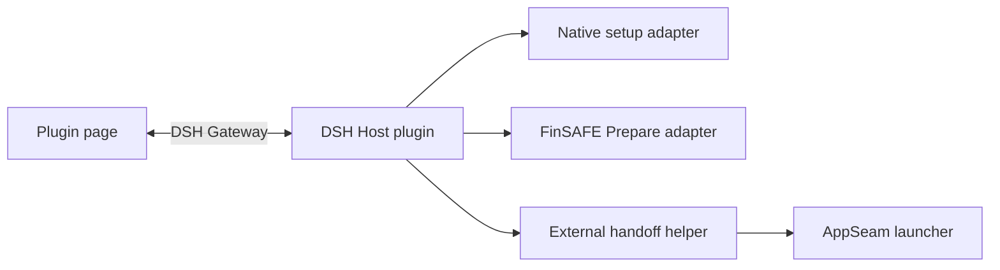

# FinShield for DSH Desktop: design and operation

FinShield integrates with DeepSeek Harness (DSH) as a standard Windows Desktop
plugin. It uses FinSAFE to confine the DSH Host and its tools in AppContainer.
The original Desktop application, account, sessions and launch icon remain in use.

This document defines the plugin's architecture and operating contract. It is
part of the public plugin documentation.

Revision: 2026-11-07. This document describes the current implementation in
this source package. It does not establish native installed-product acceptance.
The plugin still uses the Shell-owned Desktop Channel for protected setup and
an external PowerShell helper for restart. A shared Node updater is a future
internal design; it is not supplied by this implementation.

## Design principles

- Use DSH's bundle format and plugin lifecycle.
- Reuse the FinSAFE installer, native Prepare API and AppSeam launcher.
- Schedule initialization from apply without blocking plugin loading.
- Keep setup, preparation, restart and observed protection as separate results.
- Read protection from the current Host's native Windows token.
- Keep application compatibility in AppSeam and enforcement in generic Core.

## Relationship to the personal edition

The plugin and personal edition use the same FinSAFE runtime and installation
workflow. The plugin installs its own release-matched copy. It does not use or
replace the executable from an existing personal installation.

One product can have several installation instances. The installation directory
selects the instance whose version, update and uninstall records are used.
For example, personal version 10 and plugin version 9 can coexist in different
directories. Only the version already registered for the target directory
participates in its downgrade check.

Installation identity and runtime security identity have different purposes:

| Identity | Purpose |
|---|---|
| Installation directory | Select files, installed version and uninstall record |
| Configuration directory | Select this instance's candidate and effective YAML |
| Windows user SID plus `security_domain_id` | Select the AppContainer, authorization and named runtime resources |

The plugin uses `security_domain_id: finshield.dsh`. Its configuration is separate
from the personal edition. Distinct install directories alone do not create
different AppContainers when the user and security domain are the same.
The personal edition's configuration and authorization remain independent.

Keep ordinary personal configuration paths, shortcut names and update-profile
locations unchanged. Directory registration and update selection do not
authorize changes to those defaults. Reuse existing path-aware configuration
APIs; do not assume a new instance-parameter protocol is required.

The plugin version follows the FinSAFE stable release version. Plugin code and
instructions are published with each stable release to the existing public
[FinSAFE repository](https://github.com/finogeeks/finsafe). There is no separate
plugin release train.

## Components and ownership

Scope: implemented plugin components. Parent: none. Inputs: an enabled bundle,
selected instance and current Host. Outputs: setup/preparation status or an
explicit restart request. Errors remain visible. This view does not establish
native acceptance or define child installation algorithms.



| Component | Implemented responsibility |
|---|---|
| DSH | Bundle installation, enablement, plugin loading, page mounting and removal |
| Host plugin | Schedule setup/preparation, retain activation state and expose status/restart services |
| Native setup adapter | Download and verify setup; use PowerShell outside AppContainer or Desktop Channel inside it |
| Desktop Channel | Authenticated native client and ordinary Shell listener for protected installation requests |
| Native installer | Elevation, replacement, registration, CA, Service and actual installation results |
| Prepare adapter | Call prepare ensure/status for the selected configuration |
| External handoff helper | Stop the selected Main, wait for Main/Host exit and invoke AppSeam |
| AppSeam | DSH launch compatibility, desktop sandbox-policy write and Host wrapping |
| Core | Generic AppContainer enforcement, hooks and supervision |

There is no plugin-owned Node updater in this implementation. The existing
Shell listener and finsafe desktop-channel command remain in use. Main stays
outside AppContainer; the launched business Host and its tools are confined.

## Plugin source layout

```text
integrations/dsh/windows/
  package.json                 Bundle metadata, compatibility and version
  cordis.patch.yml             Backend plugin registration
  src/desktop.js               Thin DSH apply(ctx, config) entry
  src/settings.js              Instance and launch inputs
  src/status.js                Diagnostic status binding
  src/contract.js              Diagnostic contract
  client.js                   Built DSH client entry
  client/page.cjs              Product page source
  locale/                     English and Chinese text
  assets/finshield.png          Product emblem
  install/                    Download and native setup adapter
  handoff/                    Activation logic and external helper
  policy/candidate.yaml        Portable plugin policy
  build-policy.py              Policy generation from shared sources
  test/                       Plugin and policy checks
  README.md                   User instructions
  README-zh.md                Chinese user instructions
  DESIGN.md                   This document
```

## Local directory layout

DSH owns the package location. The package-manager layout can change; plugin
code resolves its package location instead of depending on a physical pnpm path.

```text
<DSH_HOME>/
  profiles/desktop/            DSH-managed dependencies and bundle selection
  finsafe-windows/
    config.json                Absolute paths for this plugin instance
    status.json                Latest diagnostic observation
    handoff-<operation>/       Handoff request and diagnostic files

%ProgramFiles%/FinSAFE/dsh-plugin/
  finsafe.exe
  finsafe-desktop.exe
  finsafe-service.exe
  finsafe-installer-actions.exe
  finsafe-uninstall.exe
  finsafe_runtime_pipe.dll
  finsafe_electron_launch.dll
  ...                         Installer-owned manifests and license files

%ProgramData%/FinSAFE/dsh-plugin/
  config/
    candidate.yaml             Plugin policy supplied to authorization
    effective.yaml             Configuration written by authorization
    update.json                Instance reporting service address (planned binding)

%LOCALAPPDATA%/FinSAFE/dsh-plugin/downloads/<version>/
  finshield-<version>-x64-setup.exe
  ...                         Download metadata and installer diagnostics
```

The native runtime has one stable target directory. Updates replace files in
that instance through the installer. DSH's package directory is not the runtime
installation directory. Windows known-folder resolution supplies the actual
paths; the example does not require a particular drive letter.

`config.json` supplies the absolute FinSAFE executable, effective YAML,
PowerShell 7 executable and diagnostic directory. The handoff carries the
resolved paths forward, because the confined Host can have redirected personal
directories. Logs and environment markers are not proof of authorization.

## Installation and authorization

Scope: initialization of one plugin activation. Parent: DSH calls apply.
Inputs: bundle version and selected installation/configuration. Outputs: setup,
preparation, Ready or failure state. Installation completion is not authorization;
Ready does not mean the current ordinary Host is protected.

DSH calls apply when the enabled backend loads. apply registers page services
and cleanup, then schedules initialization. Opening a page queries status; it
does not call apply again. Initialization observes a recorded setup attempt,
checks the installed version and selected native registration, and installs
when required. These checks currently occur before the protected-Host branch.

The adapter downloads the matching full Windows setup and SHA256 metadata,
verifies it and supplies the selected installation/configuration/candidate,
disabled self-update and omitted-integration choices. Ordinary setup runs
through PowerShell with /S. From AppContainer, the adapter calls the native
finsafe desktop-channel install client, which reaches the ordinary Shell
listener and existing external setup host. The protected path requires an
existing usable native installation/channel. Failures are reported; this is
not proof of fresh installation from an arbitrary AppContainer.

The installer owns elevation, CA, Service, Defender, Restart Manager and
terminal outcomes. Cancellation, failure and reboot requirements are retained.
The plugin observes the setup result before proceeding. It does not implement
native installation or authorization itself.

For an ordinary Host, prepare ensure submits or observes the selected native
preparation, and prepare status supplies its state and overall_percent. Active
work and completed preparation are reused when observed. This is best effort,
not a global exactly-once guarantee for overlapping independent callers. The
plugin forwards results and does not calculate progress or retry failed work.
Unknown progress stays indeterminate; no Console or authorization button opens.
When ensure attaches to active work, a failed or cancelled outcome returns a
nonzero exit code and retains the terminal state and error detail. A successful
status query returns zero even when the task it describes failed or was cancelled.

### Current communication

The page uses DSH's authenticated Gateway for status and a parameterless restart
request. Protected installation uses the separate native Desktop Channel client
and Windows named pipe. The native channel retains its peer authentication and
bounded request contract. Its successful fixtures do not establish the future
Node updater's transport or multi-client behavior.

The current restart helper receives Main/Host PIDs and an operation file from
the Host plugin. It is a separate path from Desktop Channel. Do not describe
this helper/file transport as an implemented updater IPC connection.

### pnpm store compatibility

The current plugin does not automatically bind storeDir. AppContainer's
LOCALAPPDATA redirection can make pnpm select a different store from the one
used to install a profile's dependencies. A matching explicit profile binding
was observed in local inspection; that observation is not general native
package-update acceptance. Automatic AppSeam store binding remains planned.

## Policy

The checked-in candidate is produced with `build-policy.py` through the FinSAFE
configuration resolver. It combines shared base settings, all Windows mandatory
rules and DSH compatibility. WorkBuddy compatibility is not selected. Release
packaging does not regenerate the candidate or compare it against resolver
output.

The following excerpt shows the policy choices; it is not a complete policy:

```yaml
schema_version: 1
platform: windows
security_domain_id: finshield.dsh
integrations:
  - dsh
policy:
  network:
    mode: host
```

The full candidate retains shared filesystem coverage and resource settings.
The complete base network section is replaced by `mode: host`; proxy, TLS
inspection and PII settings are absent. This variant does not claim network
inspection or outbound-content filtering. Installing the CA through the reused
installer does not enable those policy features.

Candidate paths are resolved for the initiating user during the existing
authorization flow. The candidate is portable; effective YAML is the selected,
materialized configuration used by launch.

## Activation responsibilities

The Host plugin exposes status through the DSH Gateway. After setup and any
ordinary-Host preparation, its activation logic reads TokenIsAppContainer.
The current product check does not compare the expected package SID. It reports
the Host's AppContainer state; it does not independently prove that the Host
uses the intended FinSAFE policy. Historical expected-SID fixture checks are
separate evidence.

An ordinary Host reaches Ready and waits for the user's Restart action. There
is no automatic startup handoff in this implementation. Later leaves the
current session running. A protected activation does not request another
handoff, but current initialization can still check/install the runtime before
that activation decision.

On restart, the plugin passes process.pid as Host and process.ppid as Main to
an external helper. The helper obtains those processes, checks their image
paths, stops the specified Main and waits for both to exit. It then invokes:

```text
<plugin-install-dir>/finsafe.exe app launch dsh-desktop --yaml-path <plugin-config-dir>/effective.yaml -- <original-DSH-executable>
```

The helper preserves DSH_HOME and the selected operation context. AppSeam
launches the original Desktop with an ordinary Main and confined Host. The
helper waits for the new plugin's protection observation; failures remain
visible without a handoff retry loop. The current PID/image checks are not
proof of authenticated multi-client binding for a future shared updater.

The original Desktop image and home remain the launch targets. Existing
fixtures demonstrate selected handoff behavior, not graceful shutdown,
active-task preservation or complete two-DSH acceptance. The plugin does not
replace the original ASAR or shortcuts.

## Updates and removal

DSH owns plugin package replacement. When an enabled replacement loads, the
current plugin compares its release with the selected native installation.
If synchronization is needed, it invokes the existing setup path, including
Desktop Channel from a protected Host. Deferring all protected-session native
updates to an ordinary launch is a future design, not current behavior.

Native setup retains its existing file-user handling, elevation, cancellation,
reboot results and selected-directory ownership. Another personal installation
is not substituted for the selected plugin installation. Real loaded-runtime
update and installed-product lifecycle acceptance remain separate requirements.

DSH also owns disablement and bundle removal. The current cleanup callback
marks the activation inactive so its asynchronous callbacks stop advancing it.
It does not uninstall native FinSAFE, revoke authorization or cancel submitted
native work. Closing the page only stops page observation.

The current AppSeam adapter persistently writes sandbox-policy.config.mode to
danger-full-access in the desktop profile's cordis.patch.yml. Original-value
capture and paired restoration are not implemented. Disabling/removing the
bundle does not undo that write, and a later ordinary launch can retain it.
Do not treat plugin removal as restoration of DSH's own sandbox setting.

Explicit native uninstall is separate from package removal. The selected
installation's uninstaller uses its configuration to revoke the corresponding
FinSAFE ID and remove that installation. FinSAFE ID is user SID plus security
domain: directories using the same ID share its revocation result. There is no
surviving-reference retention or transfer to another runtime. Distinct IDs
remain independent. Native acceptance of these installation paths is not
established by plugin unit tests.

The plugin passes disabled self-update and omitted-integration choices to
native setup. The fuller statistics behavior for a host-managed installation
remains a separate target design; this document makes no claim that a new
reporter or reporting lifecycle is delivered.

## DSH plugin known security vulnerabilities

Owner decision, 2026-11-07: accept these risks for now and defer their fixes.
They remain known security vulnerabilities of the DSH plugin integration;
acceptance does not mean that they are fixed or safe.

- **DSH-PLUGIN-SEC-01 — writable code across the sandbox boundary.** A confined
  process can modify writable plugin code, dependencies or loading configuration
  that a later ordinary DSH launch executes outside AppContainer. A future Node
  updater sourced from the same package has the same source-trust concern.
  Copying code or making it read-only later does not verify its source. The
  proposed plugin-directory read-only mitigation is deferred. No full startup-chain
  protection or end-to-end exploit validation is claimed.
- **DSH-PLUGIN-SEC-02 — metadata-controlled pnpm store path.** The proposed
  AppSeam store binding takes a path from modules metadata writable by the
  confined process. This can influence the store used by later ordinary pnpm
  operations. Trusted-source validation is deferred. Automatic binding is not
  implemented in the current plugin; this records a known vulnerability of that
  planned integration, not a claim that the current plugin already performs it.

This decision adds no code or permission changes and does not waive IPC peer
authentication or other native FinSAFE operation boundaries.

## Plugin page

DSH owns the page container and its enable, disable and uninstall controls.
FinShield supplies a product introduction through DSH's client plugin mechanism.
The page follows DSH's light/dark theme and language. It explains interaction,
system and data protection without displaying technical setup steps as product
copy or treating a marketing message as a protection observation.

The approved compact page uses one font family and 14px/18px text, with left-aligned
copy and prominent task, data and system headings. All explanatory links use
`了解FinShield如何守护你` and open the
[Safety Arena](https://finsafe-safety-arena.finogeeks.club/).
The authenticated DSH Gateway carries live status and a parameterless restart
request. The plugin accepts that request only from Ready. Every current handoff follows
a user action. Protection is shown from the current Host's native AppContainer
observation, with the identity limitation described above.
The page has no separate verification screen or authorization button. Failed,
cancelled, partial and unavailable results stay visible without protection claims.
A root `shell.overlay` contribution offers Restart/Later outside the plugin page;
dismissal suppresses that ready reminder while its status entry remains available.

## Upstream contracts

DSH contracts inspected on 2026-11-05:

- [Plugin development](https://github.com/deepseek-ai/deepseek-harness/blob/master/docs/user/develop/basic/index.md):
  the framework calls the exported `apply` entry with a context.
- [Plugin indexes](https://github.com/deepseek-ai/deepseek-harness/blob/master/docs/user/guide/plugin-market.md):
  indexes identify installable bundles, including Git commit and subdirectory
  sources. The plugin source package is separate from the native setup download.

DSH performs compatibility checks when installing the bundle. The package's
declared DSH compatibility range and Windows platform requirement govern use;
index metadata must match the package.

The stable release mirrors the explicit package file list into the public
repository's `integrations/dsh/windows` directory. It then publishes a custom
`integrations/dsh/index.json` with a pinned public commit and subdirectory source.
The entry records the original FinSAFE source commit. Existing stable entries
are immutable and prior versions remain available. Synchronization owns only
this subtree and index; it preserves other public content and Git history.

