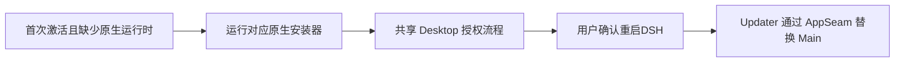
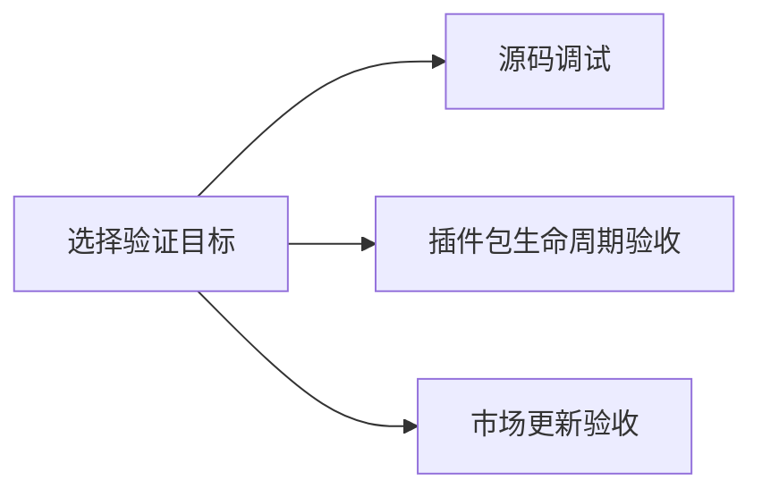

# FinShield DSH Windows插件：运行与开发参考

[返回产品介绍](README-zh.md) · [English](OPERATIONS.md) · [架构与运行契约](DESIGN.md)

## 安装与授权

需要 Windows x64、DSH `>=0.2.1-rc.5 <0.3.0`，以及下载对应
FinSAFE 稳定版安装包的网络和 Windows 安装授权。先打开一次 DSH 建立 Desktop
profile，再按[桌面版安装步骤](README-zh.md#在dsh桌面版安装)操作。

插件正常运行不依赖 PowerShell，复用 DSH 的 Node、现有原生 DLL 和完整 FinSAFE
安装器。可选的离线 PowerShell 辅助脚本仍需 PowerShell 7。

常规安装使用[README中的应用内步骤](README-zh.md#在dsh桌面版安装)；离线安装使用下方附带的PowerShell脚本。

首次激活且缺少原生运行时时，插件通过对应完整 Windows 安装器下载安装，保留现有的
发布包 SHA256 校验。激活立即返回，安装和授权在后台继续。updater 调用所选安装目录的
`finsafe desktop authorization` CLI，薄适配与控件、控制台共用同一个 Desktop 函数。
调用立即返回就绪或进行中；已接受的原生任务保留执行宿主，直至结束。Windows 权限确认和
Prepare 原有逻辑不变。重新启用时附着已有任务；同一 Main 会话里后来的插件 apply 不会重试
失败或取消的授权。进度标题显示当前安装或安全授权步骤，
并显示原生百分比；展开可查看步骤详情。
不增加授权按钮，不打开控制台。目标安装、配置及授权全部就绪且需要切换包装时，
选择“重启DSH”或“稍后”。
原生环境本来已就绪时，启动时期自动包裹一次，不显示重启提醒。所有启动都进入同一个
Host Token 检查流程，不区分启动来源。Host bind 失败显示实际错误，不包裹、不重建
updater。安装文件不等于已经获得保护。安装失败结果会保留；轮询、页面重开和同一
Main 下的 Host 重连不会自动重试授权。

历史安装记录仅用于诊断，不会等待旧结果文件或阻止后续安装。以后启动时按原生安装状态
判断是否需要新安装；本次安装失败后不自动重试。安装或授权状态读取失败时保留当前 DSH，
显示原始错误。Keep 放行当前 DSH，不把 Main 加入 updater 的 Job；
Host 实际防护状态单独报告。

独立的普通用户 Node updater 负责安装、准备和观察，直接复用 DSH 选定的 Node，
每个插件版本只复制一次脚本与依赖，不下载或复制独立 Node，也不在每次启用时全量校验文件。
受保护 Host 可连接已有的普通 updater，提交固定更新请求，但不能在外部创建 updater。
updater 跨插件版本复用，不按插件版本或协议版本拒绝复用。只有普通启动时期可以恢复
不可用的 updater：终止并关闭旧的命名 Job，再启动一个替代 updater。运行时期的 Host
bind 失败显示实际错误，不自动重试或恢复 updater。
updater 的 Job 负责自身和安装任务的清理，DSH 在此 Job 外运行，包裹启动也不继承此 Job。
updater 注册 Main 进程句柄的退出等待；Main 独立退出后，updater 退出并关闭 Job。
updater 退出或启动恢复不会结束 DSH。插件移除不会结束此生命周期，FinSAFE 不重载 Host。
安装随 updater 停止，已受理授权独立继续。
页面 Restart 保留 updater 和 Job，停止旧 Main 后通过 AppSeam 启动替代 Main，并切换退出等待；
此时不执行安装或授权，也不等待新 Host bind。

也可在启动 DSH 前，从解包后的插件源码目录执行：

```powershell
./install/Install-Plugin.ps1 -Archive <plugin.tgz>
```

`-DshDirectory` 指定原 Desktop 安装目录，`-DshHome` 覆盖 DSH 解析的数据根。
`-InstallDirectory` 和 `-ConfigDirectory` 指定原生绝对路径。
打开原DSH继续后台授权。`-Offline`只控制DSH依赖解析，原生下载仍需网络。
需要明确重试安装时，再次运行此脚本。

插件激活使用以下默认位置：

| 内容 | 默认位置 |
|---|---|
| 完整原生运行时 | `%ProgramFiles%/FinSAFE/dsh-plugin-versions/<release>/` |
| candidate 和 effective 配置 | `%ProgramData%/FinSAFE/dsh-plugin-versions/<release>/config/` |
| 下载与原生安装结果 | `%LOCALAPPDATA%/FinSAFE/dsh-plugin/downloads/<release>/` |
| 实例设置与 Host 支持库副本 | `<DSH_HOME>/finsafe-windows/` |
| 独立 updater 及依赖 | `%LOCALAPPDATA%/FinSAFE/dsh-updater/` |

实际路径来自 Windows 已知文件夹和 DSH 实际启动输入，支持自定义安装和 home、
移动后的用户目录、空格和中文路径。插件使用独立的 `finshield.dsh` 安全域，保留
个人版文件、配置和授权。一个 FinSAFE 产品按目标目录保存安装记录，不同目录
可以保留不同版本。
现有 `installation`、`configuration` 精确路径设置保留原意。新版本的根目录由单独的
`nativeVersionRoot`、`configurationVersionRoot`、`downloadRoot` 设置选择。离线脚本保留
其明确的安装、配置路径输入，不移动现有安装。



原生配置接口负责candidate物化与effective生成，Prepare负责授权。策略保留Windows强制
文件保护及基础资源设置，仅选择 DSH 兼容规则，网络使用 host 模式，不提供代理、
TLS 检查、PII 或出站内容过滤。

## 使用与更新

在 **插件 → 已安装 → FinShield** 查看产品页面。页面跟随DSH主题和语言，全部说明链接跳转到
[Agent安全测评](https://safety.finaios.ai/agents/dsh/zh-CN)。品牌图链接到
[FinShield官网](https://safety.finaios.ai/)。四个安全按两列排列，
授权标题为单行，统一字体及14px、18px两档字号。本地化`meta.detail`选择`detail/`中
紧凑介绍文档。发现页在安装前、启用时和卸载后统一使用原生Markdown和288×81动图，
启用的防护页隐藏重复介绍，避免将开发者README放入产品页面。
页面显示后台授权、等待重启与实际保护状态，
不增加检查页面。日志与诊断状态是观察结果，保护由Host原生令牌确认。

通过 DSH 更新插件包，版本跟随 FinSAFE 稳定版。受保护插件可向普通 updater 请求目标版本。
updater 下载并安装目标版本，完成配置和授权后才提供重启提醒。共享 Service 维护及所需
组件替换仍由原生模块负责。正在进行、失败、取消或等待系统重启的工作都不能提供 Restart，
页面保留实际结果。“稍后”对同一就绪条目生效，不因 Host 重连而重复提醒。

确认后，updater 停止旧 Main，通过 `finsafe app launch dsh-desktop` 启动已准备好的替代
Main，并保留原 updater 和 Job。本期不支持改变 FinSAFE ID。
轮询不发起授权、不自行包裹；当前 Host 的实际保护与更新就绪、错误分别显示。

若 DSH 的包管理操作要求先删除再安装插件包，此操作保留原生运行时和授权，不调用原生卸载。

## 停用与卸载

使用 DSH 标准控制停用或删除插件。updater 可用时，清理仅恢复 AppSeam 拥有的
Desktop sandbox 字段；pnpm storeDir 绑定在停用和移除时保留。
后续修改冲突或 updater 不可用会报错，原覆盖值可能保留，
不保证自动恢复。离线脚本移除前，先在运行中的 DSH 停用插件以执行正常清理。
插件包裹启动前会关闭配置热加载，保存停用状态时保持关闭。
移除已启用的 FinShield 包时，先启用 HMR，再执行 DSH 的移除操作。
没有 HMR 时保存的插件和配置变更需要重启生效。
退出并重新打开后改变后续激活。停用不能把
已运行的 Host 移出 AppContainer。附带脚本还可清理本插件元数据：

```powershell
./install/Install-Plugin.ps1 -Remove
```

删除插件包保留原生文件、下载、日志、备份及授权。需要删除原生运行时时，使用
该目录的 `finsafe-uninstall.exe` 或对应 Windows 已安装应用条目。原生卸载只影响
选定实例拥有的文件和记录，保留 effective 配置、其他用户文件及 DSH 账户、会话。
原生卸载通过已有的
定向 unprepare 清除该运行时安装目录、配置和原用户对应的 FinSAFE ID 授权。
不执行 SYSTEM 全量授权清理，不向其他运行时转交 Service。两个目录如果使用
相同的用户与安全域 ID，就共享同一份授权；清除此 ID 的授权会同时生效。
不同 ID 的授权保持独立。个人版默认配置路径、更新配置路径和快捷方式名称不变。
详见[设计文档](DESIGN.md#updates-and-removal)。

## 本地开发与验收

按待验证的行为选择 DSH 已有的开发方式。调试插件不需要先搭本地市场。

| 验证目标 | 使用方式 | 能证明什么 |
|---|---|---|
| 模块代码 | 在测试 profile 使用 `--patch` 和模块绝对路径，或链接本地包目录 | 模块加载和行为；不证明包分发正常 |
| Desktop 集成 | DSH 源码仓库的 Desktop 开发入口 | 开发应用内 Main、Host 和 Renderer 的行为 |
| 构建后的插件包 | 通过 Desktop 插件管理器安装预构建 `.tgz` | 包内容、激活、停用和移除 |
| 市场更新 | 在索引中提供两个不可变版本，使用待验收的分发来源 | 版本发现、更新按钮和版本替换 |



### 源码调试

调试小型 DSH 模块时，官方教程使用 overlay 插入模块，模块路径使用绝对路径。
在已完成开发环境准备的 DSH 源码仓库执行：

```powershell
pnpm dsh web --patch C:/work/my-plugin/dev.patch.yml
```

使用单独的测试 home/profile。调试 Desktop 时，官方入口为：

```powershell
pnpm run dev:desktop
```

该命令构建 Desktop 组件，并在 `apps/desktop/.desktop-build/development/` 下使用
独立的 home、project 和 Electron 浏览器数据目录。改代码后先构建，再使用
Reload Page 或 Restart App and Host；这两个菜单操作不会构建代码。
不要为了调试而重新启用 HMR，绕过 FinShield 的启动要求。
Web/CLI 的结果不能证明 Desktop 的 AppContainer 防护生效。
Desktop 拥有保留的 `desktop` profile，包操作使用 Desktop 插件管理器。

### 插件包验收

先按下节命令构建客户端、策略、解析器和原生 DLL，再打包。
单独执行 `npm pack` 不会生成这些文件。在构建后的包目录执行：

```powershell
npm pack --ignore-scripts --pack-destination C:/work/artifacts
```

在 Desktop 的 **插件 → 添加插件 → 安装第三方插件** 中输入 `.tgz` 的绝对路径。
通过 Desktop 验收安装、激活、重启、停用和移除，记录实际安装版本和 Host 原生令牌。
本地目录链接适合迭代，但不能证明压缩包包含全部运行文件。
安装第二个本地压缩包，也不能证明市场更新按钮可用。

插件包与原生安装器是两项输入。未公开发布的插件版本，也需要对应版本的原生
安装器、有效下载元数据和校验值。测试下载源应记录在暂存产物中，不得静默
替换成公开版本。本地市场仅允许下述目标 profile 的临时 scope 配置。

### 市场更新验收

FinShield 发布流程使用 DSH 索引中的 Git 提交和包子目录。验收该 Git 分发路径时：
包含构建后的运行文件，每个版本固定完整提交，两个版本使用同一仓库和子目录，
并通过 DSH 的索引解析器验证。本地索引 URL 只是目录，不代表插件包和原生安装器
也来自本地。用户开始验收前，先核对实际地址和提交。

仓库中的[本地市场工具](../../../scripts/dev/dsh-market.py)保留此前的本地 HTTP/npm
方式，只覆盖这次要求的两条生命周期流程。独立 profile 已通过实际 DSH 服务的
安装、重启后更新及卸载；真实 Desktop 操作待用户验收。这项验收不证明正式 Git 传输通过。
边界和证据见[设计](../../../docs/design/dsh-local-market.md)。

先只展示版本 A。安装、移除验收通过后，重新安装 A 并保留。再增加版本 B，
不修改 A 的文件或来源。通过 DSH 更新按钮操作，重启后核对结果。
插件包移除和原生运行时卸载按上节说明分别验收。
没有发布授权时，不向公共服务发布这两个版本。

本工具不改用户级或全局 npm 配置。经设计者批准，可以临时增加目标 DSH profile
的 scope registry，使重启后的查询和移除仍使用本地来源；不改变默认 registry。
测试结束且 registry 插件已移除后，精确恢复原文件。保留原始失败步骤和 pnpm 输出，
不能仅凭来源失败就认定是 FinShield 的故障。

### 本地市场命令

以下命令从 FinSAFE 仓库根目录执行。Python 标准库即可；无需安装 registry 服务。
构建产物沿用现有打包流程。`build.json` 记录 `version`、`sourceCommit`、`plugin`、
`installer`、`pluginSha256`、`installerSha256` 和 `bindingSha256`；文件路径为绝对路径。
暂存插件包中的 `install/download-source.json` 必须指向 `http://127.0.0.1:18771`。
`prepare` 检查这些输入并导入不可变副本，不修改源包。两个版本使用相同下载根地址。

```powershell
python scripts/dev/dsh-market.py prepare C:/work/artifacts/A/build.json
python scripts/dev/dsh-market.py prepare C:/work/artifacts/B/build.json
python scripts/dev/dsh-market.py expose 0.10.55
python scripts/dev/dsh-market.py configure-profile "$env:USERPROFILE/.dsh/profiles/desktop"
python scripts/dev/dsh-market.py serve
```

示例 A 为 0.10.55、B 为 0.10.56；按实际产物版本执行。默认数据目录为
`dist/dsh-market/acceptance/`，受 Git 忽略。需要隔离目录时，在子命令前使用 `--root`；
同一轮所有命令必须使用同一目录。端口占用直接报错，不自动换端口。
`serve` 保持运行；Ctrl+C 停止。另一个终端执行：

```powershell
python scripts/dev/dsh-market.py check
```

该检查下载并校验插件和原生安装器，只证明 HTTP 接口与产物一致。自检请求记录在
`requests.jsonl` 中；开始用户验收前记录时间，区分之后的真实下载。
在 DSH 的索引源界面添加 `http://127.0.0.1:18771/index.json`。
若已安装的是 `file:` 包，先通过 DSH 移除，再从此市场安装 A，不能修改依赖来源冒充更新基线。
用户自行操作安装、授权、重启、使用和卸载。检查日志及 Host 防护后，再从同源安装 A。
准备验收更新时，执行：

```powershell
python scripts/dev/dsh-market.py expose 0.10.56
```

在 DSH 刷新市场，通过现有更新按钮更新，重启并核对实际版本和防护。
若当前已有 B 的原生组件，本轮不能算覆盖了 B 的下载与安装，须如实记录。
验收结束后，先通过 DSH 移除本地 registry 插件，再恢复：

```powershell
python scripts/dev/dsh-market.py restore-profile "$env:USERPROFILE/.dsh/profiles/desktop"
```

原始 `.npmrc` 字节或不存在状态保存于数据目录的 `profile-bindings/`，可能含本机凭据，
不得提交或分享该目录。重复配置/恢复不改变结果。若期间有其他修改，恢复报错并保留备份，
不覆盖新内容。不要提前删除数据目录；停止服务器也不会自动恢复配置。
随后通过 DSH 删除本地索引源，停止服务器。不需要修改全局 npm 配置或系统证书。

维护工具时运行 `verify.py --lane dsh-local-market --lane dsh-local-market-runtime`，
先加 `--dry-run` 阅读计划。后者使用独立临时 profile 和实际已安装 DSH 服务，
验证自然生成的依赖元数据及来源连续性，不操作当前 Desktop 或运行原生安装。

每个独立的配置场景从普通 pnpm 生成的 `node_modules/.modules.yaml` 和预定配置
基线开始，不手工修改该元数据来匹配受保护环境。一次安装、更新、移除场景内部
保留自然生成的元数据，才能验证流程连续性。

调研日期：2026-11-14；上游提交：`39163dd30f703a79079e2d2446545cff3c453738`。
依据为官方[模块教程](https://github.com/deepseek-ai/deepseek-harness/blob/39163dd30f703a79079e2d2446545cff3c453738/docs/user/develop/basic/index.md)、
[打包教程](https://github.com/deepseek-ai/deepseek-harness/blob/39163dd30f703a79079e2d2446545cff3c453738/docs/user/develop/basic/publish.md)、
[Desktop 开发说明](https://github.com/deepseek-ai/deepseek-harness/blob/39163dd30f703a79079e2d2446545cff3c453738/apps/desktop/README.md#develop)及
[插件管理器来源与更新规则](https://github.com/deepseek-ai/deepseek-harness/blob/39163dd30f703a79079e2d2446545cff3c453738/packages/boot/plugin-manager/README.md)。
以上是开发方法，不是 FinShield Desktop 已通过验收的证据。使用时须核对待测 DSH
版本是否支持对应入口。

## 构建、发布与验证

插件通过发布流程配置的公开下载通道获取 FinShield 原生安装包，读取指定版本的
元数据，并在安装前校验 SHA-256。下载地址可使用 COS 或 CDN 域名。该通道不可用时，
插件自动从 GitHub 下载同版本安装包并校验 SHA-256；元数据或校验值错误会停止安装。
插件包本身的分发来源单独管理。

稳定版流程在安装包发布成功后，将完整客户端、策略、许可证、第三方声明和双语
说明同步到[公开仓库](https://github.com/finogeeks/finsafe/tree/main/integrations/dsh/windows)，
并生成[自定义 DSH 索引](https://raw.githubusercontent.com/finogeeks/finsafe/main/integrations/dsh/index.json)。
每版固定公开 Git 提交和子目录，并记录原始 FinSAFE 源码提交。将该 URL 添加为
自定义插件索引。本次变更本身不发布版本，也不代表通过市场上架验收。

构建与验证命令见[英文说明](OPERATIONS.md#build-publication-and-verification)。策略生成直接使用 `finsafe config resolve`；策略测试需要 Python 和 PyYAML。自动适配器、实例、策略和索引检查不能证明真实安装、升级、
卸载、跨账户授权、原会话保留、浏览器布局或远程 Git 安装，均需单独原生验收。
历史 shared 原型观察不能代表独立安全域包的验收结果。

插件含原有 FinSAFE 产品许可证 LICENSE.rtf 和[第三方声明](THIRD-PARTY-NOTICES.md)。
原生安装器提供自己的运行时声明，无需解压依赖。

Node updater 的新 IPC 和真实安装生命周期仍需单独原生验收，旧 Desktop Channel 的结果
不能替代。已接受并延后的安全问题见[设计文档](DESIGN.md#dsh-plugin-known-security-vulnerabilities)。
