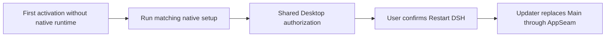
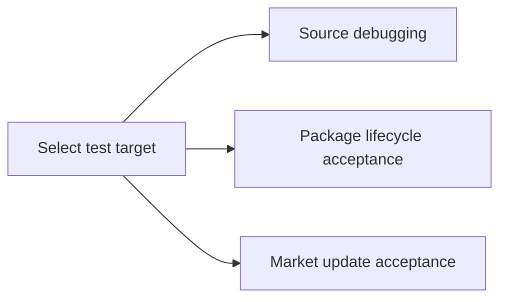

# FinShield for DSH Desktop: operation and development

[Product introduction](README.md) · [中文](OPERATIONS-zh.md) · [Design and operation](DESIGN.md)

## Install and authorize

Use Windows x64, DSH `>=0.2.1-rc.5 <0.3.0`, network access to the
matching official FinSAFE stable release and Windows setup consent. Open DSH once
to create its Desktop profile. Follow the [Desktop installation steps](README.md#install-in-dsh-desktop).

Normal plugin operation does not require PowerShell. It reuses DSH's Node,
the existing native DLL and full FinSAFE installer. The optional offline
PowerShell helper below requires PowerShell 7.

Use the [application installation steps](README.md#install-in-dsh-desktop). For offline setup, use the supplied PowerShell helper below.

On first activation, a missing native runtime is downloaded and installed through
the matching full Windows installer. The existing release SHA256 check remains.
Activation returns while this work continues in the background. The updater calls
the selected installation's `finsafe desktop authorization` CLI. That thin adapter
uses the same shared Desktop function as the Widget and Console. It promptly
returns Ready or Pending; accepted native work keeps its owner until completion.
Windows consent and existing Prepare behavior remain unchanged. Re-enabling
attaches to active work. A failed or cancelled attempt is not replayed by a later
plugin apply in the same Main session. Optional progress names the current installation
or authorization step and displays the native percentage. The plugin adds no
authorization button and does not open Console.
After the selected installation, configuration and authorization are fully ready,
choose Restart DSH or Later if a wrapper switch is needed.
If the matching native instance is already ready at startup, DSH wraps once
without a restart reminder. Every launch uses the same Host-token check;
launch origin does not select behavior. Installed files alone do not
establish protection. Historical setup records remain diagnostic only. A later
startup checks native installation state and can start a new installation when
needed; it does not wait for an old result file. The current attempt is never
automatically retried.

An installation or authorization read error keeps the current DSH and displays
the original error. Keep lets DSH continue without assigning Main to updater's
Job. Actual Host protection remains a separate result.

Page Restart stops old Main and launches its replacement through AppSeam.
It keeps updater and the Job, performs no setup or authorization, and does not
wait for new Host binding. A failed Host bind reports its actual error without
automatic retry or updater recovery.

An independent ordinary-user Node updater owns setup, preparation and restart.
It reuses DSH's selected Node executable and copies its scripts and dependencies
once per plugin version. It does not download or copy a separate Node runtime,
or hash all files on activation.
A protected Host connects to the existing ordinary updater for fixed update
requests. It cannot bootstrap an outside updater. The updater is shared across
plugin versions without a package-version or protocol-compatibility gate. An
unusable updater can be replaced only during ordinary startup: terminate and
close its named Job, then start one replacement. Running Host binding never
performs this recovery.
The updater retains its own Job for fault cleanup and installation work. DSH
stays outside that Job, including on wrapped launch. A registered wait on Main's
process handle ends updater when Main exits independently. Updater exit or
startup recovery leaves DSH running. Plugin removal does not end that lifetime.
FinSAFE does not reload Host. Installation stops with updater; accepted
authorization continues independently. Page Restart retains updater and its Job
and switches the exit wait to the replacement Main.

The supplied script can complete bundle and native setup before DSH starts.
Run it from an unpacked plugin source package:

```powershell
./install/Install-Plugin.ps1 -Archive <plugin.tgz>
```

`-DshDirectory` selects the original Desktop installation. `-DshHome` overrides
DSH's resolved data root. `-InstallDirectory` and `-ConfigDirectory` select native
absolute paths. Open the original DSH to continue background authorization.
`-Offline` affects DSH dependencies; native download still needs
the network. Rerun the script for an explicit setup retry.

Plugin activation uses these default locations:

| Content | Default location |
|---|---|
| Full native runtime | `%ProgramFiles%/FinSAFE/dsh-plugin-versions/<release>/` |
| Candidate and effective policy | `%ProgramData%/FinSAFE/dsh-plugin-versions/<release>/config/` |
| Downloads and native setup results | `%LOCALAPPDATA%/FinSAFE/dsh-plugin/downloads/<release>/` |
| Instance settings and Host support copy | `<DSH_HOME>/finsafe-windows/` |
| Independent updater and dependencies | `%LOCALAPPDATA%/FinSAFE/dsh-updater/` |
| AppSeam original-field records | `%LOCALAPPDATA%/FinSAFE/AppSeam/dsh-originals/` |

Windows known folders and DSH actual launch inputs determine paths, including
custom homes, relocated user folders and custom installations. The plugin uses its independent
`finshield.dsh` security domain. It preserves personal-edition files,
configuration and authorization. One FinSAFE product stores installation records
by target directory. Different directories can retain different versions.
Existing exact `installation` and `configuration` settings keep their meaning.
Separate `nativeVersionRoot`, `configurationVersionRoot` and `downloadRoot`
settings select roots for new versions. The offline helper retains its explicit
installation/configuration inputs; it does not move an existing installation.



Native configuration owns candidate materialization and effective generation;
Prepare owns authorization. The
policy retains Windows mandatory filesystem protections and base resources,
selects DSH compatibility and uses host networking. It does not provide proxy,
TLS inspection, PII or outbound-content filtering.

## Use and update

Open **Plugins → Installed → FinShield** for the product page. It follows DSH's
theme and language. Every explanatory link opens the
[Agent Safety Arena](https://safety.finaios.ai/agents/dsh/index.html).
The brand illustration opens the [FinShield product site](https://safety.finaios.ai/).
The page uses four safety areas in two columns, a single-line authorization heading,
one font family and 14px/18px text. Localized `meta.detail` entries select the
compact introduction under `detail/`. Discover renders this native Markdown
with 288×81 assessment GIFs in every installation state. The active protection
page hides the duplicate introduction; this operation reference is separate from the compact product page.
The page shows background authorization, restart readiness and live protection.
There is no separate verification page. Logs and diagnostic status are observations;
the Host's native token establishes protection.

Upgrade the bundle through DSH. Its version follows FinSAFE stable releases.
The protected plugin can request that release through the ordinary updater.
The updater downloads the selected version, runs the full installer and completes
configuration and authorization before offering Restart. Native runtime owners
handle shared Service maintenance and required component replacement. Active,
failed, cancelled or reboot-pending work cannot offer Restart. Its actual result
remains visible. Later dismisses the ready session item across Host reconnects.

After confirmation, updater stops old Main and launches the prepared replacement
through `finsafe app launch dsh-desktop`, retaining the same updater and Job.
Changing FinSAFE ID is unsupported in this iteration. Polling never
submits authorization or wraps by itself. Current Host protection is
reported separately from update readiness or errors.

Bundle removal and reinstallation, when required by DSH's package controls,
retain the native runtime and authorization. They do not invoke native uninstall.

## Disable and remove

Use DSH's controls to disable or remove the bundle. With an available updater,
cleanup restores the AppSeam-owned desktop sandbox fields. The pnpm storeDir
binding remains on disablement and removal. Later user edits
or unavailable cleanup produce an error; the override can remain. There is no
automatic crash recovery. Disable in running DSH before offline script removal.
Plugin Wrap closes profile hot reload before starting protected DSH. Saved
disablement keeps it closed. Removal of an enabled FinShield bundle enables HMR
before DSH's removal operation. Changes saved without HMR require restart.
Quit and reopen
Desktop to change future activation. Disabling cannot remove AppContainer from an existing
Host. The metadata-aware script removal is:

```powershell
./install/Install-Plugin.ps1 -Remove
```

Bundle removal retains native files, downloads, logs, backups and authorization.
Remove the native runtime separately through its directory's
`finsafe-uninstall.exe` or corresponding Windows Installed Apps entry. Native
uninstall affects the selected instance's owned files and record. Effective
configuration, other user files and DSH accounts and sessions are retained.
Native uninstall revokes only the FinSAFE ID selected by that runtime's
installation/configuration and original user, through existing scoped unprepare.
It does not run all-ID SYSTEM cleanup or transfer Services to another runtime.
Two directories using the same user/domain ID share that authorization, so
revoking the ID affects both. Distinct IDs remain independent. Personal default
configuration/update paths and shortcut names stay unchanged. See [design](DESIGN.md#updates-and-removal).

## Local development and acceptance

Choose the DSH development path for the behavior under test. A local market is
not a prerequisite for plugin debugging.

| Test target | Use | What it establishes |
|---|---|---|
| Module code | A `--patch` overlay with an absolute module path, or a linked local package in a test profile | Module loading and behavior; not package delivery |
| Desktop integration | DSH's source Desktop development launcher | Main, Host and Renderer behavior in a development application |
| Built package | A prebuilt `.tgz`, installed through Desktop's plugin manager | Package contents, activation, disablement and removal |
| Market update | Two immutable versions in an index using the intended distribution source | Discovery, the Update action and version replacement |



### Source debugging

For a small DSH module, the upstream tutorial uses an overlay whose inserted
row names the module's absolute path. Run it from a prepared DSH source checkout:

```powershell
pnpm dsh web --patch C:/work/my-plugin/dev.patch.yml
```

Use a separate test home/profile. For Desktop work, the upstream entry is:

```powershell
pnpm run dev:desktop
```

It builds the Desktop components and uses separate development home, project
and Electron browser-data directories under `apps/desktop/.desktop-build/development/`.
Rebuild changed code before Reload Page or Restart App and Host; those menu
actions do not build it. Do not enable HMR to bypass FinShield's startup rules.
Web/CLI observations do not establish Desktop AppContainer protection. Desktop
owns its reserved `desktop` profile; use its plugin manager for package operations.

### Built-package acceptance

Build the client, policy, parser and native DLL using the commands below before
packing. `npm pack` alone does not build them. From the built package directory:

```powershell
npm pack --ignore-scripts --pack-destination C:/work/artifacts
```

In Desktop, use **Plugins → Add plugin → Install a third-party plugin** and
enter the absolute path of that `.tgz`. Verify installation, activation, restart,
disablement and removal through Desktop. Record the installed package version
and actual Host token. A local directory link is useful for iteration; it does
not prove that the archive contains all runtime files. Installing a second
tarball does not establish that the market's Update action works.

The plugin package and native installer are separate inputs. An unpublished
plugin version also needs its matching native installer and valid download
metadata/checksum. Record any test download source in the staged artifact;
do not silently substitute a public version. The local market permits only the
temporary profile scope setting described below.

### Market-update acceptance

FinShield's release workflow uses a Git commit and package subdirectory
in the DSH index. For acceptance of that Git distribution, include
built runtime files, pin each version to a full commit in the same repository
and subdirectory, and validate the index with DSH's parser. A local index URL
is only a catalog; it does not make its package or native installer local.
Check the actual URLs and commits before the user starts acceptance.

The checked-in [local-market tool](../../../scripts/dev/dsh-market.py) preserves
the earlier local HTTP/npm approach for the two requested lifecycle scenarios.
An owned profile passed install, update and removal through actual DSH services
in separate processes. Desktop acceptance remains with the user. This does not
prove Git delivery. See the [design and evidence](../../../docs/design/dsh-local-market.md).

Expose version A first. Accept install/remove, then reinstall A and leave it
installed. Add version B without changing A's files or source. Use DSH's Update
action and check the result after restart. Test package removal separately from
native-runtime uninstall, as described above. Do not publish either version
to a public service without release authorization.

The tool does not change user or global npm configuration. With designer approval,
temporarily bind the package scope in the target DSH profile so queries and
removal retain the local source after restart. Keep the default registry unchanged.
After removing the registry plugin, restore the original file exactly. Keep the
original failed step and pnpm output; a source failure alone does not identify a
FinShield failure.

### Local-market commands

Run these commands from the FinSAFE repository root. Python's standard library
is sufficient. Use the existing build/package workflow. Each `build.json` records
`version`, `sourceCommit`, absolute `plugin` and `installer` paths, `pluginSha256`,
`installerSha256` and `bindingSha256`. The staged package's
`install/download-source.json` must point to `http://127.0.0.1:18771`.
`prepare` validates the inputs and imports immutable copies; it does not edit the
source archives. Both versions use the same native download base.

```powershell
python scripts/dev/dsh-market.py prepare C:/work/artifacts/A/build.json
python scripts/dev/dsh-market.py prepare C:/work/artifacts/B/build.json
python scripts/dev/dsh-market.py expose 0.10.55
python scripts/dev/dsh-market.py configure-profile "$env:USERPROFILE/.dsh/profiles/desktop"
python scripts/dev/dsh-market.py serve
```

The example uses A=0.10.55 and B=0.10.56. Use the versions in your actual builds.
Data defaults to the Git-ignored `dist/dsh-market/acceptance/`. To isolate a run,
put `--root <directory>` before the subcommand and use that root for all commands.
A port conflict fails; the tool does not select a different port. Keep `serve`
running and stop it with Ctrl+C. In another terminal, run:

```powershell
python scripts/dev/dsh-market.py check
```

This downloads and verifies plugin/native artifacts. It proves HTTP consistency
only. Requests are logged in `requests.jsonl`; record the acceptance start time
to distinguish self-check traffic from user downloads. In DSH, add the index
`http://127.0.0.1:18771/index.json`. If the current installation uses `file:`,
remove it through DSH, then install A from this market. Do not edit its source
record to create an update baseline. The user performs installation, authorization,
restart, normal use and removal. Check logs and actual Host protection, then
install A again from the same source. When ready to test updating, run:

```powershell
python scripts/dev/dsh-market.py expose 0.10.56
```

Refresh the market in DSH, use the existing Update action, restart and check
the actual version and protection. If native B is already present, record that
this run did not cover its download and installation. After acceptance, remove
the local registry plugin through DSH before restoring:

```powershell
python scripts/dev/dsh-market.py restore-profile "$env:USERPROFILE/.dsh/profiles/desktop"
```

Original `.npmrc` bytes or absence are saved under `profile-bindings/` in the
data directory. This can contain local credentials; do not commit or share it.
Repeated configuration/restoration is idempotent. If another operation changed
the file, restoration fails and retains the backup instead of overwriting it.
Keep the data directory until restoration succeeds. Server shutdown does not
restore configuration. Then remove the local index through DSH and stop the
server. No global npm settings or system certificates need changes.

For tool maintenance, run `verify.py --lane dsh-local-market --lane dsh-local-market-runtime`,
first with `--dry-run`. The latter uses an owned temporary profile and actual
installed DSH services. It checks naturally generated dependency metadata and
source continuity; it does not operate the current Desktop or run native setup.

Start each independent configuration scenario with ordinary pnpm-generated
`node_modules/.modules.yaml` and the intended baseline configuration. Do not
edit that metadata to match the protected environment. Keep generated metadata
through a single install/update/remove scenario so the test exercises continuity.

Research reviewed on 2026-11-14 at upstream commit `39163dd30f703a79079e2d2446545cff3c453738`:
[module tutorial](https://github.com/deepseek-ai/deepseek-harness/blob/39163dd30f703a79079e2d2446545cff3c453738/docs/user/develop/basic/index.md),
[package tutorial](https://github.com/deepseek-ai/deepseek-harness/blob/39163dd30f703a79079e2d2446545cff3c453738/docs/user/develop/basic/publish.md),
[Desktop development](https://github.com/deepseek-ai/deepseek-harness/blob/39163dd30f703a79079e2d2446545cff3c453738/apps/desktop/README.md#develop),
and [plugin-manager source/update rules](https://github.com/deepseek-ai/deepseek-harness/blob/39163dd30f703a79079e2d2446545cff3c453738/packages/boot/plugin-manager/README.md).
These are development procedures, not evidence that a FinShield Desktop
acceptance run has passed. Recheck support against the DSH build under test.

## Build, publication and verification

The plugin downloads native FinShield installers through the configured public
download mirror. It reads metadata for the requested version and verifies the
installer's SHA-256 before setup. The release workflow supplies the mirror base;
it can point to COS or a CDN domain. If that channel is unavailable, the plugin
downloads the same version from GitHub and verifies its SHA-256. Invalid metadata
or checksums stop installation. Plugin package distribution is separate.

The stable-release workflow synchronizes this directory, including built client,
policy, license, notices and bilingual instructions, to the public
[FinSAFE repository](https://github.com/finogeeks/finsafe/tree/main/integrations/dsh/windows).
After installer publication it generates the custom
[DSH index](https://raw.githubusercontent.com/finogeeks/finsafe/main/integrations/dsh/index.json).
Each version pins a public Git commit and subdirectory and records the originating
FinSAFE source commit. Add that URL as a custom plugin index. This code change
does not itself publish a release or establish marketplace listing acceptance.

From a FinSAFE source checkout:

```powershell
npm --prefix integrations/dsh/windows ci --ignore-scripts --legacy-peer-deps
npm --prefix integrations/dsh/windows run build
npm --prefix integrations/dsh/windows run build:pnpm-parser
./target/release/finsafe.exe config resolve --manifest windows/config/dsh-plugin/manifest.yaml --output integrations/dsh/windows/policy/candidate.yaml
npm --prefix integrations/dsh/windows run build:native
python scripts/dev/verify.py --lane dsh-windows-plugin --lane dsh-windows-updater --dry-run
python scripts/dev/verify.py --lane dsh-windows-plugin --lane dsh-windows-updater
```

Policy generation requires Python and PyYAML. Automated adapter, instance, policy
and index checks do not prove native installation/upgrade/removal, cross-account
authorization, original-session retention, browser layout or remote Git install.
These need separate native acceptance. Historical shared-domain prototype
observations do not establish acceptance of this independent-domain package.

The package carries the existing FinSAFE product license in LICENSE.rtf and
[third-party notices](THIRD-PARTY-NOTICES.md). Native setup supplies runtime notices.
The official pnpm metadata reader and its notices are bundled in AppSeam.
The native adapter and staged Node updater require separate native acceptance;
old Desktop Channel results do not prove the new IPC path. Known deferred
security vulnerabilities are recorded in [DESIGN.md](DESIGN.md#dsh-plugin-known-security-vulnerabilities).
