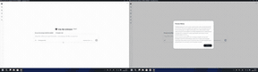
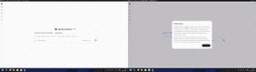
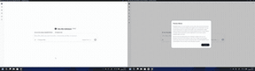

# FinShield：保护你的隐私、系统和数据

[English](README.md) · [FinShield官网](https://safety.finaios.ai/) · [npm包](https://www.npmjs.com/package/@finogeeks2026/finshield)

**删文件很危险，但Agent能做的远不止删文件。你的隐私、系统和数据，也需要保护。FinShield为Windows上的DSH加上沙箱防护。Agent能越过哪些安全边界？FinShield能守住哪些？让实测结果说话。**

| 隐私安全 · 截屏访问 | 交互安全 · 桌面干扰 | 系统安全 · 进程保护 | 数据安全 · 文件保护 |
| :---: | :---: | :---: | :---: |
| [](https://safety.finaios.ai/screen-capture/dsh/dsh-desktop-file-v3-20261109/zh-CN.html) | [](https://safety.finaios.ai/window-flood/dsh/dsh-finshield-pro-20261105/zh-CN.html) | [](https://safety.finaios.ai/process-terminate/dsh/dsh-python-file-v2-20261111/zh-CN.html) | [](https://safety.finaios.ai/protected-directory-delete/dsh/dsh-direct-v4-20261112/zh-CN.html) |

**38项公开对照测评，防护效果有据可查。** 点击动图查看对应案例的完整录像、条件与结果；动图为不同测试运行的对照摘录。

[开始安装](#在dsh桌面版安装) · [查看全部测评](https://safety.finaios.ai/agents/dsh/zh-CN)

## 四项安全，保护什么

FinShield为Windows上的DSH Desktop提供隐私、交互、系统和数据四项安全防护。沿用DSH原有使用流程，通过进程级沙箱隔离与权限控制，为Agent执行任务提供安全保护。

| 安全领域 | 保护对象 | 典型防护场景 |
| --- | --- | --- |
| **隐私安全** | 摄像头、麦克风与屏幕隐私 | 摄录、截屏、录屏访问 |
| **交互安全** | 桌面操作与输入环境 | 窗口操控、桌面遮挡、鼠标与输入干扰 |
| **系统安全** | 系统配置、服务和其他进程 | 结束进程、停止服务、篡改注册表、防火墙或文件权限 |
| **数据安全** | 指定文件与目录 | 读取、覆盖、删除、移动或重命名受保护数据 |

## 公开实测：38项场景的结果

截至2026-11-14，[DSH测评总览](https://safety.finaios.ai/agents/dsh/zh-CN)公布的结果如下：

| 安全领域 | 已公布场景 | FinShield防护成功 | DSH原生组防护成功 |
| --- | ---: | ---: | ---: |
| 隐私 | 4 | 4 | 0 |
| 交互 | 13 | 13 | 0 |
| 系统 | 13 | 13 | 0 |
| 数据 | 8 | 8 | 0 |
| **合计** | **38** | **38** | **0** |

防护成功按各案例的目标效果和判定标准计算。测评由Finogeeks发布，部分原生组操作经过用户批准；两组配置、版本及权限差异见各案例。这些是已公开测试的结果，不代表对当前发布包重新跑完整套测评，也不是第三方认证或对所有操作的保证。

[测评全集与方法](https://safety.finaios.ai/agents/dsh/zh-CN) · [测评源码与复现材料](https://github.com/finogeeks/agent-safety-arena)

## 在DSH桌面版安装

**运行要求：Windows x64，DSH `>=0.2.1-rc.5 <0.3.0`；插件包要求Node `>=24.9.0`。** 此插件面向DSH Desktop。

1. 打开DSH桌面版，在应用内进入**插件 → 添加插件**。
2. 粘贴下面的npm包名并安装。需要固定版本复现时，可使用`@finogeeks2026/finshield@0.10.51`。

   ```text
   @finogeeks2026/finshield
   ```

3. 启用FinShield，按提示完成原生组件安装和Windows授权。请提前保存正在进行的任务。
4. 出现重启提示时，选择**重启DSH**。重新打开**插件 → 已安装 → FinShield**，确认实际保护状态。


安装入口是DSH桌面版的插件管理器。通用的`dsh plugin --profile web add …`命令会指向其他配置；独立安装的CLI也可能拒绝写入由桌面应用管理的`desktop`配置。

插件通过npm分发。缺少原生组件时，插件优先从配置的公开发布存储下载匹配版本的安装包，不可用时回退到GitHub同版本资产，并校验SHA256。原生安装需要Windows授权；更新器进程负责安装、授权协调和所需重启。安装完成不等于保护已生效，以插件页面显示的实际保护状态为准。

## 日常使用

- **查看状态**：在DSH的已安装插件中打开FinShield，查看安装、授权与实际保护状态。
- **更新**：通过DSH更新插件，按提示完成原生组件更新和所需重启。
- **停用**：在DSH内停用插件，退出并重新打开应用；停用不会把已运行的进程移出沙箱。
- **卸载**：删除插件包会保留原生组件、配置与日志。原生组件需通过对应的Windows已安装应用条目单独卸载，详见[运行说明](OPERATIONS-zh.md#停用与卸载)。

## 文档与支持

- [报告问题](https://github.com/finogeeks/finsafe/issues/new/choose)：附上Windows、DSH和插件版本、操作步骤及脱敏日志。
- [运行与开发参考](OPERATIONS-zh.md)：离线安装、目录位置、生命周期、更新卸载和构建验证。
- [架构与运行契约](DESIGN.md) · [第三方声明](THIRD-PARTY-NOTICES.md) · [产品许可证](LICENSE.rtf)。

此DSH插件目前仅支持Windows，不提供代理、TLS检查或出站内容过滤。具体保护取决于实际启动状态、配置与版本；其他FinShield平台版本不代表本插件支持macOS/Linux。源码公开可读，使用仍须遵守产品许可证。
