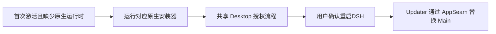

# FinShield DSH Windows 插件

[English](README.md) · [架构与运行契约](DESIGN.md)

**驭智能之力，守安全之境。**

插件保留原 DSH 桌面版、图标、账户和会话。Main 保持在沙箱外。原生就绪后，
启动时期用 `finsafe app launch dsh-desktop` 包裹 Host。页面「重启 DSH」由
当前 updater 停止旧 Main，再通过 AppSeam 启动替代 Main；updater 和 session Job 保留。
启用或更新前请保存工作；重启可能中断任务。

## 安装与授权

需要 Windows x64、DSH `>=0.2.1-rc.5 <0.3.0`，以及下载对应
FinSAFE 稳定版安装包的网络和 Windows 安装授权。先打开一次 DSH 建立 Desktop
profile，再通过标准插件界面或自带 CLI 安装：

插件正常运行不依赖 PowerShell，复用 DSH 的 Node、现有原生 DLL 和完整 FinSAFE
安装器。可选的离线 PowerShell 辅助脚本仍需 PowerShell 7。

```powershell
dsh plugin --profile desktop add <plugin.tgz> --ignore-scripts
```

首次激活且缺少原生运行时时，插件通过对应完整 Windows 安装器下载安装，保留现有的
发布包 SHA256 校验。激活立即返回，安装和授权在后台继续。updater 调用所选安装目录的
`finsafe desktop authorization` CLI，薄适配与控件、控制台共用同一个 Desktop 函数。
调用立即返回就绪或进行中；已接受的原生任务保留执行宿主，直至结束。Windows 权限确认和
Prepare 原有逻辑不变。重新启用时附着已有任务；同一 Main 会话里后来的插件 apply 不会重试
失败或取消的授权。进度标题显示当前安装或安全授权步骤，
并显示原生百分比；展开可查看步骤详情。
不增加授权按钮，不打开控制台。目标安装、配置及授权全部就绪且需要切换包装时，
选择“重启DSH”或“稍后”。
原生环境本来已就绪时，启动时期自动包裹一次，不显示重启提醒。所有启动都进入同一个
Host Token 检查流程，不区分启动来源。Host bind 失败显示实际错误，不包裹、不重建
updater。安装文件不等于已经获得保护。安装失败结果会保留；轮询、页面重开和同一
Main 下的 Host 重连不会自动重试授权。

历史安装记录仅用于诊断，不会等待旧结果文件或阻止后续安装。以后启动时按原生安装状态
判断是否需要新安装；本次安装失败后不自动重试。安装或授权状态读取失败时保留当前 DSH，
显示原始错误。Keep 放行当前 DSH，不把 Main 加入 updater 的 Job；
Host 实际防护状态单独报告。

独立的普通用户 Node updater 负责安装、准备和观察，直接复用 DSH 选定的 Node，
每个插件版本只复制一次脚本与依赖，不下载或复制独立 Node，也不在每次启用时全量校验文件。
受保护 Host 可连接已有的普通 updater，提交固定更新请求，但不能在外部创建 updater。
updater 跨插件版本复用，不按插件版本或协议版本拒绝复用。只有普通启动时期可以恢复
不可用的 updater：终止并关闭旧的命名 Job，再启动一个替代 updater。运行时期的 Host
bind 失败显示实际错误，不自动重试或恢复 updater。
updater 的 Job 负责自身和安装任务的清理，DSH 在此 Job 外运行，包裹启动也不继承此 Job。
updater 注册 Main 进程句柄的退出等待；Main 独立退出后，updater 退出并关闭 Job。
updater 退出或启动恢复不会结束 DSH。插件移除不会结束此生命周期，FinSAFE 不重载 Host。
安装随 updater 停止，已受理授权独立继续。
页面 Restart 保留 updater 和 Job，停止旧 Main 后通过 AppSeam 启动替代 Main，并切换退出等待；
此时不执行安装或授权，也不等待新 Host bind。

也可在启动 DSH 前，从解包后的插件源码目录执行：

```powershell
./install/Install-Plugin.ps1 -Archive <plugin.tgz>
```

`-DshDirectory` 指定原 Desktop 安装目录，`-DshHome` 覆盖 DSH 解析的数据根。
`-InstallDirectory` 和 `-ConfigDirectory` 指定原生绝对路径。
打开原DSH继续后台授权。`-Offline`只控制DSH依赖解析，原生下载仍需网络。
需要明确重试安装时，再次运行此脚本。

插件激活使用以下默认位置：

| 内容 | 默认位置 |
|---|---|
| 完整原生运行时 | `%ProgramFiles%/FinSAFE/dsh-plugin-versions/<release>/` |
| candidate 和 effective 配置 | `%ProgramData%/FinSAFE/dsh-plugin-versions/<release>/config/` |
| 下载与原生安装结果 | `%LOCALAPPDATA%/FinSAFE/dsh-plugin/downloads/<release>/` |
| 实例设置与 Host 支持库副本 | `<DSH_HOME>/finsafe-windows/` |
| 独立 updater 及依赖 | `%LOCALAPPDATA%/FinSAFE/dsh-updater/` |

实际路径来自 Windows 已知文件夹和 DSH 实际启动输入，支持自定义安装和 home、
移动后的用户目录、空格和中文路径。插件使用独立的 `finshield.dsh` 安全域，保留
个人版文件、配置和授权。一个 FinSAFE 产品按目标目录保存安装记录，不同目录
可以保留不同版本。
现有 `installation`、`configuration` 精确路径设置保留原意。新版本的根目录由单独的
`nativeVersionRoot`、`configurationVersionRoot`、`downloadRoot` 设置选择。离线脚本保留
其明确的安装、配置路径输入，不移动现有安装。



原生配置接口负责candidate物化与effective生成，Prepare负责授权。策略保留Windows强制
文件保护及基础资源设置，仅选择 DSH 兼容规则，网络使用 host 模式，不提供代理、
TLS 检查、PII 或出站内容过滤。

## 使用与更新

在 **插件 → 已安装 → FinShield** 查看产品页面。页面跟随DSH主题和语言，全部说明链接跳转到
[Agent安全测评](https://safety.finaios.ai/agents/dsh/zh-CN)。品牌图链接到
[FinShield官网](https://safety.finaios.ai/)。四个安全按两列排列，
授权标题为单行，统一字体及14px、18px两档字号。本地化`meta.detail`选择`detail/`中
紧凑介绍文档。发现页在安装前、启用时和卸载后统一使用原生Markdown和288×81动图，
启用的防护页隐藏重复介绍，避免将开发者README放入产品页面。
页面显示后台授权、等待重启与实际保护状态，
不增加检查页面。日志与诊断状态是观察结果，保护由Host原生令牌确认。

通过 DSH 更新插件包，版本跟随 FinSAFE 稳定版。受保护插件可向普通 updater 请求目标版本。
updater 下载并安装目标版本，完成配置和授权后才提供重启提醒。共享 Service 维护及所需
组件替换仍由原生模块负责。正在进行、失败、取消或等待系统重启的工作都不能提供 Restart，
页面保留实际结果。“稍后”对同一就绪条目生效，不因 Host 重连而重复提醒。

确认后，updater 停止旧 Main，通过 `finsafe app launch dsh-desktop` 启动已准备好的替代
Main，并保留原 updater 和 Job。本期不支持改变 FinSAFE ID。
轮询不发起授权、不自行包裹；当前 Host 的实际保护与更新就绪、错误分别显示。

若 DSH 的包管理操作要求先删除再安装插件包，此操作保留原生运行时和授权，不调用原生卸载。

## 停用与卸载

使用 DSH 标准控制停用或删除插件。updater 可用时，清理仅恢复 AppSeam 拥有的
Desktop sandbox 和 pnpm storeDir 字段；后续修改冲突或 updater 不可用会报错，原覆盖值可能保留，
不保证自动恢复。离线脚本移除前，先在运行中的 DSH 停用插件以执行正常清理。
插件包裹启动前会关闭配置热加载，停用或删除后保持关闭。插件和配置变更需要重启生效。
退出并重新打开后改变后续激活。停用不能把
已运行的 Host 移出 AppContainer。附带脚本还可清理本插件元数据：

```powershell
./install/Install-Plugin.ps1 -Remove
```

删除插件包保留原生文件、下载、日志、备份及授权。需要删除原生运行时时，使用
该目录的 `finsafe-uninstall.exe` 或对应 Windows 已安装应用条目。原生卸载只影响
选定实例拥有的文件和记录，保留 effective 配置、其他用户文件及 DSH 账户、会话。
原生卸载通过已有的
定向 unprepare 清除该运行时安装目录、配置和原用户对应的 FinSAFE ID 授权。
不执行 SYSTEM 全量授权清理，不向其他运行时转交 Service。两个目录如果使用
相同的用户与安全域 ID，就共享同一份授权；清除此 ID 的授权会同时生效。
不同 ID 的授权保持独立。个人版默认配置路径、更新配置路径和快捷方式名称不变。
详见[设计文档](DESIGN.md#updates-and-removal)。

## 构建、发布与验证

稳定版流程在安装包发布成功后，将完整客户端、策略、许可证、第三方声明和双语
说明同步到[公开仓库](https://github.com/finogeeks/finsafe/tree/main/integrations/dsh/windows)，
并生成[自定义 DSH 索引](https://raw.githubusercontent.com/finogeeks/finsafe/main/integrations/dsh/index.json)。
每版固定公开 Git 提交和子目录，并记录原始 FinSAFE 源码提交。将该 URL 添加为
自定义插件索引。本次变更本身不发布版本，也不代表通过市场上架验收。

构建与验证命令见[英文说明](README.md#build-publication-and-verification)。策略生成直接使用 `finsafe config resolve`；策略测试需要 Python 和 PyYAML。自动适配器、实例、策略和索引检查不能证明真实安装、升级、
卸载、跨账户授权、原会话保留、浏览器布局或远程 Git 安装，均需单独原生验收。
历史 shared 原型观察不能代表独立安全域包的验收结果。

插件含原有 FinSAFE 产品许可证 LICENSE.rtf 和[第三方声明](THIRD-PARTY-NOTICES.md)。
原生安装器提供自己的运行时声明，无需解压依赖。

Node updater 的新 IPC 和真实安装生命周期仍需单独原生验收，旧 Desktop Channel 的结果
不能替代。已接受并延后的安全问题见[设计文档](DESIGN.md#dsh-plugin-known-security-vulnerabilities)。
