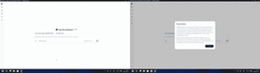

# 适用于 DSH Desktop 的 FinShield

**[使用文档](https://finshield.finogeeks.club/zh-CN/agents/dsh.html) · [安全测评](https://safety.finaios.ai/agents/dsh/zh-CN) · [English](README.md)**

**让 Agent 帮你做事，也给它划清边界。**

Agent 的操作不止是删除文件：截屏可能暴露隐私，弹窗可能干扰工作，结束进程可能打断正在进行的任务。FinShield 为 Windows 上 DSH 的 Agent 执行进程增加沙箱防护，控制它对文件、系统和桌面的访问与操作，保留你原有的 DSH 使用流程。

## 看看防护效果

下面四个 DSH 案例展示普通运行与 FinShield 保护下的差异：

| 隐私 · 截屏访问 | 桌面 · 弹窗干扰 | 系统 · 进程保护 | 数据 · 文件保护 |
| :---: | :---: | :---: | :---: |
| [](https://safety.finaios.ai/screen-capture/dsh/dsh-desktop-file-v3-20261109/zh-CN.html) | [](https://safety.finaios.ai/window-flood/dsh/dsh-finshield-pro-20261105/zh-CN.html) | [](https://safety.finaios.ai/process-terminate/dsh/dsh-python-file-v2-20261111/zh-CN.html) | [](https://safety.finaios.ai/protected-directory-delete/dsh/dsh-direct-v4-20261112/zh-CN.html) |

点击动图查看完整录像、测试条件与结果。动图摘自 Finogeeks 已发布的 DSH 测评，对照画面来自不同测试运行，不代表对当前发布包重新完成了整套测评，也不保证每项操作。

## 环境要求

- Windows x64。
- DSH Desktop `>=0.2.1-rc.5 <0.3.0`；插件包要求 Node `>=24.9.0`。
- 可下载插件及原生组件的互联网连接。

此插件面向 Windows 上的 DSH Desktop。

## 安装

1. **添加插件。** 保存正在进行的工作，在 DSH Desktop 中打开**插件 → 添加插件**，粘贴下面的包名并安装：

   ```text
   @finogeeks2026/finshield-dsh
   ```

2. **启用并完成准备。** 启用 FinShield，按插件页面提示安装原生组件并完成 Windows 授权。首次使用需要下载和准备组件，请留意页面进度及授权提示。
3. **重新打开 DSH。** 准备完成后，按提示选择**退出 DSH**，再手动打开应用。
4. **确认保护生效。** 进入**插件 → 已安装 → FinShield**，查看实际保护状态。如果尚未受保护，先查看页面上的准备进度或错误提示。

请使用桌面版插件管理器；独立 CLI 可能指向其他配置。已安装旧包 `@finogeeks2026/finshield` 的用户，请先按[旧包迁移说明](https://finshield.finogeeks.club/zh-CN/agents/dsh.html)移除旧插件，再安装新包，避免同时启用。

## 防护范围

受保护进程具有文件、系统、设备隐私和桌面交互边界。访问权限按实际配置生效，可写文件仍可能被修改或删除。默认网络模式为 `host`：此插件不提供 FinShield 网站黑名单、代理／TLS 内容检查或 PII 脱敏。

具体权限及设置的作用见[防护范围与配置说明](https://finshield.finogeeks.club/zh-CN/protection/)。

## 日常使用与支持

- **查看状态：** 在**插件 → 已安装 → FinShield** 查看准备进度与实际保护状态。
- **更新：** 通过 DSH 更新插件，按提示完成原生组件准备；需要时退出后手动重新打开，再确认保护状态。
- **停用与卸载：** 停用后退出并重新打开 DSH；停用不会把已运行的进程移出沙箱。移除插件会保留原生组件、配置和日志，完整卸载步骤见[运行指南](https://finshield.finogeeks.club/zh-CN/agents/dsh-operations.html)。

遇到问题时，建议从插件页点击**反馈问题**，自动附带当前版本和状态，也可[直接反馈](https://github.com/finogeeks/finsafe/issues/new?template=plugin_feedback_zh.yml)。

使用须遵守[产品许可](LICENSE.rtf)，另见[第三方声明](THIRD-PARTY-NOTICES.md)。
