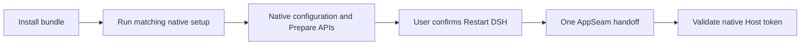

# FinShield for DSH Desktop on Windows

[中文](README-zh.md) · [Design and operation](DESIGN.md)

**Harness intelligence. Shield your world.**

FinShield keeps the original DSH Desktop, icon, account and sessions. The plugin
requests one restart through FinSAFE AppSeam. The new Host must pass native
AppContainer status checks. Main stays outside AppContainer. Save active
work before enabling or updating: the handoff can interrupt a task.

## Install and authorize

Use Windows x64, DSH `>=0.2.1-rc.5 <0.3.0`, PowerShell 7, network access to the
matching official FinSAFE stable release and Windows setup consent. Open DSH once
to create its Desktop profile. Install through DSH's plugin controls or bundled CLI:

```powershell
dsh plugin --profile desktop add <plugin.tgz> --ignore-scripts
```

On first activation, the plugin downloads the matching full Windows installer
and SHA256SUMS, verifies SHA256 and runs setup when its native version is missing
or different. Activation returns while this work continues in the background.
The plugin uses thin native adapters to the existing Desktop authorization APIs,
retaining Windows consent. Re-enabling attaches to active work and reuses completed
preparation. Optional progress displays the native percentage. It adds no authorization button and does not open Console.
When ready, choose Restart DSH or Later in the plugin page or global reminder.
Installed files alone do not establish protection. Failed setup is recorded;
automatic activation does not retry it on every start.

The supplied script can complete bundle and native setup before DSH starts.
Run it from an unpacked plugin source package:

```powershell
./install/Install-Plugin.ps1 -Archive <plugin.tgz>
```

`-DshDirectory` selects the original Desktop installation. `-DshHome` overrides
DSH's resolved data root. `-InstallDirectory` and `-ConfigDirectory` select native
absolute paths. Open the original DSH to continue background authorization.
`-Offline` affects DSH dependencies; native download still needs
the network. Rerun the script for an explicit setup retry.

| Content | Default location |
|---|---|
| Full native runtime | `%ProgramFiles%/FinSAFE/dsh-plugin/` |
| Candidate and effective policy | `%ProgramData%/FinSAFE/dsh-plugin/config/` |
| Downloads and native setup results | `%LOCALAPPDATA%/FinSAFE/dsh-plugin/downloads/` |
| Settings, handoff logs and backups | `<DSH_HOME>/finsafe-windows/` |

Windows known folders determine actual paths. The plugin uses its independent
`finshield.dsh` security domain. It preserves personal-edition files,
configuration and authorization. One FinSAFE product stores installation records
by target directory. Different directories can retain different versions.



Native configuration owns candidate materialization and effective generation;
Prepare owns authorization. The
policy retains Windows mandatory filesystem protections and base resources,
selects DSH compatibility and uses host networking. It does not provide proxy,
TLS inspection, PII or outbound-content filtering.

## Use and update

Open **Plugins → Installed → FinShield** for the product page. It follows DSH's
theme and language. Every explanatory link opens the
[Safety Arena](https://finsafe-safety-arena.finogeeks.club/).
The page shows background authorization, restart readiness and live protection.
There is no separate verification page. Logs and diagnostic status are observations;
the Host's native token establishes protection.

Upgrade the bundle through DSH. Its version follows FinSAFE stable releases.
When needed, activation runs that version's full setup against the same native
directory. Native Restart Manager owns confirmation, shutdown of actual runtime
file users and replacement. Setup runs outside the runtime it replaces.
Cancellation, replacement failures and reboot codes retain their native results.
A failed second Host generation does not request another handoff.

## Disable and remove

Use DSH's controls to disable or remove the bundle. Quit and reopen Desktop to
change future activation. Disabling cannot remove AppContainer from an existing
Host. The metadata-aware script removal is:

```powershell
./install/Install-Plugin.ps1 -Remove
```

Bundle removal retains native files, downloads, logs, backups and authorization.
Remove the native runtime separately through its directory's
`finsafe-uninstall.exe` or corresponding Windows Installed Apps entry. Native
uninstall affects the selected instance's owned files and record. Effective
configuration, other user files and DSH accounts and sessions are retained.
Revised design (2026-11-06; implementation alignment and native acceptance
pending): native uninstall revokes only the FinSAFE ID selected by that runtime's
installation/configuration and original user, through existing scoped unprepare.
It does not run all-ID SYSTEM cleanup or transfer Services to another runtime.
Two directories using the same user/domain ID share that authorization, so
revoking the ID affects both. Distinct IDs remain independent. Personal default
configuration/update paths and shortcut names stay unchanged. See [design](DESIGN.md#updates-and-removal).

## Build, publication and verification

The stable-release workflow synchronizes this directory, including built client,
policy, license, notices and bilingual instructions, to the public
[FinSAFE repository](https://github.com/finogeeks/finsafe/tree/main/integrations/dsh/windows).
After installer publication it generates the custom
[DSH index](https://raw.githubusercontent.com/finogeeks/finsafe/main/integrations/dsh/index.json).
Each version pins a public Git commit and subdirectory and records the originating
FinSAFE source commit. Add that URL as a custom plugin index. This code change
does not itself publish a release or establish marketplace listing acceptance.

From a FinSAFE source checkout:

```powershell
npm --prefix integrations/dsh/windows ci --ignore-scripts --legacy-peer-deps
npm --prefix integrations/dsh/windows run build
python scripts/dev/verify.py --lane dsh-windows-plugin --lane dsh-windows-handoff --dry-run
python scripts/dev/verify.py --lane dsh-windows-plugin --lane dsh-windows-handoff
```

Policy generation requires Python and PyYAML. Automated adapter, instance, policy
and index checks do not prove native installation/upgrade/removal, cross-account
authorization, original-session retention, browser layout or remote Git install.
These need separate native acceptance. Historical shared-domain prototype
observations do not establish acceptance of this independent-domain package.

The package carries the existing FinSAFE product license in LICENSE.rtf and
[third-party notices](THIRD-PARTY-NOTICES.md). Native setup supplies runtime notices.
No extraction dependency is required.
