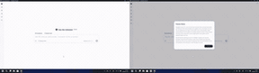

# FinShield for DSH Desktop

**[Documentation](https://finshield.finogeeks.club/en/agents/dsh.html) · [Safety evaluations](https://safety.finaios.ai/agents/dsh/) · [简体中文](README-zh.md)**

**Let your agent work. Keep its access under control.**

Agents can do more than delete files: screenshots can expose private information, pop-ups can disrupt your desktop, and process termination can interrupt active work. FinShield adds Windows sandbox protection to DSH's Agent execution processes, controlling access to files, system functions and the desktop while preserving your usual DSH workflow.

## See protection in action

These four DSH cases compare ordinary runs with FinShield protection:

| Privacy · Screen access | Desktop · Disruptive pop-ups | System · Process protection | Data · File protection |
| :---: | :---: | :---: | :---: |
| [](https://safety.finaios.ai/screen-capture/dsh/dsh-desktop-file-v3-20261109/index.html) | [](https://safety.finaios.ai/window-flood/dsh/dsh-finshield-pro-20261105/index.html) | [](https://safety.finaios.ai/process-terminate/dsh/dsh-python-file-v2-20261111/index.html) | [](https://safety.finaios.ai/protected-directory-delete/dsh/dsh-direct-v4-20261112/index.html) |

Select a GIF for full recordings, test conditions and results. These excerpts come from Finogeeks' published DSH evaluations and compare separate test runs. They are not a complete rerun against the current package or a guarantee for every operation.

## Requirements

- Windows x64.
- DSH Desktop `>=0.2.1-rc.5 <0.3.0`; Node `>=24.9.0` as required by the package.
- An internet connection to download the plugin and native components.

This plugin targets DSH Desktop on Windows.

## Install

1. **Add the plugin.** Save active work. In DSH Desktop, open **Plugins → Add plugin**, paste this package name and install it:

   ```text
   @finogeeks2026/finshield-dsh
   ```

2. **Enable and prepare.** Enable FinShield, then follow its page's prompts to install native components and complete Windows authorization. First use involves downloading and preparing components; watch the page for progress and authorization prompts.
3. **Reopen DSH.** When preparation is ready, choose **Exit DSH** as prompted, then open the application manually.
4. **Confirm protection.** Open **Plugins → Installed → FinShield** and check the actual protection state. If protection is not active, check the page for preparation progress or an error.

Use the desktop plugin manager; a separate CLI can target a different profile. If you have the older `@finogeeks2026/finshield` package, follow the [migration instructions](https://finshield.finogeeks.club/en/agents/dsh.html) to remove it before installing the new package. Do not enable both together.

## Protection scope

The protected process has file, system, device-privacy and desktop-interaction boundaries. Access follows the effective configuration; writable files can still be changed or deleted. Network mode defaults to `host`: this plugin does not provide a FinShield website blacklist, proxy/TLS content inspection or PII redaction.

See [protection scope and configuration](https://finshield.finogeeks.club/en/protection/) for permissions and the effects of available settings.

## Everyday use and support

- **Check status:** Open **Plugins → Installed → FinShield** for preparation progress and actual protection status.
- **Update:** Update through DSH and follow the native setup prompts. Exit and reopen DSH when requested, then confirm protection.
- **Disable and remove:** After disabling, exit and reopen DSH; disabling does not move an already running process out of its sandbox. Removing the plugin retains native components, configuration and logs. See the [operation guide](https://finshield.finogeeks.club/en/agents/dsh-operations.html) for complete removal steps.

If you encounter a problem, use the plugin page's **Feedback** link to include current version and status, or [report a problem](https://github.com/finogeeks/finsafe/issues/new?template=plugin_feedback_en.yml).

Use is governed by the [product license](LICENSE.rtf). See [third-party notices](THIRD-PARTY-NOTICES.md).
