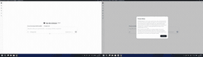
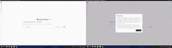
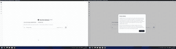
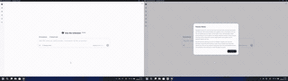
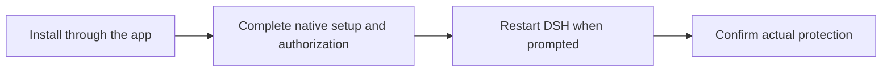

# FinShield: protect your privacy, system and data

[简体中文](README-zh.md) · [FinShield website](https://safety.finaios.ai/) · [npm package](https://www.npmjs.com/package/@finogeeks2026/finshield)

**Deleting files is dangerous, but agents can do much more. Your privacy, system and data need protection too. FinShield adds sandbox protection to DSH on Windows. Which security boundaries can agents cross, and which can FinShield defend? Let the test results speak.**

| Privacy · Screen access | Interaction · Desktop interference | System · Process protection | Data · File protection |
| :---: | :---: | :---: | :---: |
| [](https://safety.finaios.ai/screen-capture/dsh/dsh-desktop-file-v3-20261109/index.html) | [](https://safety.finaios.ai/window-flood/dsh/dsh-finshield-pro-20261105/index.html) | [](https://safety.finaios.ai/process-terminate/dsh/dsh-python-file-v2-20261111/index.html) | [](https://safety.finaios.ai/protected-directory-delete/dsh/dsh-direct-v4-20261112/index.html) |

**38 public comparison scenarios, with evidence you can inspect.** Select a GIF for the case's full recordings, conditions and results. The GIFs compare excerpts from separate test runs.

[Install](#install-in-dsh-desktop) · [Browse all evaluations](https://safety.finaios.ai/agents/dsh/)

## Four areas of protection

FinShield provides privacy, interaction, system and data protection for DSH Desktop on Windows. It fits into the existing DSH workflow and uses process-level sandbox isolation and permission controls to protect agent task execution.

| Safety area | What it protects | Example scenarios |
| --- | --- | --- |
| **Privacy** | Camera, microphone and screen privacy | Audio/video capture, screenshots and screen recording |
| **Interaction** | Desktop controls and input environment | Window manipulation, screen obstruction, mouse and input interference |
| **System** | System settings, services and other processes | Process termination, service stops, registry, firewall or file-permission changes |
| **Data** | Selected files and directories | Reading, overwriting, deleting, moving or renaming protected data |

## Public evaluations: results across 38 scenarios

The [DSH evaluation overview](https://safety.finaios.ai/agents/dsh/) reported these results as of 2026-11-14:

| Safety area | Published scenarios | FinShield prevention successes | Native DSH prevention successes |
| --- | ---: | ---: | ---: |
| Privacy | 4 | 4 | 0 |
| Interaction | 13 | 13 | 0 |
| System | 13 | 13 | 0 |
| Data | 8 | 8 | 0 |
| **Total** | **38** | **38** | **0** |

Prevention success follows each case's target effect and decision criteria. These evaluations are published by Finogeeks. Some baseline operations followed user approval; configuration, version and permission differences are recorded per case. These published results are not a complete rerun against the current package, independent certification or a guarantee for every operation.

[All evaluations and methods](https://safety.finaios.ai/agents/dsh/) · [Evaluation source and reproduction materials](https://github.com/finogeeks/agent-safety-arena)

## Install in DSH Desktop

**Requirements: Windows x64, DSH `>=0.2.1-rc.5 <0.3.0`; the package requires Node `>=24.9.0`.** This plugin targets DSH Desktop.

1. Open DSH Desktop and go to **Plugins → Add plugin** in the application.
2. Paste this npm package name and install it. For a version-pinned reproduction, use `@finogeeks2026/finshield@0.10.51`.

   ```text
   @finogeeks2026/finshield
   ```

3. Enable FinShield and follow the native setup and Windows authorization prompts. Save active tasks first.
4. When prompted, choose **Restart DSH**. Open **Plugins → Installed → FinShield** and confirm the actual protection state.



Use DSH Desktop's plugin manager. The generic `dsh plugin --profile web add …` command targets a different profile; a separately installed CLI may also refuse to write to the application-managed `desktop` profile.

The plugin is distributed through npm. If native components are missing, it prefers the configured public release storage for the matching installer, with GitHub assets of the same version as fallback and SHA256 verification. Native setup needs Windows consent; an updater process handles installation, authorization coordination and required restarts. Installation alone does not establish protection: check the actual state on the plugin page.

## Everyday use

- **Check status**: open FinShield from DSH's installed plugins to see installation, authorization and actual protection status.
- **Update**: update the plugin through DSH and follow the native component update and restart prompts.
- **Disable**: disable it in DSH, then exit and reopen the application. Disabling does not move a running process out of the sandbox.
- **Uninstall**: removing the plugin retains native components, configuration and logs. Uninstall native components separately through their Windows Installed Apps entry; see [operation details](OPERATIONS.md#disable-and-remove).

## Documentation and support

- [Report a problem](https://github.com/finogeeks/finsafe/issues/new/choose) with Windows, DSH and plugin versions, reproduction steps and redacted logs.
- [Operation and development](OPERATIONS.md): offline setup, directories, lifecycle, updates, removal, builds and verification.
- [Design and operation contract](DESIGN.md) · [Third-party notices](THIRD-PARTY-NOTICES.md) · [Product license](LICENSE.rtf).

This DSH plugin currently supports Windows only and does not provide proxy/TLS inspection or outbound-content filtering. Protection depends on actual launch state, configuration and version. Other FinShield editions do not establish macOS/Linux support for this plugin. Source is publicly readable; use remains subject to the product license.
