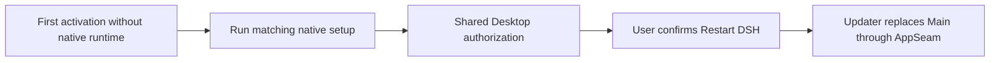

# FinShield for DSH Desktop on Windows

[中文](README-zh.md) · [Design and operation](DESIGN.md)

**Harness intelligence. Shield your world.**

FinShield keeps the original DSH Desktop, icon, account and sessions. Main
stays outside AppContainer. After native setup is ready, startup wraps Host
through `finsafe app launch dsh-desktop`. Page Restart uses this updater to
replace Main while keeping the same updater and session Job. Save active
work before enabling or updating: a restart can interrupt a task.

## Install and authorize

Use Windows x64, DSH `>=0.2.1-rc.5 <0.3.0`, network access to the
matching official FinSAFE stable release and Windows setup consent. Open DSH once
to create its Desktop profile. Install through DSH's plugin controls or bundled CLI:

Normal plugin operation does not require PowerShell. It reuses DSH's Node,
the existing native DLL and full FinSAFE installer. The optional offline
PowerShell helper below requires PowerShell 7.

```powershell
dsh plugin --profile desktop add <plugin.tgz> --ignore-scripts
```

On first activation, a missing native runtime is downloaded and installed through
the matching full Windows installer. The existing release SHA256 check remains.
Activation returns while this work continues in the background. The updater calls
the selected installation's `finsafe desktop authorization` CLI. That thin adapter
uses the same shared Desktop function as the Widget and Console. It promptly
returns Ready or Pending; accepted native work keeps its owner until completion.
Windows consent and existing Prepare behavior remain unchanged. Re-enabling
attaches to active work. A failed or cancelled attempt is not replayed by a later
plugin apply in the same Main session. Optional progress names the current installation
or authorization step and displays the native percentage. The plugin adds no
authorization button and does not open Console.
After the selected installation, configuration and authorization are fully ready,
choose Restart DSH or Later if a wrapper switch is needed.
If the matching native instance is already ready at startup, DSH wraps once
without a restart reminder. Every launch uses the same Host-token check;
launch origin does not select behavior. Installed files alone do not
establish protection. Historical setup records remain diagnostic only. A later
startup checks native installation state and can start a new installation when
needed; it does not wait for an old result file. The current attempt is never
automatically retried.

An installation or authorization read error keeps the current DSH and displays
the original error. Keep lets DSH continue without assigning Main to updater's
Job. Actual Host protection remains a separate result.

Page Restart stops old Main and launches its replacement through AppSeam.
It keeps updater and the Job, performs no setup or authorization, and does not
wait for new Host binding. A failed Host bind reports its actual error without
automatic retry or updater recovery.

An independent ordinary-user Node updater owns setup, preparation and restart.
It reuses DSH's selected Node executable and copies its scripts and dependencies
once per plugin version. It does not download or copy a separate Node runtime,
or hash all files on activation.
A protected Host connects to the existing ordinary updater for fixed update
requests. It cannot bootstrap an outside updater. The updater is shared across
plugin versions without a package-version or protocol-compatibility gate. An
unusable updater can be replaced only during ordinary startup: terminate and
close its named Job, then start one replacement. Running Host binding never
performs this recovery.
The updater retains its own Job for fault cleanup and installation work. DSH
stays outside that Job, including on wrapped launch. A registered wait on Main's
process handle ends updater when Main exits independently. Updater exit or
startup recovery leaves DSH running. Plugin removal does not end that lifetime.
FinSAFE does not reload Host. Installation stops with updater; accepted
authorization continues independently. Page Restart retains updater and its Job
and switches the exit wait to the replacement Main.

The supplied script can complete bundle and native setup before DSH starts.
Run it from an unpacked plugin source package:

```powershell
./install/Install-Plugin.ps1 -Archive <plugin.tgz>
```

`-DshDirectory` selects the original Desktop installation. `-DshHome` overrides
DSH's resolved data root. `-InstallDirectory` and `-ConfigDirectory` select native
absolute paths. Open the original DSH to continue background authorization.
`-Offline` affects DSH dependencies; native download still needs
the network. Rerun the script for an explicit setup retry.

Plugin activation uses these default locations:

| Content | Default location |
|---|---|
| Full native runtime | `%ProgramFiles%/FinSAFE/dsh-plugin-versions/<release>/` |
| Candidate and effective policy | `%ProgramData%/FinSAFE/dsh-plugin-versions/<release>/config/` |
| Downloads and native setup results | `%LOCALAPPDATA%/FinSAFE/dsh-plugin/downloads/<release>/` |
| Instance settings and Host support copy | `<DSH_HOME>/finsafe-windows/` |
| Independent updater and dependencies | `%LOCALAPPDATA%/FinSAFE/dsh-updater/` |
| AppSeam original-field records | `%LOCALAPPDATA%/FinSAFE/AppSeam/dsh-originals/` |

Windows known folders and DSH actual launch inputs determine paths, including
custom homes, relocated user folders and custom installations. The plugin uses its independent
`finshield.dsh` security domain. It preserves personal-edition files,
configuration and authorization. One FinSAFE product stores installation records
by target directory. Different directories can retain different versions.
Existing exact `installation` and `configuration` settings keep their meaning.
Separate `nativeVersionRoot`, `configurationVersionRoot` and `downloadRoot`
settings select roots for new versions. The offline helper retains its explicit
installation/configuration inputs; it does not move an existing installation.



Native configuration owns candidate materialization and effective generation;
Prepare owns authorization. The
policy retains Windows mandatory filesystem protections and base resources,
selects DSH compatibility and uses host networking. It does not provide proxy,
TLS inspection, PII or outbound-content filtering.

## Use and update

Open **Plugins → Installed → FinShield** for the product page. It follows DSH's
theme and language. Every explanatory link opens the
[Agent Safety Arena](https://safety.finaios.ai/agents/dsh/index.html).
The brand illustration opens the [FinShield product site](https://safety.finaios.ai/).
The page uses four safety areas in two columns, a single-line authorization heading,
one font family and 14px/18px text. Localized `meta.detail` entries select the
compact introduction under `detail/`. Discover renders this native Markdown
with 288×81 assessment GIFs in every installation state. The active protection
page hides the duplicate introduction; this developer README is not product copy.
The page shows background authorization, restart readiness and live protection.
There is no separate verification page. Logs and diagnostic status are observations;
the Host's native token establishes protection.

Upgrade the bundle through DSH. Its version follows FinSAFE stable releases.
The protected plugin can request that release through the ordinary updater.
The updater downloads the selected version, runs the full installer and completes
configuration and authorization before offering Restart. Native runtime owners
handle shared Service maintenance and required component replacement. Active,
failed, cancelled or reboot-pending work cannot offer Restart. Its actual result
remains visible. Later dismisses the ready session item across Host reconnects.

After confirmation, updater stops old Main and launches the prepared replacement
through `finsafe app launch dsh-desktop`, retaining the same updater and Job.
Changing FinSAFE ID is unsupported in this iteration. Polling never
submits authorization or wraps by itself. Current Host protection is
reported separately from update readiness or errors.

Bundle removal and reinstallation, when required by DSH's package controls,
retain the native runtime and authorization. They do not invoke native uninstall.

## Disable and remove

Use DSH's controls to disable or remove the bundle. With an available updater,
cleanup restores the AppSeam-owned desktop sandbox and pnpm storeDir fields. Later user edits
or unavailable cleanup produce an error; the override can remain. There is no
automatic crash recovery. Disable in running DSH before offline script removal.
Plugin Wrap closes profile hot reload before starting protected DSH. It remains
disabled after plugin removal; DSH configuration and plugin changes require restart.
Quit and reopen
Desktop to change future activation. Disabling cannot remove AppContainer from an existing
Host. The metadata-aware script removal is:

```powershell
./install/Install-Plugin.ps1 -Remove
```

Bundle removal retains native files, downloads, logs, backups and authorization.
Remove the native runtime separately through its directory's
`finsafe-uninstall.exe` or corresponding Windows Installed Apps entry. Native
uninstall affects the selected instance's owned files and record. Effective
configuration, other user files and DSH accounts and sessions are retained.
Native uninstall revokes only the FinSAFE ID selected by that runtime's
installation/configuration and original user, through existing scoped unprepare.
It does not run all-ID SYSTEM cleanup or transfer Services to another runtime.
Two directories using the same user/domain ID share that authorization, so
revoking the ID affects both. Distinct IDs remain independent. Personal default
configuration/update paths and shortcut names stay unchanged. See [design](DESIGN.md#updates-and-removal).

## Build, publication and verification

The stable-release workflow synchronizes this directory, including built client,
policy, license, notices and bilingual instructions, to the public
[FinSAFE repository](https://github.com/finogeeks/finsafe/tree/main/integrations/dsh/windows).
After installer publication it generates the custom
[DSH index](https://raw.githubusercontent.com/finogeeks/finsafe/main/integrations/dsh/index.json).
Each version pins a public Git commit and subdirectory and records the originating
FinSAFE source commit. Add that URL as a custom plugin index. This code change
does not itself publish a release or establish marketplace listing acceptance.

From a FinSAFE source checkout:

```powershell
npm --prefix integrations/dsh/windows ci --ignore-scripts --legacy-peer-deps
npm --prefix integrations/dsh/windows run build
npm --prefix integrations/dsh/windows run build:pnpm-parser
./target/release/finsafe.exe config resolve --manifest windows/config/dsh-plugin/manifest.yaml --output integrations/dsh/windows/policy/candidate.yaml
npm --prefix integrations/dsh/windows run build:native
python scripts/dev/verify.py --lane dsh-windows-plugin --lane dsh-windows-updater --dry-run
python scripts/dev/verify.py --lane dsh-windows-plugin --lane dsh-windows-updater
```

Policy generation requires Python and PyYAML. Automated adapter, instance, policy
and index checks do not prove native installation/upgrade/removal, cross-account
authorization, original-session retention, browser layout or remote Git install.
These need separate native acceptance. Historical shared-domain prototype
observations do not establish acceptance of this independent-domain package.

The package carries the existing FinSAFE product license in LICENSE.rtf and
[third-party notices](THIRD-PARTY-NOTICES.md). Native setup supplies runtime notices.
The official pnpm metadata reader and its notices are bundled in AppSeam.
The native adapter and staged Node updater require separate native acceptance;
old Desktop Channel results do not prove the new IPC path. Known deferred
security vulnerabilities are recorded in [DESIGN.md](DESIGN.md#dsh-plugin-known-security-vulnerabilities).
