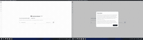
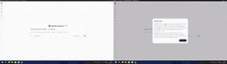
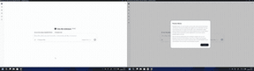
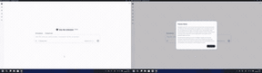

| **[Privacy](https://safety.finaios.ai/agents/dsh/index.html#privacy)**　Limit recording & screenshots. | **[Controls](https://safety.finaios.ai/agents/dsh/index.html#interaction)**　Limit window & mouse use. |
| --- | --- |
|  |  |
| **[System](https://safety.finaios.ai/agents/dsh/index.html#system)**　Limit processes & settings. | **[Data](https://safety.finaios.ai/agents/dsh/index.html#data)**　Protect sensitive files. |
|  |  |

[See how FinShield protects you ↗](https://safety.finaios.ai/agents/dsh/index.html)　[Meet FinShield ↗](https://safety.finaios.ai/)

First-time setup requires administrator approval to configure isolation. If Windows asks for permission, check the program details, then select Yes.
