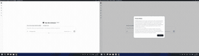
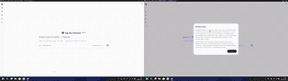
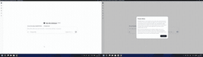
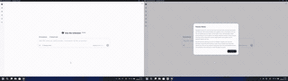

| **[隐私别乱碰](https://safety.finaios.ai/agents/dsh/zh-CN#privacy)**　约束摄录和截屏操作 | **[电脑别乱控](https://safety.finaios.ai/agents/dsh/zh-CN#interaction)**　限制窗口和鼠标干扰 |
| --- | --- |
|  |  |
| **[系统别乱改](https://safety.finaios.ai/agents/dsh/zh-CN#system)**　限制进程与系统改动 | **[数据别乱动](https://safety.finaios.ai/agents/dsh/zh-CN#data)**　保护敏感目录和文件 |
|  |  |

[了解FinShield如何守护你 ↗](https://safety.finaios.ai/agents/dsh/zh-CN)　[认识FinShield ↗](https://safety.finaios.ai/)

首次启用需管理员授权，用于配置安全隔离环境。出现Windows权限提示时，请核对程序信息后选择“是”。
