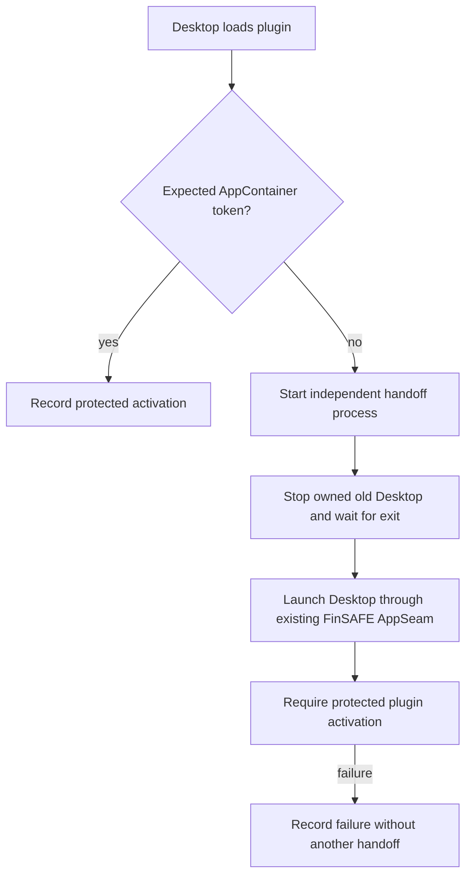

# Desktop handoff experiment

This file records the earlier fixture experiment. For the current installation
contract, see [plugin design](../DESIGN.md) and [instructions](../README.md).
The results below do not prove independent-domain installation acceptance.

Status: experiment, not a marketplace feature. Parent: the DSH Windows plugin.
Inputs: an owned Desktop fixture, an already prepared effective policy and the
expected AppContainer package SID. Output: a new Desktop whose Host has the
expected native token, or a visible experiment failure.



The experiment reuses installed Electron and DSH Main/Host code. A fixture-only
bootstrap sets a separate Electron user-data path and DSH home before importing
the installed Main module. The copied ASAR changes only its package Main entry
to select this fixture bootstrap; installed Main/Host code remains unchanged.
The installed ASAR and shortcuts are never patched. The fixture requires a
build whose ASAR integrity validation is already disabled; it never disables it.
This bootstrap is an isolation fixture, not a proposed production requirement.

The helper deliberately terminates only the owned old Main. This tests the
user-authorized forced handoff, not graceful application shutdown. It must
survive that termination; the old Host must then exit and release its state
before the new launch. No global process-name kill or automatic retry is used.
The helper uses its own hidden console. On this host, Node's detached-process
flag made PowerShell exit without executing its script. A plain inherited-console
launch also failed to complete handoff. The small Start-Process bootstrap passed
the survival experiment; it is not an automatic alternative launch path.

The second activation requires both TokenIsAppContainer and a native EqualSid
comparison against the explicit expected package SID. An environment marker
only distinguishes experiment generations; it never proves confinement.
A second unprotected generation fails instead of requesting another restart.
The fixture also observes Main receiving the new Host's real Node IPC `ready`
message. This is separate from plugin activation and token verification.

Electron supports relaunch after exit, VS Code coordinates quit before
relaunch, and Steam's RestartAppIfNecessary delegates relaunch to an external
client. These sources establish the lifecycle pattern, not DSH plugin support:

- https://www.electronjs.org/docs/latest/api/app#apprelaunchoptions
- https://github.com/microsoft/vscode/blob/main/src/vs/platform/lifecycle/electron-main/lifecycleMainService.ts
- https://partner.steamgames.com/doc/api/steam_api#SteamAPI_RestartAppIfNecessary

Inspected 2026-11-05. DSH standard plugins have no public Main relaunch API in
the inspected source. Production shutdown, active-task handling, visual
continuity and marketplace acceptance remain unverified. Main stays outside
AppContainer; the full business Host is confined. Core, native AppSeam behavior
and the platform feature matrix remain unchanged by this external experiment.

## Run

For manual experience, `Start-Experience.ps1 -SettingsPath <local settings.json>`
uses the same owned-copy driver with `-KeepOpen`. It launches an ordinary copy
first; only the loaded plugin initiates FinSAFE handoff. The new protected Desktop
stays open after the launcher exits. The automatic test driver still stops its
copy by default and also stops a failed `-KeepOpen` launch.

On the current test computer, the Desktop shortcut is
`DSH - FinSAFE 插件体验.lnk`. Its local settings and per-attempt launcher logs are
under `%LOCALAPPDATA%/FinSAFE/dsh-handoff-experience`. Each click creates a fresh
isolated copy and data directories. Wait for startup before using the new window;
it can first show DSH onboarding because existing sessions are not imported.
Use DSH's Application > Exit menu to end the experience instance.

The screen resolution is unchanged. A first DSH window may appear, close and
reopen during handoff; actual visibility remains a manual experience check.
The original application and shortcuts are unchanged.

Run from the repository root on Windows with PowerShell 7. Supply the expected
package SID from the already prepared policy. A native observer of the known
prepared FinSAFE Host supplied the SID in this experiment. No prepare apply or
authorization changes are performed.

```powershell
$env:FINSAFE_DSH_EXPECTED_PACKAGE_SID = '<expected prepared package SID>'
python scripts/dev/verify.py --lane dsh-windows-handoff --lane dsh-windows-handoff-native --dry-run
python scripts/dev/verify.py --lane dsh-windows-handoff --lane dsh-windows-handoff-native
```

The native driver uses installed DSH and FinSAFE by default. Its parameters can
select explicit installation and effective-policy paths. It retains evidence
under `target/verification/dsh-handoff-<UUID>` and stops only processes running
the unique copied Desktop executable. It does not remove the evidence tree or
follow its shared-resource junctions for cleanup.

`dsh-windows-experience` checks the manual lifetime: a separate launcher process
uses `-KeepOpen` and exits, then protected Main and Host remain live for six
seconds. That regression then stops only its owned copy. It does not establish
visual acceptance.

## Evidence, 2026-11-05

Installed runtime: DSH Desktop 0.2.1-rc.5; FinSAFE 0.10.9. Final readiness run:
`target/verification/dsh-handoff-5ab01631cc3f4696ae33c412de288951/result.json`.

| Criterion | Result and evidence |
|---|---|
| Actual plugin activation in an unprotected Host | PASS: Main 38968, Host 22924; native token reports no AppContainer |
| Independent helper survives old Main termination | PASS: helper 39772 records old Main and Host exit before launching FinSAFE |
| New full Host uses the expected AppContainer | PASS: Main 36076, Host 27580; TokenIsAppContainer and native EqualSid both pass |
| New Main receives real Host readiness over Node IPC | PASS: `main-ready-protected.json` |
| One handoff with no second unprotected generation | PASS: exactly two plugin activations, one helper; six activation contract tests also pass |
| Existing installation and running original Desktop are retained | PASS: original ASAR SHA-256 and existing original-image PIDs unchanged |

Initial plugin activation to new Main receiving Host readiness took 4.225 s in
this run. This is one handoff measurement, not total startup time or a promise
of no window flash. An earlier token-only run also passed; it did not require
Main readiness. Failed development runs are retained separately.

Not established: ordinary marketplace installation, graceful quit, active-task
preservation, visual continuity, automatic-start/taskbar-specific behavior,
model/tool tasks, policy denial tests, or all application versions. The copied
archive changes its entry metadata only to isolate this test while the original
application is running; a production plugin would not need that fixture bootstrap.
