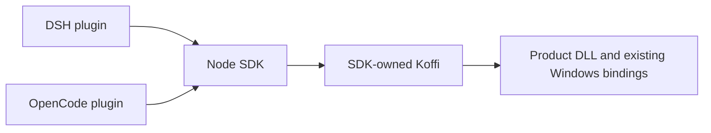

# FinSAFE Node SDK

The public SDK carries `bin/finsafe_native.dll`, built by the personal edition's
existing CLI package from Prepare, Execution, Installer and AppSeam modules.
DSH and OpenCode declare this SDK as a dependency. Their archives use its
product DLL. The SDK owns Koffi 3.1.1 and bundles its Windows x64 native package.
Importing the SDK loads no DLL or Koffi native addon.

```js
import {createClient} from '@finogeeks2026/finsafe-sdk';
const call = createClient();
const identity = await call({module: 'prepare', request: {action: 'identity'}});
```

`loadKoffi()` is the public lazy entry for existing direct Windows bindings.
Both this entry and `createClient()` resolve Koffi from the SDK package. Plugins
must not resolve it from a host or inspect the SDK's private dependency paths.
Windows locks a loaded native addon. On first native use, the SDK synchronously
copies its two dependency directories to a unique `finshield-sdk-koffi-*`
directory under that process's standard temporary directory, then loads from
there. Later calls in the same SDK module reuse the loaded instance. This
bounded copy is about 2.83 MB; it preserves the synchronous call API and allows
package removal while a Host remains alive. It is required loading work, not a
startup precheck. Failure is reported directly. Copies are not shared between
processes or used as persistent state. Native mappings last until the process
exits; remaining temporary files use the system's normal temporary-file cleanup.
The SDK adds no cleanup process, service, shared cache or locks.
`createClient({libraryRoot})` supports an explicit removal-safe copy of the SDK
library without changing dependency resolution. An optional `require` injection
is retained for controlled tests. The default library is this SDK's
`bin/finsafe_native.dll`. This is independent of the operation's installation
and configuration targets, which callers pass explicitly. First installation
uses the same product Installer operations without needing a prior full install.

Scope: native dependency ownership. Parent: plugin delivery. Input: an SDK
package. Output: native calls or the original loading error. The updater copies
the complete SDK, including bundled dependencies. No host Koffi is required.



Koffi adds two delivered packages on Windows x64: `koffi` and
`@koromix/koffi-win32-x64`, with no further runtime dependencies. Their installed
files total about 2.83 MB in 3.1.1. The SDK archive includes their MIT licenses.
The native component is an optional dependency for platform selection, but is
required when using this Windows x64 SDK. Publication verifies its presence.
The shared updater source owns orchestration, not dependency installation.

Named product modules are `prepare`, `execution`, `installer`, `desktop` and the explicit
AppSeam adapters `app_seam.dsh` and `app_seam.opencode`. Application compatibility stays in AppSeam; Core
never selects behavior from application identity. Product modules own native
handles, singletons and process lifetimes. The SDK only adapts calls and callbacks.
Cancel exit observation before releasing its Node callback. Native cancellation
waits for queued callbacks; a failed cancellation retains the callback.

Build the product DLL with `python scripts/prod/build-node-sdk.py` from the
repository root. Run `npm install --package-lock=false --ignore-scripts` and then `npm pack` from this
directory on Windows x64. Publication on another build host stages dependencies
with `--os=win32 --cpu=x64` before packing. Consumers install the
prebuilt package without Rust. Public release signs the product DLL before npm
packaging and publishes the SDK before exposing the dependent DSH Git package, market index
or npm package.

## Common HTTP status client (#1163)

DSH, OpenCode and Kilo use the package-owned SDK to call the selected shell backend's new
HTTP resources. The [canonical query contract](../../docs/internal/design/plugin-updater-shared.md#unified-sdk-http-status-queries-1163-2026-11-22)
defines authorization state, attempt-bound progress, application status, optional
installation/update reads and resource events. `createStatusClient` exports
`authorizationState`, `authorizationProgress(attempt)`, `applicationStatus(id)`,
`applicationInstallation(id)`, `applications`, `update` and `subscribe`.
Each query issues an independent HTTP request. Each subscription has its own
stream and cancellation. There is no query-result or pending-request cache,
subscription sharing, saved endpoint discovery or request replay.
`createAuthorizationObserver` has been removed.

```js
const connection = await obtainShell(selectedSettings);
const status = createStatusClient(connection);
const state = await status.authorizationState();
// Later queries use this connection; they do not invoke obtainShell again.
```

Load the complete SDK from the plugin's own dependency directory. Delivery
pins the packages; runtime loading does not compare package versions, DLL
versions or source commits. Native load errors are returned directly.

`obtainShell(settings)` is the common public launch adapter for DSH, OpenCode
and Kilo. Each invocation calls the native launch owner with the explicit
executable, Effective YAML and user environment. Shell alone decides start,
reuse or replacement through its existing algorithm. The SDK returns its actual
`origin` and authenticated `nonce`, or distinct cancellation or actual error.
It keeps no completed result, Promise or endpoint cache. Timeout does not kill
the Shell or replay the request. The native owner lets a new Shell inherit the
requesting updater's Job, so it ends with that session. Obtaining an existing
Shell does not transfer its Job or lifetime. Releasing only the request does
not end Shell. Accepted native authorization keeps its separate lifetime.

Background entry requests no Widget or Console display. It otherwise uses the
same Shell, identity, HTTP, update and Inspector behavior as foreground entry.
Query calls use the returned connection and neither start Shell nor fall back
to CLI, DLL status reads or installation discovery. The former signed-discovery
client and authorization observer have been deleted. The updater owns the live
connection for its selected target. When updater A explicitly selects B, it
installs B and obtains Shell B while keeping its own A SDK. FinSAFE B executes
B configuration and authorization. Queries for B use Shell B.

Use `python scripts/dev/verify.py --lane dsh-windows-plugin` for Node/packaging
checks and `--lane dsh-windows-updater` for native product fixtures. Those fixtures
change no installed product or authorization. SDK publication is a separate
release operation; this change does not publish an npm version.
