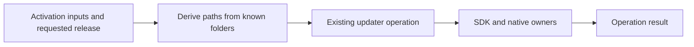
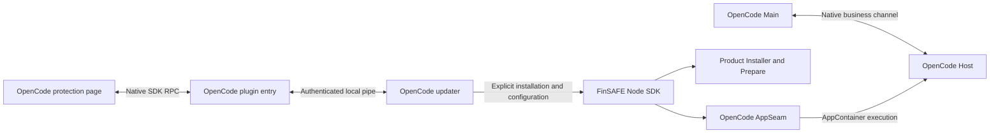
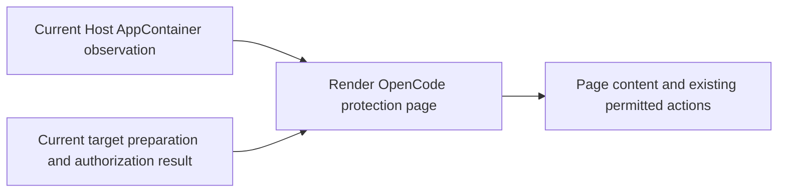
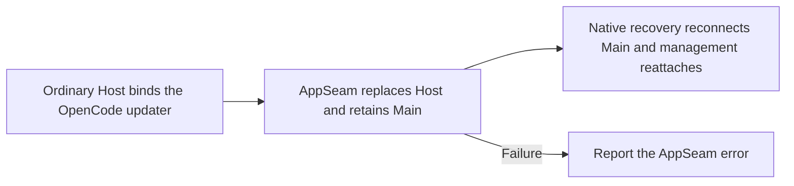
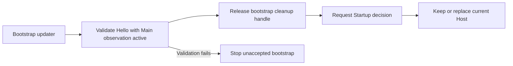
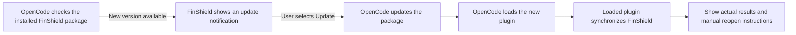
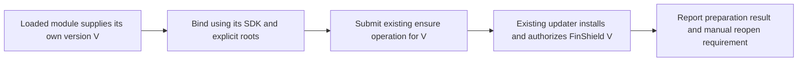

# OpenCode Windows plugin architecture

## Derived operation inputs (2026-11-24)

The owner decision in issue #1180 removes the generated settings snapshot.
OpenCode configuration remains the only user configuration entry. Each activation
derives installation and configuration paths from the loaded package's requested
release and Windows known folders. Native-path overrides and the manual external
installation workflow are retired. No read, write, migration or replacement cache
exists for `<OpenCode config home>/finsafe-windows/config.json`.

The existing updater holds the explicit target during an old-plugin/new-native
update. The SDK/native owners supply installation registration, previous-installation
inputs, configuration and authorization facts. Native receipts and diagnostic
results keep their existing contracts. No startup check or lifecycle state is added.

Earlier external/shared selection evidence below is historical. Owned fixtures
cover interrupted installation, manual reopen and updater A preparing native B;
they do not establish real Desktop acceptance for this revision.

## Separate startup decision revision (2026-11-23)

The owner-agreed [shared startup decision design](../../../docs/internal/design/plugin-startup-decision.md)
separates the immediate Keep/Wrap decision from input reads, Host replacement,
background preparation and page observation. Page/status attachment must not
initiate startup, and observation must not wait for `activation.start()` or
authorization completion. Shared source separates these operations. Main's initial
plugin setup supplies startup intent and endpoint reattachment is observation-only;
distinguishing same-Main plugin reload from actual startup remains an explicit
adapter gap in the shared design. Retain the two-condition policy, existing
AppSeam handoff and manual reopen. Installed-product acceptance is pending.

## Independent runs (2026-11-23)

The owner-approved [independent-run contract](../../../docs/internal/design/plugin-updater-shared.md#independent-plugin-runs-2026-11-23)
supersedes plugin-level startup and completed-task caches below. Every setup
owns its attachment. Every explicit Shell invocation executes the existing
Shell entry; instance acquisition belongs to Shell. OpenCode uses DSH's shared
authorization-based launch decision without its own `startupReady` wrapper.
An absent program keeps startup ordinary; management then installs and
authorizes the requested release. Each new management run reads actual state.

## Startup and handoff simplification (2026-11-23)

The owner-approved [OpenCode startup revision](../../../docs/internal/design/opencode-personal-app-seam.md#startup-and-handoff-simplification-2026-11-23)
is authoritative. Startup uses the selected AC and authorization completion;
retained handoff matches only PID and creation time. It passes the actual bound
Host executable and service registration without a guessed staging path,
fixed-version, file-hash or duplicate complete-preparation gate. Existing
transport authentication, Core admission and operation-result handling remain.

## Manual reopen revision (2026-11-22)

The [shared manual reopen contract](../../../docs/internal/design/plugin-updater-shared.md#manual-reopen-revision-2026-11-22)
supersedes running Restart and updater reuse in this document. Running preparation
offers Exit OpenCode and Later. Exit stops Main and launches no replacement.
The next normal start loads the installed plugin. Each ordinary acquisition
terminates an existing updater Job and creates a fresh updater. Shell owns its
existing instance-acquisition algorithm; the plugin does not retain a resident
Shell handle or startup-result cache. Protected Hosts only attach
to this session's updater. Startup Keep/Wrap remains.

Status: implemented technical validation; remaining acceptance gaps are in the
[verification record](docs/verification.md). Owner clarification: 2026-11-17.

The 2026-11-21 [retained-Main Host handoff](docs/retained-main-host-handoff.md)
records the retained-Main implementation and source experiments. Its
[no-rollback revision](docs/retained-main-host-handoff.md#registration-ownership-and-no-rollback)
and the [shared current-state revision](../../../docs/internal/design/plugin-updater-shared.md#current-state-decision-revision)
are approved in [#1159](https://github.com/Geeksfino/finsafe/issues/1159);
source implements those revisions; native acceptance is pending. The owner
approved the minimal OpenCode page alignment below on 2026-11-22. This later
approval extends the DSH observation rules to OpenCode presentation only.

## SDK HTTP query revision (#1163, 2026-11-22)

Status: source implemented. The owner selected focused unit checks only; the PR records the tested commit and results. Follow the
[canonical SDK HTTP query contract](../../../docs/internal/design/plugin-updater-shared.md#unified-sdk-http-status-queries-1163-2026-11-22).
The independent ordinary updater uses its package-owned SDK to query the selected
FinShield shell backend's new HTTP resources. Replace OpenCode's authorization
query subprocess and duplicate query cache. Migrate all consumers and remove old
HTTP aliases, authorization state/progress CLI entries and dead query code/tests.
Do not introduce direct DLL status queries or a CLI fallback.

The GUI and server Host retain their native RPC and existing updater management
channel. The current Host token remains the protection fact; HTTP application
status does not prove this Host or Main's business connection. No protected-Host
loopback permission or ordinary-process creation right is added. HTTP observation
failures retain their actual causes. The independent-run revision above handles
an absent executable during startup as Keep, followed by installation. Neither
result proves the current Host's token. A status read starts no backend and
needs no visible Widget/Console.

Keep actual Main/Host attachment, native command submission, no rollback and
protected-session close/reopen limits. Read-only HTTP
observation binds to the selected instance, independently of the SDK release.
Present active A and prepared B separately until #1163 activation completes.
Existing implementation/preview evidence does not verify this migration.

## Plugin independence

Formal Windows builds use `dev/build_release.py` to stage the package, install
locked development dependencies, build the GUI and updater, and bundle the
source-matched public SDK. The shared public-plugin renderer supplies the release
CDN base. Both the full Actions release and the local Windows release publish
this built package after the matching native release and SDK.
Native installation uses the shared verified download in `updater/common/download.js`:
CDN and the same version's public GitHub Release start together; the first
verified result wins and cancels the other source. Local npm preview overrides
only its staged package's CDN base.

Local preview delivery uses the plugin-owned [npm preview workflow](docs/local-npm.md).
It stages package copies and serves immutable artifacts over loopback. This
development tool changes no sandbox or platform capability; the platform matrix
needs no additional change for the delivery tool.

OpenCode uses its own application adapter and the declared product SDK.

The Node updater flow is owned by `integrations/common/windows` and delivered
in this plugin's archive. OpenCode declares the FinSAFE Node SDK for native
calls and has its own application adapter, Candidate, runtime namespace and UI. The
SDK carries the personal-edition product DLL. The plugin package carries no
Rust build or private DLL.

### Installation dependencies

OpenCode Desktop 2.3.0 supplies the server plugin SDK through its Bun runtime
module loader and the GUI shared modules through its GUI host. Keep
`@opencode/plugin` in development dependencies only. An isolated npm 11.19.1
installation on 2026-11-21 showed that an optional SDK peer still makes npm
query the host's peer dependency tree, including Electron, Vite and Playwright.
Omit that installation peer as well as the regular SDK dependency. The existing
development SDK remains pinned to 2.3.0; the runtime launch path does not
reject other versions before calling their actual interfaces. Other releases
still need compatibility acceptance.

The official GUI preset builds React and React DOM into the delivered page.
Keep those packages and build tools in development dependencies. There is no
direct runtime import requiring a separate `@opencode/client` installation.
Only the FinSAFE Node SDK remains a regular dependency. That SDK owns and
bundles Koffi 3.1.1 with its Windows x64 native component, using npm's bundled
dependency contract. Existing direct Windows bindings use its public
`loadKoffi` entry. The independent updater copies the complete SDK. It requires
no separate Koffi copy and resolves no native dependency from OpenCode.
The plugin still includes Node for its independent process because OpenCode's
compiled Bun backend does not supply that runtime. The GUI uses OpenCode's
declared shared modules; React/React DOM are built into the page.

Preview publication rejects an SDK archive without the Windows x64 addon.
Delivery verification must load the SDK and Koffi from a fresh npm consumer.
The earlier `.1` preview omitted the native package; `.2` bundled it directly
in the plugin. Later previews use the SDK-owned layout for both DSH and OpenCode.

Inspected on 2026-11-21: OpenCode
[2.3.0 runtime loader](https://github.com/anomalyco/opencode/blob/v2.3.0/packages/plugin/src/runtime.ts),
[GUI build contract](https://opencode.ai/docs/build/plugins/gui/#build-the-bundle),
and npm [optional peer behavior](https://docs.npmjs.com/cli/v11/configuring-npm/package-json/#peerdependenciesmeta).
The general OpenCode example declares the SDK as a regular dependency; this
host-specific package instead uses the verified host module contract to avoid
installing a second SDK copy.

Third-party comparison, 2026-11-21: the published
[`@rizal72/oc-notify` 0.1.2](https://github.com/rizal72/opencode-plugins/blob/main/plugins/oc-notify/package.json)
and [`@rizal72/oc-plugin-updates` 0.1.9](https://github.com/rizal72/opencode-plugins/blob/main/plugins/oc-plugin-updates/package.json)
ship a prebuilt GUI and declare neither regular nor peer dependencies. Their
development workspace installs the SDK. By comparison,
[`@slkiser/opencode-quota` 6.3.0](https://github.com/slkiser/opencode-quota/blob/main/package.json)
retains a required SDK peer. These examples establish multiple packaging
patterns, not a universal zero-dependency rule. FinShield uses the first pattern
for its host APIs and retains its own native support. A local-registry consumer
of the revision 5 archive installed in 5.46 seconds with 136 delivered files;
the npm install phase took 1.76 seconds. Its request log contained only local
FinShield package/SDK requests, and the bundled Windows Koffi loaded correctly.
A second owned consumer with an empty npm cache took 9.20 seconds end to end;
the install phase took 2.45 seconds. The archive fetch/extraction took 2.23
seconds for the plugin and 0.10 seconds for the SDK, with no public requests.
These measurements use npm 11.19.1, not the OpenCode plugin-add command, and
do not establish a general installation-time guarantee.

## Components

The user action is called "Enable protection" / "开启防护". It switches the
execution environment and interrupts running tasks while retaining the window.
Do not call it a page refresh or a full OpenCode restart. Internal operation
names remain unchanged. A protected session with a prepared update still uses
the existing close-and-reopen instruction while live protected-version
replacement is unsupported; its text must not promise that the window stays open.

Page content follows the two current observations defined in the
[page observation contract](#page-observation-alignment-2026-11-22).
`starting` and unknown phases supply no authorization fact. Keep the current
Host observation visible independently of target work or observation errors.

The sidebar entry is registered after the first startup decision. The existing
native receipt check still selects Keep or Wrap; the page does not read receipt
files or make that decision. An outgoing Host waiting in Wrap does not publish
the entry. The protected Host can publish it from its actual token observation;
an ordinary Keep session publishes it when preparation, readiness or an error is
known. Once registered, status/connection changes do not withdraw it. Before a
local client exists, the existing status loop waits for its next iteration
instead of manufacturing a failed preparation result. This delays only the
plugin contribution; OpenCode startup and backend admission remain unchanged.
If the first observation says startup is pending, a later RPC transport error
during Host replacement is not treated as a native authorization result. A
native failure response, which includes its current-protection observation,
still exposes the error page. The one-time registration is local to that GUI
instance and is removed by the normal plugin lifecycle; nothing is persisted.

The owner-approved layout (2026-11-21) keeps the existing two-column protection
summary, as shown in the [approved reference](../../../windows/prototypes/assets/opencode-plugin-layout-2026-11-21.png).
Only a confirmed package update adds an "Install update" button at the
top right, above the status card. The existing automatic package checks and
native update notice supply that state. Installing disables the same action;
success or a later current-version result removes it. The page has no manual
"Check for updates" control. Update work still requires an explicit user action
and uses OpenCode's existing package API.

The footer contains exactly three plain links in one row: "How FinShield
protects you", "FinShield website", and "Feedback". The first opens the
owner-selected https://safety.finaios.ai/ in a separate window. English and
Chinese labels use the same destination. The error section keeps the actual
failure but does not duplicate the feedback link.

Scope: component connections. Parent: OpenCode integration. Inputs: desktop
business requests and fixed plugin management requests. Output: native service
results and observed protection. Management does not proxy session traffic.

The page and updater coordinate explicit management requests. The SDK calls the
OpenCode AppSeam adapter for verified bindings. The adapter delegates fixed
setup and authorization operations to their product owners. The updater keeps
the existing installer Job and uses the shared Desktop authorization transport,
including acknowledgment, terminal result and retained-worker handoff.

## Page observation alignment (2026-11-22)

Owner-approved scope: apply the confirmed DSH presentation rules in the existing
OpenCode page. Keep its layout, sidebar registration and flicker correction,
package update entry, native toast, and native launch and authorization flows.
Use OpenCode-owned source; DSH is the design reference, not a runtime import.
Platform capabilities are unchanged, so the feature matrix remains accurate.
Source implements this alignment; owned verification is recorded below.
Installed-product acceptance remains pending.

Scope: protection page observations. Parent: OpenCode GUI plugin. Inputs: the
current Host's actual AppContainer observation and the selected target's current
preparation/authorization task and result. Output: page content and existing
permitted actions. Read and command errors retain their actual causes.
Observation submits no installation, authorization, handoff or recovery.

| Current facts | Display |
| --- | --- |
| Actual download, installation, authorization or handoff in progress | Show that operation and progress, with current Host protection separately. Authorization wording requires an actual authorization operation. |
| Prepared target with a pending permitted switch | Show ready and Enable protection. Keep Main and the existing action capability checks. |
| Protected Host with a prepared update and `restartAllowed:false` | Show the ready update and the existing close-and-reopen instruction; offer no live switch. |
| No active operation or pending switch; actual Host is in AppContainer | Show protection enabled. Actual operation errors remain visible separately. |
| A required observation is unavailable | Show loading for that information. Keep any independently obtained current fact. |
| Task, token or whole-RPC observation fails | Show the actual cause. A read failure proves neither lack of protection nor incomplete authorization. |

For a protected ready update without a permitted live switch, show the
close-and-reopen instruction once in the page summary. Do not repeat it in
the switch warning or a second status paragraph. Keep the existing collapsed
help and actual current-release display. This does not add a restart capability
or change the existing notification policy.

The Host status boundary retains token and task observations independently.
A failed token read removes protection fields derived from that failed read,
while successful task information remains available. A task read error does
not erase a successful actual Host observation. A whole-RPC failure supplies
an error and no fabricated protection or task phase.

The page stores received observations without rewriting their business phase.
Keep request-in-flight, page visibility and Later/notice state for their UI
purpose. Enable protection or Later request errors are separate UI errors;
After acknowledgment, keep submission disabled until a fresh observation arrives;
an observation started before acknowledgment cannot release it.
they do not change a prepared target into failed preparation. `starting` and
`running` are not a second page business state. Existing updater task phases
remain owned by updater. Preserve the existing read schedule and operations.
OpenCode uses the shared activation's request-error propagation option so a
status or Enable RPC rejection reaches these existing observation and command
boundaries. It must not become a sticky failed task inside activation. Other
adapters retain their existing default error policy. This adds no reconnect,
retry, preparation request or status read outside the existing schedule.

Before implementation, add regressions for unknown/starting observations,
actual work plus AC, ordinary ready, protected ready update, idle AC, partial
observation errors, whole-RPC failure, and Enable protection/Later RPC errors
with an already-ready target. Check both content and actions. Existing sidebar
flicker, one-time registration, package-update and Main-retention tests remain
required. Owned tests do not establish installed native desktop acceptance.

### Verification for this alignment

Local source: `63f38e4c0a4c49f538cb64e14233cff8a34ab8e0` plus the working-tree
change, checked on 2026-11-22 (Asia/Shanghai). Tests were added before their fixes.
The first run failed on fabricated authorization/protection, command errors
rewriting ready observations, and loss of independent token/task information.
Additional real Host-path regressions first reproduced sticky failed status
after status/Enable RPC errors; they now observe the actual ready result on
the next existing read without submitting new work.
The next independent review found untranslated optional second-line keys in
download/install headings. A regression first reproduced the visible key;
four empty localized values corrected it without changing layout or logic.

| Verification | Result |
| --- | --- |
| Common updater, OpenCode presentation/attachment/management, DSH default activation/startup compatibility | Final focused run: 136 passed; 0 failed, including both languages' download/install headings |
| `windows-plugin-common` | Passed, including shared delivery and default DSH behavior |
| `file-cell-opencode-plugin-unit` | Before the final heading correction, build passed and 77 of 78 Node tests passed. The unchanged manifest SDK requirement 0.11.19 differs from workspace SDK 0.11.24; this version assertion is the sole failure. The lane is failed, not passed. The heading-only correction is covered by the final focused run, build and page checks |
| Unit verification planner remainder | 4 Python tests passed; run separately because the unit lane stops at its Node failure |
| `file-cell-opencode-plugin-page` | Passed with owned Edge/Host substitutes: sidebar, locale/theme/state rendering, three footer widths, conditional package update and existing actions |
| `acceptance-hygiene`, `planner-tests`, `docs`, `docs-layout` | Passed |
| `file-cell-opencode-plugin-native` | Owned Main-exit/absent-Installer fixtures passed; native product implementation was unchanged |
| Installed desktop and policy acceptance | Not run: no declared disposable OpenCode host/options/evidence or compatible `FINSAFE_OPENCODE_POLICY_CLI` |

The exact selection is in `target/opencode-page-scope-plan.txt`; it has no
missing file declarations. Local red/green and final output are in
`target/opencode-page-*.log`. Existing SDK version, installed configuration,
authorization, native launch and DSH page work were not changed by this alignment.

## Startup through AppSeam

Scope: plugin launch steps. Parent: updater management. Inputs: ordinary
OpenCode instance and selected authorized FinSAFE Effective. Output: the same
Main and a verified AppContainer Host, or the actual handoff error.

Plugin setup registers Promise-based management handlers and returns without
awaiting updater completion. Pending and failed management remain visible in
status. The desktop startup path does not wait for installation, authorization,
a page, download or a management connection.

The updater calls the fixed SDK `replace_host` operation. It runs the selected
`finsafe app launch opencode --retain-main PID:CREATED --replace-host PID:CREATED`
with the selected Effective and Desktop image. The
[personal AppSeam workflow](../../../docs/internal/design/opencode-personal-app-seam.md)
starts Core and verifies the new protected Host before shared verified-target
replacement stops only the pinned old Host. It retains the existing
Main and never creates or terminates Main in this mode. The shared Shell has
its own native lifetime outside the updater Job. The launcher
runs outside the updater Job. Main's native disconnected-stream recovery adopts
the new native service registration. The SDK verifies returned process ancestry,
Main identity, native registration and the Host's actual AppContainer token.

Host readiness is not connection confirmation. The reactive sidecar reference
triggers plugin-owned Main IPC after connection; Main resends attachment through
its current `ctx.client`, after `server.info()` confirms the business Host PID.
The updater waits up to 45 seconds for that exact protected binding before
reporting handoff completion. Main exit stays observable during that wait.
The new Host's actual token supplies protection status.
The public SDK has no native reconnect method. OpenCode owns native service
publication and recovery, including its ability to start an ordinary Host.
FinShield verifies the current token and never reports an ordinary Host as
protected. The owner withdrew the requirement to control later native recovery.
On failure, release only this attempt's resources and report the actual error;
do not restore registration or relaunch the previous Host/Main. New-Host readiness
must precede old-Host termination. The canonical
[no-rollback contract](docs/retained-main-host-handoff.md#registration-ownership-and-no-rollback)
replaces registration backup/restoration. Source removes the rollback owner;
native failure acceptance remains pending.
Closing the page or releasing the binding leaves the protected session running.
Apply an update to an already protected session after closing and reopening it.
An existing updater must advertise `retainedMainHost`; older full-launch updaters
require an OpenCode restart. Delivery requires the matching SDK and product CLI.

## Shared updater extraction contract

Owner-approved extraction, 2026-11-20. Source implementation is complete;
installed-product acceptance is pending.
The [shared updater design](../../../docs/internal/design/plugin-updater-shared.md)
defines the common owner and adapter contract. The OpenCode attachment flow below
is implemented by this plugin and its AppSeam adapter.
Use the existing DSH updater flow as the shared baseline, including independent
process creation, Job ownership, authenticated Host communication, startup
acquisition, Keep/Wrap, running preparation and replacement lifetime handoff.
`integrations/common/windows` owns the common Node implementation. Each plugin supplies its own
AppSeam adapter and keeps its application-specific package inputs.

The application adapter supplies the activation phase when its host can identify
it. An absent or unknown phase selects the existing startup flow. This is an
explicit default and does not establish that the application is actually
starting. DSH retains its current synchronous `appReady` sample and running
operation completion gate. OpenCode uses the startup default while its supported
host API supplies no equivalent phase signal; `OPENCODE_CLIENT` identifies a
client source and must not determine the activation phase.

Activation routes through the canonical
[shared activation flow](../../../docs/internal/design/plugin-updater-shared.md#current-state-decision-revision).
Observe the current Host's actual token. Protected Hosts connect to the existing
updater without Startup decision; connection failure does not bootstrap an
ordinary updater. An ordinary Host uses adapter phase: running bypasses Startup
decision, while absent or unknown selects it. OpenCode has no reliable phase
signal and retains that startup default, even for a visible window.

OpenCode updater starts its native Main-exit observation before serving Hello.
A validated Hello therefore confirms that the updater owns its verified Main
lifetime. Release the caller's bootstrap cleanup handle at that point, before
requesting Startup admission, which can replace and disconnect the caller Host.
An admission connection loss cannot stop that Main-owned updater. A failure
before validated Hello still stops the unaccepted bootstrap. The shared
transport keeps other adapters' existing cleanup boundary by default.

Activation and attachment transport failures carry their actual error without
a preparation phase. Only updater task results can report failed preparation.
Keep the independently observed Host protection when management is unavailable.

Do not infer phase from updater existence, unchanged Main, earlier Keep/Wrap,
completed work, `mainRetained`, `session.keep` or equivalent history records.
Keep belongs to one activation. Preparation completion offers the existing
confirmed switch; it does not repeat Startup decision. Status and Later do not
submit preparation or replacement. User Restart executes the already-presented
selected target without another Startup decision.

The shared owner retains applicable accepted work and native results. Review
`beginAssessment`, `session.items`, task `satisfied` and `restartPolicy` together:
completed protection belongs to its verified Host. It cannot transfer `protected`
or `restartPolicy:never` to a new ordinary Host. Reassess on verified attachment
and existing preparation-result events through existing bindings; add no parallel
identity store, polling or status-time recovery.

Before runtime changes, add regressions through activation, bind, ensure and
status. Cover startup readiness independently of earlier Keep/Wrap, completed
handoff result reuse, duplicate attachments joining accepted work, and Main exit
during replacement. DSH retains `appReady` and Loader/`settled` gates. Unit and
installed acceptance must be recorded separately; native acceptance is pending.

## OpenCode desktop reattachment

OpenCode's server plugin can survive desktop closure in the ordinary native
background service. Each desktop activation must attach management again.
Use the supported GUI `main` entry for this desktop-lifetime notification.
Its setup returns independently of the asynchronous attachment. The server
entry registers the management RPC before accepting attachment work. Window
page setup observes the resulting state.

AppSeam retains the explicitly supplied Main and Host by PID and creation time.
It does not infer Main from Host's original parent or require a staging path,
Desktop version, bundled Host hash, image name or command-line shape. The native
management transport still authenticates its peers. Actual selected AC tokens
supply protection; native operations retain their original errors.

Each activation or verified new-Host attachment acquires or reuses updater and
establishes its verified binding. Duplicate attachment of the same activation to
the same live Host can reuse that activation. A different Host under the same
Main requires its own verified attachment and actual token observation; unchanged
Main alone does not permit reuse. A new Main gets its own verified lifetime owner.
Superseded connections and terminal failures are released with their activation.
Join applicable installation, authorization or replacement already accepted without
duplicate submission. Preserve ready actions and Later dismissal while applicable,
and reassess applicability on new-Host attachment. Do not transfer the previous
Host's completed protection or never-restart policy to a new ordinary Host.

OpenCode Host replacement retains the same verified Main and keeps updater alive
through the shared lifecycle contract. Old Host exit is not Main exit. The
reactive sidecar endpoint change reattaches the existing Main even when OpenCode
reuses the unchanged GUI bundle and does not run Main setup again. AppSeam remains
responsible for the application's native launch command and readiness evidence.
A protected current Host exposes its native replacement limitation through
`restartAllowed:false`; its prepared update explains the required desktop
close/reopen. Direct Restart also enforces that capability.

## Available package updates

Owner-approved revision, 2026-11-23, #1170. OpenCode owns package installation
and plugin loading. Only the loaded plugin supplies the native target version.
This revision supersedes the earlier OpenCode install-only update sequence in
the shared manual reopen contract. DSH keeps its existing sequence.

Scope: one OpenCode package update. Parent: plugin management. Inputs: the
configured package source and the user's update action. Outputs: actual package,
loading and native preparation results. Errors remain with their stage. Normal
startup and the current Host's protection do not depend on update completion.

DSH lets its host manage the package update. OpenCode uses the built-in server's
plugin inventory, check and update APIs for the same responsibility. FinShield
checks its configured package on launch, periodically and on request from its
settings page. A notification offers Update or Later. The host applies the
configured source and version rules. Checking does not change the package or
touch the native installation. Update starts only after user confirmation.

The old plugin finishes after `plugin.update()` returns. It does not read
`plugin.list()` to infer the native target or submit native installation.
Package completion is not plugin activation. If OpenCode does not load the new
plugin in this session, the user closes and reopens manually first. Loading
failures retain the host's error; no native task for the unloaded plugin starts.

The loaded server module reads its package version V once. Management
`version()` returns `{version: V}` without starting or waiting for an updater or
Host attachment. Status also reports this module version, independently of old
Host feedback. Host management objects are shared only within the same immutable
release, so B cannot inherit A's activation closure or SDK. Desktop attachment
uses the existing verified Main and Host inputs.

Parent node: `Loaded plugin synchronizes FinShield`. Inputs: the loaded package,
its delivered SDK, explicit roots and the existing updater channel. Output: the
native preparation task for V, or its original error. Plugin registration does
not wait for native installation or authorization.

In a protected session, B connects to the existing ordinary A updater. That
updater keeps its own A runtime and SDK while executing the B installation and
authorization task. Its own version is not the target. No updater replacement,
SDK hot replacement, new ordinary process or version-negotiation flow is added.
Normal ordinary startup still creates a fresh updater through the existing
acquisition operation. Plugin activation always uses the normal managed flow.

Existing `ensure` handles same-version state and full preparation. The
install-only acknowledgment is not completion or authorization success.
The page distinguishes package completion, the loaded server module version,
native work and its errors, and current Host protection. Window-local handoff
data keeps only the package notice; it does not select the native release.
Exit stops OpenCode without relaunching it. If a reopen was needed to load B,
another reopen can still be needed to activate prepared FinShield B.

V is passed unchanged to settings and management. Stable releases use the same
three-part version for plugin, bundled SDK and FinShield. Local suffixes are
not stripped to claim alignment: the existing stable-only native delivery
contract reports its error until a separate suffixed-release contract is
defined. Complete package staging and explicit version roots remain unchanged;
OpenCode cache generations are never scanned for a target.

## Configuration and removal

The product owns `windows/config/opencode-plugin/manifest.yaml`. Resolve
generates the packaged `policy/candidate.yaml` from the OpenCode base, Windows
mandatory rules and the existing OpenCode compatibility source.
Native versions are separate children of `opencode-plugin-versions`. The read-only
install rule covers their stable parent. Resolve/Materialize must produce equal
authorization inputs for a version-directory change. Actual native upgrade
receipt reuse still requires installed acceptance.

During setup, a byte-for-byte match for the original prototype Candidate
selects the bundled formal Candidate for the new version. Staging keeps edited
Candidates and leaves the active installation's configuration in place.

Native management uses the plugin's own domain, `finshield.opencode`, for product
setup or authorization. Development fixtures leave `finsafe.shared` unchanged.
Real setup requires the final-stage disposable Desktop test environment.

OpenCode's Extensions switch controls GUI only. Native negative-ID configuration
controls server loading. Removing the package entry releases its management
binding; the current protected Host, runtime, configuration and authorization
remain. Native uninstall is rejected before dispatch. No native uninstall driver
or implementation is part of this plugin.

## Design references and local ownership

| Reference | OpenCode-owned implementation |
| --- | --- |
| DSH independent updater lifecycle | `updater/coordinator.js`, `src/activation.js` |
| DSH fixed management transport pattern | `updater/protocol.js`, `updater/native.js`, OpenCode AppSeam |
| DSH installer/authorization orchestration pattern | `install/`, `src/preparation.js`, `updater/operations.js` |
| DSH page interaction pattern | `ui/`, `src/gui.tsx`, `src/presentation.js` |
| OpenCode Desktop/SDK 2.3.0 native contract | `src/index.js`, `updater/launch.js`, OpenCode AppSeam |

Inspected OpenCode source: `v2.3.0`, commit
`a6b15d33daf6ab7d35569f6d711fdb630b9f04e7`, MIT. Native service registration,
Promise RPC, GUI SettingsPage and Back to app follow that pinned contract.
No desktop patch, extra server choice or session proxy is introduced.
