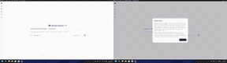
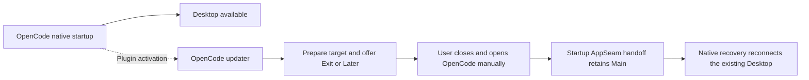

# FinShield for OpenCode Desktop

[Product GitHub](https://github.com/finogeeks/finsafe) · [Safety Arena](https://safety.finaios.ai/) · [npm](https://www.npmjs.com/package/@finogeeks2026/finshield-opencode)

**Let your agent work. Keep its access under control.**

Agents can do more than delete files: they can access private information, disrupt your desktop and change system settings. FinShield adds Windows sandbox protection to OpenCode Desktop's execution backend, helping keep agent operations within configured access boundaries while you keep your usual coding workflow.

See what those boundaries can mean in practice:

| Privacy | Desktop | System | Data |
| :---: | :---: | :---: | :---: |
| [](https://safety.finaios.ai/screen-capture/dsh/dsh-desktop-file-v3-20261109/index.html) | [](https://safety.finaios.ai/window-flood/dsh/dsh-finshield-pro-20261105/index.html) | [](https://safety.finaios.ai/process-terminate/dsh/dsh-python-file-v2-20261111/index.html) | [](https://safety.finaios.ai/protected-directory-delete/dsh/dsh-direct-v4-20261112/index.html) |
| Screen capture | Disruptive pop-ups | Process termination | Protected-directory deletion |

These GIFs are excerpts from FinShield's published **DSH evaluations**, not OpenCode test runs. Select a GIF for the conditions, full recordings and results. Each comparison shows separate test runs.

[Install](#install) · [Browse DSH evaluations](https://safety.finaios.ai/agents/dsh/) · [Evaluation source and methods](https://github.com/finogeeks/agent-safety-arena)

## Requirements

- Windows x64.
- OpenCode Desktop V2. The integration currently targets OpenCode Desktop/SDK 2.3.0.
- An internet connection to download the plugin and its native components.

Install [OpenCode Desktop](https://opencode.ai/) first if you do not already have it.

## Install

With the OpenCode V2 CLI installed, run:

```sh
opencode plugin add @finogeeks2026/finshield-opencode
```

Restart OpenCode Desktop to load the plugin. Desktop only? See [Install without the CLI](#install-without-the-cli).

## What happens on first launch

FinShield automatically prepares its components and configures Windows sandbox permissions in the background. This can take a while; you can keep using OpenCode while it finishes. Windows may ask for administrator consent.

When ready, FinShield prompts you to exit and reopen OpenCode. After that, protection starts automatically on normal launches. You can check its status at any time in **Settings > FinShield**.

## Update

Use **Check for updates** on the FinShield settings page. After an update finishes, save your work, exit OpenCode and open it again manually. Check the current protection status after reopening.

## Troubleshooting

### Install without the CLI

Add FinShield to `plugins` in `%USERPROFILE%\.config\opencode\opencode.json`, keeping your other settings and plugin entries:

```json
{
  "plugins": ["@finogeeks2026/finshield-opencode"]
}
```

If the folder or file does not exist, create it. If you already use `opencode.jsonc` or a custom configuration directory, edit that configuration instead. Restart Desktop; OpenCode downloads and loads the configured plugin automatically. See [OpenCode's plugin documentation](https://opencode.ai/docs/plugins/).

### FinShield does not appear in Settings

Confirm that you edited the global configuration used by this Desktop installation, that the field is `plugins` for V2, and that the package name is `@finogeeks2026/finshield-opencode`. Check for JSON errors and plugin download or load errors before repeating installation.

### The plugin is installed but protection is not active

Check **Settings > FinShield** for preparation progress or an error. When preparation is ready, exit and reopen OpenCode as prompted to activate protection.

## Links and support

- [FinShield product and documentation](https://github.com/finogeeks/finsafe)
- [Agent Safety Arena](https://safety.finaios.ai/) · [Evaluation source and methods](https://github.com/finogeeks/agent-safety-arena)
- [Latest product releases](https://github.com/finogeeks/finsafe/releases)
- [Report a problem](https://github.com/finogeeks/finsafe/issues/new/choose)

## Scope and license

This Windows integration protects the backend Host and retains Desktop Main. Network mode is `host`; do not interpret the AppContainer integration as a claim of complete network isolation. See the product's compatibility and verification documentation for the current supported scope and remaining acceptance limits.

Use is governed by the [product license supplied with the integration](https://github.com/finogeeks/finsafe/blob/main/integrations/opencode/windows/LICENSE.rtf).

## Maintainer notes

<details>
<summary>Startup, packaging and verification in the source checkout</summary>

## Startup

Double-click OpenCode normally. Plugin setup returns without waiting for the
updater, download, installation, authorization or page. Management errors remain
visible in Settings > FinShield. The current Host token determines protection.
After setup, choose Exit OpenCode or Later. The next normal start uses the
existing startup handoff to replace Host and retain Main. The native connection
must reach that Host before startup handoff completes.
A protected session shows its current state in Settings.



## Build and package

For npm-style local experience, use the committed
`docs/local-npm.md` in the source checkout. It serves the plugin,
matching SDK and native installer, then prints the normal `opencode plugin add`
command. It does not install the plugin or launch OpenCode for the user.

Generate the bundled Candidate from the product manifest when configuration
sources change. Run these commands from this directory:

```powershell
npm ci --ignore-scripts
npm run build:policy
npm run build
npm pack --ignore-scripts --pack-destination C:\owned-test
```

The package carries JavaScript, Candidate and notices. The independent updater
uses OpenCode's installed Bun runtime; users need no additional Node or Bun
installation. The declared SDK carries Koffi and the common product DLL. For development
before the matching SDK is published, build and pack it with the
SDK build instructions in `sdk/node/README.md` in the source checkout and install from that
local archive.

Install the archive in an owned package directory and add its installed package
directory to OpenCode's global `opencode.json`:

```json
{"plugins":[{"package":"C:/owned-test/packages/node_modules/@finogeeks2026/finshield-opencode"}]}
```

Managed native versions use `%ProgramFiles%\FinSAFE\opencode-plugin-versions\<version>`.
Configuration uses `%ProgramData%\FinSAFE\opencode-plugin-versions\<version>\config`.
The security domain is `finshield.opencode`. The product sources live under
`windows/config/opencode-plugin/`. The install rule covers the stable parent
read-only. The generated Candidate is under `policy/`.
Downloads and updater stages use their own `opencode-plugin` and
`opencode-updater` locations under `%LOCALAPPDATA%\FinSAFE`.

The updater installs and authorizes the selected version through the shared SDK.
During an update it stages the existing desired Candidate. An exact match for
the prototype default selects the formal bundled Candidate for the new version.
The matching FinSAFE executable supports
`app launch opencode --retain-main PID:CREATED --replace-host PID:CREATED`. Plugin removal retains native runtime,
configuration and authorization.

OpenCode's configuration is the only user configuration entry. The plugin derives
native and configuration paths from its requested release and Windows known
folders. Manual native executable, YAML and version-root overrides are retired.
It does not read or write `finsafe-windows/config.json`, migrate an old snapshot,
or save runtime process and resource data. The updater keeps an explicit update
target in memory; installation registration and authorization remain native-owned.

## Verify

Use the plugin-owned driver and read its plan first:

```powershell
python test/verify.py --lane unit --lane native --lane page --dry-run
python test/verify.py --lane unit --lane native --lane page
```

The former external-instance `installed` lane is retired. Set
`FINSHIELD_OPENCODE_SDK_ARCHIVE` for a verification run with a locally packed SDK.
The final-stage `product` lane uses the normal plugin installation flow, opens
an owned Windows shortcut, observes the actual token/native connection/session
and checks unchanged shared file hashes. It requires a declared disposable
Windows test account and its own authorization; do not run it on a working desktop.
The `policy` lane uses an explicit compatible FinSAFE executable and temporary
files only. Final-stage `product`, `lifecycle` and `isolation` need their stated
owned inputs; they are not part of automatic unit checks.

Cross-native-version authorization reuse, model/MCP/network cases, full crash
and multi-window recovery remain unaccepted. Network mode is `host`. The SDK
dependency tree has 24 moderate audit findings; no public-release claim is made.

</details>
