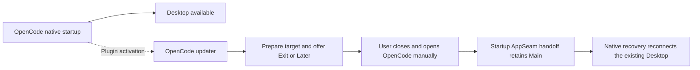

# FinShield for OpenCode Desktop on Windows

OpenCode uses a separate package and declares the FinSAFE Node SDK.

DSH is a design reference. OpenCode has its own updater, page, configuration
and tests. It declares `@finogeeks2026/finsafe-sdk` for product operations.

The plugin uses FinSAFE AppSeam to replace the ordinary Host with an AppContainer
Host while keeping Desktop Main. OpenCode owns native recovery, authentication
and sessions. Use the matching SDK and CLI with the retained-Main launch support.
Target: Windows x64 and OpenCode Desktop/SDK 2.3.0.
See [architecture](DESIGN.md) and [verification](docs/verification.md).

## Install

```powershell
& "$env:LOCALAPPDATA\Programs\ai.opencode.desktop\resources\opencode-cli.exe" plugin add '@finogeeks2026/finshield-opencode'
```

This uses Desktop's bundled CLI at its default per-user Windows path and needs
no `opencode` command on PATH. For a different Desktop installation directory,
use its `resources\opencode-cli.exe`. See [local npm setup and command troubleshooting](docs/local-npm.md#powershell-cannot-find-opencode).

Open OpenCode Desktop and go to **Settings > FinShield**. Follow Windows
authorization when prompted. When protection is ready, save your work and choose **Exit OpenCode**.
Open OpenCode manually to use the prepared protection. There is no running Restart action.

## Update

FinShield checks the configured package through OpenCode when Desktop starts
and once per hour while it is open. You can also select **Check for updates**
on the FinShield page. Select **Update** to install the plugin, then the matching
FinShield native components. When installation finishes, close OpenCode and open
it manually to load the new version. Installation does not establish authorization.

## Startup

Double-click OpenCode normally. Plugin setup returns without waiting for the
updater, download, installation, authorization or page. Management errors remain
visible in Settings > FinShield. The current Host token determines protection.
After setup, choose Exit OpenCode or Later. The next normal start uses the
existing startup handoff to replace Host and retain Main. The native connection
must reach that Host before startup handoff completes.
A protected session shows its current state in Settings.



## Build and package

For npm-style local experience, use the committed
[local npm preview tool and guide](docs/local-npm.md). It serves the plugin,
matching SDK and native installer, then prints the normal `opencode plugin add`
command. It does not install the plugin or launch OpenCode for the user.

Generate the bundled Candidate from the product manifest when configuration
sources change. Run these commands from this directory:

```powershell
npm ci --ignore-scripts
npm run build:policy
npm run build
npm pack --ignore-scripts --pack-destination C:\owned-test
```

The package carries the updater's Node runtime, JavaScript, Candidate and
notices. The declared SDK carries the common product DLL. For development
before the matching SDK is published, build and pack it with the
[SDK build instructions](../../../sdk/node/README.md) and install from that
local archive.

Install the archive in an owned package directory and add its installed package
directory to OpenCode's global `opencode.json`:

```json
{"plugins":[{"package":"C:/owned-test/packages/node_modules/@finogeeks2026/finshield-opencode"}]}
```

Managed native versions use `%ProgramFiles%\FinSAFE\opencode-plugin-versions\<version>`.
Configuration uses `%ProgramData%\FinSAFE\opencode-plugin-versions\<version>\config`.
The security domain is `finshield.opencode`. The product sources live under
`windows/config/opencode-plugin/`. The install rule covers the stable parent
read-only. The generated Candidate is under `policy/`.
Downloads and updater stages use their own `opencode-plugin` and
`opencode-updater` locations under `%LOCALAPPDATA%\FinSAFE`.

The updater installs and authorizes the selected version through the shared SDK.
During an update it stages the existing desired Candidate. An exact match for
the prototype default selects the formal bundled Candidate for the new version.
The matching FinSAFE executable supports
`app launch opencode --retain-main PID:CREATED --replace-host PID:CREATED`. Plugin removal retains native runtime,
configuration and authorization.

OpenCode's configuration is the only user configuration entry. The plugin derives
native and configuration paths from its requested release and Windows known
folders. Manual native executable, YAML and version-root overrides are retired.
It does not read or write `finsafe-windows/config.json`, migrate an old snapshot,
or save runtime process and resource data. The updater keeps an explicit update
target in memory; installation registration and authorization remain native-owned.

## Verify

Use the plugin-owned driver and read its plan first:

```powershell
python test/verify.py --lane unit --lane native --lane page --dry-run
python test/verify.py --lane unit --lane native --lane page
```

The former external-instance `installed` lane is retired. Set
`FINSHIELD_OPENCODE_SDK_ARCHIVE` for a verification run with a locally packed SDK.
The final-stage `product` lane uses the normal plugin installation flow, opens
an owned Windows shortcut, observes the actual token/native connection/session
and checks unchanged shared file hashes. It requires a declared disposable
Windows test account and its own authorization; do not run it on a working desktop.
The `policy` lane uses an explicit compatible FinSAFE executable and temporary
files only. Final-stage `product`, `lifecycle` and `isolation` need their stated
owned inputs; they are not part of automatic unit checks.

Cross-native-version authorization reuse, model/MCP/network cases, full crash
and multi-window recovery remain unaccepted. Network mode is `host`. The SDK
dependency tree has 24 moderate audit findings; no public-release claim is made.
